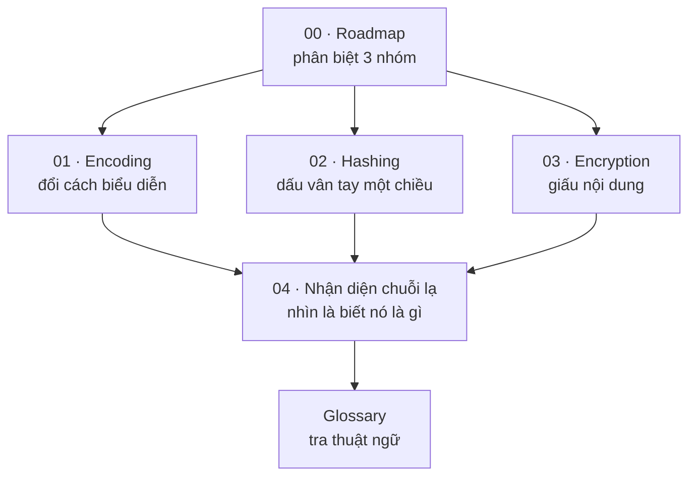

# 00 — Roadmap: Encode, Hash, Encrypt

> **TL;DR:** Ba thứ này trông giống nhau (đều biến dữ liệu thành chuỗi loằng ngoằng) nhưng trả lời **ba câu hỏi hoàn toàn khác nhau**. Lẫn lộn chúng là nguồn gốc của phần lớn lỗ hổng bảo mật do lập trình viên tự tạo ra.

> **Prereq:** biết byte là gì (đọc [[01 - Tu URL den Pixel - Vong doi mot trang web]] nếu chưa rõ). Không cần biết toán.

---

## 🧠 Mental model — phân biệt trong 10 giây

Mỗi khi gặp một kỹ thuật lạ, hỏi đúng 2 câu: **đảo ngược được không?** và **cần khoá không?**

```
                    Đảo ngược được?
                    │
        ┌───────────┴───────────┐
       CÓ                       KHÔNG
        │                        │
   Cần khoá?                  HASHING
        │                     (băm)
   ┌────┴────┐                 └─ SHA-256, bcrypt, Argon2
  KHÔNG     CÓ                    "dấu vân tay", đi một chiều
   │         │
ENCODING  ENCRYPTION
(mã hoá   (mã hoá thật)
 ký tự)    └─ AES, RSA, TLS
 └─ UTF-8, Base64, Hex, URL-encode
```

| | Câu hỏi nó trả lời | Ai đảo ngược được | Ví dụ |
| --- | --- | --- | --- |
| **Encoding** | *Dữ liệu này biểu diễn ra sao để truyền đi được?* | **Bất kỳ ai** | UTF-8, Base64, Hex, URL-encode |
| **Hashing** | *Hai thứ này có giống nhau không? / Dữ liệu có bị sửa không?* | **Không ai** | SHA-256, bcrypt, Argon2 |
| **Encryption** | *Ai được phép đọc nội dung này?* | **Người có khoá** | AES, RSA, TLS |

> ⚠️ **Câu quan trọng nhất cả series:** Base64 **không phải** mã hoá. Nó không giấu được gì cả — ai cũng giải ngược được trong 1 giây. Dùng Base64 để "bảo mật" là lỗi kinh điển.

---

## 🗺 Bản đồ series



| # | Note | Trả lời câu hỏi |
| --- | --- | --- |
| 01 | [[01 - Encoding - Doi cach bieu dien du lieu]] ⭐ | UTF-8, Base64, Hex, URL-encode khác nhau chỗ nào? Khi nào dùng cái nào? |
| 02 | [[02 - Hashing - Dau van tay mot chieu]] ⭐⭐ | Hash là gì? Vì sao **không** được "mã hoá" mật khẩu? Salt để làm gì? |
| 03 | [[03 - Encryption - Giau noi dung]] | Đối xứng vs bất đối xứng? TLS bắt tay ra sao? Chữ ký số hoạt động thế nào? |
| 04 | [[04 - Nhan dien chuoi la - Nhin la biet]] ⭐ | Nhìn một chuỗi lạ trong DB/log, làm sao biết nó là Base64, hash, JWT hay UUID? |
| — | [[Glossary - Encode, Hash, Encrypt]] | Tra nhanh 60+ thuật ngữ |

---

## 🎯 Lộ trình đọc

**Chỉ có 15 phút** → đọc hết trang này + [[04 - Nhan dien chuoi la - Nhin la biet]]. Đủ để không phạm lỗi ngu.

**Làm backend / xử lý user login** → `02` là bắt buộc, đọc kỹ. Sai chỗ này là lộ toàn bộ mật khẩu người dùng.

**Làm frontend** → `01` + `04` là đủ dùng hằng ngày. `03` đọc lướt để hiểu HTTPS.

---

## ⚡ Bảng tra nhanh: "tôi cần làm X thì dùng gì"

| Tôi cần… | Dùng | ❌ Đừng dùng |
| --- | --- | --- |
| Lưu mật khẩu người dùng | **Argon2id** (hoặc bcrypt) | MD5, SHA-256 trần, AES |
| Nhúng ảnh vào HTML/CSS | **Base64** (data URI) | — |
| Truyền dữ liệu nhị phân qua JSON | **Base64** | — |
| Đưa tiếng Việt vào URL | **URL-encode** (percent-encoding) | Base64 |
| Kiểm tra file tải về có nguyên vẹn không | **SHA-256** checksum | MD5 (đã vỡ) |
| Xác thực request từ webhook (Shopify, Stripe) | **HMAC-SHA256** | so sánh chuỗi thường |
| Giấu dữ liệu nhạy cảm trong DB | **AES-256-GCM** | Base64, hash |
| Chứng minh "đúng là tôi gửi" | **Chữ ký số** (RSA/ECDSA) | HMAC (nếu cần bên thứ ba xác minh) |
| Tạo ID không trùng | **UUID v4 / v7** | hash của timestamp |
| Bảo vệ dữ liệu khi truyền qua mạng | **TLS (HTTPS)** | tự mã hoá tay |
| So sánh hai chuỗi bí mật | **hàm so sánh constant-time** | `===` / `==` |

---

## 💀 5 lỗi kinh điển (đọc trước, đỡ mất tài khoản người dùng)

1. **"Mã hoá mật khẩu"** — sai cả từ ngữ lẫn kỹ thuật. Mật khẩu phải **băm (hash)**, không phải mã hoá. Mã hoá thì giải ngược được → hacker lấy được khoá là có sạch mật khẩu.
2. **Dùng Base64 để giấu thông tin** — Base64 là encoding, ai cũng giải được. Token bỏ trong Base64 vẫn là token trần.
3. **Băm mật khẩu bằng SHA-256** — SHA-256 quá **nhanh**, GPU thử được hàng tỷ mật khẩu/giây. Mật khẩu cần hàm **cố tình chậm**: Argon2, bcrypt, scrypt.
4. **Quên salt** — hai người đặt cùng mật khẩu sẽ ra cùng một hash → lộ ngay, và dính rainbow table.
5. **So sánh chữ ký bằng `===`** — rò rỉ thông tin qua thời gian thực thi (timing attack). Dùng `crypto.timingSafeEqual()`.

Chi tiết từng lỗi nằm trong `02` và `03`.

---

## 🔗 Liên quan trong vault

- [[01 - Tu URL den Pixel - Vong doi mot trang web]] — bytes, charset, và chỗ TLS chen vào
- [[00 - Roadmap - Tu HTML den Pixel]] — series nền tảng browser
- [[Glossary - Networking]] — thuật ngữ mạng

---

## 📚 Nguồn nền

- [MDN — Web Crypto API](https://developer.mozilla.org/en-US/docs/Web/API/Web_Crypto_API)
- [OWASP — Password Storage Cheat Sheet](https://cheatsheetseries.owasp.org/cheatsheets/Password_Storage_Cheat_Sheet.html)
- [OWASP — Cryptographic Storage Cheat Sheet](https://cheatsheetseries.owasp.org/cheatsheets/Cryptographic_Storage_Cheat_Sheet.html)
- [Node.js — `crypto` module](https://nodejs.org/api/crypto.html)
