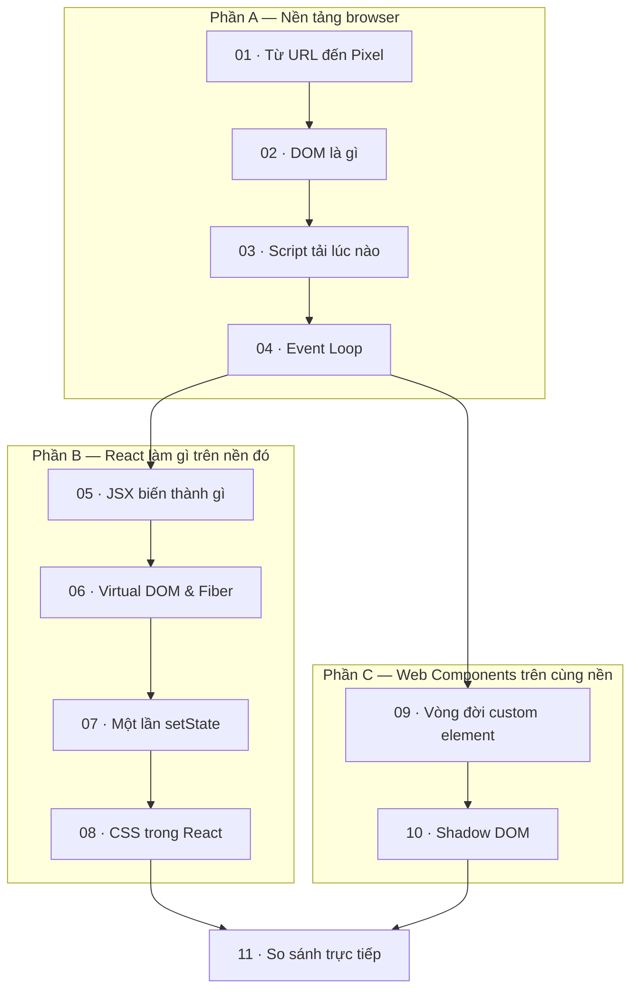

# 00 — Roadmap: Từ HTML đến Pixel

> **Mục tiêu:** hiểu **browser thực sự làm gì** từ lúc bạn gõ URL đến lúc chữ hiện lên màn hình. Sau đó mới xem **React** chen vào chỗ nào, và **Web Components** chen vào chỗ nào.
>
> **Vì sao cần series này:** đọc note Web Components mà thấy khó là bình thường — vì nó đang nói về *tầng dưới*. Không biết DOM được tạo ra lúc nào, script chạy lúc nào, thì "Shadow DOM đóng gói CSS" chỉ là một câu chữ. Series này lấp đúng khoảng trống đó.
>
> **Prereq:** biết HTML/CSS cơ bản, viết được JS thường. **Không cần** biết React hay Web Components trước.

---

## 🧭 Mental model — 3 câu

```
1. Browser là một CÁI MÁY biến TEXT (HTML/CSS/JS) thành PIXEL.
   Nó có một quy trình cố định: parse → dựng cây → tính vị trí → vẽ.

2. React KHÔNG thay quy trình đó. React chỉ là JS chạy trong bước "JS",
   và việc duy nhất nó làm là: gọi DOM API để sửa cây.

3. Web Components cũng KHÔNG thay quy trình đó. Nó chỉ dạy browser
   một loại NODE mới trong cây, ngay tại bước dựng cây.
```

👉 Cả React lẫn Web Components đều **đứng trên cùng một cái máy**. Khác nhau ở chỗ: React đứng *ngoài* máy điều khiển từ xa, Web Components *nằm trong* máy.

```
                    ┌─────────────────────────────────────┐
   HTML/CSS/JS  →   │   BROWSER ENGINE (cái máy)          │  →  PIXEL
                    │   parse · DOM · CSSOM · layout ·    │
                    │   paint · composite                 │
                    └─────────────────────────────────────┘
                        ↑                        ↑
                        │                        │
                 React gọi DOM API        Web Components
                 từ bên ngoài             LÀ một node bên trong
```

---

## 🗺 Bản đồ series



### 📘 Phần A — Nền tảng browser (bắt buộc, đọc theo thứ tự)

| # | Note | Trả lời câu hỏi |
| --- | --- | --- |
| 01 | [[01 - Tu URL den Pixel - Vong doi mot trang web]] ⭐ | Gõ URL xong thì chuyện gì xảy ra, theo đúng thứ tự? |
| 02 | [[02 - DOM la gi - Cay, Node va API]] | DOM là gì? Khác file HTML chỗ nào? Sao sửa DOM lại "đắt"? |
| 03 | [[03 - Script duoc tai luc nao - defer, async, module]] ⭐ | `<script>` chạy lúc nào? Vì sao đặt sai chỗ là trang trắng? |
| 04 | [[04 - Event Loop - Task, Microtask va luc browser ve]] | Vì sao sửa DOM 10 lần mà browser chỉ vẽ 1 lần? |

### ⚛️ Phần B — React làm gì trên nền đó

| # | Note | Trả lời câu hỏi |
| --- | --- | --- |
| 05 | [[05 - React - JSX bien thanh gi]] ⭐ | `<MyButton />` thực chất là cái gì? Vì sao nó biến mất trong DevTools? |
| 06 | [[06 - React - Virtual DOM, Reconciliation va Fiber]] | "Virtual DOM" là cái gì thật sự? `key` để làm gì? |
| 07 | [[07 - React - Truy vet mot lan setState tu click den pixel]] ⭐ | Bấm nút → chữ đổi: đi qua bao nhiêu bước? |
| 08 | [[08 - React - CSS va chuyen khong co encapsulation]] | CSS Modules có "đóng gói" thật không? |

### 🧩 Phần C — Web Components trên cùng nền

| # | Note | Trả lời câu hỏi |
| --- | --- | --- |
| 09 | [[09 - Web Components - Truy vet mot custom element tu HTML den pixel]] ⭐ | Browser gặp `<my-card>` thì làm gì? "Upgrade" là gì? |
| 10 | [[10 - Shadow DOM - Cay trong cay va ranh gioi that su]] ⭐ | Vì sao CSS ngoài **không thể** lọt vào? Ai chặn? |

### 🔍 Tổng kết

| # | Note | Nội dung |
| --- | --- | --- |
| 11 | [[11 - So sanh truc tiep - React vs Web Components]] ⭐⭐ | Đối chiếu **từng bước** của pipeline, khi nào chọn cái nào, dùng chung ra sao |

### 📖 Glossary — tra thuật ngữ

Đọc gặp từ lạ thì nhảy vào đây, không cần nhớ hết:

| File | Chứa |
| --- | --- |
| [[Glossary/00 - Index\|Glossary — Index]] | Mục lục A→Z toàn bộ thuật ngữ |
| [[Glossary/A - Browser va Rendering\|A — Browser & Rendering]] | parser, DOM, CSSOM, render tree, layout, paint, composite, reflow, FOUC… |
| [[Glossary/B - JS Runtime va Event Loop\|B — JS Runtime & Event Loop]] | call stack, task, microtask, event loop, `defer`/`async`, ES module… |
| [[Glossary/C - React\|C — React]] | JSX, React element, VDOM, reconciliation, Fiber, render/commit phase, hook… |
| [[Glossary/D - Web Components va DOM nang cao\|D — Web Components & DOM nâng cao]] | custom element, upgrade, shadow root, light DOM, flattened tree, slot, retargeting… |

---

## 🎯 Lộ trình đọc gợi ý

**Nếu bạn chỉ có 30 phút** → đọc `01` → `05` → `11`. Đủ để nắm ý chính.

**Nếu muốn hiểu thật** → đọc tuần tự 01 → 11. Phần A là nền, bỏ là hụt.

**Nếu đang debug một bug cụ thể:**

| Triệu chứng | Đọc note |
| --- | --- |
| Trang trắng vài giây rồi mới hiện | [[01 - Tu URL den Pixel - Vong doi mot trang web]], [[03 - Script duoc tai luc nao - defer, async, module]] |
| `document.querySelector` trả về `null` | [[03 - Script duoc tai luc nao - defer, async, module]] |
| Scroll giật, animation lag | [[01 - Tu URL den Pixel - Vong doi mot trang web]] (layout/paint), [[04 - Event Loop - Task, Microtask va luc browser ve]] |
| `setState` xong `console.log` vẫn giá trị cũ | [[04 - Event Loop - Task, Microtask va luc browser ve]], [[07 - React - Truy vet mot lan setState tu click den pixel]] |
| List React nhảy lung tung khi sort | [[06 - React - Virtual DOM, Reconciliation va Fiber]] (`key`) |
| CSS của người khác đè lên component của mình | [[08 - React - CSS va chuyen khong co encapsulation]], [[10 - Shadow DOM - Cay trong cay va ranh gioi that su]] |
| `<my-card>` hiện ra trống rồi mới có nội dung | [[09 - Web Components - Truy vet mot custom element tu HTML den pixel]] (upgrade, FOUC) |
| Tailwind không ăn trong Web Component | [[10 - Shadow DOM - Cay trong cay va ranh gioi that su]] |

---

## ✅ Checklist tự đánh giá

Đọc xong series, tự trả lời **không nhìn note**:

- [ ] Kể đúng thứ tự 6 bước từ HTML text → pixel trên màn hình
- [ ] Giải thích DOM khác file `.html` chỗ nào
- [ ] Phân biệt `defer` vs `async` vs `type="module"`, biết cái nào giữ thứ tự
- [ ] Giải thích vì sao `for` 1 triệu vòng làm treo cả trang
- [ ] Nói được `<MyButton />` sau khi compile là object có shape thế nào
- [ ] Phân biệt "React re-render" và "DOM thật bị sửa" — không phải một
- [ ] Kể được vòng đời từ `click` → `setState` → pixel, chỉ ra chỗ nào browser paint
- [ ] Giải thích vì sao CSS Modules **không** phải encapsulation thật
- [ ] Giải thích "element upgrade" và vì sao nó gây FOUC
- [ ] Chỉ ra **ai** chặn CSS ở shadow boundary (không phải JS, không phải build tool)
- [ ] Nói được 3 khác biệt cốt lõi giữa React và Web Components ở tầng pipeline

---

## 🔗 Liên quan trong vault

- Series ứng dụng: [[00 - Roadmap Web Components - Lit]] — sau khi hiểu tầng dưới thì quay lại đọc sẽ nhẹ hơn nhiều
- [[Introduction]] · [[01 - Web Components la gi - Lich su va Tong quan]]

---

## 📚 Nguồn nền

- [web.dev — Critical rendering path](https://web.dev/articles/critical-rendering-path)
- [MDN — Populating the page: how browsers work](https://developer.mozilla.org/en-US/docs/Web/Performance/Guides/How_browsers_work)
- [HTML Standard — Parsing / Scripting](https://html.spec.whatwg.org/multipage/parsing.html)
- [React docs — Render and Commit](https://react.dev/learn/render-and-commit)
- [MDN — Web Components](https://developer.mozilla.org/en-US/docs/Web/API/Web_components)
