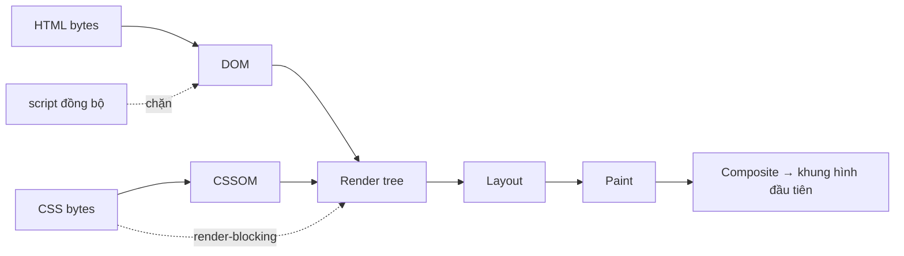

# 01 — Từ URL đến Pixel: vòng đời một trang web

> **TL;DR:** Browser không "nhận về một trang web". Nó nhận về một **dòng bytes**, rồi tự tay dựng lại mọi thứ qua một dây chuyền cố định: **parse HTML → DOM**, **parse CSS → CSSOM**, ghép thành **render tree**, **layout** (tính toạ độ), **paint** (vẽ), **composite** (ghép lớp). Dây chuyền này luôn giống nhau — với trang HTML tĩnh, với React, hay với Web Components. Hiểu 6 bước này là hiểu được 80% các bug "trang trắng", "giật lag", "CSS không ăn".

Series: [[00 - Roadmap - Tu HTML den Pixel]]
Anh em: [[02 - DOM la gi - Cay, Node va API]] · [[03 - Script duoc tai luc nao - defer, async, module]] · [[04 - Event Loop - Task, Microtask va luc browser ve]] · [[Glossary/A - Browser va Rendering|Glossary A]]

---

## 🎯 Mục tiêu note này

Sau khi đọc xong, bạn phải trả lời được:

- Gõ `github.com` rồi Enter, browser làm gì — **theo đúng thứ tự**?
- Vì sao CSS chặn việc **vẽ** nhưng không chặn việc **đọc HTML**?
- Vì sao animate `transform` mượt còn animate `left` thì giật?
- React và Web Components chen vào **chỗ nào** trong dây chuyền này?

Không cần biết React. Không cần biết Web Components. Chỉ cần biết HTML/CSS/JS cơ bản.

---

## 🧠 Sơ đồ tổng — nhìn cái này trước đã

Đây là bản đồ của toàn bộ note. Đọc đến đoạn nào thì ngoái lại nhìn nó một cái.

```
   ┌──────────────┐
   │  Gõ URL      │  DNS → TCP → TLS → HTTP request
   └──────┬───────┘
          ▼
   ╔══════════════╗
   ║   BYTES      ║  01001000 01010100 ...   ← browser nhận về CHỈ CÓ THẾ NÀY
   ╚══════╤═══════╝
          ▼
   ┌──────────────┐
   │  Characters  │  <html><body><p>Hi</p>...   (giải mã theo charset, vd UTF-8)
   └──────┬───────┘
          ▼
   ┌──────────────┐
   │  Tokens      │  StartTag:html · StartTag:body · Character:"Hi" ...
   └──────┬───────┘
          ▼
   ┌──────────────┐
   │  Nodes       │  mỗi token → một object
   └──────┬───────┘
          ▼
   ┌──────────────┐          ┌──────────────┐
   │  DOM tree    │          │  CSSOM tree  │  ← .css tải song song, parse riêng
   └──────┬───────┘          └──────┬───────┘
          └───────────┬─────────────┘
                      ▼
              ┌──────────────┐
              │ RENDER TREE  │  chỉ node NHÌN THẤY ĐƯỢC + style đã tính xong
              └──────┬───────┘
                     ▼
              ┌──────────────┐
              │   LAYOUT     │  x, y, width, height   ← "50%" biến thành "640px"
              └──────┬───────┘
                     ▼
              ┌──────────────┐
              │    PAINT     │  sinh lệnh vẽ → raster thành pixel
              └──────┬───────┘
                     ▼
              ┌──────────────┐
              │  COMPOSITE   │  ghép các layer (thường có GPU) → màn hình
              └──────┬───────┘
                     ▼
                  🖥️ PIXEL
```

> **Ghi nhớ một câu:** browser là cái máy biến **text** thành **pixel**. Sáu bước trên là toàn bộ cái máy đó.

---

## ⚙️ Bước 1 — Gõ URL → có bytes về máy

Bạn gõ `https://example.com` rồi Enter. Rất gọn:

| Giai đoạn | Việc gì xảy ra |
| --- | --- |
| **DNS** | Đổi tên miền `example.com` → địa chỉ IP `93.184.x.x`. Giống tra danh bạ để lấy số điện thoại. |
| **TCP** | Bắt tay 3 bước để mở "đường ống" tin cậy giữa máy bạn và server. |
| **TLS** | Nếu là `https`, thêm bước thoả thuận mã hoá. Tốn thêm vòng đi-về. |
| **HTTP request** | Gửi đi: `GET / HTTP/1.1` + headers. |
| **HTTP response** | Server trả về headers + **body**. |

Và đây là điểm quan trọng nhất của cả bước này:

```
Server KHÔNG gửi về "một trang web".
Server gửi về một chuỗi BYTES + một cái header nói "đây là text/html; charset=utf-8".

Content-Type: text/html; charset=utf-8

3c 21 44 4f 43 54 59 50 45 20 68 74 6d 6c 3e ...
```

Browser đọc header `Content-Type` để biết **đây là HTML**, đọc `charset` để biết **giải mã bytes thành chữ theo bảng mã nào**. Rồi từ đó nó **tự dựng lại toàn bộ giao diện** bằng sức mình.

> Note này không đi sâu network. Chỉ cần đóng đinh: **browser nhận bytes, không nhận sẵn giao diện.** Mọi thứ đẹp đẽ bạn thấy trên màn hình đều do browser tự dựng từ text.

---

## ⚙️ Bước 2 — Bytes → Characters → Tokens → Nodes → DOM tree

Đây là công việc của **HTML parser** (bộ phân tích cú pháp HTML). Nó đi qua 4 nấc:

### Nấc 1 — Bytes → Characters

Dùng charset (thường UTF-8) để giải mã. `3c` → `<`, `70` → `p`, v.v.

### Nấc 2 — Characters → Tokens

**Token** = "mẩu có nghĩa". Parser quét từng ký tự và nhóm lại:

```html
<p class="hi">Xin chào</p>
```

biến thành:

```
StartTag(p, attrs={class:"hi"})   Character("Xin chào")   EndTag(p)
```

### Nấc 3 — Tokens → Nodes

Mỗi token biến thành một **object trong bộ nhớ**: một `HTMLParagraphElement`, một `Text` node...

### Nấc 4 — Nodes → DOM tree

Parser gắn các node vào nhau theo quan hệ **cha–con** dựa trên thứ tự mở/đóng thẻ.

### Ví dụ đầy đủ

```html
<!DOCTYPE html>
<html>
  <head>
    <title>Blog</title>
    <link rel="stylesheet" href="/style.css">
  </head>
  <body>
    <h1>Hello</h1>
    <p>Xin <em>chào</em> bạn</p>
  </body>
</html>
```

Cây DOM tương ứng:

```
Document
└── html
    ├── head
    │   ├── title
    │   │   └── #text "Blog"
    │   └── link (rel=stylesheet)
    └── body
        ├── h1
        │   └── #text "Hello"
        └── p
            ├── #text "Xin "
            ├── em
            │   └── #text "chào"
            └── #text " bạn"
```

Ba điều cần để ý:

1. **Chữ cũng là node.** `#text "Hello"` là một node riêng, con của `h1`. Chi tiết ở [[02 - DOM la gi - Cay, Node va API]].
2. **`<em>` nằm trong `<p>`** vì lúc gặp `StartTag(em)` thì `<p>` đang mở → em thành con của p.
3. **Kết quả không phải file HTML.** Nó là một **cây object sống trong RAM** — bạn có thể sửa bằng JS, và file `.html` trên server không hề đổi.

### 🔑 Parser chạy tăng dần (incremental)

Đây là chỗ nhiều người hiểu sai. Parser **không** đợi tải xong toàn bộ file rồi mới bắt đầu.

```
Gói TCP #1 về  →  parse ngay đoạn đó  →  DOM có <head> và một phần <body>
Gói TCP #2 về  →  parse tiếp          →  DOM dài thêm
Gói TCP #3 về  →  parse tiếp          →  ...
```

Vì thế browser có thể **hiện ra một phần trang khi file HTML còn đang tải dở**. Đây cũng là lý do kỹ thuật streaming HTML (server gửi dần từng khúc) có tác dụng thật.

Hệ quả thực tế: **thứ tự bạn viết trong HTML là thứ tự browser xử lý.** Thẻ nằm trên được xử lý trước. Điều này giải thích rất nhiều thứ ở các bước sau.

---

## ⚙️ Bước 3 — CSS → CSSOM

Khi parser gặp:

```html
<link rel="stylesheet" href="/style.css">
```

Browser **bắt đầu tải file CSS**, và **vẫn parse HTML tiếp** (không dừng). Đây là điểm khác biệt lớn so với `<script>`.

Nhưng CSS có một tính chất riêng: **render-blocking**.

```
CSS KHÔNG chặn parse HTML   →  DOM vẫn lớn dần bình thường
CSS  CÓ  chặn RENDER        →  browser không vẽ gì ra màn hình
                               khi CSSOM chưa dựng xong
```

Vì sao? Vì nếu vẽ trước khi có CSS, bạn sẽ thấy trang chữ Times New Roman đen trắng nhấp nháy một cái rồi mới đổi sang giao diện thật. Hiện tượng đó gọi là **FOUC** (Flash of Unstyled Content — nháy nội dung chưa có style). Browser thà chờ còn hơn cho bạn thấy cảnh đó.

### CSSOM cũng là một cây

```css
body { font-size: 16px; color: #333; }
p    { font-size: 14px; }
p em { color: red; }
```

```
CSSOM
└── body   { font-size:16px; color:#333 }
    ├── h1 { font-size:16px; color:#333 }     ← kế thừa từ body
    └── p  { font-size:14px; color:#333 }     ← font-size bị ghi đè, color kế thừa
        └── em { font-size:14px; color:red }  ← color bị ghi đè
```

### Tính kế thừa (inheritance) hiện ra ở đây

Cây CSSOM **không** phải chỉ là danh sách luật CSS bạn viết. Nó là **style cuối cùng của từng node** sau khi đã tính:

1. **Kế thừa** — một số thuộc tính (`color`, `font-family`, `font-size`, `line-height`...) tự chảy từ cha xuống con. `h1` ở trên không có luật nào cả, nhưng vẫn `color:#333` vì thừa hưởng từ `body`.
2. **Cascade** — luật nào thắng khi nhiều luật cùng nhắm vào một element (độ đặc hiệu, thứ tự, `!important`).

Vì kế thừa chảy từ trên xuống, browser **phải dựng CSSOM từ gốc xuống**. Đó là lý do nó không thể "dùng tạm CSSOM dựng dở" — một luật CSS xuất hiện ở cuối file vẫn có thể thay đổi màu của element trên cùng.

> Kết luận thực dụng: **đặt CSS trong `<head>`**. Đặt ở cuối `<body>` sẽ khiến browser vẽ một lượt không-style rồi vẽ lại → FOUC.

---

## ⚙️ Bước 4 — Gặp `<script>`: parser DỪNG

Parser đang chạy êm, gặp:

```html
<script src="/app.js"></script>
```

Nó **dừng hẳn việc dựng DOM**, đi tải `app.js`, chạy xong `app.js`, rồi mới parse tiếp. Lý do: script có quyền gọi `document.write()` hoặc sửa DOM ngay tại chỗ, nên browser không dám parse tiếp trước khi biết script làm gì.

Hệ quả: mỗi `<script>` đồng bộ trong `<head>` là một **cái chốt chặn** giữa người dùng và nội dung trang. `defer`, `async`, `type="module"` sinh ra để gỡ chốt đó.

👉 Chi tiết đầy đủ (kèm timeline từng loại) ở [[03 - Script duoc tai luc nao - defer, async, module]]. Ở note này chỉ cần nhớ: **script chặn parser, CSS chặn render.**

---

## ⚙️ Bước 5 — DOM + CSSOM → Render tree

Giờ có 2 cây. Browser ghép chúng thành **render tree** — cây chứa **những gì thật sự sẽ hiện lên màn hình**.

Quy tắc: đi qua từng node của DOM, hỏi *"node này có được hiển thị không?"*. Có thì đưa vào render tree kèm style đã tính; không thì bỏ.

### Ai bị loại?

| Node | Vào render tree? | Vì sao |
| --- | --- | --- |
| `<head>`, `<meta>`, `<title>`, `<link>`, `<script>` | ❌ Không | Chúng không phải nội dung hiển thị |
| Element có `display: none` | ❌ Không | Bị gỡ khỏi luồng hiển thị hoàn toàn |
| Element có `visibility: hidden` | ✅ Có | Vẫn **chiếm chỗ**, chỉ là không vẽ ra |
| Element có `opacity: 0` | ✅ Có | Vẫn chiếm chỗ, vẫn nhận click |
| `<!-- comment -->` | ❌ Không | Không có biểu diễn hình ảnh |
| Text node toàn khoảng trắng giữa các block | ❌ Thường không | Bị gộp/bỏ theo luật xử lý white-space |

### Bảng đối chiếu `display:none` vs `visibility:hidden`

| | `display: none` | `visibility: hidden` |
| --- | --- | --- |
| Có trong DOM? | ✅ Có (DOM không đổi) | ✅ Có |
| Có trong render tree? | ❌ Không | ✅ Có |
| Chiếm chỗ trong layout? | ❌ Không — các element khác dồn lên | ✅ Có — để lại một khoảng trống |
| Có nhận sự kiện click? | ❌ Không | ❌ Không |
| Con của nó có thể hiện lại? | ❌ Không (cả nhánh biến mất) | ✅ Có — con đặt `visibility: visible` sẽ hiện |
| Đổi qua lại tốn gì? | **Layout + paint** (đắt) | **Paint** (nhẹ hơn) |

Ví dụ trực quan:

```html
<div>A</div>
<div style="display:none">B</div>
<div>C</div>
```
```
Màn hình:   A
            C          ← B biến mất, C dồn lên
```

```html
<div>A</div>
<div style="visibility:hidden">B</div>
<div>C</div>
```
```
Màn hình:   A
                       ← chỗ của B vẫn còn, chỉ trống
            C
```

> Một element có thể nằm trong DOM mà **không** nằm trong render tree. DOM ≠ những gì bạn thấy. Đây là nhầm lẫn kinh điển khi debug "sao element có trong Elements tab mà không thấy đâu".

---

## ⚙️ Bước 6 — Layout (reflow): tính x, y, width, height

Render tree biết *"cái gì hiện ra và trông thế nào"*, nhưng chưa biết *"nó nằm ở đâu, to bao nhiêu"*. Layout trả lời câu đó.

Browser đi từ gốc render tree xuống, tính cho **từng box** một bộ số:

```
┌─ <body>  x=0    y=0    w=1280  h=2400
   ├─ <h1>   x=16   y=16   w=1248  h=48
   └─ <p>    x=16   y=80   w=1248  h=24
      └─ <em> x=48  y=80   w=40    h=24
```

### Đây là lúc `%` biến thành `px`

```css
.sidebar { width: 50%; }
```

CSS nói `50%`. Nhưng màn hình chỉ hiểu pixel. Layout là bước quy đổi:

```
viewport rộng 1280px  →  .sidebar width = 640px
viewport rộng 768px   →  .sidebar width = 384px
```

Tương tự với `em`, `rem`, `vw`, `vh`, `auto`, `flex: 1`, `minmax()`... — tất cả đều là **công thức**, và layout là lúc công thức được chấm ra số cụ thể.

### Layout phụ thuộc kích thước viewport

Vì công thức phụ thuộc chiều rộng cửa sổ, nên:

- **Kéo resize cửa sổ** → phải layout lại toàn trang.
- **Xoay điện thoại ngang/dọc** → layout lại.
- **Hiện thanh scroll** → viewport hẹp đi vài px → có thể layout lại.

### Từ "reflow" nghĩa là gì?

**Reflow** = layout chạy lại. Khi bạn sửa `width`, thêm element, đổi `font-size`... browser phải tính lại vị trí — không chỉ của element đó, mà thường của cả các element **phía sau nó** trong luồng.

Đây là bước **đắt nhất** trong pipeline với trang có nhiều element. Ghi nhớ: **layout hay chạy lại = trang chậm.**

> Cách gọi khác nhau tuỳ engine (Blink/WebKit hay gọi "layout", Gecko hay gọi "reflow") nhưng khái niệm là một.

---

## ⚙️ Bước 7 — Paint: biến box thành lệnh vẽ

Layout xong ta có một đống hình chữ nhật kèm toạ độ. Paint biến chúng thành **lệnh vẽ** (paint records / display list):

```
1. fillRect(0, 0, 1280, 2400, #ffffff)          ← nền body
2. drawText("Hello", 16, 52, font: bold 32px)   ← chữ h1
3. fillRect(16, 80, 1248, 24, #f0f0f0)          ← nền p
4. drawText("Xin chào bạn", 16, 96, 14px)       ← chữ p
5. drawRoundRect(...)  drawShadow(...)          ← border-radius, box-shadow
```

Sau đó **raster** (rasterization): thực thi các lệnh trên thành **mảng pixel màu** trong bộ nhớ.

### Thứ tự vẽ (painting order) — vì sao cái này đè lên cái kia

Browser vẽ theo một thứ tự cố định, vẽ sau đè lên vẽ trước. Đại khái, trong một **stacking context** (ngữ cảnh xếp chồng):

```
1. background + border của element gốc
2. các element con có z-index ÂM
3. các block bình thường (theo thứ tự trong DOM)
4. các float
5. nội dung inline / chữ
6. element có z-index: 0 hoặc auto và position khác static
7. các element con có z-index DƯƠNG
```

Hai hệ quả hay gặp:

- **Cùng z-index thì cái viết sau trong HTML nằm trên.** Đây là lý do modal thường đặt cuối `<body>`.
- **`z-index: 9999` mà vẫn bị đè**: vì nó chỉ so trong stacking context của cha nó. Cha tạo stacking context (do có `transform`, `opacity < 1`, `filter`, `position: fixed`, `will-change`, `isolation: isolate`...) thì con không thể "trèo" ra ngoài để đè lên anh em của cha.

---

## ⚙️ Bước 8 — Composite: ghép các layer

Browser không nhất thiết vẽ mọi thứ lên **một** tấm ảnh. Nó có thể chia trang thành nhiều **layer** (lớp), raster từng lớp riêng, rồi ở bước cuối **ghép** (composite) chúng lại — công việc này thường đẩy cho **GPU** vì GPU cực giỏi việc dịch chuyển/ghép/làm mờ ảnh có sẵn.

```
    Layer 1: nội dung trang
    ┌──────────────────┐
    │  Hello           │
    │  Xin chào bạn    │
    └──────────────────┘
              +
    Layer 2: modal đang trượt vào (được tách riêng)
         ┌──────────┐
         │  Modal   │
         └──────────┘
              ↓
      GPU ghép lại → khung hình cuối
```

### 🔑 Vì sao `transform`/`opacity` mượt hơn `top`/`left`

Đây là câu hỏi phỏng vấn kinh điển, và giờ bạn trả lời được bằng pipeline:

```
Animate  left: 0 → 200px
   → đổi vị trí trong luồng
   → LAYOUT lại (có thể ảnh hưởng element khác)
   → PAINT lại
   → COMPOSITE
   ↳ 3 bước, chạy trên main thread, mỗi frame. 60fps = 16.6ms/frame. Dễ trượt.

Animate  transform: translateX(0) → translateX(200px)
   → transform KHÔNG thay đổi kích thước/vị trí của element khác trong layout
   → không cần layout, không cần paint lại nội dung
   → chỉ cần COMPOSITE: dịch layer đã raster sẵn sang phải
   ↳ 1 bước, làm được trên compositor/GPU. Mượt.
```

Tương tự `opacity`: đổi độ mờ của một layer đã vẽ sẵn là việc GPU làm gần như miễn phí.

> ⚠️ Nói cho chính xác: `transform`/`opacity` chỉ đạt mức "chỉ composite" khi element được browser **tách thành layer riêng**. Browser tự quyết điều này; bạn có thể gợi ý bằng `will-change: transform`. Nhưng **đừng rải `will-change` khắp nơi** — mỗi layer tốn bộ nhớ, quá nhiều layer lại làm chậm ngược.

### Bảng: sửa thuộc tính này thì chạy lại những bước nào?

| Nhóm | Ví dụ thuộc tính | Phải chạy lại |
| --- | --- | --- |
| 🔴 **Layout** | `width`, `height`, `top`, `left`, `right`, `bottom`, `margin`, `padding`, `border-width`, `display`, `font-size`, `font-family`, `line-height`, `position`, `float`, `flex`, `grid-template-*` | **layout → paint → composite** |
| 🟡 **Paint** | `color`, `background-color`, `background-image`, `border-color`, `border-radius`, `box-shadow`, `outline`, `visibility`, `text-decoration` | **paint → composite** |
| 🟢 **Composite** | `transform`, `opacity` | **composite** |

Quy tắc bỏ túi khi làm animation: **ưu tiên `transform` và `opacity`.** Muốn phóng to → `transform: scale()` chứ đừng `width`. Muốn di chuyển → `transform: translate()` chứ đừng `left`.

---

## 🔍 Critical Rendering Path và các chỉ số

**Critical Rendering Path (CRP)** = chuỗi việc **bắt buộc** phải xong trước khi browser vẽ được **khung hình đầu tiên có nội dung**.



Tối ưu CRP là tối ưu 3 con số:

1. **Số resource chặn render** — bao nhiêu file CSS/JS phải tải xong trước khi vẽ.
2. **Tổng dung lượng** của chúng.
3. **Số vòng đi-về mạng** cần thiết.

Hai chỉ số hay nhắc:

| Chỉ số | Đo cái gì | Ý nghĩa |
| --- | --- | --- |
| **FCP** — First Contentful Paint | Thời điểm browser vẽ ra **nội dung đầu tiên** (chữ, ảnh, SVG...) | "Trang bắt đầu có gì đó" — hết màn hình trắng |
| **LCP** — Largest Contentful Paint | Thời điểm **khối nội dung lớn nhất** trong viewport vẽ xong (thường là ảnh hero hoặc khối chữ chính) | "Trang trông như đã tải xong" — đây là chỉ số Core Web Vitals |

Ba việc hiệu quả nhất, suy ra thẳng từ pipeline:

- **CSS trong `<head>`, càng nhỏ càng tốt** (nó chặn render).
- **JS dùng `defer` hoặc đặt cuối `<body>`** (nó chặn parser).
- **Ảnh hero đừng để JS mới tải** (nó là LCP element, đưa thẳng vào HTML).

---

## ⚠️ Bẫy thường gặp

### 1. Đặt `<link rel=stylesheet>` ở cuối `<body>` → FOUC

```html
<body>
  <h1>Trang của tôi</h1>   <!-- browser vẽ dòng này bằng style mặc định -->
  ...
  <link rel="stylesheet" href="/style.css">  <!-- ❌ đến đây mới có CSS -->
</body>
```

Người dùng thấy trang thô một nhịp rồi mới "nhảy" sang giao diện thật. **Sửa:** đưa `<link>` lên `<head>`.

### 2. Đọc `offsetHeight` ngay sau khi sửa style → forced synchronous layout

```js
el.style.width = '300px';   // ghi → browser đánh dấu "layout đã bẩn", định tính sau
const h = el.offsetHeight;  // ĐỌC → cần số chính xác → browser BUỘC PHẢI layout NGAY
```

Bình thường browser gom nhiều thay đổi rồi layout một lần. Nhưng khi bạn **đọc một giá trị hình học** (`offsetTop`, `offsetHeight`, `clientWidth`, `getBoundingClientRect()`, `scrollTop`, `getComputedStyle()`...) ngay sau khi ghi, browser không còn đường lười — nó phải layout ngay lập tức, đồng bộ. Lặp việc này trong vòng `for` gọi là **layout thrashing** và có thể làm chậm trang cả chục lần.

👉 Ví dụ code sai/đúng và cách sửa nằm ở [[02 - DOM la gi - Cay, Node va API]].

### 3. Animate `width` / `top` thay vì `transform`

```css
/* ❌ mỗi frame: layout + paint + composite */
.box { transition: left .3s, width .3s; }

/* ✅ mỗi frame: chỉ composite */
.box { transition: transform .3s, opacity .3s; }
```

### 4. Font chưa tải xong → FOIT / FOUT

Web font tải chậm hơn HTML. Trong lúc chờ, browser phải chọn:

| Hiện tượng | Nghĩa là | Xảy ra khi |
| --- | --- | --- |
| **FOIT** — Flash of Invisible Text | Chữ **tàng hình** cho tới khi font về | `font-display: block` (hoặc mặc định của một số browser) |
| **FOUT** — Flash of Unstyled Text | Hiện chữ bằng font dự phòng trước, font thật về thì **đổi** (chữ nhảy) | `font-display: swap` |

Không có lựa chọn hoàn hảo. Thực dụng: `font-display: swap` + chọn font dự phòng có kích cỡ gần giống để chữ đỡ nhảy, và `<link rel="preload">` cho font quan trọng.

### 5. Tưởng "element có trong DOM là đã hiện ra"

Element có thể ở trong DOM mà không ở trong render tree (`display:none`, nằm trong `<head>`, cha nó bị ẩn). Xem lại bảng ở bước 5.

---

## 🧩 Chốt: React và Web Components nằm ở đâu trong bức tranh này?

Đây là câu quan trọng nhất của cả series, nên viết to:

> **Cả React lẫn Web Components đều KHÔNG thay đổi pipeline này.**
> Chúng chỉ can thiệp ở **bước 2 (dựng DOM)** và **bước 5 (làm DOM đổi → kích hoạt lại render tree/layout/paint)**.

```
   HTML/CSS/JS
        │
        ▼
   [2] parse → DOM ◄─────── React gọi createElement/appendChild/setAttribute
        │                   Web Components thêm một LOẠI NODE mới vào chính cây này
        ▼
   [3] CSS → CSSOM ◄─────── Shadow DOM tạo ranh giới style tại đây
        │
        ▼
   [5] Render tree
        │
        ▼
   [6] Layout  →  [7] Paint  →  [8] Composite  →  🖥️
       ▲
       └── Không ai "vượt mặt" được mấy bước này. Kể cả React.
```

Cụ thể:

| | React | Web Components |
| --- | --- | --- |
| Chạy ở tầng nào | JS thuần, chạy trong bước script | Do **chính browser** hỗ trợ (custom elements, shadow DOM) |
| Tác động lên DOM | Gọi DOM API từ bên ngoài | Chính nó **là** node trong cây |
| Có đổi layout/paint/composite? | ❌ Không | ❌ Không |

Nói cách khác: khi ai đó bảo "Virtual DOM nhanh vì tránh đụng DOM thật", cái họ đang nói là **giảm số lần kích hoạt bước 6–7**, chứ không phải một pipeline khác. Chi tiết ở [[06 - React - Virtual DOM, Reconciliation va Fiber]] và [[07 - React - Truy vet mot lan setState tu click den pixel]].

---

## ✅ Nhớ 5 điều

- **Browser nhận bytes, không nhận giao diện.** Mọi thứ trên màn hình đều do nó tự dựng từ text, qua 6 bước cố định: DOM → CSSOM → render tree → layout → paint → composite.
- **CSS chặn render, script chặn parser.** CSS trong `<head>`, JS thì `defer`. Nhớ đúng hai vế này là tránh được phần lớn bug "trang trắng" và FOUC.
- **Render tree chỉ chứa cái nhìn thấy được.** `display:none` bị loại hẳn; `visibility:hidden` vẫn nằm trong và vẫn chiếm chỗ.
- **Layout là lúc `%` biến thành `px`,** và là bước đắt nhất. Animate `transform`/`opacity` để chỉ chạm bước composite, đừng animate `width`/`left`.
- **React và Web Components không thay pipeline này** — chúng chỉ là cách khác nhau để sửa DOM ở bước 2. Ghi nhớ câu này, cả series sẽ dễ hơn nhiều.

---

## 📚 Nguồn

- [web.dev — Critical rendering path](https://web.dev/articles/critical-rendering-path)
- [MDN — Populating the page: how browsers work](https://developer.mozilla.org/en-US/docs/Web/Performance/Guides/How_browsers_work)
- [HTML Standard — Parsing HTML documents](https://html.spec.whatwg.org/multipage/parsing.html)
- [web.dev — Rendering performance](https://web.dev/articles/rendering-performance)
- [web.dev — Stick to compositor-only properties and manage layer count](https://web.dev/articles/stick-to-compositor-only-properties-and-manage-layer-count)
- [web.dev — First Contentful Paint (FCP)](https://web.dev/articles/fcp)
- [web.dev — Largest Contentful Paint (LCP)](https://web.dev/articles/lcp)
- [MDN — CSS inheritance](https://developer.mozilla.org/en-US/docs/Web/CSS/CSS_cascade/Inheritance)
- [MDN — Stacking context](https://developer.mozilla.org/en-US/docs/Web/CSS/CSS_positioned_layout/Stacking_context)
- [MDN — `font-display`](https://developer.mozilla.org/en-US/docs/Web/CSS/@font-face/font-display)
- [MDN — `will-change`](https://developer.mozilla.org/en-US/docs/Web/CSS/will-change)
