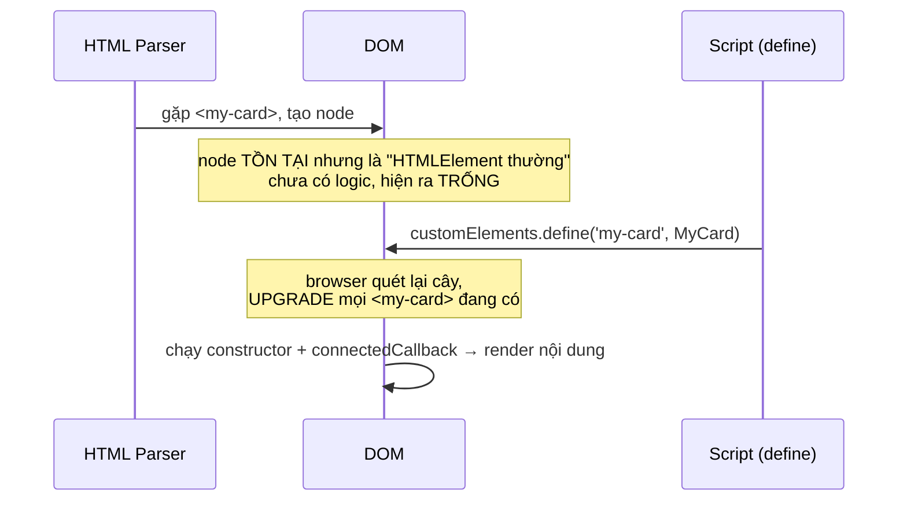

# 03 — Script được tải lúc nào: `defer`, `async`, `module`

> **TL;DR:** Browser đọc HTML **từ trên xuống, tuần tự, bằng một luồng duy nhất**. Gặp `<script>` trần là nó **dừng đọc HTML lại**, đi tải file JS, chạy xong mới đọc tiếp — đó chính là lý do trang trắng vài giây. `defer` = tải song song, chạy sau khi DOM dựng xong, đúng thứ tự. `async` = tải song song, chạy ngay khi tải xong, cắt ngang, không giữ thứ tự. `type="module"` = mặc định đã `defer`, có scope riêng, chỉ chạy 1 lần.

Series: [[00 - Roadmap - Tu HTML den Pixel]]
Anh em: [[01 - Tu URL den Pixel - Vong doi mot trang web]] · [[02 - DOM la gi - Cay, Node va API]] · [[04 - Event Loop - Task, Microtask va luc browser ve]] · [[Glossary/B - JS Runtime va Event Loop|Glossary B]]

---

## 🎯 Câu hỏi bài này trả lời

> *"Script được tải lúc page load — nó load theo các bước như thế nào?"*

Câu trả lời ngắn: **không có một câu trả lời duy nhất** — nó phụ thuộc bạn viết thẻ `<script>` kiểu gì. Có 5 kiểu, mỗi kiểu một timeline khác nhau. Bài này đi qua đủ 5 kiểu.

---

## 🧠 Vấn đề gốc: parser chỉ có MỘT luồng

**Parser** = bộ phân tích cú pháp, là phần của browser đọc chuỗi HTML text và dựng dần cây DOM ([[02 - DOM la gi - Cay, Node va API]]).

**Main thread** (luồng chính) = một dòng thi hành duy nhất mà browser dùng để làm gần như mọi thứ trên trang: parse HTML, chạy JS, tính layout, vẽ. Một luồng nghĩa là **tại một thời điểm chỉ làm được một việc**.

Bây giờ vấn đề: JS có quyền **sửa chính cái HTML đang được đọc dở**.

```html
<p>Xin chào</p>
<script>
  document.write('<b>chèn thẳng vào giữa luồng HTML!</b>');
</script>
<p>Tạm biệt</p>
```

`document.write()` bơm text thẳng vào **luồng byte HTML** mà parser đang đọc. Nghĩa là parser không thể vừa đọc tiếp vừa để JS chạy — nó sẽ không biết mình đang đọc cái gì nữa.

Vì vậy spec quy định: **gặp `<script>` trần thì parser phải dừng lại**.

```
       ┌── parser đang dựng DOM
       ▼
parse ────────▌ DỪNG ──[ tải app.js qua mạng ]──[ chạy app.js ]──▶ parse tiếp ────▶
              ▲                                                   ▲
              │                                                   │
        gặp <script>                                        DOM mới lớn tiếp
                          ← khoảng này DOM ĐỨNG YÊN →
                          ← người dùng nhìn thấy TRANG TRẮNG →
```

Thuật ngữ cho hiện tượng này: **parser-blocking** (chặn parser).

> 💡 Một chi tiết ít người biết: script trần còn phải **đợi CSS tải xong** mới chạy, vì JS có thể hỏi `getComputedStyle()`. Nên một file CSS chậm cũng gián tiếp làm script chậm theo.

---

## ⚙️ Kiểu 1 — `<script>` trần trong `<head>` (tệ nhất)

```html
<!doctype html>
<html>
<head>
  <script src="app.js"></script>   <!-- ⛔ chặn ở đây -->
</head>
<body>
  <div id="app">Nội dung</div>
</body>
</html>
```

```js
// app.js
const el = document.querySelector('#app');
console.log(el);        // → null
el.textContent = 'hi';  // 💥 TypeError: Cannot set properties of null
```

**Vì sao `null`?** Lúc `app.js` chạy, parser mới đọc tới `</head>`. Cây DOM hiện tại chỉ có:

```
document
└── html
    └── head
        └── script      ← đang chạy ở đây
                          (chưa có <body>, chưa có #app)
```

`#app` **chưa tồn tại**. Không phải lỗi cú pháp, không phải lỗi React — chỉ là bạn hỏi một thứ chưa được sinh ra.

```
Timeline:
──▌═══════════════▌────────────────────────────────▶
  ↑  tải + chạy   ↑
  gặp script    xong    body mới bắt đầu được parse
```

---

## ⚙️ Kiểu 2 — `<script>` trần cuối `<body>` (cách cũ, vẫn chạy được)

```html
<body>
  <div id="app">Nội dung</div>
  <script src="app.js"></script>   <!-- ✅ DOM phía trên đã có -->
</body>
```

**Vì sao hoạt động:** parser đã đọc hết mọi thẻ phía trên, `#app` đã nằm trong cây rồi mới tới lượt script.

**Nhược điểm:** browser chỉ **biết đến sự tồn tại của `app.js`** khi đọc tới dòng gần cuối file. Nếu HTML dài / server trả chậm thì việc tải file JS bắt đầu rất muộn — lãng phí thời gian mạng lẽ ra có thể tải song song từ đầu.

```
──────────── parse toàn bộ HTML ────────────▌═════════▌───▶
                                            ↑ tải mới bắt đầu
                                        (muộn, phí băng thông rỗi)
```

---

## ⚙️ Kiểu 3 — `defer` (mặc định nên dùng)

```html
<head>
  <script defer src="lib.js"></script>
  <script defer src="app.js"></script>
</head>
```

Ba tính chất, nhớ đủ ba:

| Tính chất | Nghĩa |
| --- | --- |
| Tải **song song** | Việc tải qua mạng chạy nền, parser **không dừng** |
| Chạy **sau khi DOM dựng xong** | Tức là sau khi parser đọc hết `</html>` |
| **Giữ đúng thứ tự** khai báo | `lib.js` luôn chạy trước `app.js`, kể cả nếu `app.js` tải xong trước |

Và: **các script `defer` chạy xong hết rồi mới bắn `DOMContentLoaded`**.

```
parse ────────────────────────────────────────▶ DOM xong
        ╰┈┈ tải lib.js ┈┈╯                          │
          ╰┈┈┈ tải app.js ┈┈┈╯                      │
                                                    ├─ chạy lib.js
                                                    ├─ chạy app.js
                                                    └─ 🔔 DOMContentLoaded
```

Với `defer`, đoạn code lỗi ở Kiểu 1 chạy ngon lành: `#app` chắc chắn đã tồn tại.

> ⚠️ `defer` **chỉ có tác dụng với script có `src`**. Viết `<script defer>console.log(1)</script>` (inline, không `src`) thì thuộc tính `defer` bị **bỏ qua hoàn toàn** — nó vẫn chạy ngay và vẫn chặn parser.

---

## ⚙️ Kiểu 4 — `async` (script độc lập, không quan tâm thứ tự)

```html
<script async src="analytics.js"></script>
```

| Tính chất | Nghĩa |
| --- | --- |
| Tải **song song** | Giống `defer` |
| Chạy **ngay khi tải xong** | Cắt ngang parser tại đúng thời điểm đó |
| **KHÔNG giữ thứ tự** | Ai tải xong trước chạy trước — kết quả **không đoán được** |

```
parse ──────────╳──────────────────╳────────────▶ DOM xong
      ╰┈ a.js ┈╯│                  │
      ╰┈┈┈┈┈ b.js (nặng hơn) ┈┈┈┈┈┈╯
                ↑                  ↑
          a.js chạy (cắt)     b.js chạy (cắt)

Nếu b.js nhẹ hơn và tải xong trước → b chạy trước a. Đảo hẳn thứ tự.
```

**Dùng khi nào:** script hoàn toàn tự lập, không ai import nó, nó không cần ai — analytics, error tracking, quảng cáo, widget chat.

**Không dùng khi:** script này cần một script khác đã chạy trước (jQuery + plugin jQuery chẳng hạn) — đó là công thức bug ngẫu nhiên.

---

## ⚙️ Kiểu 5 — `type="module"` (ES module)

```html
<script type="module" src="main.js"></script>
```

```js
// main.js
import { render } from './ui.js';   // import chỉ hợp lệ trong module
render();
```

**ES module** = hệ thống chia file JS chuẩn của ngôn ngữ, dùng `import` / `export`.

| Đặc điểm | Chi tiết |
| --- | --- |
| Mặc định **đã là `defer`** | Không cần viết `defer`, viết cũng bị bỏ qua |
| Luôn **strict mode** | Không cần `'use strict'`; gán biến chưa khai báo là lỗi |
| Có **scope riêng** | `const x = 1` trong module **không** rò ra `window` như script thường |
| Mỗi URL chỉ **chạy đúng 1 lần** | 10 file cùng `import './config.js'` → `config.js` vẫn chỉ chạy 1 lần, ai cũng dùng chung kết quả |
| Hỗ trợ **top-level `await`** | Được `await` ngay ở cấp cao nhất file, không cần bọc `async function` |
| **CORS chặt hơn** | Module luôn tải ở chế độ CORS. Script cross-origin thiếu header `Access-Control-Allow-Origin` sẽ **bị chặn** (script thường thì không) |
| `document.write` bị **vô hiệu** | Giống mọi script defer/async |

**`type="module" async`** là hợp lệ: khi đó module bỏ tính chất defer và chạy ngay khi cây import của nó tải xong — hành xử như `async`.

**`nomodule`** — thuộc tính đánh dấu "script dự phòng cho browser cũ": browser **hiểu** module sẽ **bỏ qua** thẻ này, browser cũ không hiểu `type="module"` thì bỏ qua thẻ module và chạy thẻ `nomodule`.

```html
<script type="module" src="modern.js"></script>
<script nomodule defer src="legacy.js"></script>
```

Năm 2026 gần như không còn cần `nomodule` nữa — mọi browser còn được hỗ trợ đều chạy module.

---

## 🔍 BẢNG TỔNG HỢP

| Kiểu | Chặn parser? | Tải song song? | Chạy lúc nào | Giữ thứ tự? | DOM đã sẵn sàng? | Dùng khi |
| --- | --- | --- | --- | --- | --- | --- |
| `<script>` trong `<head>` | ✅ Có | ❌ Không | Ngay khi tải xong | ✅ Có | ❌ **Chưa** | Gần như không bao giờ |
| `<script>` cuối `<body>` | ✅ Có (nhưng cuối rồi) | ❌ Không | Khi parser đọc tới | ✅ Có | ✅ Rồi | Code cũ / trang tĩnh nhỏ |
| `defer` | ❌ Không | ✅ Có | Sau khi DOM dựng xong, trước `DOMContentLoaded` | ✅ **Có** | ✅ Rồi | **Mặc định nên dùng** |
| `async` | ⚠️ Cắt ngang lúc chạy | ✅ Có | Ngay khi tải xong | ❌ **Không** | ⚠️ Không chắc | Analytics, script độc lập |
| `type="module"` | ❌ Không | ✅ Có | Như `defer` | ✅ Có | ✅ Rồi | App hiện đại, có `import` |

---

## 🖼 Timeline hợp nhất — hình quan trọng nhất bài

Cùng một trang, cùng một trục thời gian, 4 cách viết `<script src="app.js">`:

```
 t →  0ms                                                            xong
      │                                                               │
HTML  │████████████████████████████████████████████████████████████████│  (nếu không ai chặn)


① <script> trong <head>
      │██████▌░░░░░░░░░░▓▓▓▓▓▌███████████████████████████████████████████│
       parse  ↑  TẢI      CHẠY ↑ parse tiếp
              └─ parser ĐỨNG YÊN, màn hình trắng ─┘

② <script> cuối <body>
      │████████████████████████████████████████████████▌░░░░░░░░▓▓▓▓▓│
       parse hết trước ──────────────────────────────── TẢI     CHẠY
                                                        ↑ bắt đầu tải quá muộn

③ <script defer>
      │████████████████████████████████████████████████████████████████│▓▓▓▓▓│
      │░░░░░░░░░░░░░░│                                                  CHẠY   🔔DCL
       TẢI (song song, không cản parse)

④ <script async>
      │██████████████╳█████████████████████████████████████████████████│
      │░░░░░░░░░░░░░░│▓▓▓▓▓                                            
       TẢI (song song) CHẠY ngay, cắt ngang parser tại đúng chỗ này

Chú thích:  █ parse HTML    ░ tải qua mạng    ▓ chạy JS    ╳ điểm cắt ngang
```

Đọc hình này 3 lần là nắm được 90% bài.

---

## 🚀 Preload scanner — vì sao parser bị chặn mà mạng vẫn bận

Nếu parser dừng hẳn khi gặp script, thì lẽ ra mọi thứ phía dưới (ảnh, CSS) cũng phải đợi. Thực tế không tệ vậy: browser có thêm một **preload scanner** (bộ quét tải trước) — một bộ đọc phụ, nhẹ, **chạy trước** parser chính trên cùng chuỗi HTML, chỉ làm một việc: tìm URL trong ``, `<script>`, `<link>`, `<video poster>`… và **bắt đầu tải luôn**.

```
Parser chính:  ─────▌ ĐANG BỊ CHẶN bởi <script> ▌──────▶
Preload scan:  ───────────────▶▶▶ đọc trước, thấy hero.jpg, style.css, app.js
                                  → tải hết ngay từ bây giờ
```

**Hệ quả thực tế rất quan trọng:** preload scanner chỉ nhìn thấy **thẻ có sẵn trong HTML text**. Nếu bạn chèn thẻ bằng JS:

```js
// ⛔ preload scanner KHÔNG thấy được — phải đợi JS tải + chạy xong mới biết
const img = document.createElement('img');
img.src = '/hero.jpg';
document.body.append(img);
```

thì ảnh chỉ bắt đầu tải **sau khi** JS chạy. Đây là một lý do lớn khiến ảnh hero của SPA (single-page app — app chỉ có một file HTML, mọi thứ do JS dựng) hiện chậm hơn trang server-render. Cách chữa: `<link rel="preload" as="image" href="/hero.jpg">` ngay trong `<head>`.

---

## 🔔 `DOMContentLoaded` vs `load`

| Sự kiện | Bắn khi | Đã có gì | Chưa chắc có gì |
| --- | --- | --- | --- |
| `DOMContentLoaded` (DCL) | HTML parse xong **và** mọi script `defer` / module đã chạy xong | Toàn bộ cây DOM | Ảnh, iframe, font, script `async` |
| `load` | Mọi tài nguyên phụ (ảnh, CSS, iframe, font) đã tải xong | Tất cả, kích thước ảnh đã biết | — |

```js
document.addEventListener('DOMContentLoaded', () => {
  console.log('DOM xong — querySelector an toàn từ đây');
  console.log(document.images[0].naturalWidth); // có thể vẫn là 0
});

window.addEventListener('load', () => {
  console.log('Ảnh cũng xong — giờ đo kích thước ảnh mới chuẩn');
});
```

Lưu ý: script `async` **có thể chạy sau `DOMContentLoaded`**. Nên nếu script `async` của bạn đăng ký listener `DOMContentLoaded`, listener đó có khi **không bao giờ chạy** vì sự kiện đã bắn mất rồi. Cách an toàn:

```js
if (document.readyState === 'loading') {
  document.addEventListener('DOMContentLoaded', init);
} else {
  init();          // đã qua rồi thì chạy luôn
}
```

`document.readyState` đi qua 3 giá trị: `'loading'` → `'interactive'` (DCL) → `'complete'` (load).

---

## 🧩 Nối vào vault: vì sao chuyện này quyết định Web Components và React

### Web Components — `customElements.define()` nằm trong script

Trình tự khi browser gặp `<my-card>`:



**Upgrade** = quá trình browser "nâng cấp" một thẻ đã tồn tại trong DOM thành custom element thật, khi định nghĩa của nó cuối cùng cũng được đăng ký.

Vì script chứa `define()` gần như luôn là `defer` hoặc `module`, nên **luôn có một khoảng** trong đó `<my-card>` đã hiện trên màn hình mà chưa có nội dung → **FOUC** (Flash Of Unstyled Content — chớp một cái nội dung chưa được style/chưa có).

Mẹo chuẩn để giấu khoảng đó:

```css
my-card:not(:defined) {
  visibility: hidden;   /* giữ chỗ, không nhảy layout */
}
```

`:defined` là pseudo-class CSS khớp với element **đã được đăng ký**. Chi tiết vòng đời đầy đủ: [[09 - Web Components - Truy vet mot custom element tu HTML den pixel]] · [[10 - Shadow DOM - Cay trong cay va ranh gioi that su]].

### React — vì sao "View Source" thấy trang trống

```html
<body>
  <div id="root"></div>                        <!-- rỗng -->
  <script type="module" src="/bundle.js"></script>
</body>
```

`bundle.js` là module → tức là `defer` → **chạy sau khi DOM dựng xong**. Trước thời điểm đó, `#root` rỗng thật. Đây chính xác là lý do:

- Xem "View Page Source" của một SPA → thấy một `<div>` trống, không thấy chữ nào.
- Nhưng mở DevTools → Elements → thấy đầy đủ, vì DevTools hiển thị **DOM hiện tại**, không phải HTML gốc ([[02 - DOM la gi - Cay, Node va API]]).

SSR (server-side rendering) sinh ra để lấp khoảng này: server trả sẵn HTML có nội dung, JS tải sau chỉ "gắn não" vào (hydration). Truy vết đầy đủ: [[07 - React - Truy vet mot lan setState tu click den pixel]].

---

## ⚠️ Bẫy thường gặp

**1. Quên `defer` → `querySelector` trả `null`**

```html
<head><script src="app.js"></script></head>   <!-- ⛔ -->
<head><script defer src="app.js"></script></head>  <!-- ✅ -->
```

Bug số 1 của người mới. Nếu gặp `Cannot read properties of null`, kiểm tra thẻ script trước khi kiểm tra logic.

**2. Hai script `async` phụ thuộc nhau**

```html
<script async src="jquery.js"></script>
<script async src="jquery-plugin.js"></script>   <!-- 💥 có hôm chạy, có hôm lỗi -->
```

Máy bạn có cache → chạy ngon. Máy khách mạng chậm → `$ is not defined`. Đổi cả hai sang `defer` là xong (defer giữ thứ tự).

**3. Inline `<script>` chạy TRƯỚC `<script defer>` đứng trên nó**

```html
<script defer src="app.js"></script>
<script>
  console.log(window.myAppReady);   // undefined — app.js CHƯA chạy
</script>
```

`defer` đẩy script ra cuối, còn inline chạy ngay tại chỗ. Nhìn thứ tự dòng thì thấy ngược, nhưng đúng spec.

**4. Bọc `DOMContentLoaded` bên trong một script `defer`**

```js
// trong file được nạp bằng <script defer>
document.addEventListener('DOMContentLoaded', init);   // thừa
```

Script `defer` **vốn đã** chạy sau khi DOM xong và trước DCL — nên bọc thêm chỉ làm trễ vô ích (và dễ nhầm với trường hợp `async`, nơi listener có thể miss hẳn). Trong module/defer: gọi thẳng `init()`.

**5. Tưởng `type="module"` là "nhanh hơn"**

Module không nhanh hơn. Nó chỉ khác về scope, thứ tự và cách phân giải `import`. Một cây import sâu 5 tầng chưa bundle còn chậm hơn một file bundle `defer`.

---

## ✅ Nhớ 5 điều

1. **Parser một luồng** — `<script>` trần chặn nó lại, và đó là gốc của mọi chuyện trong bài này.
2. **`defer` là mặc định đúng**: tải song song, chạy sau DOM, giữ nguyên thứ tự.
3. **`async` = không thứ tự**. Chỉ dùng cho script không dính dáng đến ai.
4. **`type="module"` đã là `defer` sẵn**, cộng thêm scope riêng và chạy đúng một lần cho mỗi URL.
5. **Script chạy lúc nào quyết định DOM có gì lúc đó** — `null` của `querySelector`, `<my-card>` trống, `<div id="root">` rỗng: cùng một nguyên nhân.

---

## 📚 Nguồn

- [MDN — `<script>` element (defer, async, type=module, nomodule)](https://developer.mozilla.org/en-US/docs/Web/HTML/Reference/Elements/script)
- [HTML Standard — Scripting](https://html.spec.whatwg.org/multipage/scripting.html#the-script-element)
- [HTML Standard — Parsing: scripts that modify the page](https://html.spec.whatwg.org/multipage/parsing.html#scripts-that-modify-the-page)
- [MDN — JavaScript modules](https://developer.mozilla.org/en-US/docs/Web/JavaScript/Guide/Modules)
- [web.dev — Efficiently load third-party JavaScript](https://web.dev/articles/efficiently-load-third-party-javascript)
- [web.dev — Preload scanner (Don't fight the browser preload scanner)](https://web.dev/articles/preload-scanner)
- [MDN — `Document: DOMContentLoaded` event](https://developer.mozilla.org/en-US/docs/Web/API/Document/DOMContentLoaded_event)
- [MDN — CSS `:defined` pseudo-class](https://developer.mozilla.org/en-US/docs/Web/CSS/:defined)
