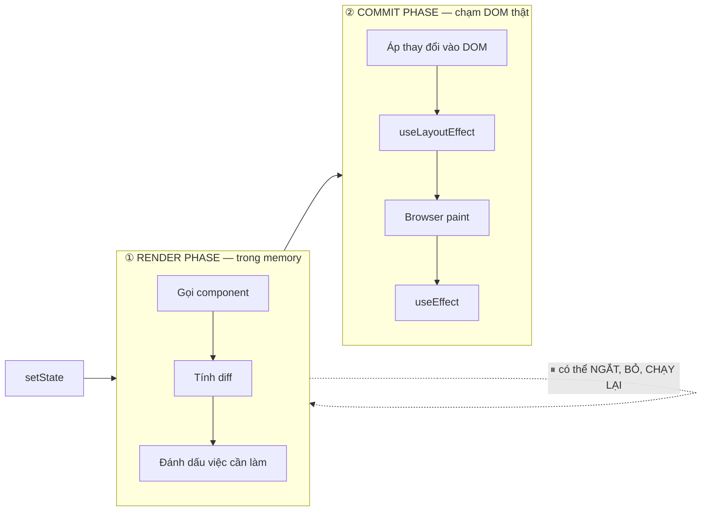

# 06 — React: Virtual DOM, Reconciliation và Fiber

> **TL;DR:** "Virtual DOM" nghe huyền bí nhưng thật ra chỉ là **cây object element ở note 05, giữ trong memory**. Mỗi lần state đổi, React dựng cây mới, **so với cây cũ** (reconciliation) để tìm ra đúng vài chỗ khác nhau, rồi mới chạm vào DOM thật. VDOM **không nhanh hơn DOM thuần** — cái nó mua cho bạn là **mô hình khai báo**. Fiber là cách React tổ chức việc so sánh đó thành từng mẩu nhỏ **ngắt được**, chia làm 2 giai đoạn: render (ngắt được) và commit (không ngắt được).

Series: [[00 - Roadmap - Tu HTML den Pixel]]
Anh em: [[05 - React - JSX bien thanh gi]] · [[02 - DOM la gi - Cay, Node va API]] · [[04 - Event Loop - Task, Microtask va luc browser ve]] · [[07 - React - Truy vet mot lan setState tu click den pixel]] · [[Glossary/C - React|Glossary C]]

---

## 🎯 Câu hỏi note này trả lời

- "Virtual DOM nhanh hơn DOM" — đúng hay sai?
- Vì sao đổi `<div>` thành `<span>` thì input bên trong **mất sạch chữ đang gõ**?
- `key` để làm gì, và vì sao `key={index}` là bug chờ nổ?
- "Component re-render 50 lần" có nghĩa là DOM bị sửa 50 lần không?
- Fiber là gì, và vì sao React StrictMode gọi hàm component **2 lần**?

---

## 🧩 Bước 0 — Vấn đề cần giải

Ở [[02 - DOM la gi - Cay, Node va API]] ta biết: **sửa DOM đắt**. Mỗi lần chạm vào cây, browser có thể phải tính lại layout, vẽ lại (note 01).

Giả sử có danh sách 100 dòng, state đổi làm **1 dòng** thay chữ. Hai cách ngây thơ:

| Cách | Vấn đề |
| --- | --- |
| **A. Xoá sạch, dựng lại** `root.innerHTML = renderAll()` | Mất focus ô input đang gõ · Mất vị trí scroll · Mất trạng thái `<video>` đang chạy · Layout + paint toàn bộ · Animation giật |
| **B. Tự tay sửa đúng chỗ** `document.querySelector("#row-42 .name").textContent = x` | Nhanh nhất, nhưng **bạn phải tự nhớ** cái gì đổi, ở đâu, trong mọi nhánh logic. Code lớn lên = bug lệch trạng thái |

> Vấn đề thật không phải "làm sao sửa DOM nhanh". Vấn đề là: **làm sao biết chính xác cái gì đã đổi**, mà không bắt lập trình viên tự theo dõi.

React chọn đường thứ ba: **bạn cứ mô tả UI đầy đủ ở mọi thời điểm; React tự tìm ra phần khác nhau.**

---

## 🧠 Bước 1 — Virtual DOM là gì (nói thẳng, không huyền bí)

**Virtual DOM = cây React element (object JS thuần ở note 05) giữ trong bộ nhớ.**

Hết. Không có gì hơn.

```js
// đây chính là "virtual DOM" cho <div className="card"><p>Hi</p></div>
{
  type: "div",
  props: {
    className: "card",
    children: { type: "p", props: { children: "Hi" } }
  }
}
```

React giữ **2 phiên bản**: cây của lần render trước, và cây vừa dựng. So hai cái đó → ra danh sách việc cần làm với DOM thật.

### ❗ Đập tan huyền thoại: "VDOM nhanh hơn DOM"

**Sai.** VDOM là **công thêm**, không phải công bớt:

```
DOM thuần viết đúng:   [tính toán] → [sửa DOM]
React:                 [dựng cây mới] → [so 2 cây] → [sửa DOM]
                        ↑ chi phí THÊM, không có ở cách kia
```

Sự thật trung thực:

| Tình huống | Ai nhanh hơn |
| --- | --- |
| Sửa đúng 1 text node, biết rõ vị trí | **DOM thuần** thắng, không bàn cãi |
| Update phức tạp, viết tay cẩu thả (`innerHTML` cả khối) | **React** thắng — vì nó không xoá đi dựng lại |
| App vừa và lớn, nhiều state đan xen | **React** thắng về *bảo trì*, không phải về *tốc độ thô* |

👉 Cái VDOM thật sự bán cho bạn là **mô hình lập trình khai báo**:

```
UI = f(state)
```

Bạn viết "với state này thì UI trông thế này", **không viết** "khi state đổi từ A sang B thì gọi những lệnh DOM nào". React lo phần dịch. Đổi lại, bạn trả bằng **CPU + KB bundle**.

> Có thư viện đạt được mô hình khai báo mà **không cần VDOM** (Svelte compile ra lệnh DOM trực tiếp; SolidJS/Lit/Signals cập nhật đúng chỗ nhờ theo dõi phụ thuộc). VDOM là **một lựa chọn thiết kế**, không phải chân lý.

---

## 🔍 Bước 2 — Reconciliation: React so 2 cây thế nào

So sánh 2 cây bất kỳ một cách tối ưu là bài toán O(n³) — chạy không nổi. React dùng **heuristic** với **2 giả định** để hạ xuống ~O(n):

### Giả định 1 — Khác `type` → đập cả cây con, dựng lại

```
CÂY CŨ                       CÂY MỚI                      React làm gì
──────────                   ──────────                   ────────────────────
<div>            ─────▶      <span>                       type khác ("div" vs "span")
  └ <Input/>                   └ <Input/>                  ⇒ UNMOUNT toàn bộ <div>
      state: "abc"                 state: ???              ⇒ MOUNT <span> mới tinh
                                                           ⇒ state của <Input> MẤT SẠCH
```

Ví dụ code thấy ngay hậu quả:

```jsx
function Form({ compact }) {
  const Wrapper = compact ? "span" : "div";   // 💀
  return (
    <Wrapper>
      <input placeholder="gõ gì đó vào đây" />
    </Wrapper>
  );
}
// Gõ "hello" → toggle compact → ô input TRỐNG TRƠN, focus cũng mất.
```

Vì sao React chọn thế? Vì trong thực tế, **đổi loại node gần như luôn có nghĩa là "UI này là một thứ khác"**. Cố gắng tái sử dụng chỉ tốn công mà sai nhiều hơn đúng.

Điều này áp dụng cả cho component: `<ProfileA/>` → `<ProfileB/>` = huỷ + dựng lại, dù bên trong y hệt nhau.

> 🪤 Bẫy chết người: **định nghĩa component bên trong component**.
> ```jsx
> function Page() {
>   function Row() { return <input/>; }   // 💀 hàm MỚI mỗi lần render
>   return <Row/>;                        // type khác nhau mỗi lần ⇒ mount lại liên tục
> }
> ```
> Ô input mất chữ mỗi lần gõ 1 ký tự. Luôn khai báo component ở **ngoài cùng**.

### Giả định 2 — Cùng `type` → GIỮ node DOM, chỉ vá props khác nhau

```
CÂY CŨ                                CÂY MỚI
────────────────────────────          ────────────────────────────
{type:"div", props:{                  {type:"div", props:{
   className: "card",                    className: "card",        ← giống, bỏ qua
   title: "cũ",                          title: "mới",             ← KHÁC → node.title = "mới"
   children: [...]                       children: [...]           ← đệ quy xuống
}}                                    }}

⇒ Thao tác DOM duy nhất:  node.setAttribute("title", "mới")
   Node <div> vẫn là ĐÚNG NÓ. Focus, scroll, state con: giữ nguyên.
```

Sau khi vá props, React **đi tiếp xuống children** và lặp lại đúng 2 quy tắc trên.

### 📌 Ghi nhớ: cái quyết định state có sống sót không là **VỊ TRÍ TRONG CÂY + `type`**

Không phải tên biến, không phải nội dung. Cùng vị trí + cùng type = cùng một "danh tính" ⇒ state giữ nguyên.

---

## 🔑 Bước 3 — `key`: cách bạn nói cho React biết "ai là ai"

Với **danh sách**, quy tắc "cùng vị trí" sụp đổ. React duyệt children theo **thứ tự index**. Chèn 1 item vào đầu → mọi thứ lệch một nấc.

### ❌ Sai: `key={index}`

```jsx
{todos.map((t, i) => <Row key={i} todo={t} />)}
```

Thêm item "Zero" vào **đầu** danh sách:

```
TRƯỚC                          SAU (key = index)                 React hiểu
─────────────────────          ────────────────────────          ────────────────────────
key=0  "Mua sữa"    [✓]        key=0  "Zero"       [?]           key 0 vẫn là key 0
key=1  "Gọi mẹ"     [ ]        key=1  "Mua sữa"    [?]           ⇒ CHỈ đổi text prop
                               key=2  "Gọi mẹ"     [?]           ⇒ GIỮ nguyên DOM node
                                                                 ⇒ checkbox [✓] ở lại DÒNG 0
KẾT QUẢ: "Zero" bị tick sẵn, "Mua sữa" mất tick. Nội dung ô input cũng dính sai dòng.
```

### ✅ Đúng: `key={t.id}`

```
TRƯỚC                          SAU (key = id)                    React hiểu
─────────────────────          ────────────────────────          ────────────────────────
key="a"  "Mua sữa"  [✓]        key="z"  "Zero"     [ ]           "z" là MỚI ⇒ mount
key="b"  "Gọi mẹ"   [ ]        key="a"  "Mua sữa"  [✓]           "a" đã có ⇒ DI CHUYỂN, giữ state
                               key="b"  "Gọi mẹ"   [ ]           "b" đã có ⇒ di chuyển
KẾT QUẢ: đúng như mong đợi. DOM node của "Mua sữa" được move, không tạo lại.
```

`key` là **danh tính (identity)**, không phải số thứ tự. Nó chỉ có ý nghĩa **giữa các anh em ruột trong cùng một mảng** — không cần unique toàn app.

### Quy tắc chọn key

| Nên | Không nên |
| --- | --- |
| `id` từ database | `index` khi list **có thể** chèn/xoá/sort/lọc |
| Khoá tự nhiên ổn định (slug, uuid, mã đơn) | `Math.random()` 💀 — mỗi render một key = mount lại toàn bộ, **mất state + chậm hơn cả không dùng React** |
| Tự sinh `crypto.randomUUID()` **một lần lúc tạo item** rồi lưu vào state | Ghép nội dung có thể trùng (`key={name}` mà có 2 người trùng tên) |
| `key={index}` **chỉ khi** list tĩnh, không đổi thứ tự, không có state bên trong | |

> 💡 Mẹo ngược lại: đổi `key` **cố ý** để **reset state**. `<Form key={userId} />` — chuyển user thì form tự về trống, không cần `useEffect` dọn dẹp.

---

## 🔄 Bước 4 — Render ≠ Update DOM (chỗ nhiều người nhầm nhất)

> **"Component re-render" chỉ có nghĩa là: React GỌI LẠI HÀM component để lấy cây element mới.**
> **Nó KHÔNG có nghĩa là DOM bị đụng vào.**

```
setState
   │
   ▼
① RENDER   ── React gọi Component(props) ──▶ cây element mới     ⟵ "re-render" là ĐÂY
   │
   ▼
② DIFF     ── so cây mới vs cây cũ ──▶ danh sách thay đổi
   │
   ├── danh sách RỖNG ──▶ ✅ DỪNG. KHÔNG có một lệnh DOM nào. Browser không paint lại.
   │
   ▼
③ COMMIT   ── áp vào DOM thật ──▶ browser layout/paint (note 01)
```

Nghĩa là:

| Câu nói thường nghe | Thực tế |
| --- | --- |
| "Component re-render 50 lần, chắc chậm lắm" | Gọi 50 lần một hàm JS thuần — thường **rẻ**. Chậm hay không phụ thuộc hàm đó làm gì |
| "Re-render là DOM bị vẽ lại" | ❌ Nếu diff ra rỗng thì **không có thao tác DOM nào** |
| "Phải `memo` mọi component cho nhanh" | Xem bước 7 — `memo` cũng có giá của nó |

Cách kiểm chứng: bật **React DevTools → Profiler → Highlight updates**. Bạn sẽ thấy component "render" mà DOM không hề nháy.

Muốn xem DOM có thật sự bị đụng không: DevTools → Elements, node nào bị sửa sẽ **nháy tím** một cái.

---

## 🧵 Bước 5 — Fiber: chia việc thành từng mẩu ngắt được

### Vấn đề của React ≤ 15

Ngày xưa React duyệt cây bằng **đệ quy đồng bộ**. Cây 3000 node = một hàm chạy liền một mạch. Mà JS **chạy trên một luồng duy nhất** (note 04) → suốt lúc đó browser **không vẽ được, không nhận input được**. Gõ phím thấy khựng.

### React 16+ — Fiber

**Fiber** vừa là **cấu trúc dữ liệu**, vừa là **kiến trúc**.

Mỗi node trong cây có một **fiber** — một object mang: `type`, props, state, node DOM tương ứng, và **3 con trỏ** biến cây thành thứ duyệt được bằng vòng lặp thay vì đệ quy:

```
                   ┌──────────┐
                   │   App    │
                   └────┬─────┘
              child ↓   ↑ return
                   ┌──────────┐   sibling   ┌──────────┐
                   │  Header  │ ─────────▶  │   Main   │
                   └──────────┘             └────┬─────┘
                                       child ↓   ↑ return
                                            ┌──────────┐
                                            │  Button  │
                                            └──────────┘

child  → con đầu tiên        sibling → em kế bên        return → cha
```

Vì là **linked list duyệt bằng vòng lặp**, React có thể **dừng giữa chừng** sau bất kỳ fiber nào, trả quyền cho browser (để vẽ, để nhận click), rồi **quay lại đúng chỗ đang dở** — thứ mà đệ quy không làm được.

React cũng giữ **hai cây fiber** cùng lúc (kỹ thuật double buffering): cây đang hiển thị và cây đang dựng dở. Dựng xong mới **hoán đổi** — nên người dùng không bao giờ thấy cây nửa vời.

### Hai giai đoạn



| | **① Render phase** | **② Commit phase** |
| --- | --- | --- |
| Làm gì | Gọi hàm component, dựng cây element mới, so diff | Áp thay đổi vào DOM thật, chạy effect |
| Chạm DOM thật chưa? | ❌ **Chưa**. Toàn bộ trong memory | ✅ Có |
| Ngắt được không? | ✅ **Có** — dừng, bỏ, **chạy lại từ đầu** | ❌ **Không.** Đồng bộ, một mạch |
| Vì sao thiết kế thế | Để không chặn browser vẽ / nhận input | Để user **không bao giờ** thấy UI nửa vời (nửa cũ nửa mới) |
| Hook chạy ở đây | `useState`, `useReducer`, `useMemo`, `useContext`, thân hàm component | `useLayoutEffect` (trước paint), `useEffect` (sau paint), `useInsertionEffect` |
| Được có side effect? | ❌ **TUYỆT ĐỐI KHÔNG** — xem dưới | ✅ Được (đó là chỗ dành cho nó) |

### 🔑 Vì sao component phải "pure" — và vì sao StrictMode gọi hàm 2 lần

Vì render phase **có thể bị bỏ và chạy lại**, hàm component có thể được gọi **nhiều lần cho cùng một state** mà kết quả cuối cùng chỉ dùng một lần. Nên nó **bắt buộc** phải:

- Cùng props + state → cùng kết quả trả về
- **Không** sửa biến ngoài, **không** gọi API, **không** `document.title = ...`, **không** mutate props/state

```jsx
let count = 0;
function Bad() {
  count++;                         // 💀 side effect trong render phase
  document.title = "hi";           // 💀 chạm DOM trong render phase
  props.items.push(x);             // 💀 mutate
  return <div>{count}</div>;
}
```

👉 **`<StrictMode>` ở dev cố tình gọi hàm component 2 lần** (và gọi 2 lần cả initializer của `useState`, `useMemo`) — để những lỗi trên **lộ ra ngay**: `Bad` sẽ hiện `2` thay vì `1`. Ở production chỉ gọi 1 lần. Nó là **máy dò impurity**, không phải bug của React.

(React 18+ StrictMode còn mount → unmount → mount lại effect một lần ở dev, để bắt effect thiếu cleanup.)

---

## ⚡ Bước 6 — Concurrent features (ngắn gọn)

Vì render phase ngắt được, React 18 mở ra vài API cho phép bạn nói **"việc này không gấp"**:

| API | Dùng khi | Ý tưởng |
| --- | --- | --- |
| `useTransition` | Bấm tab → render danh sách 5000 dòng | Đánh dấu update là **không khẩn cấp**; gõ phím / click vẫn mượt vì được ưu tiên chen ngang |
| `useDeferredValue` | Ô search lọc list nặng | Giữ giá trị **cũ** để render list, trong khi ô input cập nhật ngay lập tức |
| `<Suspense>` | Chờ dữ liệu / code chia nhỏ | Hiện fallback thay vì chặn cả cây |

```jsx
const [isPending, startTransition] = useTransition();
startTransition(() => setTab("posts"));   // update này chịu bị chen ngang
```

> Đây **không phải multithread**. Vẫn một luồng JS duy nhất (note 04). React chỉ **chia nhỏ công việc và sắp thứ tự ưu tiên** giữa các lần nhả cho browser.

---

## 🎚 Bước 7 — Tối ưu: `memo`, `useMemo`, `useCallback` chặn ở đâu?

**Cả ba chỉ chặn ở bước ① — không cho gọi lại hàm component / không tính lại giá trị. Chúng KHÔNG chặn thao tác DOM,** vì bước DOM vốn đã chỉ chạy khi có khác biệt thật.

| API | Bỏ qua cái gì | So sánh bằng gì |
| --- | --- | --- |
| `React.memo(Comp)` | Bỏ qua **gọi lại hàm component** nếu props không đổi | So **nông** (`Object.is`) từng prop |
| `useMemo(fn, deps)` | Bỏ qua **tính lại một giá trị** | So nông mảng `deps` |
| `useCallback(fn, deps)` | Giữ **cùng một tham chiếu hàm** giữa các render | So nông `deps` |

### ⚠️ Chúng KHÔNG miễn phí

- Vẫn phải lưu giá trị cũ (tốn memory) và **so sánh mỗi lần render** (tốn CPU).
- `React.memo` **vô dụng** nếu prop là object/hàm tạo mới mỗi render — vì so nông luôn ra "khác":
  ```jsx
  <Child style={{ margin: 4 }} onClick={() => x()} />   // memo vô hiệu, 2 prop này luôn mới
  ```
- Bọc `useCallback` cho một hàm chỉ dùng trong `onClick` của thẻ `<button>` thường **không mang lại gì**.

**Thứ tự đúng khi tối ưu:**

1. Đo trước bằng **React DevTools Profiler** — tìm component thật sự chậm.
2. Sửa cấu trúc trước: đẩy state xuống thấp hơn, tách component, dùng `children` để tránh render lan.
3. **Rồi mới** `memo`/`useMemo`, đúng chỗ vừa đo được.

> React 19 đi kèm hệ sinh thái **React Compiler** — công cụ build tự chèn memo hoá giúp bạn. Khi dùng nó thì hầu hết `useMemo`/`useCallback` viết tay là thừa. Vẫn nên hiểu cơ chế, đừng bật rồi quên.

---

## 🔗 Bước 8 — Chốt: cỗ máy này có giá của nó

Toàn bộ những gì vừa đọc — cây element, thuật toán diff, cây fiber, scheduler, hệ thống ưu tiên — **là code JavaScript phải tải về máy người dùng và chạy trên CPU của họ**:

```
Người dùng phải trả:
  ├─ Vài chục KB JS (react + react-dom, đã gzip)   ⟵ tải, parse, compile (note 03)
  ├─ CPU mỗi lần update: dựng cây mới + so cây     ⟵ trước cả khi chạm DOM
  └─ Memory: luôn giữ 2 cây fiber trong RAM
```

Web Components **không có lớp này**. `<my-card>` là node thật trong DOM; đổi property → element **tự sửa đúng chỗ DOM của mình**, không cây ảo, không diff, không scheduler:

```
React:            state → cây element mới → diff → commit → DOM
Web Component:    property setter → sửa thẳng node cần sửa
```

Đổi lại, Web Components bắt **bạn** tự lo phần "biết cái gì đã đổi" — đúng cách B ở bước 0. (Các thư viện như Lit thêm lại một lớp template hiệu quả để đỡ chuyện đó.)

Không có bên nào "thắng". Xem [[09 - Web Components - Truy vet mot custom element tu HTML den pixel]] để thấy phía bên kia, và [[11 - So sanh truc tiep - React vs Web Components]] để so từng bước pipeline.

---

## ⚠️ Bẫy thường gặp

| Bẫy | Vì sao sai | Sửa |
| --- | --- | --- |
| **Mutate state trực tiếp**: `items.push(x); setItems(items)` | Vẫn **cùng một tham chiếu** → `Object.is` thấy giống → React bỏ qua, UI không đổi | `setItems([...items, x])` — luôn tạo mới |
| **`key={index}`** trên list có thể đổi thứ tự | State/DOM dính sai dòng: checkbox tick nhầm, input lệch chữ | `key={item.id}` |
| **`key={Math.random()}`** | Mọi item mount lại mỗi render — chậm hơn cả không dùng React, mất sạch state | Sinh id **một lần** rồi lưu vào state |
| **Nghĩ re-render = chạm DOM** | Diff rỗng thì không có lệnh DOM nào cả | Đo bằng Profiler trước khi lo |
| **Nghĩ `memo` là miễn phí** | Vẫn tốn so sánh + memory; vô hiệu nếu props là object/hàm mới | Đo trước, sửa cấu trúc trước |
| **Định nghĩa component trong component** | `type` khác nhau mỗi render → unmount + mount liên tục | Khai báo ở scope ngoài cùng |
| **Side effect trong thân hàm component** | Render phase có thể chạy lại/bị bỏ → chạy nhiều lần hoặc chạy phí | Đưa vào `useEffect` / event handler |
| **Đổi `type` thẻ bọc theo điều kiện** | Huỷ + dựng lại cả cây con, mất state | Giữ nguyên type, đổi `className` |
| **Dùng `useLayoutEffect` cho mọi thứ** | Nó chạy **đồng bộ trước paint** → chặn hiển thị | Mặc định `useEffect`; chỉ dùng `useLayoutEffect` khi cần đo layout trước khi user thấy |

---

## ✅ Nhớ 5 điều

1. **Virtual DOM = cây object element trong memory.** Không huyền bí, không nhanh hơn DOM — nó bán **mô hình khai báo `UI = f(state)`**, và bạn trả bằng KB + CPU.
2. **Reconciliation có 2 luật:** khác `type` → **đập cả cây con dựng lại** (mất state); cùng `type` → **giữ node, vá props**. Danh tính = vị trí trong cây + type.
3. **`key` là danh tính, không phải số thứ tự.** `key={index}` trên list có thể chèn/xoá/sort là bug chờ nổ.
4. **Render ≠ update DOM.** "Re-render" chỉ là React gọi lại hàm component. Diff rỗng ⇒ **zero thao tác DOM**.
5. **Fiber chia render thành mẩu ngắt được.** Render phase **ngắt/bỏ/chạy lại được** ⇒ component phải pure (và StrictMode gọi 2 lần để bắt lỗi này); commit phase **đồng bộ, không ngắt** ⇒ user không bao giờ thấy UI nửa vời.

---

## 📚 Nguồn

- [react.dev — Render and Commit](https://react.dev/learn/render-and-commit)
- [react.dev — Preserving and Resetting State](https://react.dev/learn/preserving-and-resetting-state)
- [react.dev — Rendering Lists (`key`)](https://react.dev/learn/rendering-lists)
- [react.dev — Keeping Components Pure](https://react.dev/learn/keeping-components-pure)
- [react.dev — `memo`](https://react.dev/reference/react/memo)
- [react.dev — `useTransition`](https://react.dev/reference/react/useTransition) · [`useDeferredValue`](https://react.dev/reference/react/useDeferredValue)
- [react.dev — `StrictMode`](https://react.dev/reference/react/StrictMode)
- [Dan Abramov — React as a UI Runtime](https://overreacted.io/react-as-a-ui-runtime/)
- [React docs (legacy) — Reconciliation](https://legacy.reactjs.org/docs/reconciliation.html)
- [Lin Clark — A Cartoon Intro to Fiber (React Conf 2017)](https://www.youtube.com/watch?v=ZCuYPiUIONs)
