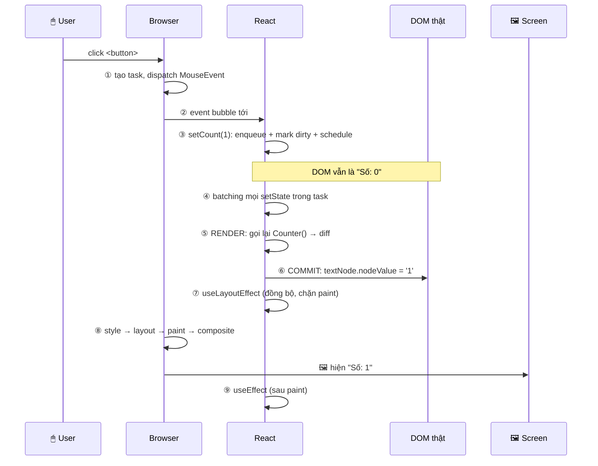

# 07 — React: Truy vết một lần `setState`, từ click đến pixel

> **TL;DR:** Bấm nút → chữ đổi trên màn hình. Ở giữa có **9 bước**, và chỉ **1 bước duy nhất** thật sự chạm vào DOM. React không vẽ gì cả — nó chỉ tính xem cần sửa node nào, gọi DOM API sửa đúng chỗ đó, rồi **nhường lại cho browser** làm phần layout → paint → composite như mọi trang web khác.
>
> Hiểu được timeline này là hiểu được 80% các bug "sao `console.log` ra giá trị cũ", "sao nháy hình", "sao `useEffect` chạy sau".

Series: [[00 - Roadmap - Tu HTML den Pixel]]
Anh em: [[05 - React - JSX bien thanh gi]] · [[06 - React - Virtual DOM, Reconciliation va Fiber]] · [[04 - Event Loop - Task, Microtask va luc browser ve]] · [[08 - React - CSS va chuyen khong co encapsulation]] · [[Glossary/C - React|Glossary C]]

---

## 🎯 Ví dụ dùng chung cả bài

Cả bài này chỉ có **một** ví dụ. Nhớ nó, rồi mọi bước bên dưới đều quy về nó:

```jsx
function Counter() {
  const [count, setCount] = useState(0);
  return <button onClick={() => setCount(count + 1)}>Số: {count}</button>;
}
```

Sau khi mount, DOM thật trong browser là:

```
<button>          ← Element node
  ├─ #text "Số: " ← Text node  (phần tĩnh)
  └─ #text "0"    ← Text node  (phần động — chính là {count})
```

👉 Để ý: `{count}` **không** phải attribute, không phải "biến trong template". Nó là **một text node riêng biệt**. Đây là lý do bước 6 bên dưới chỉ tốn đúng một dòng lệnh.

---

## 🧠 Phần 1 — Trước đó: trang được khởi động thế nào

### 1.1. File HTML thật sự gửi về từ server

Mở "View Source" một SPA React, bạn thấy gần như **trống trơn**:

```html
<!DOCTYPE html>
<html>
  <body>
    <div id="root"></div>
    <script type="module" src="/assets/index-a3f9.js"></script>
  </body>
</html>
```

Không có `<button>`, không có chữ "Số: 0". Vì sao?

Vì **HTML parser chỉ dựng được thứ có trong text HTML** (xem [[02 - DOM la gi - Cay, Node va API]]). Toàn bộ giao diện React nằm trong file `.js`, và JS chỉ chạy **sau khi được tải và thực thi** (xem [[03 - Script duoc tai luc nao - defer, async, module]] — `type="module"` mặc định hành xử như `defer`).

> **Vì sao SEO/crawler hay than phiền:** cái mà một client đơn giản (chỉ fetch HTML, không chạy JS) nhìn thấy đúng là cái `<div id="root"></div>` rỗng kia.

### 1.2. Timeline lần mount đầu tiên

```
  HTML về         JS bundle về        React chạy         Browser vẽ
     │                 │                   │                  │
─────┼─────────────────┼───────────────────┼──────────────────┼────────▶ time
     │                 │                   │                  │
  ┌──▼──┐          ┌───▼───┐          ┌────▼─────┐       ┌────▼────┐
  │parse│          │ tải + │          │createRoot│       │ layout  │
  │ HTML│          │ execute│         │ .render()│       │ paint   │
  │  ↓  │          │ bundle │         │    ↓     │       │composite│
  │ DOM │          └────────┘         │Counter() │       └─────────┘
  │#root│                             │    ↓     │
  │RỖNG │                             │element   │
  └─────┘                             │  tree    │
     │                                │    ↓     │
     │                                │document. │
     │                                │createEle-│
     │                                │ ment/Text│
     │                                │    ↓     │
     │                                │appendChild
     │                                │ vào #root│
     │                                └──────────┘
     │
  ┌──┴──────────────────────────────────────────┐
  │  ⬜ MÀN HÌNH TRẮNG trong suốt khoảng này    │
  └─────────────────────────────────────────────┘
```

Đọc theo lời:

| Bước | Ai làm | Chuyện gì |
| --- | --- | --- |
| 1 | Browser | Parse HTML → DOM chỉ có `<div id="root">` rỗng |
| 2 | Browser | Tải bundle JS (module ⇒ defer ⇒ chạy sau khi parse xong) |
| 3 | JS/React | `createRoot(document.getElementById('root')).render(<App />)` |
| 4 | React | Gọi hàm `Counter()` → nhận về **object** React element (note 05), **chưa** đụng DOM |
| 5 | React | Duyệt cây element → gọi `document.createElement('button')`, `document.createTextNode('Số: ')`… |
| 6 | React | `root.appendChild(button)` — **đây mới là lúc DOM thật thay đổi** |
| 7 | Browser | Bây giờ mới có gì để tính: style → layout → paint → composite (note 01) |

**Hệ quả thực tế:** người dùng nhìn màn hình trắng cho tới hết bước 6. Đó là lý do có:
- **Loading skeleton** — nhét sẵn HTML tĩnh vào `#root` để browser có gì đó vẽ ngay ở bước 1.
- **Code splitting** — bundle nhỏ hơn ⇒ bước 2 ngắn hơn.

### 1.3. SSR + hydration (3 câu, không đi sâu)

**SSR** = server chạy trước React, sinh sẵn HTML đầy đủ (`<button>Số: 0</button>`) rồi gửi về, nên browser vẽ được **ngay ở bước 1** — hết trắng màn hình. Nhưng HTML đó "chết": chưa có event listener nào. **Hydration** là bước React chạy ở client, đi lại cây HTML có sẵn và **gắn state + listener** vào, thay vì tạo node mới. Trong khoảng giữa "thấy được" và "hydrate xong", người dùng nhìn thấy giao diện nhưng bấm chưa ăn — đó là hiện tượng quen thuộc của Next.js/Remix.

---

## ⚙️ Phần 2 — Truy vết một lần click (phần chính)

Người dùng bấm vào `<button>Số: 0</button>`. Đây là 9 bước.

### Bước 1 — Browser tạo một **task**

Chuột nhấn xuống → browser tạo một **task** trong event loop (xem [[04 - Event Loop - Task, Microtask va luc browser ve]]) và dispatch một `MouseEvent` **thật** trên DOM thật. Chưa có React nào ở đây cả — chuyện này y hệt một trang HTML thuần.

Event đi theo 3 pha: capture (từ `window` xuống) → target (`<button>`) → **bubble** (từ `<button>` nổi ngược lên).

### Bước 2 — React nhận event ở root container

Bạn viết `onClick={...}`, nhưng React **không** gắn listener lên `<button>`. Từ React 17 trở đi, React gắn listener một lần ở **root container** (cái `#root` bạn truyền vào `createRoot`).

```
   <button> ─── bubble ───▶ <div id="root">
                                   │
                                   │ listener THẬT ở đây
                                   ▼
                        React synthetic event system
                                   │ tra ngược fiber tree
                                   │ tìm ra: node này là <Counter>
                                   ▼
                        gọi handler bạn viết: () => setCount(count + 1)
```

Cái bạn nhận trong handler là **SyntheticEvent** — một object React bọc quanh event thật, để chuẩn hoá khác biệt giữa các browser. Event gốc luôn lấy được qua `e.nativeEvent`.

> ⚠️ Vì listener nằm ở root container chứ không nằm trên `<button>`, `e.stopPropagation()` **bên ngoài React** (ở một listener DOM thuần gắn giữa button và root) có thể chặn event trước khi React kịp thấy.

### Bước 3 — `setCount(1)` **không** sửa DOM

Đây là bước hay bị hiểu sai nhất. `setCount(1)` làm đúng 3 việc:

```
setCount(1)
   │
   ├─▶ 1. ENQUEUE: đẩy update {action: 1} vào hàng đợi của HOOK đó
   │
   ├─▶ 2. MARK DIRTY: đánh dấu fiber <Counter> "cần render lại"
   │        và đánh dấu ngược lên tới root
   │
   └─▶ 3. SCHEDULE: báo scheduler "có việc" — rồi RETURN NGAY
```

Sau dòng `setCount(1)`, DOM vẫn còn nguyên `Số: 0`. Biến `count` trong scope hiện tại vẫn là `0`. **Không có gì thay đổi cả.** React chỉ ghi sổ.

### Bước 4 — **Batching**: gom mọi `setState` trong cùng task

Vì bước 3 chỉ ghi sổ, React có thể gom nhiều lần gọi lại rồi xử lý một lượt. Đây là **batching**.

Bug kinh điển:

```jsx
// ❌ Bấm 1 lần → count chỉ tăng 1, KHÔNG phải 3
function handleClick() {
  setCount(count + 1);
  setCount(count + 1);
  setCount(count + 1);
}
```

**Vì sao?** Không phải vì "setState là async". Mà vì **closure**: trong lần render này, `count` là một **hằng số** = `0`. Cả 3 dòng đều biên dịch thành `setCount(0 + 1)` = `setCount(1)`. Hàng đợi thành `[đặt=1, đặt=1, đặt=1]` → kết quả `1`.

```jsx
// ✅ Bấm 1 lần → count tăng đúng 3
function handleClick() {
  setCount(c => c + 1);
  setCount(c => c + 1);
  setCount(c => c + 1);
}
```

Ở đây bạn enqueue **hàm**, không phải giá trị. React chạy lần lượt: `0→1`, `1→2`, `2→3`.

| | `setCount(count + 1)` | `setCount(c => c + 1)` |
| --- | --- | --- |
| Cái được enqueue | **Giá trị** đã tính sẵn | **Hàm** biến đổi |
| Đọc `count` từ đâu | Closure của lần render hiện tại | Giá trị mới nhất trong hàng đợi |
| Gọi 3 lần từ 0 | → `1` | → `3` |
| Khi nào dùng | Giá trị mới không phụ thuộc giá trị cũ (`setCount(0)`, `setName(e.target.value)`) | Giá trị mới **tính từ** giá trị cũ (tăng/giảm/toggle/push) |

> **Quy tắc bỏ túi:** hễ trong biểu thức mới có mặt state cũ ⇒ dùng updater function.

### Bước 5 — **Render phase**: React gọi lại hàm `Counter()`

React chạy lại hàm component. `useState` lúc này trả về `1` (đã áp dụng hàng đợi). Hàm trả về một cây element **mới**:

```js
{ type: 'button', props: { onClick: fn, children: ['Số: ', 1] } }
```

React **diff** cây mới với cây cũ (chi tiết ở [[06 - React - Virtual DOM, Reconciliation va Fiber]]) và kết luận:
`type` vẫn là `button` → giữ nguyên node DOM; chỉ có **text node thứ hai** đổi từ `"0"` thành `"1"`.

> 🔑 **Nhấn mạnh:** "React re-render" = **gọi lại một hàm JavaScript**. Nó *không* đồng nghĩa với "DOM bị sửa". Một component có thể re-render 100 lần mà DOM không đổi một byte nào. Đây là lý do render phase **bắt buộc phải pure** — React có quyền chạy nó, bỏ đi, rồi chạy lại.

### Bước 6 — **Commit phase**: chạm DOM thật (duy nhất một lần)

Đây là bước **duy nhất** trong cả quy trình mà DOM thật bị đụng vào. Với ví dụ của ta, nó gọn đúng như vậy:

```js
textNode.nodeValue = '1';
```

Một dòng. Không tạo lại `<button>`, không `innerHTML`, không xoá node nào. Commit phase là **đồng bộ và không thể ngắt** — React làm một mạch cho xong để DOM không bao giờ ở trạng thái nửa vời.

### Bước 7 — `useLayoutEffect` chạy **ngay**, trước khi vẽ

Ngay sau khi commit xong, **vẫn trong cùng task**, React chạy đồng bộ mọi `useLayoutEffect`. DOM đã mới, nhưng browser **chưa vẽ**.

```jsx
useLayoutEffect(() => {
  const h = boxRef.current.offsetHeight; // đo được kích thước THẬT
  if (h > 300) setCollapsed(true);       // sửa lại — người dùng không thấy nháy
});
```

Nếu bạn `setState` trong `useLayoutEffect`, React sẽ render + commit lại **trước khi** nhả cho browser vẽ. Người dùng chỉ thấy kết quả cuối. Đổi lại: nó **chặn paint**, làm chậm nếu tính toán nặng.

### Bước 8 — Browser mới có **rendering opportunity**

Task JS kết thúc → call stack rỗng → microtask queue rỗng → browser mới được quyền vẽ (note 04). Lúc này pipeline quen thuộc của note 01 chạy:

```
recalculate style → layout → paint → composite → 🖼 PIXEL LÊN MÀN HÌNH
```

Người dùng **bây giờ** mới thấy chữ "Số: 1".

### Bước 9 — `useEffect` chạy **sau khi vẽ**

`useEffect` được xếp vào hàng đợi riêng (passive effects) và React chạy nó **sau khi browser đã paint**, ở một lượt sau.

```jsx
useEffect(() => {
  fetch('/api/log', { method: 'POST', body: String(count) }); // không chặn hiển thị
}, [count]);
```

Vì thế fetch/subscribe/analytics đặt trong `useEffect` **không** làm chậm việc hiển thị. Đây chính là lý do `useEffect` là nơi mặc định cho side effect.

> Thời điểm chính xác React chạy passive effects là **chi tiết cài đặt** — trong vài tình huống (ví dụ có một event rời rạc kế tiếp) React có thể flush chúng sớm hơn. Điều đảm bảo là: **`useEffect` chạy sau commit, và không chặn paint như `useLayoutEffect`.**

---

## 🔍 Sơ đồ timeline đầy đủ (hình quan trọng nhất bài)

```
     🖱  người dùng bấm chuột
     │
╔════╪═══════════════ MỘT TASK CỦA EVENT LOOP ═══════════════════════════╗
║    ▼                                                                    ║
║ ┌────────────────── VÙNG BROWSER ──────────────────┐                    ║
║ │ ① tạo task, dispatch MouseEvent thật trên DOM    │                    ║
║ │    capture ↓  target  bubble ↑                   │                    ║
║ └───────────────────────┬──────────────────────────┘                    ║
║                         │ event nổi tới #root                           ║
║ ┌───────────────────────▼──── VÙNG REACT ─────────────────────────────┐ ║
║ │ ② synthetic event system → tìm fiber → gọi onClick của bạn         │ ║
║ │                                                                     │ ║
║ │ ③ setCount(1)  →  enqueue update · mark dirty · schedule            │ ║
║ │                   ⚠ DOM VẪN CÒN "Số: 0"                             │ ║
║ │                                                                     │ ║
║ │ ④ BATCHING: gom mọi setState trong task này thành 1 lần render      │ ║
║ │                                                                     │ ║
║ │ ─────────── RENDER PHASE (thuần JS, có thể ngắt) ───────────        │ ║
║ │ ⑤ gọi lại Counter() → cây element mới → diff với cây cũ             │ ║
║ │    kết luận: chỉ text node #2 đổi "0" → "1"                         │ ║
║ │    ⚠ VẪN CHƯA CHẠM DOM                                              │ ║
║ │                                                                     │ ║
║ │ ─────────── COMMIT PHASE (đồng bộ, không ngắt) ─────────────        │ ║
║ │ ⑥ textNode.nodeValue = '1'   ◀── LẦN DUY NHẤT DOM THẬT BỊ SỬA      │ ║
║ │                                                                     │ ║
║ │ ⑦ useLayoutEffect chạy ĐỒNG BỘ ngay (đo DOM, sửa lại nếu cần)      │ ║
║ └─────────────────────────────────────────────────────────────────────┘ ║
╚═════════════════════════════╪═══════════════════════════════════════════╝
                              │ task kết thúc, stack rỗng, microtask rỗng
 ┌────────────────────────────▼──── VÙNG BROWSER ────────────────────────┐
 │ ⑧ rendering opportunity:                                              │
 │    style → layout → paint → composite                                 │
 │                                                                       │
 │              🖼  NGƯỜI DÙNG THẤY "Số: 1" TẠI ĐÂY                      │
 └────────────────────────────┬──────────────────────────────────────────┘
                              │
 ┌────────────────────────────▼──── VÙNG REACT ──────────────────────────┐
 │ ⑨ useEffect chạy (sau paint) → fetch / subscribe / analytics          │
 └───────────────────────────────────────────────────────────────────────┘
```

Cùng nội dung, dạng sequence:



---

## ⚠️ Bẫy thường gặp

### 1. `useEffect` vs `useLayoutEffect`

| | `useEffect` | `useLayoutEffect` |
| --- | --- | --- |
| Chạy lúc nào | **Sau** khi browser paint | **Ngay sau** commit, **trước** paint |
| Đồng bộ? | Không (lượt sau) | Có (cùng task với commit) |
| Chặn hiển thị? | **Không** | **Có** |
| Dùng khi | fetch, subscribe, timer, analytics, sync với hệ thống ngoài — **99% trường hợp** | Đo DOM (`offsetHeight`, `getBoundingClientRect`) rồi chỉnh lại để **tránh nháy hình**: tooltip/popover định vị, scroll position |
| Trên SSR | Không chạy trên server | Không chạy trên server, và React **cảnh báo** nếu dùng trong component render phía server |

> **Quy tắc:** mặc định luôn là `useEffect`. Chỉ đổi sang `useLayoutEffect` khi bạn *nhìn thấy* hiện tượng nháy một khung hình.

### 2. `console.log(count)` ngay sau `setCount` ra giá trị **cũ**

```jsx
function handleClick() {
  setCount(count + 1);
  console.log(count); // 0 — không phải 1
}
```

Nguyên nhân **không phải** "setState là bất đồng bộ nên chưa kịp cập nhật". Nguyên nhân là **closure**: `count` là một `const` được tạo ra khi hàm `Counter()` chạy lần này. Nó **không bao giờ đổi giá trị** — không có cách nào làm nó đổi. Giá trị `1` chỉ tồn tại trong **lần gọi `Counter()` tiếp theo**, với một `const count` hoàn toàn khác.

👉 Mỗi lần render là **một ảnh chụp (snapshot)** riêng: props, state, handler, biến local của lần đó đều bị "đóng băng".
Muốn xem giá trị mới ⇒ `console.log` ở thân component, hoặc trong `useEffect(() => {...}, [count])`.

### 3. Đọc `ref.current.offsetHeight` — chỗ nào an toàn?

| Đọc ở đâu | An toàn? | Vì sao |
| --- | --- | --- |
| Thân component (render phase) | ❌ | Đang ở **bước 5**. DOM chưa được commit (bước 6). Lần đầu `ref.current` còn là `null`; các lần sau bạn đọc phải kích thước **cũ**. Ngoài ra đọc DOM trong render phá vỡ tính pure. |
| Trong `useLayoutEffect` | ✅ | Sau bước 6: DOM đã mới, browser chưa vẽ. Đo rồi sửa vẫn kịp. |
| Trong `useEffect` | ✅ | Sau bước 6 và sau paint. DOM đúng — chỉ là nếu bạn sửa layout ở đây, người dùng có thể thấy một khung hình nháy. |
| Trong event handler | ✅ | Đang ở bước 2, DOM là kết quả commit của lần render trước — hoàn toàn hợp lệ. |

### 4. Automatic batching (React 18+)

Trước React 18, batching **chỉ** áp dụng bên trong event handler của React. Ngoài đó thì mỗi `setState` kích một lần render riêng:

```jsx
setTimeout(() => {
  setA(1); // React 17: render lần 1
  setB(2); // React 17: render lần 2  → 2 lần render, có thể nháy
}, 0);
```

Từ **React 18** (và giữ nguyên ở React 19), với `createRoot`, **automatic batching** gom cả những nơi đó: `setTimeout`, `Promise.then`, `await`, native event listener, v.v. Ví dụ trên chỉ còn **1 lần render**.

> Nếu bạn nâng lên 18/19 mà thấy hành vi lạ ở code cũ dựa vào "mỗi setState một render", đây là thủ phạm quen mặt.

### 5. StrictMode gọi mọi thứ 2 lần trong dev

Trong `<StrictMode>` ở **development** (production không bị), React cố ý:
- Gọi **hàm component** 2 lần (và cả updater function, `useMemo`…)
- Với effect: mount → **unmount** → mount lại

Không phải bug. Đây là bài kiểm tra: **render phase phải pure**, và **mọi effect phải có cleanup đúng**. Nếu code bạn double-fetch, đếm sai, hay để lại listener rác, StrictMode đang chỉ ra một bug thật — bug đó sẽ nổ trên production khi React ngắt và chạy lại render phase (note 06).

Cách khai báo hay bị nhầm là "chạy 2 lần":

```jsx
setCount(c => { console.log('hi'); return c + 1; }); // ❌ có side effect trong updater
```

### 6. `flushSync` — dùng khi buộc phải, và rất hiếm

```jsx
import { flushSync } from 'react-dom';

flushSync(() => {
  setItems([...items, newItem]);
});
// tới dòng này DOM ĐÃ có item mới
listRef.current.scrollTop = listRef.current.scrollHeight;
```

`flushSync` ép React render + commit **đồng bộ ngay lập tức**, phá vỡ batching. Chỉ dùng khi bạn cần DOM mới **ngay trong dòng lệnh tiếp theo**: cuộn tới phần tử vừa thêm, tích hợp thư viện bên thứ ba (chart, map), hoặc chụp DOM trước một transition. Cái giá: mất batching, có thể gây layout thrashing. **Mặc định là không dùng.**

---

## ✅ Nhớ 5 điều

1. **Chỉ bước 6 chạm DOM.** Tám bước còn lại là JS thuần hoặc browser. "Re-render" = gọi lại một hàm, không phải sửa DOM.
2. **`setState` chỉ ghi sổ rồi return.** DOM và biến `count` trong scope hiện tại đều **không** đổi ở dòng ngay sau nó.
3. **`count` là snapshot của lần render.** Cần tính từ giá trị cũ ⇒ luôn dùng `setCount(c => c + 1)`.
4. **`useLayoutEffect` trước paint, `useEffect` sau paint.** Nháy hình dùng cái đầu, mọi thứ khác dùng cái sau.
5. **React nhường phần vẽ cho browser.** Sau commit, React đứng ngoài — layout/paint/composite là pipeline của note 01, giống hệt một trang HTML thuần.

---

## 📚 Nguồn

- [React — Render and Commit](https://react.dev/learn/render-and-commit)
- [React — State as a Snapshot](https://react.dev/learn/state-as-a-snapshot)
- [React — Queueing a Series of State Updates](https://react.dev/learn/queueing-a-series-of-state-updates)
- [React — `useLayoutEffect`](https://react.dev/reference/react/useLayoutEffect)
- [React — `useEffect`](https://react.dev/reference/react/useEffect)
- [React — `flushSync`](https://react.dev/reference/react-dom/flushSync)
- [React blog — React 18: Automatic Batching](https://react.dev/blog/2022/03/29/react-v18#new-feature-automatic-batching)
- [React — `<StrictMode>`](https://react.dev/reference/react/StrictMode)
- [web.dev — Critical rendering path](https://web.dev/articles/critical-rendering-path)
