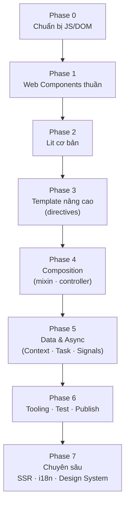

# 00 — Roadmap học Web Components & Lit

> **Mục tiêu:** đi từ zero → tự build được một **UI library / design system** bằng Web Components + [Lit](https://lit.dev), dùng được ở mọi nơi (React, Vue, Shopify theme, vanilla HTML).
>
> **Thời lượng gợi ý:** ~8 tuần (2–5h/tuần). Nén còn ~3 tuần nếu chỉ cần "dùng được".
>
> **Prereq:** JS ES6+ (class, module, arrow fn, destructuring, template literal), DOM API cơ bản, CSS.
>
> Note nền đã có: [[Introduction]] · [[Lit/Introduction|Lit — Introduction]]

---

## 🧭 Mental model — hiểu trong 1 câu

```
Web Components  =  TIÊU CHUẨN của browser (không phải thư viện)
                   → Custom Elements + Shadow DOM + Template/Slot

Lit             =  THƯ VIỆN mỏng (~5KB) ngồi trên tiêu chuẩn đó
                   → thêm: reactive state + template engine + styling tiện
```

👉 Học Lit mà **không hiểu Web Components** = học React mà không hiểu DOM. Chạy thì chạy, nhưng debug sẽ khóc. Nên **Phase 1 bắt buộc là vanilla trước**.



---

## 🟢 Phase 0 — Chuẩn bị (1–2 ngày)

Chỉ cần chắc mấy thứ này, thiếu thì ôn:

- [ ] `class`, `extends`, `super()`, static field, getter/setter
- [ ] ES modules: `import` / `export`, `<script type="module">`
- [ ] Template literal + **tagged template literal** ⭐ (Lit sống bằng cái này)
- [ ] DOM: `querySelector`, `addEventListener`, `CustomEvent`, event bubbling
- [ ] Async: Promise, `async/await`

> 💡 Tagged template literal là chỗ nhiều người bỏ qua, rồi sau đó không hiểu ``html`...` `` thực chất là gì. Dành 15 phút đọc kỹ.

---

## 🔵 Phase 1 — Web Components thuần (tuần 1–2) ⭐ QUAN TRỌNG NHẤT

Không dùng thư viện gì cả. Chỉ 1 file HTML + browser.

### 1.1 Custom Elements
- `class X extends HTMLElement` + `customElements.define('my-x', X)`
- Quy tắc tên: **bắt buộc có dấu gạch ngang** (`my-button` ✅ / `button2` ❌)
- 4 lifecycle callbacks:

| Callback | Khi nào chạy | Dùng để |
| --- | --- | --- |
| `constructor()` | lúc tạo element | set state mặc định (❌ đừng đụng DOM/attribute) |
| `connectedCallback()` | gắn vào DOM | render, đăng ký listener, fetch |
| `disconnectedCallback()` | gỡ khỏi DOM | **cleanup** listener, timer |
| `attributeChangedCallback()` | attribute đổi | sync attribute → property |

- `static observedAttributes = ['label', 'disabled']`
- **Attribute vs Property** ⭐ — attribute là string trong HTML, property là giá trị JS. Hiểu chỗ này = hiểu 50% Web Components
- `:defined` — style element trước khi nó được define (chống nhấp nháy / FOUC)

### 1.2 Shadow DOM
- `this.attachShadow({ mode: 'open' })` vs `'closed'`
- **Style encapsulation**: CSS ngoài không lọt vào, CSS trong không lọt ra
- Cái gì **xuyên qua được** shadow boundary? → CSS custom properties (`--joy-color`), inherited properties (`font`, `color`)
- Cái gì **không** xuyên qua? → class, selector thường
- `getRootNode()`, `Node.isConnected`

### 1.3 Template & Slot
- `<template>` — HTML "ngủ đông", không render; clone bằng `content.cloneNode(true)`
- `<slot>` — chỗ trống nhận content từ ngoài (tương đương `children` của React)
- Named slot: `<slot name="header">` ↔ `<div slot="header">`
- `slotchange` event, `assignedElements()`

### 1.4 Styling từ ngoài vào (đây là "API tạo hình" của component)

| Cách | Cú pháp | Dùng khi |
| --- | --- | --- |
| CSS variables | `--btn-bg: red` | ⭐ cách chính, linh hoạt nhất |
| `::part()` | `<x-btn part="label">` → `x-btn::part(label)` | mở "cửa sổ" style có chủ đích |
| `::slotted()` | `::slotted(span)` | style content người dùng nhét vào |
| `:host`, `:host()`, `:host-context()` | style chính element | biến thể theo attribute |

### 1.5 Events
- `CustomEvent` + `dispatchEvent`
- `bubbles: true`, **`composed: true`** ⭐ — thiếu `composed` là event kẹt trong shadow root
- `event.composedPath()`

### 1.6 Nâng cao (đọc lướt, biết là có)
- `ElementInternals` + **form-associated custom elements** → component tự submit được trong `<form>`
- `CustomStateSet` + CSS `:state()` — state nội bộ nhưng style được từ ngoài
- **Declarative Shadow DOM** (`<template shadowrootmode="open">`) — nền tảng cho SSR
- Constructable Stylesheets (`adoptedStyleSheets`)

### ✅ Checkpoint Phase 1
Tự làm, **không copy-paste**:
1. `<my-counter>` — nút +/−, có attribute `start`, phát event `count-change`
2. `<my-card>` — dùng slot `header` / `body` / `footer`, style qua CSS variable + `::part`
3. Trả lời được: *tại sao CSS ngoài không style được vào trong? cách nào cho phép có chủ đích?*

📖 [MDN Web Components](https://developer.mozilla.org/en-US/docs/Web/API/Web_components) · [web.dev — Custom Elements v1](https://web.dev/articles/custom-elements-v1)

---

## 🟣 Phase 2 — Lit cơ bản (tuần 3)

Setup: `npm create vite@latest` → vanilla-ts, rồi `npm i lit` (Lit 3).

- `LitElement` = `HTMLElement` + reactive + auto render
- `render()` trả về ``html`...` ``
- **Reactive properties**:
  ```js
  static properties = {
    count: { type: Number },
    open:  { type: Boolean, reflect: true },
  };
  ```
  - `type` · `attribute` (đổi tên / tắt) · `reflect` (property → attribute) · `state: true` (internal) · `converter` · `hasChanged`
  - Dùng TypeScript thì có `@property()` / `@state()`
- **Styles**: ``static styles = css`...` `` — share chung cho mọi instance (nhanh)
- **Template syntax** — 5 kiểu binding, học thuộc bảng này:

| Cú pháp | Ý nghĩa | Ví dụ |
| --- | --- | --- |
| `${x}` | text / child | `<p>${this.name}</p>` |
| `attr=${x}` | attribute | `<div id=${this.id}>` |
| `.prop=${x}` | **property** ⭐ | `<input .value=${this.v}>` |
| `?attr=${x}` | boolean attribute | `<button ?disabled=${this.busy}>` |
| `@event=${fn}` | event listener | `<button @click=${this.onClick}>` |

- **Lifecycle của Lit** ⭐:
  ```
  constructor → connectedCallback → willUpdate → update → render
              → firstUpdated → updated → (await this.updateComplete)
  ```
  - `requestUpdate()`, `shouldUpdate()`
  - `firstUpdated()` = chỗ đụng DOM lần đầu (query element con)
- Conditional: ``${cond ? html`...` : html`...`}`` · List: `${items.map(...)}`, dùng **`repeat()`** khi cần key
- `createRenderRoot()` — cách tắt Shadow DOM nếu muốn xài Tailwind global

### ✅ Checkpoint Phase 2
Viết lại `<my-counter>` và `<my-card>` bằng Lit → đếm số dòng, so với Phase 1.

📖 [lit.dev/docs/components](https://lit.dev/docs/components/overview/) · [lit.dev/tutorials](https://lit.dev/tutorials/) ← **làm hết tutorial này**

---

## 🟠 Phase 3 — Template nâng cao & Directives (tuần 4)

Built-in directives — biết khi nào dùng cái nào:

| Directive | Dùng để |
| --- | --- |
| `repeat()` | list có key, giữ nguyên DOM khi reorder |
| `map()`, `range()`, `join()` | lặp gọn |
| `classMap()`, `styleMap()` | bind class / style động ⭐ |
| `ifDefined()` | bỏ hẳn attribute khi value `undefined` |
| `when()`, `choose()` | conditional gọn |
| `cache()` | giữ DOM khi switch qua lại giữa 2 template |
| `guard()` | chặn re-render khi dependency không đổi (perf) |
| `live()` | ép sync với DOM thật (input) |
| `ref()` | lấy reference tới element |
| `until()`, `asyncAppend()` | render giá trị async |
| `unsafeHTML()` | ⚠️ render HTML thô — nhớ sanitize |

- **Custom directive**: `directive()`, `Directive`, `AsyncDirective` (nắm khái niệm là đủ)
- `static-html` (`literal`) — khi cần đổi tag name động
- Hiểu **vì sao lit-html nhanh**: template được cache theo *strings array*, mỗi lần render chỉ update đúng phần `${}` thay đổi

---

## 🟡 Phase 4 — Composition (tuần 5)

Đây là chỗ tách "biết dùng Lit" ↔ "biết **thiết kế** component".

- **Component composition** — chia nhỏ, giao tiếp: property đi xuống, event đi lên
- **Mixins** — `const Foo = (Base) => class extends Base { ... }` → tái dùng behavior (vd `ClickOutsideMixin`)
- **Reactive Controllers** ⭐ — pattern hay nhất của Lit, tương đương "custom hook" của React:
  ```js
  class ClockController {
    hostConnected() { /* start timer */ }
    hostDisconnected() { /* cleanup */ }
  }
  ```
  - `addController()`, `hostUpdate`, `hostUpdated`
  - Tách logic (timer, fetch, ResizeObserver, media query) ra khỏi component

> So sánh nhanh: **Mixin** = thêm API vào class · **Controller** = đóng gói state + lifecycle, không đụng API của class. Mặc định nên ưu tiên **Controller**.

---

## 🔴 Phase 5 — Quản lý data (tuần 6)

- **`@lit/context`** — DI / provide–inject, thay cho prop drilling (giống React Context)
  - `createContext()`, `@provide()`, `@consume()` — hợp cho theme, i18n, store
- **`@lit/task`** — quản lý async: state `pending / complete / error`, tự re-run khi args đổi
- **Signals (Labs)** — `@lit-labs/signals` (tích hợp TC39 Signals Proposal) và `@lit-labs/preact-signals`
  - ⚠️ Labs = có thể breaking change / ngừng support → cân nhắc trước khi lên production
- State ngoài (Redux / Zustand / Nanostores): subscribe bằng một Reactive Controller

---

## ⚫ Phase 6 — Tooling · Testing · Publishing (tuần 7)

- **Dev server**: Vite (nhanh, quen) hoặc `@web/dev-server` (chuẩn Lit, no-bundle)
- **TypeScript**: bật decorators, và ⚠️ `"useDefineForClassFields": false` — bẫy kinh điển làm mất reactivity
- **Testing**: `@web/test-runner` + `@open-wc/testing` — chạy trong browser thật, không dùng jsdom
  - Luôn `await el.updateComplete` trước khi assert ⭐
- **Lint**: `eslint-plugin-lit`, `lit-analyzer` (check template ngay trong IDE)
- **Custom Elements Manifest** (`custom-elements.json`) → sinh docs + autocomplete cho VSCode
- **Publish npm**: build ESM, không bundle dependency, `"type": "module"`, `"exports"` map, khai báo `"customElements"` trong `package.json`
- **Production**: `@lit-labs/compiler` (compile template), lazy-load component, đặt budget bundle size

---

## 🟤 Phase 7 — Chuyên sâu (tuần 8+, chọn hướng bạn cần)

| Hướng | Nội dung |
| --- | --- |
| **Design System** ⭐ | token → primitive → component → pattern (liên kết với `5 - Design System` trong vault) |
| **SSR** (Labs) | `@lit-labs/ssr` + Declarative Shadow DOM, hydration |
| **Framework interop** | `@lit/react` (wrapper cho React), dùng trong Vue / Angular / Svelte |
| **Localization** | `@lit/localize` — runtime mode vs transform mode |
| **A11y** | focus trap, `delegatesFocus`, ARIA xuyên shadow DOM (phần khó nhất!) |
| **Performance** | `guard()`, `cache()`, lazy define, đo bundle size |

---

## 🛠 Dự án thực chiến (làm song song với các phase)

1. **`<joy-button>`** (sau Phase 2) — variant, size, loading, disabled, icon slot
2. **`<joy-modal>`** (sau Phase 4) — focus trap, ESC để đóng, click-outside (dùng controller), a11y
3. **`<joy-data-table>`** (sau Phase 5) — fetch bằng `@lit/task`, sort/filter, `repeat()`, pagination
4. **Mini design system** (sau Phase 6) — 8–10 component + token + docs + publish npm
5. **Nhúng vào project thật** — dùng trong Shopify theme / React app để thấy đúng giá trị "framework-agnostic"

---

## ⚠️ Bẫy thường gặp (đọc trước, đỡ mất một buổi tối)

1. **Sửa object/array mà không re-render** → Lit so sánh `===`. Phải tạo mới: `this.items = [...this.items, x]`
2. Đụng DOM trong `constructor()` → chuyển sang `firstUpdated()`
3. Quên `composed: true` → event không thoát khỏi shadow root
4. Quên cleanup trong `disconnectedCallback()` → memory leak
5. `useDefineForClassFields: true` trong TS → class field ghi đè accessor, mất reactivity
6. `reflect: true` cho object → ra `[object Object]` trong attribute
7. Tailwind + Shadow DOM không ăn → dùng CSS variable, hoặc tắt shadow (`createRenderRoot`), hoặc inject stylesheet vào shadow root
8. Test assert trước khi `await el.updateComplete` → flaky

---

## 📚 Tài nguyên

**Chính thức**
- [lit.dev/docs](https://lit.dev/docs/) — docs Lit 3
- [lit.dev/tutorials](https://lit.dev/tutorials/) ⭐ interactive, làm hết
- [lit.dev/playground](https://lit.dev/playground/) — thử nhanh, không cần setup
- [MDN — Web Components](https://developer.mozilla.org/en-US/docs/Web/API/Web_components)

**Cộng đồng / đọc source thật**
- [Open WC](https://open-wc.org) — best practice, testing, linting
- [Shoelace](https://shoelace.style) — design system viết bằng Lit, source rất đáng đọc
- [Material Web](https://github.com/material-components/material-web) — Google, Lit
- [Spectrum Web Components](https://opensource.adobe.com/spectrum-web-components/) — Adobe
- [custom-elements-everywhere.com](https://custom-elements-everywhere.com) — độ tương thích với từng framework

---

## ✅ Checklist tự đánh giá

- [ ] Giải thích được Custom Elements / Shadow DOM / Template mà không nhìn note
- [ ] Phân biệt attribute vs property, biết khi nào cần `reflect`
- [ ] Style được component từ ngoài bằng 3 cách (CSS var, `::part`, `::slotted`)
- [ ] Vẽ được lifecycle Lit từ `constructor` → `updated`
- [ ] Biết khi nào dùng `repeat()` thay vì `.map()`
- [ ] Viết được 1 Reactive Controller tự chế
- [ ] Dùng được `@lit/task` cho 1 màn hình fetch data
- [ ] Test được component bằng `@web/test-runner`
- [ ] Publish được 1 package lên npm và dùng lại ở project khác
