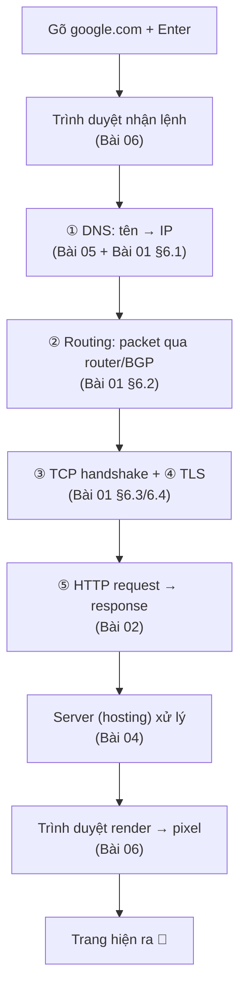

# 00 — TỔNG HỢP: Internet Fundamentals (bài 01–06)

> Bản đồ tổng quan nhóm "Internet" của [Road to Backend Developer](https://roadmap.sh/backend). Nối 6 bài thành **1 câu chuyện duy nhất**: *gõ `google.com` → thấy trang*.
>
> 📖 Thuật ngữ: [[Glossary - Networking]].

## 🎯 Bức tranh lớn — cả 6 bài là 1 hành trình

Mọi thứ bạn học đều nằm trong **1 luồng**: từ lúc gõ URL → tới lúc trang hiện ra. Mỗi bài lo 1 chặng:

**Câu thần chú:** *Tên → Địa chỉ → Đường đi → Bắt tay → Hỏi/Đáp → Dựng hình.*

---

## 📚 Tóm tắt từng bài (1 câu + điểm cốt lõi)

### [[01 - How does the internet work]] — Internet hoạt động thế nào
> Internet = **"mạng của các mạng"**, không có trung tâm. Máy tính nối nhau bằng dây/sóng thật.
- **Xây từ nhỏ:** 2 máy → **switch** (trong LAN) → **router** (nối các mạng) → **ISP** → Internet.
- **Địa chỉ:** MAC (nội bộ) / **IP** (toàn cầu) / Port (dịch vụ). Dữ liệu cắt thành **packet** (MTU ~1500B).
- **TCP/IP 4 tầng:** Application → Transport (TCP/UDP) → Internet (IP) → Link. Mỗi tầng 1 chuẩn = **protocol stack**.
- **TCP** = bắt tay 3 bước (SYN→SYN-ACK→ACK), đáng tin; **UDP** = nhanh, không đảm bảo.
- **§6 kinh điển:** DNS → Routing (BGP) → TCP → **TLS (public/private key)** → HTTP → render.

### [[02 - What is HTTP]] — HTTP là gì
> HTTP = **bộ luật client "hỏi" (request) & server "đáp" (response)**. Ở tầng 4, chạy trên TCP.
- **Request:** method + path + headers + body. **Methods:** GET/POST/PUT/PATCH/DELETE (+ safe, idempotent).
- **Response:** status code (2xx ok / 3xx chuyển / 4xx lỗi client / 5xx lỗi server) + body.
- **STATELESS** ⭐ — server không nhớ; dùng **cookie/token** để "nhớ". → dễ scale (Cloud Run).
- **Version:** 1.1 (keep-alive) → 2 (multiplexing) → 3 (QUIC/UDP). Handshake **1 lần/connection**.

### [[03 - What is Domain Name]] — Tên miền
> Domain = **tên dễ nhớ** thay cho IP. Đọc **phải→trái**: subdomain.SLD.TLD.
- **Cấu trúc:** Root → **TLD** (`.com`/`.vn`) → **SLD** (tên bạn mua) → **subdomain** (tự tạo, miễn phí).
- **1 domain → cây subdomain vô hạn** (giới hạn thật ở server + cert đằng sau).
- **"Mua" = THUÊ** theo năm. Quản: ICANN → Registry → Registrar → bạn.
- **Domain vs IP vs DNS vs URL** — domain chỉ là 1 mảnh của URL.

### [[04 - What is Hosting]] — Hosting
> Hosting = **thuê máy chủ 24/7 đặt file/code**, có IP công khai cho cả thế giới vào.
- **Không host ở nhà:** IP động (DHCP) + bị **NAT** → server "vô hình".
- **IPv4 vs IPv6:** dual-stack; **A record = v4, AAAA = v6**.
- **Loại:** Shared → VPS → Dedicated → **Cloud/Serverless** (Cloud Run: auto-scale, không quản server).
- **Cloud IP:** client thấy **GFE anycast (ổn định)**; backend đổi liên tục nhưng ẩn.

### [[05 - DNS and how it works]] — DNS chi tiết
> DNS = **danh bạ** dịch tên → IP. Cây phân cấp + cache.
- **Records:** **A** (IPv4), **AAAA** (IPv6), **CNAME** (bí danh → tên khác), **MX** (mail), **TXT** (xác minh), **NS**.
- **CNAME:** trỏ tới TÊN (cloud/SaaS) để nhà cung cấp tự quản IP — chỉ cho subdomain.
- **TTL** = cache bao lâu; **Propagation** = đổi DNS phải chờ hết TTL cũ.
- **Record do CHỦ DOMAIN đặt** ở authoritative, máy chỉ đọc.

### [[06 - Browsers and how they work]] — Trình duyệt
> Trình duyệt = **CLIENT**: lấy dữ liệu (networking) + **dựng trang (render)**.
- **7 thành phần:** UI → Browser Engine → Networking → **Rendering Engine** (Blink/WebKit/Gecko) → UI Backend → **JS Engine (V8)** → Data Storage.
- **Quy trình (MDN):** Navigation → Response → **Parsing** (DOM+CSSOM) → **Render** (Style→Layout→Paint→Composite) → Interactivity.
- **Code → pixel:** rasterization = điền màu RGB vào từng pixel (như tranh tô số).
- **V8:** Parse→AST→Ignition (bytecode)→TurboFan (JIT). Cũng là nền **Node.js**.

---

## 🧠 Bảng tra nhanh — khái niệm hay lẫn

| Cặp dễ lẫn | Khác nhau |
|---|---|
| **Internet vs Web** | Internet = hạ tầng; Web = 1 dịch vụ (HTTP) chạy trên đó |
| **Switch vs Router** | Switch: trong 1 LAN; Router: giữa các mạng |
| **MAC vs IP vs Port** | MAC: nội bộ (phần cứng); IP: toàn cầu; Port: dịch vụ trên máy |
| **TCP vs UDP** | TCP: chắc chắn (bắt tay, gửi lại); UDP: nhanh, không đảm bảo |
| **Domain vs IP vs DNS vs URL** | Tên / địa chỉ số / dịch vụ dịch / địa chỉ đầy đủ |
| **A vs CNAME** | A → IP số; CNAME → tên khác (bí danh) |
| **Recursive vs Iterative** | Máy↔resolver (giao trọn); resolver↔tầng (tự đi từng bước) |
| **Rendering Engine vs JS Engine** | Blink (HTML/CSS→hình) vs V8 (chạy JS) |
| **Stateless vs keep-alive** | HTTP quên danh tính (tầng 4); TCP giữ ống mở (tầng 3) — 2 tầng khác |
| **"UI Backend" vs backend server** | Lớp vẽ widget phía sau UI ≠ server (2 nghĩa "backend") |

---

## 💼 Gom lại — liên hệ công việc (Shopify + Firebase/GCP)

- **App Shopify** = client chạy trong trình duyệt merchant (render bằng Blink/WebKit).
- **Backend (Cloud Run)** = "hosting" serverless nhận HTTP request/webhook, trả JSON. Stateless → auto-scale.
- **Domain:** gắn custom domain bằng **A record** (gốc) / **CNAME** (subdomain `api.` → `ghs.googlehosted.com`).
- **HTTPS bắt buộc** (TLS handshake) cho webhook Shopify.
- **DNS:** đổi record phải chờ propagation; hạ TTL trước khi đổi IP.
- **V8:** backend Node.js của bạn chạy trên cùng động cơ với Chrome.

---

## ✅ Tự kiểm tra tổng (trả lời được là nắm chắc cả nhóm)

1. Kể **7 bước** từ gõ `google.com` → thấy trang (mỗi bước thuộc bài nào?).
2. Internet có trung tâm không? Vì sao không host web ở nhà?
3. TCP khác UDP? Vì sao bắt tay 3 bước (không phải 2)?
4. HTTP stateless nghĩa là gì → vì sao tốt cho scale?
5. Domain / IP / DNS / URL — mỗi cái vai trò gì?
6. A record vs CNAME — khi nào dùng cái nào?
7. TTL & propagation — vì sao đổi DNS không ăn ngay?
8. TLS trao đổi khóa thế nào mà kẻ nghe lén không lấy được chìa?
9. Code (HTML/CSS) biến thành pixel qua các bước nào?
10. Recursive vs iterative trong DNS khác gì?

---

## 🔗 Điều hướng
- [[01 - How does the internet work]]
- [[02 - What is HTTP]]
- [[03 - What is Domain Name]]
- [[04 - What is Hosting]]
- [[05 - DNS and how it works]]
- [[06 - Browsers and how they work]]
- [[Glossary - Networking]]

---

## Nguồn chính (đã dùng xuyên suốt)
- [MDN Web Docs](https://developer.mozilla.org/) — HTTP, browsers, domain name
- [Cloudflare Learning Center](https://www.cloudflare.com/learning/) — DNS, records, TTL
- [roadmap.sh — Backend](https://roadmap.sh/backend)
- [web.dev](https://web.dev/) — how browsers work, critical rendering path
