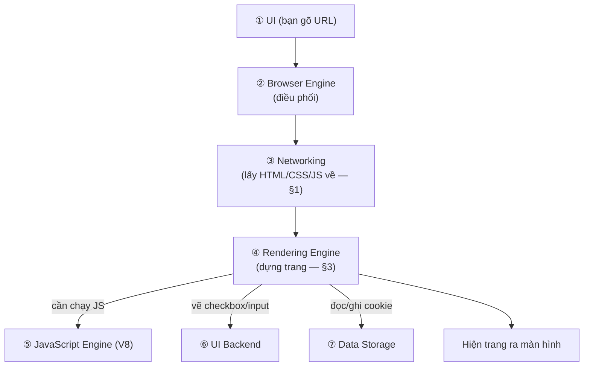
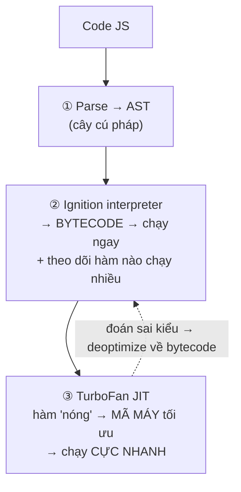
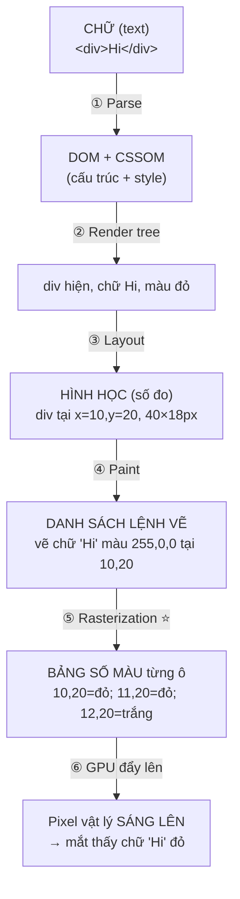

# 06 — Browsers và cách chúng hoạt động

> Bài 6 (cuối nhóm Internet) series [Road to Backend Developer](https://roadmap.sh/backend). Nối tiếp [[01 - How does the internet work]] → [[05 - DNS and how it works]].
>
> 📖 Thuật ngữ: [[Glossary - Networking]].

## 0. Một câu để nhớ

> **Trình duyệt (browser)** = **ứng dụng CLIENT** lo toàn bộ: tìm địa chỉ (DNS) → mở kết nối (TCP/TLS) → gửi HTTP request → nhận HTML/CSS/JS → **DỰNG thành trang nhìn được + tương tác được (render)**.

Nhớ [[01 - How does the internet work#6. Ráp lại: gõ `google.com` + Enter thì sao? (câu phỏng vấn kinh điển)|bài 01 §6]]: mọi bước "gõ google.com → hiện trang" đều do **trình duyệt** thực thi. Nó là **hiện thân rõ nhất của "client"** trong mô hình client–server.

---

## 1. Trình duyệt làm gì? (2 nửa)

**Nửa 1 — Lấy dữ liệu (networking):** làm hết những gì học ở bài 01–05:
DNS lookup → TCP + TLS handshake → gửi HTTP request → nhận response (HTML/CSS/JS).

**Nửa 2 — Dựng trang (rendering):** ⭐ việc **đặc trưng nhất** — biến **code thô** (HTML/CSS/JS) thành **trang đẹp bấm được**. Đây là phần khác biệt: server chỉ trả code, **trình duyệt mới "vẽ" ra hình.**

---

## 2. Các thành phần bên trong trình duyệt

> Nguồn: [MDN — How browsers work](https://developer.mozilla.org/en-US/docs/Web/Performance/Guides/How_browsers_work), [BrowserStack](https://www.browserstack.com/guide/browser-rendering-engine).

### Vai trò từng thành phần (ví như một nhà hàng 🍽️)

| Thành phần | Vai trò (1 câu) | Ví như nhà hàng |
|---|---|---|
| **1. User Interface (UI)** | Phần bạn **nhìn & bấm**: thanh địa chỉ, nút back, tab (KHÔNG gồm vùng hiển thị web) | **Quầy order** — nơi khách gọi món |
| **2. Browser Engine** | **Nhạc trưởng** — nhận lệnh từ UI, điều phối rendering engine | **Quản lý** — nhận order, sai bảo bếp |
| **3. Networking** | **Đi lấy dữ liệu** về: DNS → TCP/TLS → HTTP (nửa 1, §1) | **Người đi chợ** — mang nguyên liệu (HTML/CSS/JS) về |
| **4. Rendering Engine** ⭐ | **Bếp chính** — biến HTML/CSS thành hình vẽ trên màn hình | **Đầu bếp** — nấu nguyên liệu thành món |
| **5. JavaScript Engine** | **Chạy code JS** → làm trang tương tác (Chrome: **V8**) | **Phụ bếp chuyên** — làm phần "sống động" của món |
| **6. UI Backend** | **Vẽ widget cơ bản** (ô input, checkbox, cửa sổ) theo hệ điều hành | **Bộ đồ bày biện** chuẩn của quán |
| **7. Data Storage** | **Lưu trữ**: cookie, cache, localStorage | **Kho** — giữ đồ dùng lại lần sau |

### Có theo thứ tự không? → CÓ, chúng "chuyền tay" nhau



**Đọc thứ tự:** UI nhận lệnh → Browser Engine điều phối → Networking lấy dữ liệu → Rendering Engine dựng trang (gọi JS Engine chạy code, UI Backend vẽ widget, Data Storage lưu/đọc) → hiện ra màn hình.

→ Không phải chạy tuần tự cứng nhắc — Rendering Engine **vừa dựng vừa gọi** JS/Networking khi cần (vd JS tải thêm dữ liệu giữa chừng — nhớ [[02 - What is HTTP|request bài 02]]).

> Chi tiết đủ **cả 7 thành phần theo đúng thứ tự** (nguồn: [web.dev — How browsers work / Tali Garsiel](https://web.dev/articles/howbrowserswork)):

### 2.1. User Interface (UI) — phần bạn nhìn & bấm
- **Làm gì:** hiển thị mọi thứ **quanh** trang web: thanh địa chỉ, nút back/forward, refresh/stop, bookmark, tab. **KHÔNG gồm vùng hiển thị nội dung web** (cái đó do Rendering Engine vẽ).
- **Thực hiện:** nhận thao tác của bạn (gõ URL, bấm nút) → **chuyển lệnh cho Browser Engine**.

### 2.2. Browser Engine — nhạc trưởng điều phối
- **Làm gì:** **cầu nối** giữa UI và Rendering Engine — nhận lệnh từ UI (vd "tải trang này") rồi **ra lệnh + điều khiển** Rendering Engine làm việc.
- **Thực hiện:** *"queries and manipulates the rendering engine"* — không tự vẽ, chỉ **điều phối**.

### 2.3. Networking — đi lấy dữ liệu
- **Làm gì:** thực hiện các **cuộc gọi mạng** (HTTP/HTTPS request) để tải HTML/CSS/JS/ảnh về (đây là "nửa 1" ở §1, nối [[01 - How does the internet work|bài 01]]).
- **Thực hiện:** DNS lookup → TCP/TLS handshake → gửi HTTP request → nhận response. *"using different implementations for different platforms behind a platform-independent interface."*

### 2.4. Rendering Engine ⭐ — biến code → hình
- **Làm gì:** *"parses HTML and CSS, and displays the parsed content on the screen."* Đây là bộ phận **quan trọng nhất**.
- **Tên theo hãng:** Chrome/Edge = **Blink**, Safari = **WebKit**, Firefox = **Gecko** → lý do web hiển thị hơi khác giữa các trình duyệt.
- **Thực hiện (các bước con):**
  1. **Parse HTML → tokenize:** cắt HTML thành **token** (thẻ mở/đóng, thuộc tính).
  2. **Tree construction:** token → **node** → nối thành **cây DOM**.
  3. **Parse CSS → CSSOM:** song song, dựng cây style.
  4. **Render tree:** ghép DOM + CSSOM → giữ **node SẼ hiện**.
  5. **Layout → Paint → Composite:** tính vị trí → tô pixel → ghép lớp.
  → Chi tiết đủ ở [[#3. Quy trình đầy đủ — ĐÚNG THỨ TỰ MDN (kèm trích nguyên văn) ⭐|§3]].

### 2.5. UI Backend — vẽ widget cơ bản
- **Làm gì:** *"used for drawing basic widgets like combo boxes and windows."* Vẽ các thành phần giao diện **cơ bản** (ô input, checkbox, dropdown, cửa sổ...).
- **Thực hiện:** *"exposes a generic interface that is not platform specific. Underneath it uses operating system user interface methods."* → dùng **API vẽ của hệ điều hành** bên dưới (nên checkbox trên Mac trông khác Windows).

### 2.6. JavaScript Interpreter (Engine) — chạy JS
- **Làm gì:** *"used to parse and execute JavaScript code."* Làm trang **tương tác** (bấm, cuộn, gọi API...). Chrome dùng **V8** — cũng là nền của **Node.js**, nên **backend JS bạn viết chạy trên V8**.
- **Thực hiện (V8 — đơn giản hóa):**

  1. **Parse → AST:** cắt code → **cây cú pháp (AST)**.
  2. **Ignition (interpreter):** AST → **bytecode** chạy ngay + theo dõi hàm "hot".
  3. **TurboFan (JIT):** hàm nóng → **mã máy tối ưu** → nhanh gần code biên dịch sẵn.
- **Nhớ:** JS **single-threaded** (1 luồng) — nhờ **event loop** xử lý async không đơ (học sâu ở bài async).

### 2.7. Data Storage (Persistence) — lưu trữ cục bộ
- **Làm gì:** *"a persistence layer. The browser may need to save all sorts of data locally, such as cookies."* Lưu dữ liệu trên máy.
- **Thực hiện:** *"Browsers also support storage mechanisms such as localStorage, IndexedDB, WebSQL and FileSystem."* — cookie (giữ token/session, nhớ [[02 - What is HTTP#5. HTTP là STATELESS (không nhớ) — điểm CỐT LÕI ⭐|stateless bài 02]]), cache, localStorage, IndexedDB (DB nhỏ trong trình duyệt).

---

## 3. Quy trình đầy đủ — ĐÚNG THỨ TỰ MDN (kèm trích nguyên văn) ⭐

> Nguồn: [MDN — Populating the page: how browsers work](https://developer.mozilla.org/en-US/docs/Web/Performance/Guides/How_browsers_work). Trích *nguyên văn tiếng Anh* của MDN cho từng bước.

MDN chia quy trình thành **5 giai đoạn theo đúng thứ tự:** Navigation → Response → Parsing → Render → Interactivity.

```
① NAVIGATION → ② RESPONSE → ③ PARSING → ④ RENDER → ⑤ INTERACTIVITY
   (DNS/TCP/TLS)  (nhận HTML)  (DOM/CSSOM)  (Style/Layout/Paint/Composite)  (chạy được)
```

### ① Navigation — bắt đầu tải trang
> *"Navigation is the first step in loading a web page. It occurs whenever a user requests a page by entering a URL into the address bar, clicking a link, submitting a form..."*

Gồm 3 bước con (đã học kỹ ở [[01 - How does the internet work#6. Ráp lại: gõ `google.com` + Enter thì sao? (câu phỏng vấn kinh điển)|bài 01 §6]]):
- **DNS Lookup:** *"Your browser requests a DNS lookup... which in turn responds with an IP address."*
- **TCP Handshake:** *"the browser sets up a connection to the server via a TCP three-way handshake... "SYN, SYN-ACK, ACK"."*
- **TLS Negotiation:** *"determines which cipher will be used to encrypt the communication, verifies the server, and establishes that a secure connection is in place before beginning the actual transfer of data."*

### ② Response — nhận HTML về
> *"Once we have an established connection to a web server, the browser sends an initial HTTP `GET` request on behalf of the user, which for websites is most often an HTML file."*

- **TTFB (Time to First Byte):** *"the time between when the user made the request... and the receipt of this first packet of HTML."*

### ③ Parsing — biến bytes → DOM + CSSOM
> *"Parsing is the step the browser takes to turn the data it receives over the network into the DOM and CSSOM, which is used by the renderer to paint a page to the screen."*

- **Building the DOM tree:** *"The first step is processing the HTML markup and building the DOM tree. HTML parsing involves tokenization and tree construction."* → cắt HTML thành **token** → dựng **cây DOM**.
- **Preload scanner:** *"the preload scanner will parse through the content available and request high-priority resources like CSS, JavaScript, and web fonts."* → tải trước tài nguyên quan trọng cho nhanh.
- **Building the CSSOM tree:** *"The browser goes through each rule set in the CSS, creating a tree of nodes with parent, child, and sibling relationships based on the CSS selectors."*
- **JavaScript compilation:** *"JavaScript is parsed, compiled, and interpreted."* (chi tiết cách V8 làm ở [[#2.2. JavaScript Engine — chi tiết (chạy JS, vd V8)|§2.2]]).
- **Accessibility tree:** *"The browser also builds an accessibility tree that assistive devices use to parse and interpret content."*

### ④ Render — biến DOM/CSSOM → pixel
> *"Rendering steps include style, layout, paint, and in some cases compositing."*

- **Style (Render tree):** *"combining the DOM and CSSOM into a render tree... traversing each visible node."* → chỉ giữ node SẼ hiện.
- **Layout:** *"the process by which the dimensions and location of all the nodes in the render tree are determined."* Lần đầu = *layout*; tính lại = *"reflows"*.
- **Paint:** *"the browser converts each box calculated in the layout phase to actual pixels on the screen."*
- **Compositing:** *"When sections of the document are drawn in different layers... compositing is necessary to ensure they are drawn to the screen in the right order."*

### ⑤ Interactivity — trang bấm/cuộn được
> *"Once the main thread is done painting the page... If the load includes JavaScript... the main thread might be busy, and not available for scrolling, touch, and other interactions."*

- **TTI (Time to Interactive):** *"how long it took from that first request... to when the page is interactive."*

> 🔑 **Nhớ thứ tự:** **Navigation** (lấy địa chỉ + kết nối) → **Response** (nhận HTML) → **Parsing** (dựng DOM + CSSOM) → **Render** (Style → Layout → Paint → Composite) → **Interactivity** (chạy JS xong, bấm được). Các mục con trong Render (Style/Layout/Paint/Composite) chính là **Critical Rendering Path**.

### 3.1. Điểm quan trọng: CSS & JS "chặn render"
- **CSS render-blocking:** trình duyệt **chờ tải + xử lý XONG CSS** mới vẽ (vì style có thể bị ghi đè, vẽ sớm sẽ sai). → CSS nặng = trang trắng lâu.
- **JS có thể block:** thẻ `<script>` mặc định **dừng dựng DOM** để chạy JS trước. → JS chặn đầu trang làm trang hiện chậm (nên hay để `<script>` cuối, hoặc dùng `async`/`defer`).
- → Đây là gốc của **tối ưu tốc độ web (web performance):** giảm thứ chặn render ở đường tới hạn (critical path).

### 3.2. Code biến thành HÌNH bằng cách nào? (raster hóa) ⭐

Câu cốt lõi: làm sao **chữ (code) → hình ảnh**? Trả lời: **không phải phép màu, mà là chuỗi biến đổi dữ liệu, kết thúc bằng "điền màu vào từng pixel".**

**Trước hết — màn hình thực chất là gì?** Màn hình = **lưới các ô PIXEL** (vd 1920×1080 ≈ 2 triệu ô). **Mỗi pixel chỉ sáng được 1 MÀU** = 3 số **R,G,B** (0–255): `(255,0,0)`=đỏ, `(0,0,0)`=đen. → Nên **"vẽ hình" = quyết định mỗi pixel màu gì**; cả bức hình chỉ là **một bảng số màu khổng lồ**.

**Hành trình code → pixel** (ví dụ `<div style="color:red">Hi</div>`):


**Bước ⑤ Rasterization** (chỗ "màu nhiệm") = biến **lệnh vẽ → pixel**:
- Máy lấy từng lệnh, tính shape đó **phủ lên NHỮNG pixel nào** + mỗi pixel **màu gì** → **ghi số màu vào đúng ô** (ngoài shape để trống).
- Vd chữ H: font chứa **hình dạng chữ H** → tính pixel tạo nét H → tô `(255,0,0)` vào đó.
- Kết quả = **bitmap** (bảng số màu) = "hình" ở dạng số. ("raster" = lưới/quét — quét từng ô điền màu.)
- **Chữ** = hình dạng từ font → raster; **ảnh JPG/PNG** = vốn đã là bảng pixel → copy thẳng.

> **Ví đời sống — TRANH TÔ THEO SỐ 🧵:** màn hình = lưới ô; paint records = bản hướng dẫn "ô (10,20) tô đỏ..."; rasterizer = người tô từng ô theo số. Không ai "vẽ tự do" — chỉ **điền màu vào từng ô theo chỉ dẫn**, máy làm nhanh gấp triệu lần.

> 🔑 **Chốt:** "Code → hình" = biến đổi dữ liệu từng bước: text → DOM/CSSOM → render tree → **layout** (số đo) → **paint** (lệnh vẽ) → **rasterization** (điền màu vào từng pixel) → **GPU** đẩy lên → pixel sáng. Mấu chốt: **màn hình chỉ là lưới pixel, mỗi pixel 1 màu RGB** → "vẽ" thực chất là **điền màu vào ô**, không có phép màu.

---

## 4. Liên hệ công việc: Shopify + Firebase 💼

- **App Shopify của bạn CHẠY trong trình duyệt của merchant.** HTML/CSS/JS bạn viết được **rendering engine của họ** dựng (mục 3). Bug hiển thị khác nhau giữa Chrome/Safari = do **Blink vs WebKit** (mục 2).
- **Backend bạn (Cloud Run) chỉ trả JSON/HTML** — còn "vẽ ra" là việc trình duyệt. Đúng ranh giới client–server ([[01 - How does the internet work#4. Client – Server: mô hình chạy trên Internet|bài 01 §4]]).
- **Critical Rendering Path = hiệu năng app:** app Shopify tải chậm (CSS/JS nặng chặn render) → merchant khó chịu, điểm app thấp. Tối ưu CRP (giảm block, lazy-load) là việc thật.
- **V8:** JS engine của Chrome cũng là nền **Node.js** — bạn viết backend Node là chạy trên V8. Cùng 1 "động cơ", 2 chỗ dùng (trình duyệt + server).
- **Data storage:** cookie/localStorage trình duyệt giữ chính là chỗ lưu **token/session** (nhớ [[02 - What is HTTP#5. HTTP là STATELESS (không nhớ) — điểm CỐT LÕI ⭐|stateless bài 02]] — client tự mang danh tính mỗi request).

---

## 5. Tự kiểm tra

1. Trình duyệt đóng vai gì trong mô hình client–server? Nó làm mấy nửa việc?
2. Kể các bước Critical Rendering Path (HTML → ? → ? → ... → màn hình).
3. DOM là gì? CSSOM là gì? Render tree khác DOM chỗ nào?
4. Vì sao CSS "render-blocking"? Vì sao hay để `<script>` cuối trang?
5. Rendering engine của Chrome/Safari/Firefox tên gì? Vì sao web hiển thị hơi khác nhau?
6. V8 là gì, liên quan gì tới Node.js?

Xem tận mắt:
```
Chrome DevTools (F12):
 - Elements  → xem DOM tree thật
 - Network   → xem từng request (DNS/TCP/TLS/HTTP — bài 01)
 - Performance → xem Layout/Paint (rendering)
```

---

**Hết nhóm "Internet cơ bản"** (bài 01–06). Bài tiếp theo trong roadmap: *nhóm ngôn ngữ / OS / cách web server hoạt động sâu hơn.*

---

## Nguồn tham khảo
- [MDN — Populating the page: how browsers work](https://developer.mozilla.org/en-US/docs/Web/Performance/Guides/How_browsers_work) (nguồn chính)
- [web.dev — Understanding the critical path](https://web.dev/learn/performance/understanding-the-critical-path)
- [BrowserStack — Browser rendering engine](https://www.browserstack.com/guide/browser-rendering-engine)
- [roadmap.sh — Backend Developer Roadmap](https://roadmap.sh/backend)
