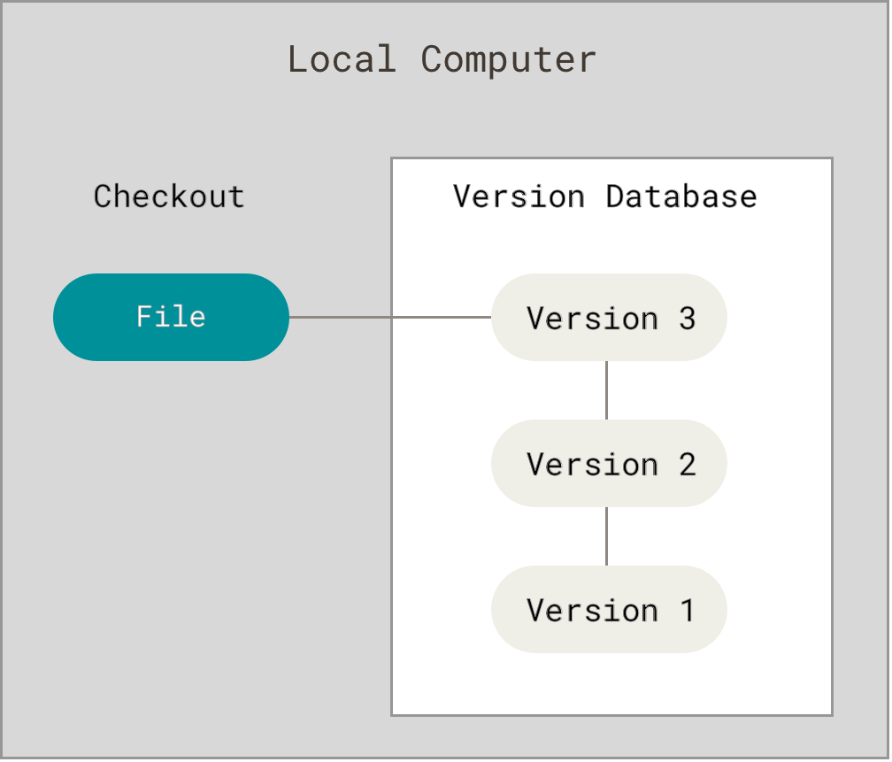
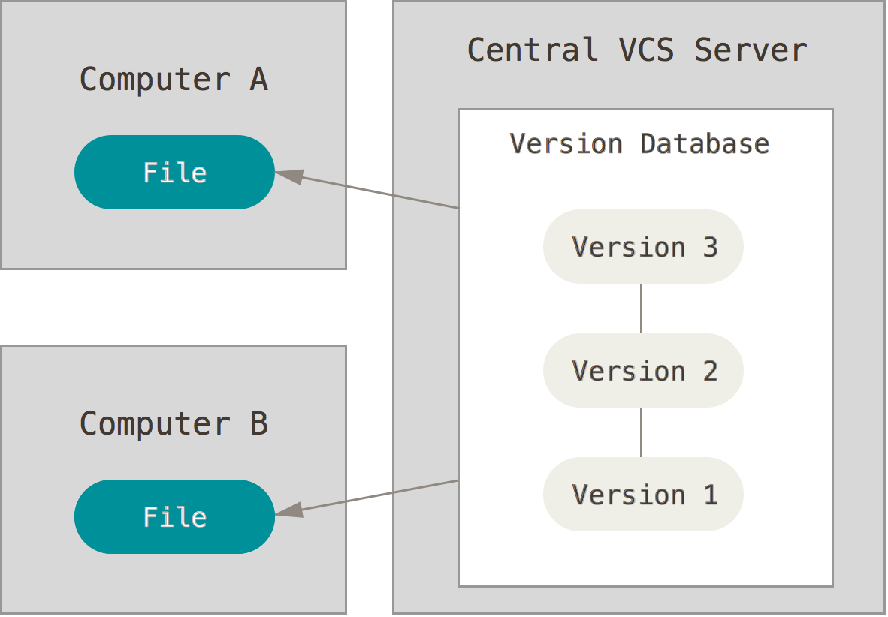
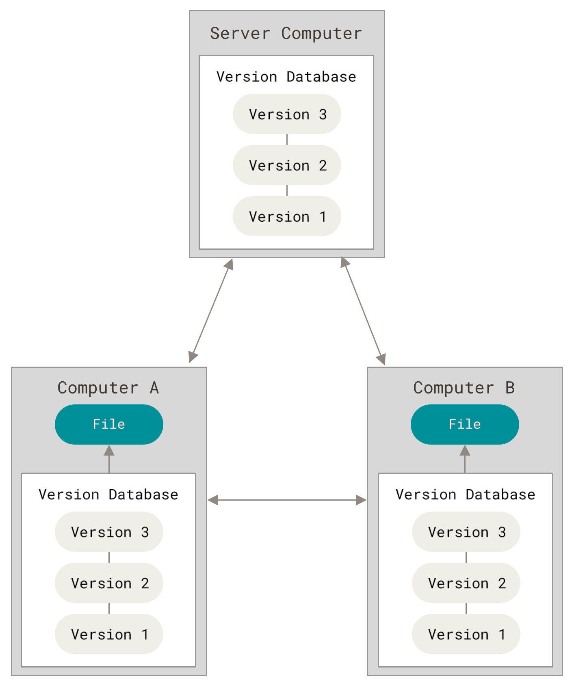

# 01 — About Version Control

> **Nguồn chính (chính thống):** Pro Git, 2nd Edition — Scott Chacon & Ben Straub, sách chính thức của dự án Git, xuất bản tại [git-scm.com/book](https://git-scm.com/book/en/v2).
> Bài này bám **§1.1 Getting Started — About Version Control**: <https://git-scm.com/book/en/v2/Getting-Started-About-Version-Control>
>
> Cách đọc: phần **📖 Nguyên văn** là trích nguyên từ sách, phần **🇻🇳 Dịch & giải thích** là của mình.

---

## Version control là gì

📖 **Nguyên văn**
> "What is “version control”, and why should you care?
> Version control is a system that records changes to a file or set of files over time so that you can recall specific versions later."

🇻🇳 **Dịch**
> "“Version control” là gì, và tại sao bạn phải quan tâm?
> Version control là một hệ thống ghi lại các thay đổi của một file hoặc một tập file theo thời gian, để sau này bạn có thể gọi lại đúng phiên bản mình cần."

📖 **Nguyên văn**
> "It allows you to revert selected files back to a previous state, revert the entire project back to a previous state, compare changes over time, see who last modified something that might be causing a problem, who introduced an issue and when, and more.
> Using a VCS also generally means that if you screw things up or lose files, you can easily recover."

🇻🇳 **Dịch**
> "Nó cho phép bạn đưa một số file được chọn về trạng thái trước đó, đưa cả project về trạng thái trước đó, so sánh các thay đổi theo thời gian, xem ai là người sửa cuối cùng thứ có thể đang gây lỗi, ai tạo ra vấn đề và tạo lúc nào, v.v.
> Dùng VCS cũng thường có nghĩa là nếu bạn làm hỏng việc hoặc mất file, bạn có thể khôi phục dễ dàng."

💡 **Ví dụ đời sống**
Nghĩ tới Google Docs: bạn viết một bản hợp đồng, sửa tới sửa lui cả tuần. Nếu không có "Version history", bạn chỉ còn bản cuối cùng — sửa sai là mất luôn bản gốc. Có version history thì bạn xem được từng mốc, ai sửa dòng nào, và bấm khôi phục về bản thứ Ba tuần trước. Version control chính là "Version history" đó, nhưng cho code, và mạnh hơn nhiều.

---

## 3 thế hệ VCS

### 1. Local Version Control Systems

📖 **Nguyên văn**
> "Many people’s version-control method of choice is to copy files into another directory (perhaps a time-stamped directory, if they’re clever).
> This approach is very common because it is so simple, but it is also incredibly error prone."

🇻🇳 **Dịch**
> "Cách quản lý phiên bản mà nhiều người chọn là copy file sang một thư mục khác (có thể là thư mục gắn timestamp, nếu họ khôn ngoan).
> Cách này rất phổ biến vì quá đơn giản, nhưng cũng cực kỳ dễ sai sót."

*Figure 1. Local version control diagram — nguồn: [Pro Git §1.1](https://git-scm.com/book/en/v2/Getting-Started-About-Version-Control)*

📖 **Nguyên văn**
> "One of the most popular VCS tools was a system called RCS, which is still distributed with many computers today.
> RCS works by keeping patch sets (that is, the differences between files) in a special format on disk; it can then re-create what any file looked like at any point in time by adding up all the patches."

🇻🇳 **Dịch**
> "Một trong những công cụ VCS phổ biến nhất là hệ thống tên RCS, tới nay vẫn được cài kèm nhiều máy tính.
> RCS hoạt động bằng cách lưu các patch set (tức là phần khác biệt giữa các file) theo một định dạng đặc biệt trên đĩa; sau đó nó có thể tái tạo lại file ở bất kỳ thời điểm nào bằng cách cộng dồn tất cả patch."

🇻🇳 **Ý chính:** database nằm ngay trên máy bạn. Không có ai khác tham gia.

> [!warning] Đây chính là thư mục `project_final`, `project_final_v2`, `project_final_that_final` mà ai cũng từng làm.

### 2. Centralized Version Control Systems (CVCS)

📖 **Nguyên văn**
> "These systems (such as CVS, Subversion, and Perforce) have a single server that contains all the versioned files, and a number of clients that check out files from that central place.
> For many years, this has been the standard for version control."

🇻🇳 **Dịch**
> "Những hệ thống này (như CVS, Subversion và Perforce) có một server duy nhất chứa toàn bộ file đã được quản lý phiên bản, và nhiều client check out file từ nơi trung tâm đó.
> Suốt nhiều năm, đây là chuẩn mực của version control."

*Figure 2. Centralized version control diagram — nguồn: [Pro Git §1.1](https://git-scm.com/book/en/v2/Getting-Started-About-Version-Control)*

📖 **Nguyên văn — điểm yếu**
> "The most obvious is the single point of failure that the centralized server represents.
> If that server goes down for an hour, then during that hour nobody can collaborate at all or save versioned changes to anything they’re working on.
> If the hard disk the central database is on becomes corrupted, and proper backups haven’t been kept, you lose absolutely everything — the entire history of the project except whatever single snapshots people happen to have on their local machines."

🇻🇳 **Dịch**
> "Rõ ràng nhất là single point of failure mà server trung tâm tạo ra.
> Nếu server đó sập một tiếng, thì trong một tiếng đó không ai cộng tác được, cũng không ai lưu được thay đổi có phiên bản cho thứ mình đang làm.
> Nếu ổ cứng chứa database trung tâm bị hỏng, và không có backup tử tế, bạn mất sạch — toàn bộ lịch sử của project, trừ mấy bản snapshot lẻ tình cờ nằm trên máy từng người."

💡 **Ví dụ đời sống**
Giống thư viện chỉ có **một** bản gốc của mỗi cuốn sách. Ai muốn đọc phải tới mượn, muốn ghi chú thêm phải trả sách về mới ghi được. Thư viện cháy → mất toàn bộ tri thức, chỉ còn vài trang photo trong cặp của vài người.

### 3. Distributed Version Control Systems (DVCS)

📖 **Nguyên văn**
> "In a DVCS (such as Git, Mercurial or Darcs), clients don’t just check out the latest snapshot of the files; rather, they fully mirror the repository, including its full history.
> Thus, if any server dies, and these systems were collaborating via that server, any of the client repositories can be copied back up to the server to restore it.
> Every clone is really a full backup of all the data."

🇻🇳 **Dịch**
> "Trong một DVCS (như Git, Mercurial hay Darcs), client không chỉ check out snapshot mới nhất của các file; mà nó mirror toàn bộ repository, bao gồm cả lịch sử đầy đủ.
> Nhờ vậy, nếu một server nào đó chết trong khi mọi người đang cộng tác qua server đó, thì bất kỳ repository nào ở phía client cũng có thể copy ngược lên server để khôi phục.
> Mỗi bản clone thực sự là một bản backup đầy đủ của toàn bộ dữ liệu."

*Figure 3. Distributed version control diagram — nguồn: [Pro Git §1.1](https://git-scm.com/book/en/v2/Getting-Started-About-Version-Control)*

📖 **Nguyên văn**
> "Furthermore, many of these systems deal pretty well with having several remote repositories they can work with, so you can collaborate with different groups of people in different ways simultaneously within the same project."

🇻🇳 **Dịch**
> "Hơn nữa, nhiều hệ thống trong số này xử lý khá tốt việc làm việc với nhiều remote repository cùng lúc, nên bạn có thể cộng tác với nhiều nhóm người khác nhau theo nhiều cách khác nhau, đồng thời, trong cùng một project."

💡 **Ví dụ đời sống**
Giống việc mỗi người đều có **bản photo đầy đủ** của cả thư viện ở nhà mình. Thư viện trung tâm cháy? Ai đó mang bản của mình tới, dựng lại nguyên vẹn. Và bạn vẫn đọc/ghi chú được ngay cả khi thư viện đóng cửa.

---

## Bảng so sánh nhanh

| | Local VCS | Centralized VCS | Distributed VCS |
|---|---|---|---|
| Ví dụ | RCS | CVS, Subversion, Perforce | Git, Mercurial, Darcs |
| Lịch sử nằm ở đâu | Máy bạn | Server trung tâm | **Mọi máy** |
| Cộng tác | Không | Có, qua server | Có, qua nhiều remote |
| Server sập | — | Tê liệt hoàn toàn | Vẫn làm việc bình thường |
| Mất dữ liệu | Mất hết | Mất hết nếu không backup | Bất kỳ clone nào cũng khôi phục được |

---

## Liên kết
- Bài tiếp theo: [[02 - What is Git]]
- Khái niệm "server", "client" đã nói ở [[01 - Introduction/01 - How does the internet work|How does the internet work]]

## Nguồn tham khảo
- **Pro Git, 2nd Edition** — Scott Chacon, Ben Straub — §1.1 About Version Control: <https://git-scm.com/book/en/v2/Getting-Started-About-Version-Control>
- Hình Figure 1–3 lấy từ chính trang trên (`git-scm.com/book/en/v2/images/`), lưu lại trong `assets/`.
- roadmap.sh — Backend → Version Control Systems: <https://roadmap.sh/backend>
