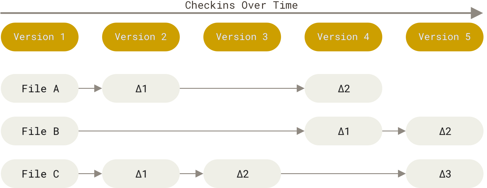
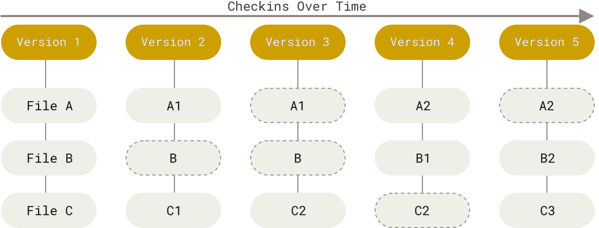
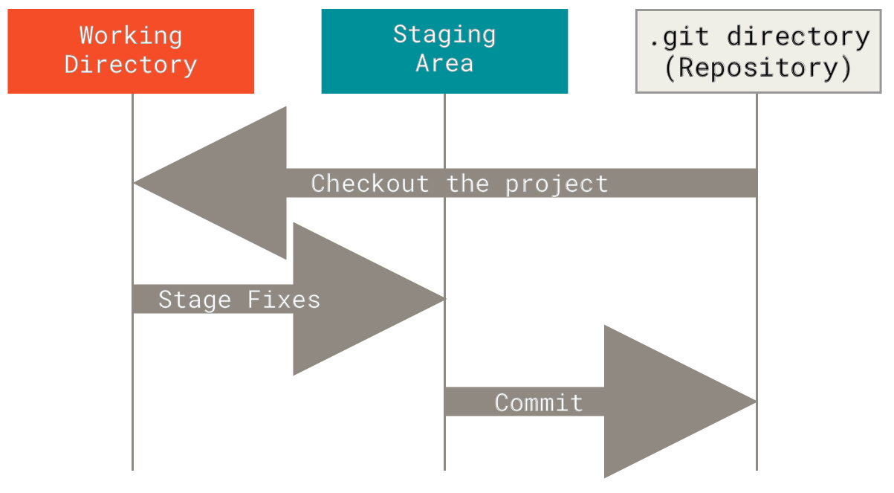

# 02 — What is Git?

> **Nguồn chính (chính thống):** Pro Git, 2nd Edition — Scott Chacon & Ben Straub.
> Bài này bám **§1.3 Getting Started — What is Git?**: <https://git-scm.com/book/en/v2/Getting-Started-What-is-Git%3F>

📖 **Nguyên văn — lời mở**
> "As you learn Git, try to clear your mind of the things you may know about other VCSs, such as CVS, Subversion or Perforce — doing so will help you avoid subtle confusion when using the tool.
> Even though Git’s user interface is fairly similar to these other VCSs, Git stores and thinks about information in a very different way."

🇻🇳 **Dịch**
> "Khi học Git, hãy cố gắng dọn sạch khỏi đầu những gì bạn biết về các VCS khác như CVS, Subversion hay Perforce — làm vậy sẽ giúp bạn tránh những nhầm lẫn tinh vi khi dùng công cụ này.
> Dù giao diện người dùng của Git khá giống các VCS kia, Git **lưu trữ và tư duy về thông tin theo một cách rất khác**."

---

## 1. Snapshots, Not Differences

📖 **Nguyên văn**
> "Conceptually, most other systems store information as a list of file-based changes.
> These other systems (CVS, Subversion, Perforce, and so on) think of the information they store as a set of files and the changes made to each file over time (this is commonly described as delta-based version control)."

🇻🇳 **Dịch**
> "Về mặt khái niệm, hầu hết các hệ thống khác lưu thông tin dưới dạng một danh sách các thay đổi theo từng file.
> Những hệ thống đó (CVS, Subversion, Perforce, v.v.) coi thông tin chúng lưu là một tập file cùng với các thay đổi trên từng file theo thời gian (cách này thường được gọi là **delta-based version control**)."


*Figure 4. Storing data as changes to a base version of each file — nguồn: [Pro Git §1.3](https://git-scm.com/book/en/v2/Getting-Started-What-is-Git%3F)*

📖 **Nguyên văn**
> "Instead, Git thinks of its data more like a series of snapshots of a miniature filesystem.
> With Git, every time you commit, or save the state of your project, Git basically takes a picture of what all your files look like at that moment and stores a reference to that snapshot.
> To be efficient, if files have not changed, Git doesn’t store the file again, just a link to the previous identical file it has already stored."

🇻🇳 **Dịch**
> "Thay vào đó, Git coi dữ liệu của nó giống một chuỗi **snapshot** của một filesystem thu nhỏ.
> Với Git, mỗi lần bạn commit — tức lưu trạng thái project — về cơ bản Git chụp một tấm ảnh xem tất cả file của bạn đang trông như thế nào tại thời điểm đó, rồi lưu một tham chiếu tới snapshot ấy.
> Để tiết kiệm, nếu file không đổi, Git không lưu lại file đó nữa mà chỉ lưu một link trỏ tới file y hệt nó đã lưu trước đó."


*Figure 5. Storing data as snapshots of the project over time — nguồn: [Pro Git §1.3](https://git-scm.com/book/en/v2/Getting-Started-What-is-Git%3F)*

💡 **Ví dụ đời sống**
- **Delta-based** = ghi nhật ký sửa nhà: "ngày 1 sơn tường xanh", "ngày 5 đổi cửa sổ", "ngày 9 bỏ cái bàn". Muốn biết nhà ngày 9 trông sao → phải đọc lại từ đầu và cộng dồn.
- **Snapshot (Git)** = ngày nào cũng chụp một tấm ảnh cả căn nhà. Muốn biết nhà ngày 9 → mở đúng tấm ảnh ngày 9. Phòng nào không đổi thì trong ảnh chỉ ghi "y như ảnh hôm qua" cho đỡ tốn chỗ.

📖 **Nguyên văn**
> "This makes Git more like a mini filesystem with some incredibly powerful tools built on top of it, rather than simply a VCS."

🇻🇳 **Dịch**
> "Điều này khiến Git giống một **mini filesystem** với vài công cụ cực mạnh xây bên trên, hơn là chỉ đơn thuần một VCS."

---

## 2. Nearly Every Operation Is Local

📖 **Nguyên văn**
> "Most operations in Git need only local files and resources to operate — generally no information is needed from another computer on your network. […]
> Because you have the entire history of the project right there on your local disk, most operations seem almost instantaneous."

🇻🇳 **Dịch**
> "Hầu hết thao tác trong Git chỉ cần file và tài nguyên ở local — nói chung không cần thông tin gì từ máy khác trong mạng. […]
> Vì bạn có toàn bộ lịch sử của project ngay trên ổ đĩa local, đa số thao tác gần như tức thì."

📖 **Nguyên văn**
> "If you get on an airplane or a train and want to do a little work, you can commit happily (to your local copy, remember?) until you get to a network connection to upload."

🇻🇳 **Dịch**
> "Nếu bạn lên máy bay hay tàu hoả và muốn làm chút việc, bạn vẫn commit thoải mái (vào bản copy local của bạn, nhớ chứ?) cho tới khi có mạng để upload."

🇻🇳 **Hệ quả:** `git log`, `git diff`, `git commit`, `git checkout` — tất cả chạy offline. Chỉ `push`, `fetch`, `pull`, `clone` mới cần mạng.

---

## 3. Git Has Integrity

📖 **Nguyên văn**
> "Everything in Git is checksummed before it is stored and is then referred to by that checksum.
> This means it’s impossible to change the contents of any file or directory without Git knowing about it."

🇻🇳 **Dịch**
> "Mọi thứ trong Git đều được tính checksum trước khi lưu, và sau đó được tham chiếu bằng chính checksum đó.
> Nghĩa là không thể thay đổi nội dung của bất kỳ file hay thư mục nào mà Git không biết."

📖 **Nguyên văn**
> "The mechanism that Git uses for this checksumming is called a SHA-1 hash.
> This is a 40-character string composed of hexadecimal characters (0–9 and a–f) and calculated based on the contents of a file or directory structure in Git.
> A SHA-1 hash looks something like this:"
> ```
> 24b9da6552252987aa493b52f8696cd6d3b00373
> ```
> "In fact, Git stores everything in its database not by file name but by the hash value of its contents."

🇻🇳 **Dịch**
> "Cơ chế Git dùng để tính checksum này gọi là **SHA-1 hash**.
> Đó là một chuỗi 40 ký tự gồm các ký tự hexadecimal (0–9 và a–f), được tính dựa trên nội dung của file hoặc cấu trúc thư mục trong Git. […]
> Thực tế, Git lưu mọi thứ trong database của nó **không phải theo tên file mà theo giá trị hash của nội dung**."

> [!note] Liên hệ
> Khái niệm hashing sẽ gặp lại ở phần **Web Security → Hashing Algorithms (MD5, SHA, bcrypt, scrypt)** trong roadmap. Ở đây SHA-1 dùng để **định danh nội dung**, không phải để bảo mật mật khẩu.

---

## 4. Git Generally Only Adds Data

📖 **Nguyên văn**
> "When you do actions in Git, nearly all of them only add data to the Git database.
> It is hard to get the system to do anything that is not undoable or to make it erase data in any way.
> As with any VCS, you can lose or mess up changes you haven’t committed yet, but after you commit a snapshot into Git, it is very difficult to lose."

🇻🇳 **Dịch**
> "Khi bạn thao tác trong Git, gần như tất cả chỉ **thêm** dữ liệu vào database của Git.
> Rất khó bắt hệ thống làm điều gì không thể undo, hay khiến nó xoá dữ liệu theo bất kỳ cách nào.
> Như mọi VCS khác, bạn có thể mất hoặc làm hỏng những thay đổi **chưa commit**; nhưng sau khi đã commit một snapshot vào Git thì rất khó để mất nó."

🇻🇳 **Quy tắc thực dụng rút ra:** sợ làm hỏng → **commit trước đã**. Commit rồi thì gần như luôn lấy lại được.

---

## 5. The Three States ⭐

📖 **Nguyên văn**
> "Pay attention now — here is the main thing to remember about Git if you want the rest of your learning process to go smoothly.
> Git has three main states that your files can reside in: modified, staged, and committed:
> - Modified means that you have changed the file but have not committed it to your database yet.
> - Staged means that you have marked a modified file in its current version to go into your next commit snapshot.
> - Committed means that the data is safely stored in your local database.
>
> This leads us to the three main sections of a Git project: the working tree, the staging area, and the Git directory."

🇻🇳 **Dịch**
> "Chú ý đây — đây là điều quan trọng nhất cần nhớ về Git nếu muốn phần còn lại của quá trình học được trôi chảy.
> Git có ba trạng thái chính mà file của bạn có thể nằm trong đó: **modified**, **staged**, và **committed**:
> - **Modified**: bạn đã thay đổi file nhưng chưa commit nó vào database.
> - **Staged**: bạn đã đánh dấu một file đã modified, ở phiên bản hiện tại của nó, để đưa vào snapshot commit kế tiếp.
> - **Committed**: dữ liệu đã được lưu an toàn trong database local của bạn.
>
> Từ đó dẫn tới ba khu vực chính của một Git project: **working tree**, **staging area**, và **Git directory**."


*Figure 6. Working tree, staging area, and Git directory — nguồn: [Pro Git §1.3](https://git-scm.com/book/en/v2/Getting-Started-What-is-Git%3F)*

📖 **Nguyên văn**
> "The working tree is a single checkout of one version of the project.
> These files are pulled out of the compressed database in the Git directory and placed on disk for you to use or modify.
>
> The staging area is a file, generally contained in your Git directory, that stores information about what will go into your next commit.
> Its technical name in Git parlance is the “index”, but the phrase “staging area” works just as well.
>
> The Git directory is where Git stores the metadata and object database for your project.
> This is the most important part of Git, and it is what is copied when you clone a repository from another computer."

🇻🇳 **Dịch**
> "**Working tree** là một bản checkout của **một** phiên bản project. Các file này được lấy ra từ database nén trong Git directory và đặt lên đĩa để bạn dùng hoặc sửa.
>
> **Staging area** là một file, thường nằm trong Git directory, lưu thông tin về những gì sẽ đi vào commit kế tiếp. Tên kỹ thuật của nó trong ngôn ngữ Git là **“index”**, nhưng gọi là “staging area” cũng được.
>
> **Git directory** là nơi Git lưu metadata và object database của project. Đây là phần quan trọng nhất của Git, và là thứ được copy khi bạn clone một repository từ máy khác."

### Workflow cơ bản

📖 **Nguyên văn**
> "The basic Git workflow goes something like this:
> 1. You modify files in your working tree.
> 2. You selectively stage just those changes you want to be part of your next commit, which adds only those changes to the staging area.
> 3. You do a commit, which takes the files as they are in the staging area and stores that snapshot permanently to your Git directory."

🇻🇳 **Dịch**
> "Workflow cơ bản của Git đại khái như sau:
> 1. Bạn sửa file trong **working tree**.
> 2. Bạn chọn lọc để **stage** đúng những thay đổi muốn đưa vào commit kế tiếp — chỉ những thay đổi đó được thêm vào **staging area**.
> 3. Bạn **commit**, thao tác này lấy các file đúng như trạng thái trong staging area và lưu snapshot đó vĩnh viễn vào **Git directory**."

💡 **Ví dụ đời sống**
Đóng hàng gửi bưu điện:
- **Working tree** = cả căn phòng đồ đạc bừa bộn của bạn.
- **Staging area** = cái thùng carton — bạn chọn nhặt đúng những món muốn gửi bỏ vào thùng.
- **Commit** = dán băng keo, dán tem, đưa cho bưu tá. Thùng đã niêm phong, có mã vận đơn (= SHA-1), không đổi được nữa.
- Món nào còn nằm trên sàn phòng thì vẫn là *modified*, chưa đi đâu cả.

---

## Liên kết
- Bài trước: [[01 - About Version Control]]
- Bài kế: `04 - Repo Hosting Services` (GitHub, GitLab)

## Nguồn tham khảo
- **Pro Git, 2nd Edition** — Scott Chacon, Ben Straub — §1.3 What is Git?: <https://git-scm.com/book/en/v2/Getting-Started-What-is-Git%3F>
- Hình Figure 4–6 lấy từ chính trang trên (`git-scm.com/book/en/v2/images/`), lưu lại trong `assets/`.
- Trang chủ Git: <https://git-scm.com>
