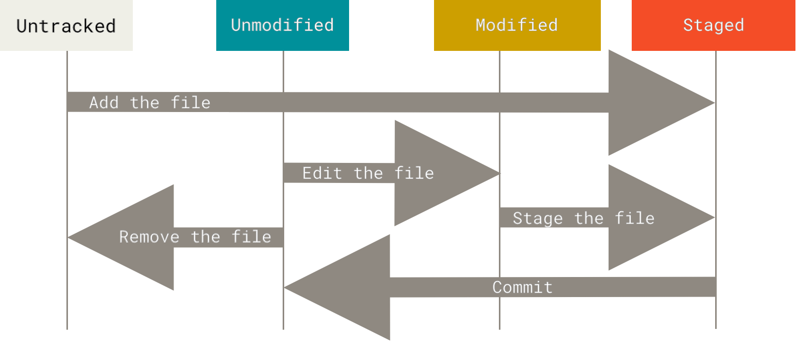

# 05 — Recording Changes to the Repository

> **Nguồn chính:** Pro Git §2.2 — <https://git-scm.com/book/en/v2/Git-Basics-Recording-Changes-to-the-Repository>
>
> Đây là bài dài nhất và quan trọng nhất của chương 2 — vòng đời của file trong Git.

---

## 1. Tracked vs Untracked

📖 **Nguyên văn**
> "Remember that each file in your working directory can be in one of two states: **tracked** or **untracked**.
> Tracked files are files that were in the last snapshot, as well as any newly staged files; they can be unmodified, modified, or staged.
> In short, tracked files are files that Git knows about.
>
> Untracked files are everything else — any files in your working directory that were not in your last snapshot and are not in your staging area."

🇻🇳 **Dịch**
> "Nhớ rằng mỗi file trong working directory có thể ở một trong hai trạng thái: **tracked** hoặc **untracked**.
> File tracked là file đã có trong snapshot gần nhất, cộng thêm bất kỳ file nào vừa được stage; chúng có thể ở trạng thái unmodified, modified, hoặc staged.
> Nói ngắn gọn, **tracked là những file Git biết tới**.
>
> File untracked là tất cả phần còn lại — bất kỳ file nào trong working directory mà không có trong snapshot gần nhất và cũng không nằm trong staging area."

📖 **Nguyên văn**
> "As you edit files, Git sees them as modified, because you’ve changed them since your last commit.
> As you work, you selectively stage these modified files and then commit all those staged changes, and the cycle repeats."

🇻🇳 **Dịch**
> "Khi bạn sửa file, Git thấy chúng là **modified**, vì bạn đã thay đổi chúng kể từ commit gần nhất.
> Trong lúc làm việc, bạn chọn lọc **stage** các file modified đó rồi **commit** toàn bộ thay đổi đã stage, và vòng lặp lặp lại."


*Figure 8. The lifecycle of the status of your files — nguồn: [Pro Git §2.2](https://git-scm.com/book/en/v2/Git-Basics-Recording-Changes-to-the-Repository)*

> [!important] Hình quan trọng nhất bài này
> Bốn ô: `Untracked → Unmodified → Modified → Staged`. Nhìn kỹ các mũi tên: `add the file`, `edit the file`, `stage the file`, `commit`, `remove the file`. Nắm được hình này là nắm được toàn bộ `git status`.

---

## 2. `git status` — kiểm tra trạng thái

📖 **Nguyên văn**
> "The main tool you use to determine which files are in which state is the `git status` command."
> ```
> $ git status
> On branch master
> Your branch is up-to-date with 'origin/master'.
> nothing to commit, working tree clean
> ```
> "This means you have a clean working directory; in other words, none of your tracked files are modified."

🇻🇳 **Dịch**
> "Công cụ chính bạn dùng để xác định file nào đang ở trạng thái nào là lệnh `git status`. […]
> Kết quả trên nghĩa là working directory của bạn sạch; nói cách khác, không file tracked nào bị modified."

📖 **Nguyên văn — về file untracked**
> "Untracked basically means that Git sees a file you didn’t have in the previous snapshot (commit), and which hasn’t yet been staged; **Git won’t start including it in your commit snapshots until you explicitly tell it to do so**.
> It does this so you don’t accidentally begin including generated binary files or other files that you did not mean to include."

🇻🇳 **Dịch**
> "Untracked về cơ bản nghĩa là Git thấy một file bạn chưa có trong snapshot (commit) trước đó và chưa được stage; **Git sẽ không đưa nó vào snapshot commit cho tới khi bạn nói rõ ràng là muốn vậy**.
> Git làm thế để bạn không vô tình đưa vào các file binary sinh ra tự động hay những file bạn không định đưa vào."

### Short status

📖 **Nguyên văn**
> ```
> $ git status -s
>  M README
> MM Rakefile
> A  lib/git.rb
> M  lib/simplegit.rb
> ?? LICENSE.txt
> ```
> "New files that aren’t tracked have a `??` next to them, new files that have been added to the staging area have an `A`, modified files have an `M` and so on.
> **There are two columns to the output — the left-hand column indicates the status of the staging area and the right-hand column indicates the status of the working tree.**"

🇻🇳 **Dịch**
> "File mới chưa được track có dấu `??` bên cạnh, file mới đã được thêm vào staging area có chữ `A`, file bị sửa có chữ `M`, v.v.
> **Output có hai cột — cột trái cho biết trạng thái của staging area, cột phải cho biết trạng thái của working tree.**"

🇻🇳 **Giải mã ví dụ trên:**

| Ký hiệu | Ý nghĩa |
|---|---|
| ` M README` | Sửa ở working tree, **chưa** stage |
| `MM Rakefile` | Đã sửa → stage → rồi lại sửa tiếp |
| `A  lib/git.rb` | File mới, đã stage |
| `M  lib/simplegit.rb` | Đã sửa và đã stage |
| `?? LICENSE.txt` | Untracked |

---

## 3. `git add` — không chỉ là "thêm file"

📖 **Nguyên văn**
> "`git add` is a multipurpose command — you use it to begin tracking new files, to stage files, and to do other things like marking merge-conflicted files as resolved.
> **It may be helpful to think of it more as “add precisely this content to the next commit” rather than “add this file to the project”.**"

🇻🇳 **Dịch**
> "`git add` là một lệnh đa năng — bạn dùng nó để bắt đầu track file mới, để stage file, và cả những việc khác như đánh dấu file bị merge-conflict là đã giải quyết xong.
> **Sẽ hữu ích hơn nếu nghĩ về nó là “thêm chính xác nội dung này vào commit kế tiếp” chứ không phải “thêm file này vào project”.**"

### Cạm bẫy kinh điển: stage rồi sửa tiếp

📖 **Nguyên văn**
> "Now `CONTRIBUTING.md` is listed as both staged and unstaged. How is that possible?
> It turns out that **Git stages a file exactly as it is when you run the `git add` command**.
> If you commit now, the version of `CONTRIBUTING.md` as it was when you last ran the `git add` command is how it will go into the commit, not the version of the file as it looks in your working directory when you run `git commit`.
> If you modify a file after you run `git add`, you have to run `git add` again to stage the latest version of the file."

🇻🇳 **Dịch**
> "Bây giờ `CONTRIBUTING.md` được liệt kê ở **cả** staged lẫn unstaged. Sao lại thế được?
> Hoá ra **Git stage file đúng y như trạng thái của nó tại thời điểm bạn chạy lệnh `git add`**.
> Nếu bạn commit ngay lúc này, phiên bản `CONTRIBUTING.md` lúc bạn chạy `git add` lần cuối mới là phiên bản đi vào commit, chứ không phải phiên bản đang nằm trong working directory lúc bạn chạy `git commit`.
> Nếu bạn sửa file sau khi đã `git add`, bạn phải chạy `git add` lại để stage phiên bản mới nhất."

💡 **Ví dụ đời sống**
Bạn bỏ cái áo vào thùng hàng (`git add`), rồi sau đó lại lấy cây kéo cắt cái áo **đang treo trong tủ** (working tree). Cái áo trong thùng vẫn là áo lành. Dán thùng lại (`commit`) → bưu tá nhận áo lành, không nhận áo đã cắt.

---

## 4. Ignoring Files — `.gitignore`

📖 **Nguyên văn**
> "Often, you’ll have a class of files that you don’t want Git to automatically add or even show you as being untracked.
> These are generally automatically generated files such as log files or files produced by your build system.
> In such cases, you can create a file listing patterns to match them named `.gitignore`."

🇻🇳 **Dịch**
> "Thường bạn sẽ có một nhóm file mà bạn không muốn Git tự động add, thậm chí không muốn nó hiện ra như untracked.
> Đó thường là các file sinh tự động như log file hoặc file do hệ thống build tạo ra.
> Trong trường hợp đó, bạn tạo một file liệt kê các pattern khớp với chúng, đặt tên `.gitignore`."

📖 **Nguyên văn — luật viết pattern**
> "The rules for the patterns you can put in the `.gitignore` file are as follows:
> - Blank lines or lines starting with `#` are ignored.
> - Standard glob patterns work, and will be applied recursively throughout the entire working tree.
> - You can start patterns with a forward slash (`/`) to avoid recursivity.
> - You can end patterns with a forward slash (`/`) to specify a directory.
> - You can negate a pattern by starting it with an exclamation point (`!`)."

🇻🇳 **Dịch**
> "Luật cho các pattern bạn đặt trong file `.gitignore` như sau:
> - Dòng trống hoặc dòng bắt đầu bằng `#` bị bỏ qua.
> - Các **glob pattern** chuẩn hoạt động được, và sẽ áp dụng **đệ quy** trên toàn bộ working tree.
> - Bắt đầu pattern bằng dấu `/` để **không** đệ quy.
> - Kết thúc pattern bằng dấu `/` để chỉ định một **thư mục**.
> - **Phủ định** một pattern bằng cách bắt đầu nó với dấu chấm than (`!`)."

📖 **Nguyên văn — ví dụ sách đưa**
> ```
> # ignore all .a files
> *.a
>
> # but do track lib.a, even though you're ignoring .a files above
> !lib.a
>
> # only ignore the TODO file in the current directory, not subdir/TODO
> /TODO
>
> # ignore all files in any directory named build
> build/
>
> # ignore doc/notes.txt, but not doc/server/arch.txt
> doc/*.txt
>
> # ignore all .pdf files in the doc/ directory and any of its subdirectories
> doc/**/*.pdf
> ```

> [!tip] Nguồn mẫu chính thống
> 📖 "GitHub maintains a fairly comprehensive list of good `.gitignore` file examples for dozens of projects and languages at <https://github.com/github/gitignore>"
> 🇻🇳 GitHub duy trì một danh sách khá đầy đủ các file `.gitignore` mẫu cho hàng chục loại project và ngôn ngữ.

📖 **Nguyên văn — nhiều file .gitignore**
> "However, it is also possible to have additional `.gitignore` files in subdirectories.
> The rules in these nested `.gitignore` files apply only to the files under the directory where they are located.
> **The Linux kernel source repository has 206 `.gitignore` files.**"

🇻🇳 **Dịch**
> "Tuy nhiên, cũng có thể có thêm các file `.gitignore` trong các thư mục con.
> Luật trong những file `.gitignore` lồng nhau này chỉ áp dụng cho các file nằm dưới thư mục chứa chúng.
> **Repository mã nguồn Linux kernel có 206 file `.gitignore`.**"

---

## 5. `git diff` — xem chính xác thay đổi

📖 **Nguyên văn**
> "If the `git status` command is too vague for you — you want to know exactly what you changed, not just which files were changed — you can use the `git diff` command. […]
> Although `git status` answers those questions very generally by listing the file names, `git diff` shows you the **exact lines added and removed — the patch**, as it were."

🇻🇳 **Dịch**
> "Nếu lệnh `git status` quá chung chung với bạn — bạn muốn biết chính xác mình đã đổi gì chứ không chỉ file nào bị đổi — hãy dùng lệnh `git diff`. […]
> Trong khi `git status` trả lời rất chung chung bằng cách liệt kê tên file, `git diff` cho bạn thấy **chính xác những dòng được thêm và bị xoá — tức là bản patch**."

| Lệnh | So sánh cái gì | Trả lời câu hỏi |
|---|---|---|
| `git diff` | working directory ↔ staging area | "Tôi đã đổi gì mà **chưa** stage?" |
| `git diff --staged`<br>(= `--cached`) | staging area ↔ commit gần nhất | "Tôi đã stage gì, sắp commit gì?" |

📖 **Nguyên văn — điểm rất dễ nhầm**
> "It’s important to note that `git diff` by itself doesn’t show all changes made since your last commit — only changes that are still unstaged.
> **If you’ve staged all of your changes, `git diff` will give you no output.**"

🇻🇳 **Dịch**
> "Điều quan trọng cần lưu ý: bản thân `git diff` **không** hiển thị mọi thay đổi kể từ commit gần nhất — chỉ những thay đổi **còn chưa stage**.
> **Nếu bạn đã stage hết, `git diff` sẽ không in ra gì cả.**"

📖 **Nguyên văn**
> "`--staged` and `--cached` are synonyms"

🇻🇳 `--staged` và `--cached` là hai tên gọi của cùng một thứ.

---

## 6. `git commit`

📖 **Nguyên văn**
> "Remember that anything that is still unstaged — any files you have created or modified that you haven’t run `git add` on since you edited them — won’t go into this commit.
> They will stay as modified files on your disk."

🇻🇳 **Dịch**
> "Nhớ rằng bất cứ thứ gì còn unstaged — mọi file bạn tạo hoặc sửa mà chưa chạy `git add` kể từ lần sửa — sẽ **không** đi vào commit này.
> Chúng vẫn nằm trên đĩa ở trạng thái modified."

📖 **Nguyên văn**
> ```
> $ git commit -m "Story 182: fix benchmarks for speed"
> [master 463dc4f] Story 182: fix benchmarks for speed
>  2 files changed, 2 insertions(+)
>  create mode 100644 README
> ```
> "You can see that the commit has given you some output about itself: which branch you committed to (`master`), what SHA-1 checksum the commit has (`463dc4f`), how many files were changed, and statistics about lines added and removed in the commit."

🇻🇳 **Dịch**
> "Bạn thấy commit in ra vài thông tin về chính nó: bạn đã commit vào branch nào (`master`), commit có SHA-1 checksum là gì (`463dc4f`), bao nhiêu file bị thay đổi, và thống kê số dòng thêm/bớt trong commit."

📖 **Nguyên văn**
> "Remember that the commit records the snapshot you set up in your staging area. […]
> **Every time you perform a commit, you’re recording a snapshot of your project that you can revert to or compare to later.**"

🇻🇳 **Dịch**
> "Nhớ rằng commit ghi lại đúng cái snapshot bạn đã dựng trong staging area. […]
> **Mỗi lần commit là một lần bạn ghi lại một snapshot của project mà sau này bạn có thể quay về hoặc đem ra so sánh.**"

> [!note] Mẹo
> 📖 "For an even more explicit reminder of what you’ve modified, you can pass the `-v` option to `git commit`. Doing so also puts the diff of your change in the editor."
> 🇻🇳 Dùng `git commit -v` để editor hiện luôn phần diff, thấy rõ mình đang commit đúng những gì.

### Skipping the Staging Area

📖 **Nguyên văn**
> "Adding the `-a` option to the `git commit` command makes Git automatically stage every file that is **already tracked** before doing the commit, letting you skip the `git add` part. […]
> This is convenient, but be careful; sometimes this flag will cause you to include unwanted changes."

🇻🇳 **Dịch**
> "Thêm option `-a` vào lệnh `git commit` khiến Git tự động stage mọi file **đã được track** trước khi commit, cho phép bạn bỏ qua bước `git add`. […]
> Tiện, nhưng phải cẩn thận; đôi khi flag này khiến bạn đưa vào cả những thay đổi không mong muốn."

⚠️ `-a` **không** bắt file untracked. File mới toanh vẫn phải `git add`.

---

## 7. Removing Files — `git rm`

📖 **Nguyên văn**
> "To remove a file from Git, you have to remove it from your tracked files (more accurately, remove it from your staging area) and then commit.
> The `git rm` command does that, and also removes the file from your working directory."

🇻🇳 **Dịch**
> "Để xoá một file khỏi Git, bạn phải xoá nó khỏi danh sách file tracked (chính xác hơn là xoá khỏi staging area) rồi commit.
> Lệnh `git rm` làm việc đó, đồng thời xoá file khỏi working directory của bạn."

📖 **Nguyên văn — `--cached`**
> "Another useful thing you may want to do is to keep the file in your working tree but remove it from your staging area.
> In other words, you may want to keep the file on your hard drive but not have Git track it anymore.
> This is particularly useful if you forgot to add something to your `.gitignore` file and accidentally staged it, like a large log file or a bunch of `.a` compiled files."
> ```
> $ git rm --cached README
> ```

🇻🇳 **Dịch**
> "Một việc hữu ích khác bạn có thể muốn làm là **giữ file trong working tree nhưng bỏ nó khỏi staging area**.
> Nói cách khác, giữ file trên ổ cứng nhưng không cho Git track nó nữa.
> Việc này đặc biệt hữu ích khi bạn quên thêm thứ gì đó vào `.gitignore` và lỡ stage nó, ví dụ một log file to đùng hay một mớ file `.a` đã compile."

> [!tip] Tình huống rất hay gặp
> Lỡ commit `.env` hoặc `node_modules/`:
> ```bash
> echo ".env" >> .gitignore
> git rm --cached .env
> git commit -m "Stop tracking .env"
> ```
> File vẫn còn trên máy, Git thôi không theo dõi nữa. (Lưu ý: commit cũ vẫn còn `.env` trong lịch sử — nếu là secret thật thì phải đổi secret.)

---

## 8. Moving Files — `git mv`

📖 **Nguyên văn**
> "Unlike many other VCSs, **Git doesn’t explicitly track file movement**.
> If you rename a file in Git, no metadata is stored in Git that tells it you renamed the file.
> However, Git is pretty smart about figuring that out after the fact."

🇻🇳 **Dịch**
> "Khác nhiều VCS khác, **Git không track việc di chuyển file một cách tường minh**.
> Nếu bạn đổi tên một file trong Git, không có metadata nào được lưu để nói rằng bạn đã rename.
> Tuy nhiên Git khá thông minh trong việc suy ra điều đó sau đó."

📖 **Nguyên văn**
> ```
> $ git mv README.md README
> ```
> "However, this is equivalent to running something like this:"
> ```
> $ mv README.md README
> $ git rm README.md
> $ git add README
> ```
> "The only real difference is that `git mv` is one command instead of three — it’s a convenience function."

🇻🇳 **Dịch**
> "Khác biệt thực sự duy nhất là `git mv` gộp ba lệnh thành một — nó chỉ là hàm tiện lợi."

---

## Tóm tắt lệnh bài này

```bash
git status            # file nào đang ở trạng thái nào
git status -s         # bản ngắn, 2 cột: staging | working tree
git add <file>        # "thêm chính xác nội dung này vào commit kế tiếp"
git diff              # working tree ↔ staging (chưa stage)
git diff --staged     # staging ↔ commit cuối (sắp commit)
git commit -m "..."   # chốt snapshot
git commit -a -m "…"  # bỏ qua add, chỉ với file đã tracked
git rm <file>         # xoá file + stage việc xoá
git rm --cached <f>   # giữ file, thôi track
git mv <a> <b>        # đổi tên (= mv + rm + add)
```

## Liên kết
- Vòng đời file ở đây là bản chi tiết của **Three States** trong [[02 - What is Git]]
- Bài kế: [[06 - Viewing the Commit History]]

## Nguồn tham khảo
- Pro Git §2.2: <https://git-scm.com/book/en/v2/Git-Basics-Recording-Changes-to-the-Repository>
- Hình Figure 8 lấy từ trang trên, lưu trong `assets/lifecycle.png`
- Mẫu `.gitignore` chính thức: <https://github.com/github/gitignore>
