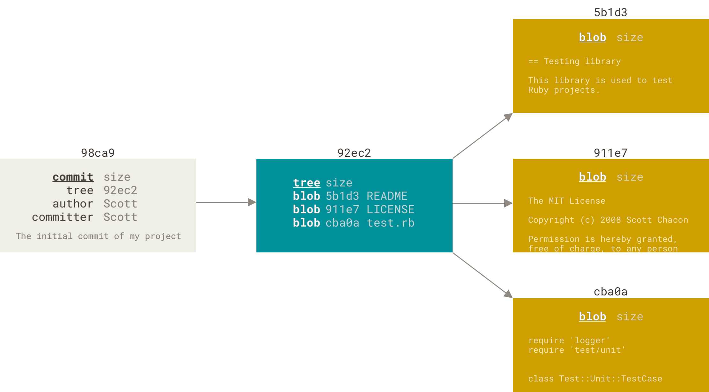
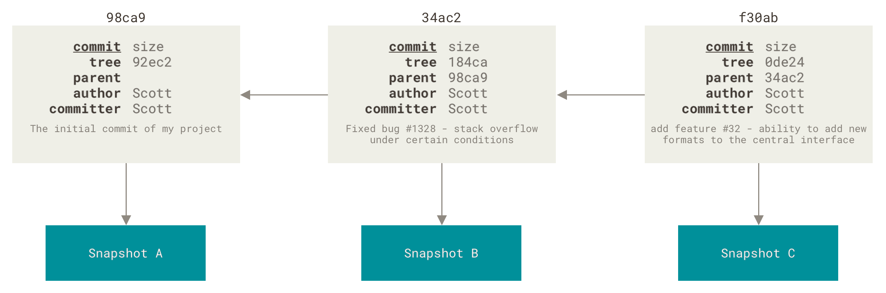
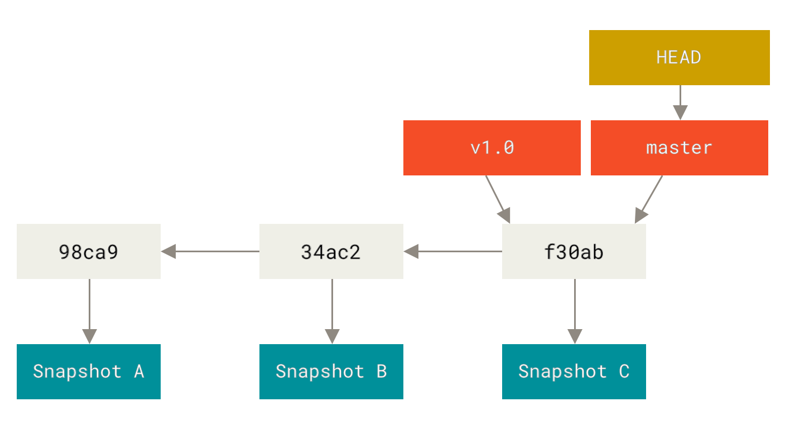
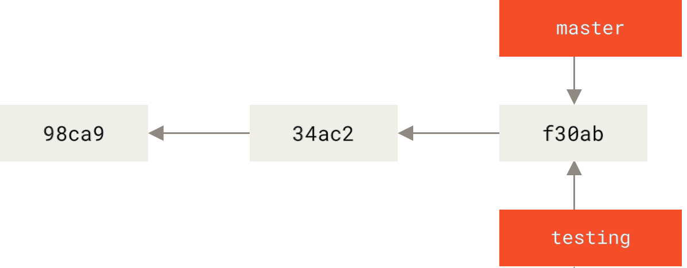
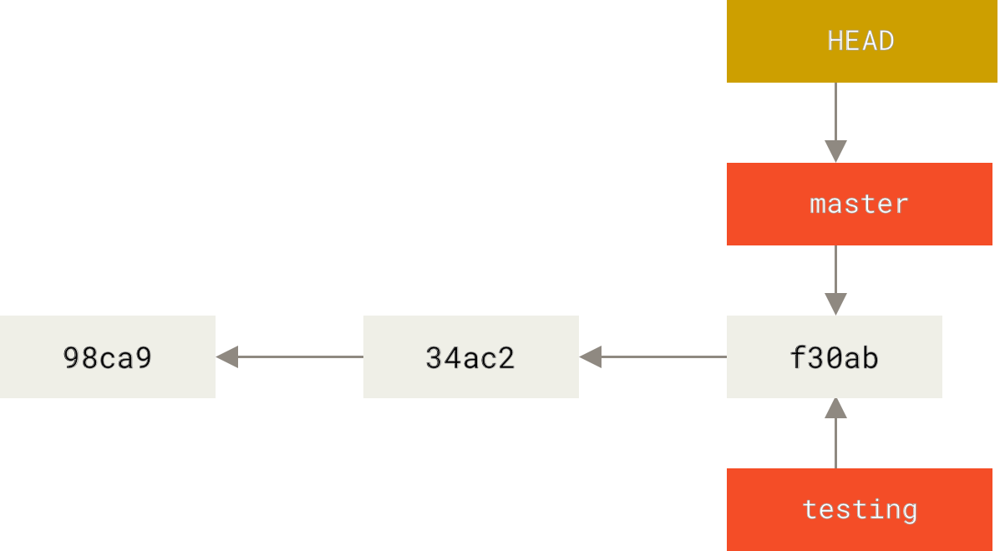
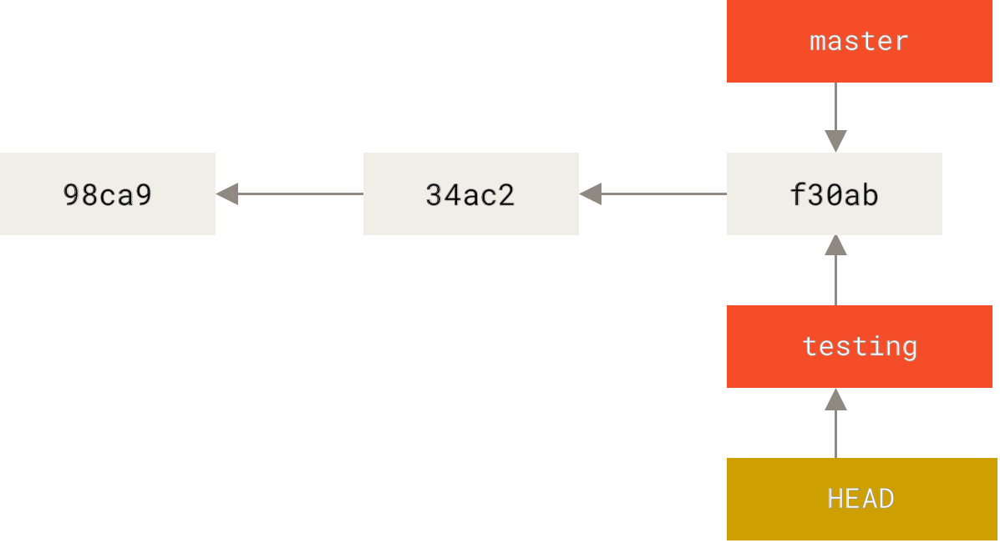
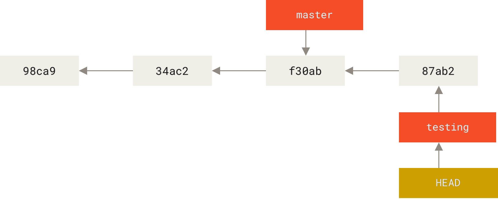
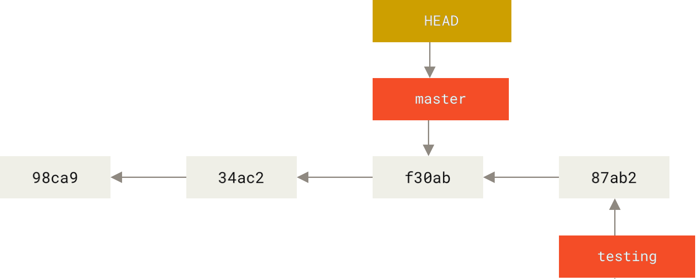
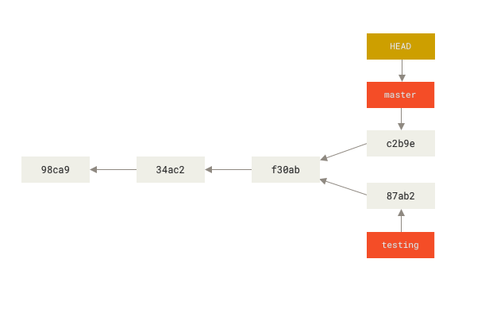

# 10 — Branches in a Nutshell

> **Nguồn chính:** Pro Git §3.1 — <https://git-scm.com/book/en/v2/Git-Branching-Branches-in-a-Nutshell>
>
> Đây là chương được coi là "killer feature" của Git. Đọc kỹ hình.

📖 **Nguyên văn — mở chương 3**
> "Branching means you diverge from the main line of development and continue to do work without messing with that main line.
> In many VCS tools, this is a somewhat expensive process, often requiring you to create a new copy of your source code directory, which can take a long time for large projects.
>
> Some people refer to Git’s branching model as its **“killer feature,”** and it certainly sets Git apart in the VCS community.
> Why is it so special?
> The way Git branches is **incredibly lightweight**, making branching operations nearly instantaneous, and switching back and forth between branches generally just as fast."

🇻🇳 **Dịch**
> "Branching nghĩa là bạn rẽ nhánh khỏi dòng phát triển chính và tiếp tục làm việc mà không động chạm tới dòng chính đó.
> Ở nhiều công cụ VCS, đây là quá trình khá tốn kém, thường đòi hỏi tạo một bản copy mới của thư mục mã nguồn — có thể rất lâu với project lớn.
>
> Một số người gọi mô hình branching của Git là **“killer feature”** của nó, và nó chắc chắn làm Git khác biệt trong cộng đồng VCS.
> Vì sao đặc biệt đến thế?
> Cách Git tạo branch **nhẹ đến khó tin**, khiến các thao tác branch gần như tức thì, và việc chuyển qua lại giữa các branch cũng nhanh y như vậy."

---

## 1. Git lưu commit thế nào

📖 **Nguyên văn**
> "When you make a commit, Git stores a commit object that contains a pointer to the snapshot of the content you staged.
> This object also contains the author’s name and email address, the message that you typed, and **pointers to the commit or commits that directly came before this commit (its parent or parents)**: zero parents for the initial commit, one parent for a normal commit, and multiple parents for a commit that results from a merge of two or more branches."

🇻🇳 **Dịch**
> "Khi bạn tạo một commit, Git lưu một **commit object** chứa con trỏ tới snapshot của nội dung bạn đã stage.
> Object này cũng chứa tên và email của author, message bạn đã gõ, và **con trỏ tới commit hoặc các commit đứng ngay trước nó (parent của nó)**: 0 parent với commit đầu tiên, 1 parent với commit thường, và nhiều parent với commit sinh ra từ việc merge hai branch trở lên."

📖 **Nguyên văn**
> "Staging the files computes a checksum for each one (the SHA-1 hash […]), stores that version of the file in the Git repository (**Git refers to them as blobs**), and adds that checksum to the staging area. […]
> When you create the commit by running `git commit`, Git checksums each subdirectory […] and stores them as a **tree object** in the Git repository.
> Git then creates a **commit object** that has the metadata and a pointer to the root project tree."

🇻🇳 **Dịch**
> "Việc stage các file sẽ tính checksum cho từng file (SHA-1 hash), lưu phiên bản file đó vào Git repository (**Git gọi chúng là blob**), và thêm checksum đó vào staging area. […]
> Khi bạn tạo commit bằng `git commit`, Git tính checksum cho từng thư mục con […] và lưu chúng thành **tree object** trong Git repository.
> Sau đó Git tạo một **commit object** chứa metadata và một con trỏ tới root tree của project."

📖 **Nguyên văn**
> "Your Git repository now contains five objects: three **blobs** (each representing the contents of one of the three files), one **tree** that lists the contents of the directory and specifies which file names are stored as which blobs, and one **commit** with the pointer to that root tree and all the commit metadata."

🇻🇳 **Dịch**
> "Repository Git của bạn giờ chứa năm object: ba **blob** (mỗi cái đại diện nội dung một trong ba file), một **tree** liệt kê nội dung thư mục và chỉ rõ tên file nào được lưu thành blob nào, và một **commit** chứa con trỏ tới root tree đó cùng toàn bộ metadata của commit."


*Figure 9. A commit and its tree — nguồn: [Pro Git §3.1](https://git-scm.com/book/en/v2/Git-Branching-Branches-in-a-Nutshell)*

📖 **Nguyên văn**
> "If you make some changes and commit again, the next commit stores a pointer to the commit that came immediately before it."

🇻🇳 **Dịch**
> "Nếu bạn thay đổi rồi commit tiếp, commit tiếp theo lưu một con trỏ tới commit đứng ngay trước nó."


*Figure 10. Commits and their parents — nguồn: Pro Git §3.1*

💡 **Ví dụ đời sống**
Mỗi commit là một tấm ảnh gia đình, mặt sau ghi "ảnh này chụp ngay sau tấm ảnh số ...". Cả xấp ảnh nối nhau thành một sợi dây thời gian — bạn không cần đánh số trang, cứ lần mặt sau là ra thứ tự.

---

## 2. Branch thực chất là gì ⭐

📖 **Nguyên văn**
> "**A branch in Git is simply a lightweight movable pointer to one of these commits.**
> The default branch name in Git is `master`.
> As you start making commits, you’re given a `master` branch that points to the last commit you made.
> Every time you commit, the `master` branch pointer moves forward automatically."

🇻🇳 **Dịch**
> "**Một branch trong Git đơn giản chỉ là một con trỏ nhẹ, có thể di chuyển, trỏ tới một trong các commit đó.**
> Tên branch mặc định trong Git là `master`.
> Khi bạn bắt đầu commit, bạn được cấp một branch `master` trỏ tới commit gần nhất bạn tạo.
> Mỗi lần commit, con trỏ branch `master` tự động tiến lên."

> [!note] `master` không hề đặc biệt
> 📖 "The “master” branch in Git is **not a special branch**. It is exactly like any other branch. The only reason nearly every repository has one is that the `git init` command creates it by default and most people don’t bother to change it."
> 🇻🇳 Branch "master" trong Git **không phải branch đặc biệt**. Nó y hệt mọi branch khác. Lý do duy nhất gần như repo nào cũng có nó là vì `git init` tạo ra nó mặc định và đa số không buồn đổi.


*Figure 11. A branch and its commit history — nguồn: Pro Git §3.1*

---

## 3. Tạo branch — `git branch`

📖 **Nguyên văn**
> "What happens when you create a new branch?
> Well, doing so creates a new pointer for you to move around."
> ```
> $ git branch testing
> ```
> "This creates a new pointer to the same commit you’re currently on."

🇻🇳 **Dịch**
> "Điều gì xảy ra khi bạn tạo branch mới?
> Việc đó tạo cho bạn một con trỏ mới để di chuyển. […]
> Lệnh này tạo một con trỏ mới trỏ tới đúng commit bạn đang đứng."


*Figure 12. Two branches pointing into the same series of commits — nguồn: Pro Git §3.1*

---

## 4. `HEAD` là gì ⭐

📖 **Nguyên văn**
> "How does Git know what branch you’re currently on?
> **It keeps a special pointer called `HEAD`.**
> Note that this is a lot different than the concept of HEAD in other VCSs you may be used to, such as Subversion or CVS.
> **In Git, this is a pointer to the local branch you’re currently on.**
> In this case, you’re still on `master`. The `git branch` command **only created a new branch — it didn’t switch to that branch**."

🇻🇳 **Dịch**
> "Làm sao Git biết bạn đang ở branch nào?
> **Nó giữ một con trỏ đặc biệt tên là `HEAD`.**
> Lưu ý khái niệm này khác nhiều so với HEAD ở các VCS khác bạn có thể đã quen như Subversion hay CVS.
> **Trong Git, đây là con trỏ trỏ tới branch local bạn đang đứng.**
> Trong trường hợp này bạn vẫn đang ở `master`. Lệnh `git branch` **chỉ tạo branch mới — nó không chuyển sang branch đó**."


*Figure 13. HEAD pointing to a branch — nguồn: Pro Git §3.1*

💡 **Ví dụ đời sống**
- **Commit** = từng trang sách đã in.
- **Branch** = cái kẹp sách (bookmark) ghi tên, kẹp ở một trang.
- **HEAD** = ngón tay bạn đang đặt lên **cái kẹp nào**. Bạn đọc theo ngón tay, không phải theo cái kẹp bất kỳ.

📖 **Nguyên văn — nhìn thấy HEAD**
> ```
> $ git log --oneline --decorate
> f30ab (HEAD -> master, testing) Add feature #32 …
> ```

---

## 5. Chuyển branch — `git checkout` / `git switch`

📖 **Nguyên văn**
> "To switch to an existing branch, you run the `git checkout` command."
> ```
> $ git checkout testing
> ```
> "This moves `HEAD` to point to the `testing` branch."

🇻🇳 **Dịch**
> "Để chuyển sang một branch đã tồn tại, chạy lệnh `git checkout`. […]
> Lệnh này di chuyển `HEAD` sang trỏ vào branch `testing`."


*Figure 14. HEAD points to the current branch — nguồn: Pro Git §3.1*

📖 **Nguyên văn — commit tiếp**
> ```
> $ vim test.rb
> $ git commit -a -m 'Make a change'
> ```
> "This is interesting, because now your `testing` branch has moved forward, but your `master` branch still points to the commit you were on when you ran `git checkout` to switch branches."

🇻🇳 **Dịch**
> "Điều thú vị là bây giờ branch `testing` của bạn đã tiến lên, nhưng branch `master` vẫn trỏ tới commit bạn đang đứng lúc chạy `git checkout` để chuyển branch."


*Figure 15. The HEAD branch moves forward when a commit is made — nguồn: Pro Git §3.1*

📖 **Nguyên văn — quay lại master**
> ```
> $ git checkout master
> ```
> "That command did two things.
> **It moved the `HEAD` pointer back to point to the `master` branch, and it reverted the files in your working directory back to the snapshot that `master` points to.**
> This also means the changes you make from this point forward will diverge from an older version of the project."

🇻🇳 **Dịch**
> "Lệnh đó làm hai việc.
> **Nó đưa con trỏ `HEAD` quay về trỏ vào branch `master`, và nó khôi phục các file trong working directory về đúng snapshot mà `master` đang trỏ tới.**
> Điều này cũng có nghĩa các thay đổi bạn làm từ đây trở đi sẽ rẽ nhánh khỏi một phiên bản cũ hơn của project."


*Figure 16. HEAD moves when you checkout — nguồn: Pro Git §3.1*

> [!warning] Chuyển branch làm ĐỔI file trên đĩa
> 📖 "It’s important to note that when you switch branches in Git, **files in your working directory will change**.
> If you switch to an older branch, your working directory will be reverted to look like it did the last time you committed on that branch.
> **If Git cannot do it cleanly, it will not let you switch at all.**"
>
> 🇻🇳 "Quan trọng: khi bạn chuyển branch trong Git, **file trong working directory sẽ thay đổi**.
> Nếu chuyển sang branch cũ hơn, working directory sẽ được đưa về đúng như lần commit gần nhất trên branch đó.
> **Nếu Git không làm việc đó một cách sạch sẽ được, nó sẽ không cho bạn chuyển.**"

> [!note] `git log` không hiện mọi branch
> 📖 "by default, `git log` will only show commit history **below the branch you’ve checked out**.
> To show commit history for the desired branch you have to explicitly specify it: `git log testing`.
> To show all of the branches, add `--all` to your `git log` command."
> 🇻🇳 Mặc định `git log` chỉ hiện lịch sử **dưới branch bạn đang checkout**. Muốn xem hết thì thêm `--all`.

---

## 6. Lịch sử rẽ nhánh (Divergent history)

📖 **Nguyên văn**
> "Now your project history has diverged.
> You created and switched to a branch, did some work on it, and then switched back to your main branch and did other work.
> **Both of those changes are isolated in separate branches**: you can switch back and forth between the branches and merge them together when you’re ready.
> And you did all that with simple `branch`, `checkout`, and `commit` commands."

🇻🇳 **Dịch**
> "Giờ lịch sử project của bạn đã rẽ nhánh.
> Bạn tạo và chuyển sang một branch, làm việc trên đó, rồi quay lại branch chính và làm việc khác.
> **Cả hai thay đổi đó được cô lập trong hai branch riêng**: bạn có thể chuyển qua lại giữa chúng và merge lại khi sẵn sàng.
> Và bạn làm được tất cả chỉ với ba lệnh đơn giản `branch`, `checkout` và `commit`."


*Figure 17. Divergent history — nguồn: Pro Git §3.1*

📖 **Nguyên văn**
> ```
> $ git log --oneline --decorate --graph --all
> * c2b9e (HEAD, master) Make other changes
> | * 87ab2 (testing) Make a change
> |/
> * f30ab Add feature #32 …
> ```

---

## 7. Vì sao branch của Git rẻ đến vậy ⭐

📖 **Nguyên văn**
> "Because **a branch in Git is actually a simple file that contains the 40 character SHA-1 checksum of the commit it points to**, branches are cheap to create and destroy.
> **Creating a new branch is as quick and simple as writing 41 bytes to a file (40 characters and a newline).**
>
> This is in sharp contrast to the way most older VCS tools branch, which involves copying all of the project’s files into a second directory.
> This can take several seconds or even minutes, depending on the size of the project, whereas in Git the process is always instantaneous."

🇻🇳 **Dịch**
> "Vì **một branch trong Git thực chất là một file đơn giản chứa chuỗi SHA-1 checksum 40 ký tự của commit mà nó trỏ tới**, nên branch rất rẻ để tạo và xoá.
> **Tạo một branch mới nhanh và đơn giản như ghi 41 byte vào một file (40 ký tự và một dấu xuống dòng).**
>
> Điều này trái ngược hẳn với cách phần lớn các công cụ VCS cũ tạo branch — vốn phải copy toàn bộ file của project sang một thư mục thứ hai.
> Việc đó mất vài giây, thậm chí vài phút tuỳ kích thước project, trong khi ở Git quá trình này luôn tức thì."

📖 **Nguyên văn**
> "Also, because we’re recording the parents when we commit, **finding a proper merge base for merging is automatically done for us** and is generally very easy to do.
> These features help encourage developers to create and use branches often."

🇻🇳 **Dịch**
> "Ngoài ra, vì chúng ta ghi lại parent khi commit, nên **việc tìm merge base đúng đắn để merge được làm tự động** và nói chung rất dễ.
> Những đặc tính này khuyến khích lập trình viên tạo và dùng branch thường xuyên."

---

## 8. Cú pháp rút gọn & lệnh mới `git switch`

📖 **Nguyên văn**
> "It’s typical to create a new branch and want to switch to that new branch at the same time — this can be done in one operation with `git checkout -b <newbranchname>`."

🇻🇳 **Dịch**
> "Thường thì người ta tạo branch mới và muốn chuyển sang nó luôn — làm được trong một thao tác với `git checkout -b <tên-branch-mới>`."

📖 **Nguyên văn — Git ≥ 2.23**
> "From Git version 2.23 onwards you can use `git switch` instead of `git checkout` to:
> - Switch to an existing branch: `git switch testing-branch`.
> - Create a new branch and switch to it: `git switch -c new-branch`. The `-c` flag stands for **create**, you can also use the full flag: `--create`.
> - Return to your previously checked out branch: `git switch -`."

🇻🇳 **Dịch**
> "Từ Git phiên bản 2.23 trở đi, bạn có thể dùng `git switch` thay cho `git checkout` để:
> - Chuyển sang branch đã có: `git switch testing-branch`.
> - Tạo branch mới và chuyển sang luôn: `git switch -c new-branch`. Flag `-c` là viết tắt của **create**, cũng có thể dùng dạng đầy đủ `--create`.
> - Quay về branch vừa checkout trước đó: `git switch -`."

---

## Tóm tắt

```bash
git branch                    # liệt kê branch
git branch testing            # tạo branch, KHÔNG chuyển sang
git checkout testing          # chuyển (cách cũ)
git switch testing            # chuyển (Git ≥ 2.23)
git checkout -b new           # tạo + chuyển
git switch -c new             # tạo + chuyển (mới)
git switch -                  # quay lại branch trước
git log --oneline --decorate --graph --all   # xem toàn cảnh
```

**Ba khái niệm cốt lõi:**
- **Commit** — snapshot bất biến, trỏ về parent của nó
- **Branch** — con trỏ 41 byte, tự tiến lên mỗi lần commit
- **HEAD** — con trỏ trỏ vào branch bạn đang đứng

## Liên kết
- Bài trước: [[09 - Tagging và Git Aliases]]
- Bài kế: [[11 - Basic Branching and Merging]]
- Khái niệm snapshot & SHA-1: [[02 - What is Git]]

## Nguồn tham khảo
- Pro Git §3.1: <https://git-scm.com/book/en/v2/Git-Branching-Branches-in-a-Nutshell>
- Hình Figure 9–17 lấy từ trang trên, lưu trong `assets/`
