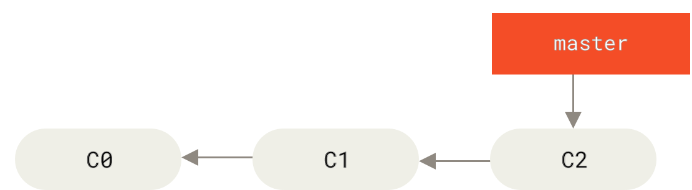
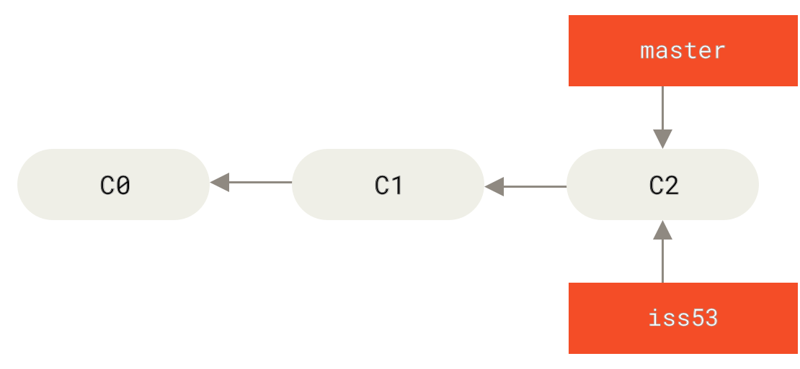
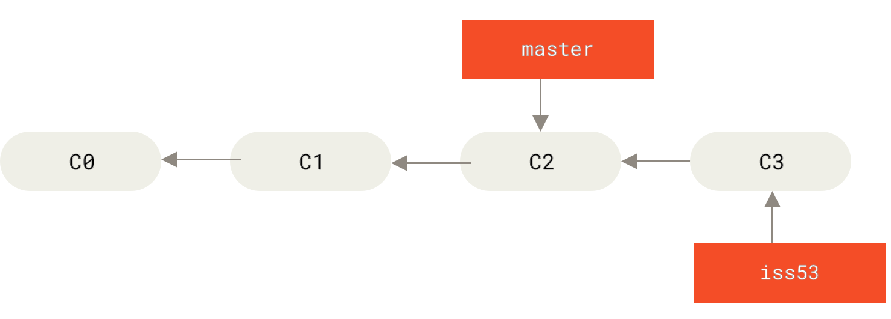
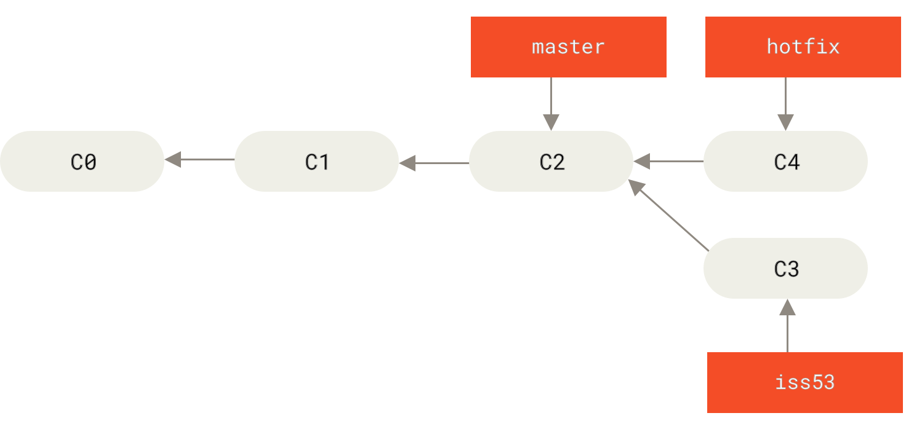
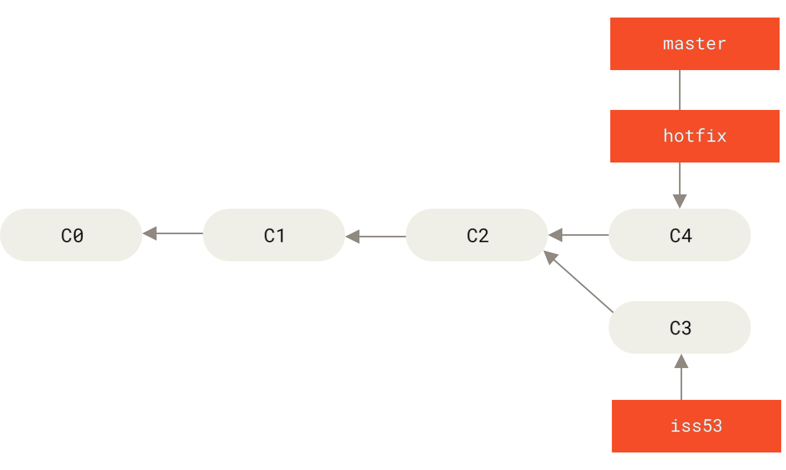
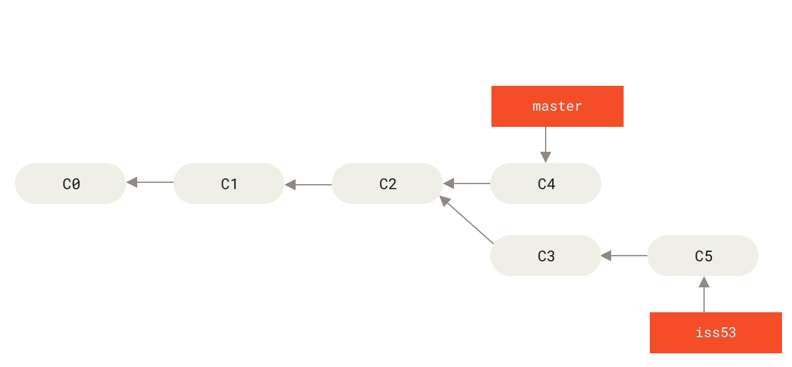
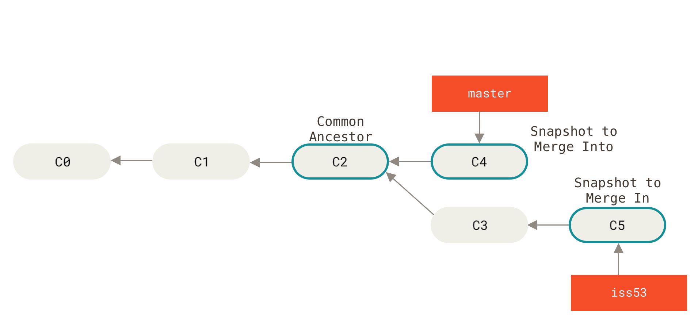
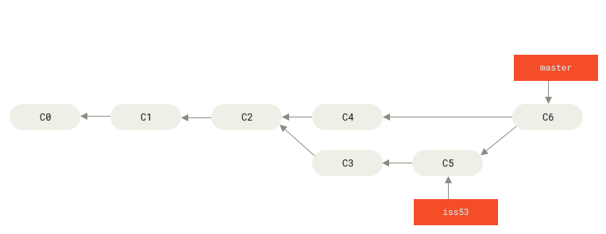

# 11 — Basic Branching and Merging

> **Nguồn chính:** Pro Git §3.2 — <https://git-scm.com/book/en/v2/Git-Branching-Basic-Branching-and-Merging>

📖 **Nguyên văn — kịch bản sách dựng**
> "Let’s go through a simple example of branching and merging with a workflow that you might use in the real world. You’ll follow these steps:
> 1. Do some work on a website.
> 2. Create a branch for a new user story you’re working on.
> 3. Do some work in that branch.
>
> At this stage, you’ll receive a call that another issue is critical and you need a hotfix. You’ll do the following:
> 4. Switch to your production branch.
> 5. Create a branch to add the hotfix.
> 6. After it’s tested, merge the hotfix branch, and push to production.
> 7. Switch back to your original user story and continue working."

🇻🇳 **Dịch**
> "Hãy đi qua một ví dụ đơn giản về branching và merging với workflow bạn có thể dùng ngoài đời thật. Các bước:
> 1. Làm việc trên một website.
> 2. Tạo một branch cho user story mới bạn đang làm.
> 3. Làm việc trong branch đó.
>
> Tới đây, bạn nhận được cuộc gọi báo một vấn đề khác là nghiêm trọng và cần hotfix ngay. Bạn sẽ:
> 4. Chuyển sang branch production.
> 5. Tạo một branch để thêm hotfix.
> 6. Sau khi test xong, merge branch hotfix và push lên production.
> 7. Quay lại user story ban đầu và làm tiếp."

---

## Phần A — Basic Branching

### Bước 1: lịch sử ban đầu


*Figure 18. A simple commit history — nguồn: [Pro Git §3.2](https://git-scm.com/book/en/v2/Git-Branching-Basic-Branching-and-Merging)*

### Bước 2: tạo branch cho issue #53

📖 **Nguyên văn**
> ```
> $ git checkout -b iss53
> Switched to a new branch "iss53"
> ```
> "This is shorthand for:"
> ```
> $ git branch iss53
> $ git checkout iss53
> ```


*Figure 19. Creating a new branch pointer — nguồn: Pro Git §3.2*

### Bước 3: làm việc, branch tiến lên

📖 **Nguyên văn**
> "You work on your website and do some commits.
> Doing so moves the `iss53` branch forward, because you have it checked out (that is, your `HEAD` is pointing to it)."

🇻🇳 **Dịch**
> "Bạn làm việc trên website và tạo vài commit.
> Việc đó đẩy branch `iss53` tiến lên, vì bạn đang checkout nó (tức `HEAD` đang trỏ vào nó)."


*Figure 20. The iss53 branch has moved forward with your work — nguồn: Pro Git §3.2*

### Bước 4: có sự cố, cần hotfix ngay

📖 **Nguyên văn**
> "Now you get the call that there is an issue with the website, and you need to fix it immediately.
> With Git, **you don’t have to deploy your fix along with the `iss53` changes you’ve made**, and you don’t have to put a lot of effort into reverting those changes before you can work on applying your fix to what is in production.
> All you have to do is switch back to your `master` branch."

🇻🇳 **Dịch**
> "Giờ bạn nhận được cuộc gọi báo website có sự cố và bạn phải sửa ngay lập tức.
> Với Git, **bạn không phải deploy bản fix kèm theo các thay đổi `iss53` đang làm dở**, và cũng không phải tốn công revert các thay đổi đó trước khi áp bản fix lên thứ đang chạy production.
> Tất cả những gì bạn cần làm là chuyển về branch `master`."

> [!warning] Điều kiện: working directory phải sạch
> 📖 "note that **if your working directory or staging area has uncommitted changes that conflict with the branch you’re checking out, Git won’t let you switch branches**.
> It’s best to have a clean working state when you switch branches.
> There are ways to get around this (namely, **stashing** and **commit amending**)."
>
> 🇻🇳 "Lưu ý **nếu working directory hoặc staging area có thay đổi chưa commit mà xung đột với branch bạn định checkout, Git sẽ không cho bạn chuyển branch**.
> Tốt nhất là có trạng thái làm việc sạch khi chuyển branch.
> Có cách để lách chuyện này (cụ thể là **stashing** và **commit amending**)."

📖 **Nguyên văn — điểm quan trọng**
> "This is an important point to remember: **when you switch branches, Git resets your working directory to look like it did the last time you committed on that branch.**
> It adds, removes, and modifies files automatically to make sure your working copy is what the branch looked like on your last commit to it."

🇻🇳 **Dịch**
> "Đây là điểm quan trọng cần nhớ: **khi bạn chuyển branch, Git reset working directory về đúng như lần commit gần nhất trên branch đó.**
> Nó tự động thêm, xoá và sửa file để đảm bảo bản copy đang làm việc của bạn giống hệt branch ở commit gần nhất của nó."

### Bước 5: tạo branch hotfix


*Figure 21. Hotfix branch based on master — nguồn: Pro Git §3.2*

### Bước 6: merge — fast-forward ⭐

📖 **Nguyên văn**
> ```
> $ git checkout master
> $ git merge hotfix
> Updating f42c576..3a0874c
> Fast-forward
> ```
> "You’ll notice the phrase **“fast-forward”** in that merge.
> **Because the commit C4 pointed to by the branch `hotfix` you merged in was directly ahead of the commit C2 you’re on, Git simply moves the pointer forward.**
> To phrase that another way, when you try to merge one commit with a commit that can be reached by following the first commit’s history, Git simplifies things by moving the pointer forward because **there is no divergent work to merge together** — this is called a “fast-forward.”"

🇻🇳 **Dịch**
> "Bạn sẽ để ý cụm từ **“fast-forward”** trong lần merge đó.
> **Vì commit C4 mà branch `hotfix` trỏ tới nằm ngay phía trước commit C2 bạn đang đứng, nên Git chỉ đơn giản đẩy con trỏ tiến lên.**
> Nói cách khác, khi bạn merge một commit với một commit có thể đi tới được bằng cách lần theo lịch sử của commit thứ nhất, Git đơn giản hoá bằng cách dịch con trỏ tới trước, vì **không có công việc rẽ nhánh nào cần hợp nhất** — đó gọi là “fast-forward”."


*Figure 22. master is fast-forwarded to hotfix — nguồn: Pro Git §3.2*

💡 **Ví dụ đời sống**
Fast-forward giống như bạn và bạn cùng phòng cùng đọc một cuốn sách. Bạn đang ở trang 100, người kia đọc tới trang 150 trên **cùng** cuốn đó. "Merge" chỉ là dời cái kẹp sách của bạn từ trang 100 sang trang 150 — không có gì để hoà giải cả.

### Bước 7: xoá branch đã merge

📖 **Nguyên văn**
> "you’ll delete the `hotfix` branch, because you no longer need it — **the `master` branch points at the same place**."
> ```
> $ git branch -d hotfix
> ```

🇻🇳 **Dịch**
> "Bạn sẽ xoá branch `hotfix` vì không cần nữa — **branch `master` đã trỏ tới cùng chỗ đó rồi**."


*Figure 23. Work continues on iss53 — nguồn: Pro Git §3.2*

📖 **Nguyên văn**
> "It’s worth noting here that **the work you did in your `hotfix` branch is not contained in the files in your `iss53` branch**.
> If you need to pull it in, you can merge your `master` branch into your `iss53` branch by running `git merge master`, or you can wait to integrate those changes until you decide to pull the `iss53` branch back into `master` later."

🇻🇳 **Dịch**
> "Đáng lưu ý là **công việc bạn làm trong branch `hotfix` KHÔNG có trong các file ở branch `iss53`**.
> Nếu cần kéo vào, bạn có thể merge branch `master` vào branch `iss53` bằng `git merge master`, hoặc chờ tới lúc quyết định kéo `iss53` ngược vào `master` sau này."

---

## Phần B — Basic Merging (three-way merge) ⭐

📖 **Nguyên văn**
> ```
> $ git checkout master
> $ git merge iss53
> Merge made by the 'recursive' strategy.
> ```
> "This looks a bit different than the `hotfix` merge you did earlier.
> In this case, **your development history has diverged from some older point**.
> Because the commit on the branch you’re on isn’t a direct ancestor of the branch you’re merging in, Git has to do some work.
> In this case, **Git does a simple three-way merge, using the two snapshots pointed to by the branch tips and the common ancestor of the two**."

🇻🇳 **Dịch**
> "Lần này trông hơi khác lần merge `hotfix` trước đó.
> Ở đây, **lịch sử phát triển của bạn đã rẽ nhánh từ một điểm cũ hơn**.
> Vì commit trên branch bạn đang đứng không phải tổ tiên trực tiếp của branch bạn đang merge vào, Git phải làm thêm việc.
> Trong trường hợp này, **Git thực hiện một three-way merge đơn giản, dùng hai snapshot mà hai đầu branch trỏ tới cùng với tổ tiên chung của chúng**."


*Figure 24. Three snapshots used in a typical merge — nguồn: Pro Git §3.2*

📖 **Nguyên văn**
> "Instead of just moving the branch pointer forward, Git creates a new snapshot that results from this three-way merge and automatically creates a new commit that points to it.
> **This is referred to as a merge commit, and is special in that it has more than one parent.**"

🇻🇳 **Dịch**
> "Thay vì chỉ dịch con trỏ branch tiến lên, Git tạo một snapshot mới là kết quả của three-way merge này và tự động tạo một commit mới trỏ tới nó.
> **Đó được gọi là merge commit, và nó đặc biệt ở chỗ có nhiều hơn một parent.**"


*Figure 25. A merge commit — nguồn: Pro Git §3.2*

💡 **Ví dụ đời sống**
Three-way merge giống hai người cùng sửa một hợp đồng từ **cùng một bản gốc**. Muốn gộp lại, bạn cần ba thứ: bản của A, bản của B, và **bản gốc** — nhờ bản gốc mới biết ai đã đổi chỗ nào. Nếu hai người sửa hai điều khoản khác nhau, gộp tự động được. Nếu cùng sửa một điều khoản → phải ngồi lại đàm phán (= conflict).

---

## Phần C — Basic Merge Conflicts

📖 **Nguyên văn**
> "Occasionally, this process doesn’t go smoothly.
> **If you changed the same part of the same file differently in the two branches you’re merging, Git won’t be able to merge them cleanly.**"
> ```
> $ git merge iss53
> Auto-merging index.html
> CONFLICT (content): Merge conflict in index.html
> Automatic merge failed; fix conflicts and then commit the result.
> ```

🇻🇳 **Dịch**
> "Thỉnh thoảng quá trình này không suôn sẻ.
> **Nếu bạn sửa cùng một đoạn của cùng một file theo hai cách khác nhau ở hai branch đang merge, Git sẽ không thể merge sạch sẽ.**"

📖 **Nguyên văn**
> "**Git hasn’t automatically created a new merge commit. It has paused the process while you resolve the conflict.**
> If you want to see which files are unmerged at any point after a merge conflict, you can run `git status`."

🇻🇳 **Dịch**
> "**Git chưa tự động tạo merge commit mới. Nó đã tạm dừng quá trình lại để bạn giải quyết conflict.**
> Muốn biết file nào đang unmerged tại bất kỳ thời điểm nào sau khi có conflict, chạy `git status`."

### Conflict markers

📖 **Nguyên văn**
> "Git adds standard conflict-resolution markers to the files that have conflicts, so you can open them manually and resolve those conflicts.
> Your file contains a section that looks something like this:"
> ```
> <<<<<<< HEAD:index.html
> <div id="footer">contact : email.support@github.com</div>
> =======
> <div id="footer">
>  please contact us at support@github.com
> </div>
> >>>>>>> iss53:index.html
> ```
> "This means **the version in `HEAD` (your `master` branch, because that was what you had checked out when you ran your merge command) is the top part of that block (everything above the `=======`), while the version in your `iss53` branch looks like everything in the bottom part**."

🇻🇳 **Dịch**
> "Git thêm các marker giải quyết conflict chuẩn vào những file bị conflict, để bạn mở ra và tự giải quyết. […]
> Nghĩa là **phiên bản trong `HEAD` (branch `master` của bạn, vì đó là branch bạn đang checkout khi chạy lệnh merge) là phần TRÊN của khối đó (mọi thứ phía trên `=======`), còn phiên bản ở branch `iss53` là toàn bộ phần DƯỚI**."

📖 **Nguyên văn — cách giải quyết**
> "In order to resolve the conflict, you have to either choose one side or the other or merge the contents yourself. […]
> This resolution has a little of each section, and **the `<<<<<<<`, `=======`, and `>>>>>>>` lines have been completely removed**.
> After you’ve resolved each of these sections in each conflicted file, **run `git add` on each file to mark it as resolved. Staging the file marks it as resolved in Git.**"

🇻🇳 **Dịch**
> "Để giải quyết conflict, bạn phải chọn một trong hai phía, hoặc tự tay hoà trộn nội dung. […]
> Bản giải quyết này lấy một chút từ mỗi phần, và **các dòng `<<<<<<<`, `=======`, `>>>>>>>` đã bị xoá hoàn toàn**.
> Sau khi giải quyết từng đoạn trong từng file bị conflict, **chạy `git add` lên từng file để đánh dấu đã xong. Việc stage file chính là cách đánh dấu “đã resolve” trong Git.**"

> [!danger] Lỗi kinh điển
> Quên xoá `<<<<<<<`, `=======`, `>>>>>>>` rồi commit lên. Code sẽ crash ngay vì các marker đó không phải cú pháp hợp lệ của ngôn ngữ nào cả.

### `git mergetool`

📖 **Nguyên văn**
> "If you want to use a graphical tool to resolve these issues, you can run `git mergetool`, which fires up an appropriate visual merge tool and walks you through the conflicts. […]
> After you exit the merge tool, Git asks you if the merge was successful.
> If you tell the script that it was, it stages the file to mark it as resolved for you."

🇻🇳 **Dịch**
> "Nếu muốn dùng công cụ đồ hoạ để giải quyết, chạy `git mergetool` — nó mở một visual merge tool phù hợp và dẫn bạn đi qua từng conflict. […]
> Sau khi bạn thoát merge tool, Git hỏi bạn merge có thành công không.
> Nếu bạn trả lời có, nó stage file giúp bạn để đánh dấu đã resolve."

### Kết thúc merge

📖 **Nguyên văn**
> ```
> $ git status
> On branch master
> All conflicts fixed but you are still merging.
>   (use "git commit" to conclude merge)
> ```
> "If you’re happy with that, and you verify that everything that had conflicts has been staged, you can type `git commit` to finalize the merge commit."

🇻🇳 **Dịch**
> "Nếu bạn hài lòng và đã xác nhận mọi thứ từng bị conflict đều đã được stage, gõ `git commit` để chốt merge commit."

📖 **Nguyên văn — lời khuyên về message**
> "If you think it would be helpful to others looking at this merge in the future, you can modify this commit message with details about **how you resolved the merge** and explain **why** you did the changes you made if these are not obvious."

🇻🇳 **Dịch**
> "Nếu bạn nghĩ nó sẽ hữu ích cho người sau xem lại lần merge này, hãy sửa commit message để ghi rõ **bạn đã giải quyết merge thế nào** và giải thích **vì sao** bạn làm những thay đổi đó, nếu chúng không hiển nhiên."

---

## Tóm tắt: hai kiểu merge

| | Fast-forward | Three-way merge |
|---|---|---|
| Khi nào | Branch đích là tổ tiên trực tiếp | Lịch sử đã rẽ nhánh |
| Git làm gì | Dịch con trỏ tiến lên | Tạo **merge commit** mới |
| Số parent của commit mới | (không tạo commit mới) | **≥ 2 parent** |
| Có conflict không | Không bao giờ | Có thể |

```bash
git checkout -b iss53          # tạo + chuyển
git checkout master
git merge hotfix               # fast-forward
git merge iss53                # three-way merge
git branch -d hotfix           # xoá branch đã merge
# khi conflict:
git status                     # file nào unmerged
# sửa file, xoá marker
git add <file>                 # = đánh dấu đã resolve
git commit                     # chốt merge commit
```

## Liên kết
- Bài trước: [[10 - Branches in a Nutshell]]
- Bài kế: [[12 - Branch Management và Branching Workflows]]
- `rebase` là cách tích hợp thay thế cho merge: [[14 - Rebasing]]

## Nguồn tham khảo
- Pro Git §3.2: <https://git-scm.com/book/en/v2/Git-Branching-Basic-Branching-and-Merging>
- Hình Figure 18–25 lấy từ trang trên, lưu trong `assets/`
