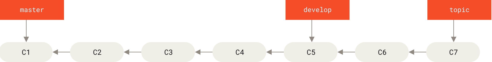
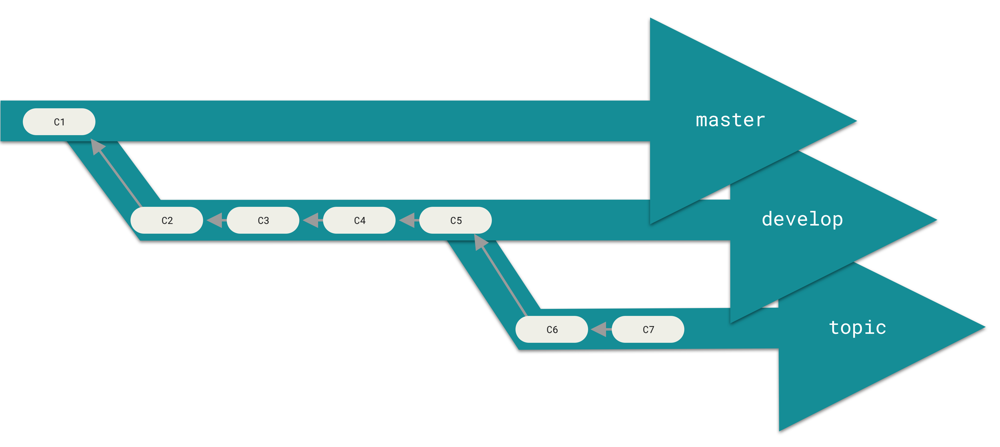
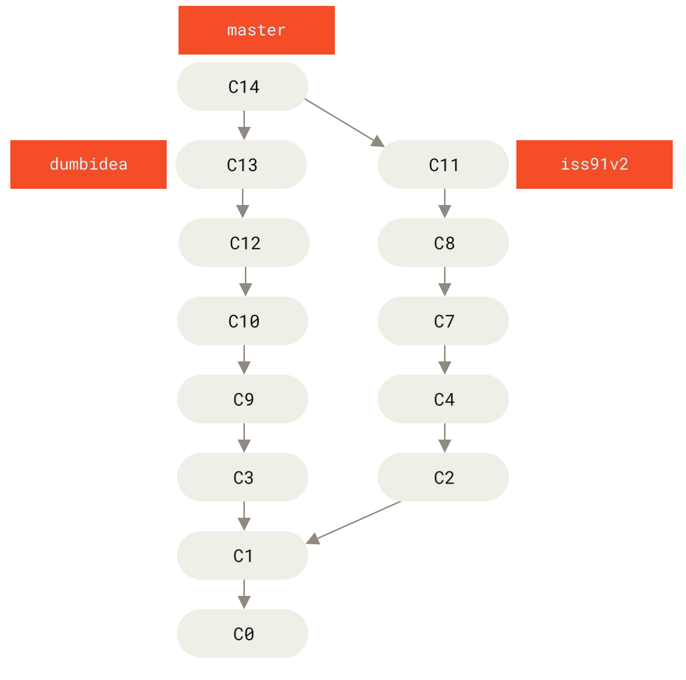

# 12 — Branch Management và Branching Workflows

> **Nguồn chính:** Pro Git §3.3 + §3.4
> - <https://git-scm.com/book/en/v2/Git-Branching-Branch-Management>
> - <https://git-scm.com/book/en/v2/Git-Branching-Branching-Workflows>

---

# Phần A — Branch Management (§3.3)

## 1. Liệt kê branch

📖 **Nguyên văn**
> ```
> $ git branch
>   iss53
> * master
>   testing
> ```
> "Notice the `*` character that prefixes the `master` branch: **it indicates the branch that you currently have checked out (i.e., the branch that `HEAD` points to)**.
> This means that if you commit at this point, the `master` branch will be moved forward with your new work."

🇻🇳 **Dịch**
> "Để ý ký tự `*` đứng trước branch `master`: **nó cho biết branch bạn đang checkout (tức branch mà `HEAD` đang trỏ tới)**.
> Nghĩa là nếu bạn commit lúc này, branch `master` sẽ tiến lên cùng công việc mới của bạn."

📖 **Nguyên văn — `-v`**
> "To see the last commit on each branch, you can run `git branch -v`."

🇻🇳 **Dịch**
> "Để xem commit gần nhất trên mỗi branch, chạy `git branch -v`."

## 2. `--merged` và `--no-merged` ⭐

📖 **Nguyên văn**
> "The useful `--merged` and `--no-merged` options can filter this list to branches that you have or have not yet merged into the branch you’re currently on. […]
> Branches on this list without the `*` in front of them are generally **fine to delete** with `git branch -d`; you’ve already incorporated their work into another branch, so you’re not going to lose anything."

🇻🇳 **Dịch**
> "Hai option hữu ích `--merged` và `--no-merged` lọc danh sách này thành các branch bạn **đã** hoặc **chưa** merge vào branch hiện tại. […]
> Những branch trong danh sách `--merged` mà không có dấu `*` phía trước thì **xoá an toàn** bằng `git branch -d`; công việc của chúng đã được hợp nhất vào branch khác, nên bạn không mất gì cả."

📖 **Nguyên văn**
> "To see all the branches that contain work you haven’t yet merged in, you can run `git branch --no-merged`. […]
> Because it contains work that isn’t merged in yet, trying to delete it with `git branch -d` will fail:"
> ```
> $ git branch -d testing
> error: The branch 'testing' is not fully merged.
> If you are sure you want to delete it, run 'git branch -D testing'.
> ```
> "If you really do want to delete the branch and lose that work, you can force it with `-D`, as the helpful message points out."

🇻🇳 **Dịch**
> "Để xem mọi branch còn chứa công việc bạn chưa merge vào, chạy `git branch --no-merged`. […]
> Vì nó chứa công việc chưa được merge, cố xoá bằng `git branch -d` sẽ thất bại. […]
> Nếu bạn thực sự muốn xoá branch và mất luôn phần việc đó, ép bằng `-D` như thông báo đã gợi ý."

> [!warning] `-d` vs `-D`
> - `-d` = xoá **an toàn**, Git chặn nếu chưa merge.
> - `-D` = ép xoá, **mất commit**. Chỉ dùng khi biết chắc.

📖 **Nguyên văn — hỏi về branch khác**
> "The options described above, `--merged` and `--no-merged` will, if not given a commit or branch name as an argument, show you what is, respectively, merged or not merged into your **current** branch.
> You can always provide an additional argument to ask about the merge state with respect to some other branch **without checking that other branch out first**."
> ```
> $ git checkout testing
> $ git branch --no-merged master
>   topicA
>   featureB
> ```

🇻🇳 **Dịch**
> "Hai option `--merged` và `--no-merged` ở trên, nếu không kèm tên commit hay branch, sẽ hiện những gì đã/chưa merge vào branch **hiện tại**.
> Bạn luôn có thể thêm một tham số để hỏi về trạng thái merge so với một branch khác, **mà không cần checkout branch đó trước**."

## 3. Đổi tên branch

> [!danger] Cảnh báo của sách
> 📖 "**Do not rename branches that are still in use by other collaborators.**
> Do not rename a branch like `master`/`main`/`mainline` without having read the section Changing the master branch name."
> 🇻🇳 "**Đừng đổi tên những branch mà đồng nghiệp khác vẫn đang dùng.**"

📖 **Nguyên văn — quy trình**
> "Rename the branch locally with the `git branch --move` command:"
> ```
> $ git branch --move bad-branch-name corrected-branch-name
> ```
> "This replaces your `bad-branch-name` with `corrected-branch-name`, **but this change is only local for now**.
> To let others see the corrected branch on the remote, push it:"
> ```
> $ git push --set-upstream origin corrected-branch-name
> ```

🇻🇳 **Dịch**
> "Đổi tên branch ở local bằng lệnh `git branch --move`. […]
> Lệnh này thay `bad-branch-name` bằng `corrected-branch-name`, **nhưng thay đổi này hiện mới chỉ ở local**.
> Để người khác thấy branch tên đúng trên remote, hãy push nó lên."

📖 **Nguyên văn**
> "However, the branch with the bad name is also still present there but you can delete it by executing the following command:"
> ```
> $ git push origin --delete bad-branch-name
> ```

🇻🇳 **Dịch**
> "Tuy nhiên branch với tên cũ vẫn còn trên remote, bạn xoá nó bằng lệnh trên."

## 4. Đổi tên branch `master` → `main`

> [!danger] Cảnh báo của sách
> 📖 "**Changing the name of a branch like `master`/`main`/`mainline`/`default` will break the integrations, services, helper utilities and build/release scripts that your repository uses.**
> Before you do this, make sure you consult with your collaborators.
> Also, make sure you do a thorough search through your repo and update any references to the old branch name in your code and scripts."
>
> 🇻🇳 "**Đổi tên một branch như `master`/`main`/`mainline`/`default` sẽ làm hỏng các integration, service, tiện ích hỗ trợ và script build/release mà repository của bạn đang dùng.**
> Trước khi làm, hãy bàn với đồng nghiệp.
> Đồng thời tìm kỹ trong toàn repo và cập nhật mọi tham chiếu tới tên branch cũ trong code và script."

📖 **Nguyên văn — checklist chuyển đổi**
> "Now you have a few more tasks in front of you to complete the transition:
> - Any projects that depend on this one will need to update their code and/or configuration.
> - Update any test-runner configuration files.
> - Adjust build and release scripts.
> - Redirect settings on your repo host for things like the repo’s default branch, merge rules, and other things that match branch names.
> - Update references to the old branch in documentation.
> - Close or merge any pull requests that target the old branch."

🇻🇳 **Dịch**
> "Còn vài việc nữa để hoàn tất chuyển đổi:
> - Mọi project phụ thuộc project này cần cập nhật code và/hoặc cấu hình.
> - Cập nhật các file cấu hình test-runner.
> - Điều chỉnh script build và release.
> - Chỉnh lại thiết lập trên repo host: branch mặc định của repo, luật merge, và những thứ khác khớp theo tên branch.
> - Cập nhật tham chiếu tới branch cũ trong tài liệu.
> - Đóng hoặc merge mọi pull request nhắm vào branch cũ."

📖 **Nguyên văn**
> "After you’ve done all these tasks, and are certain the `main` branch performs just as the `master` branch, you can delete the `master` branch:"
> ```
> $ git push origin --delete master
> ```

---

# Phần B — Branching Workflows (§3.4)

## 1. Long-Running Branches

📖 **Nguyên văn**
> "Because Git uses a simple three-way merge, merging from one branch into another multiple times over a long period is generally easy to do.
> This means you can have several branches that are always open and that you use for different stages of your development cycle; you can merge regularly from some of them into others."

🇻🇳 **Dịch**
> "Vì Git dùng three-way merge đơn giản, việc merge từ branch này sang branch khác nhiều lần trong thời gian dài nói chung là dễ.
> Nghĩa là bạn có thể có vài branch luôn mở, dùng cho các giai đoạn khác nhau của chu trình phát triển; và merge định kỳ từ branch này sang branch kia."

📖 **Nguyên văn**
> "Many Git developers have a workflow that embraces this approach, such as having **only code that is entirely stable in their `master` branch** — possibly only code that has been or will be released.
> They have another parallel branch named **`develop` or `next`** that they work from or use to test stability — it isn’t necessarily always stable, but whenever it gets to a stable state, it can be merged into `master`.
> It’s used to pull in **topic branches** (short-lived branches, like your earlier `iss53` branch) when they’re ready, to make sure they pass all the tests and don’t introduce bugs."

🇻🇳 **Dịch**
> "Nhiều lập trình viên Git dùng workflow theo hướng này, ví dụ **chỉ giữ code hoàn toàn ổn định trong branch `master`** — có thể chỉ là code đã release hoặc sắp release.
> Họ có một branch song song tên **`develop` hoặc `next`** để làm việc hoặc để kiểm thử độ ổn định — nó không nhất thiết lúc nào cũng ổn định, nhưng khi đạt trạng thái ổn định thì có thể merge vào `master`.
> Branch này dùng để kéo các **topic branch** (branch ngắn hạn, như `iss53` lúc trước) vào khi chúng sẵn sàng, nhằm đảm bảo chúng qua hết test và không sinh bug."

📖 **Nguyên văn**
> "In reality, we’re talking about pointers moving up the line of commits you’re making.
> **The stable branches are farther down the line in your commit history, and the bleeding-edge branches are farther up the history.**"

🇻🇳 **Dịch**
> "Thực chất, ta đang nói về các con trỏ di chuyển dọc theo dòng commit bạn tạo ra.
> **Các branch ổn định nằm lùi về phía sau trong lịch sử commit, còn các branch tiên phong (bleeding-edge) nằm tiến về phía trước.**"


*Figure 26. A linear view of progressive-stability branching — nguồn: [Pro Git §3.4](https://git-scm.com/book/en/v2/Git-Branching-Branching-Workflows)*

📖 **Nguyên văn**
> "It’s generally easier to think about them as **work silos**, where sets of commits graduate to a more stable silo when they’re fully tested."

🇻🇳 **Dịch**
> "Thường thì dễ hình dung hơn khi coi chúng là các **silo công việc**, nơi từng nhóm commit “tốt nghiệp” lên silo ổn định hơn khi đã được test đầy đủ."


*Figure 27. A "silo" view of progressive-stability branching — nguồn: Pro Git §3.4*

📖 **Nguyên văn**
> "Some larger projects also have a `proposed` or `pu` (proposed updates) branch that has integrated branches that may not be ready to go into the `next` or `master` branch.
> The idea is that **your branches are at various levels of stability; when they reach a more stable level, they’re merged into the branch above them**.
> Again, having multiple long-running branches isn’t necessary, but it’s often helpful, especially when you’re dealing with very large or complex projects."

🇻🇳 **Dịch**
> "Một số project lớn còn có branch `proposed` hoặc `pu` (proposed updates) chứa các branch đã tích hợp nhưng có thể chưa sẵn sàng vào `next` hay `master`.
> Ý tưởng là **các branch của bạn ở những mức độ ổn định khác nhau; khi đạt mức ổn định hơn, chúng được merge lên branch phía trên**.
> Một lần nữa, có nhiều long-running branch không phải là bắt buộc, nhưng thường hữu ích, đặc biệt với project rất lớn hoặc phức tạp."

💡 **Ví dụ đời sống**
Giống quy trình xuất bản: bản nháp (`topic branch`) → bản biên tập (`develop`) → bản in thử (`next`) → bản phát hành (`master`). Mỗi cấp chỉ nhận nội dung đã qua kiểm duyệt của cấp dưới.

## 2. Topic Branches

📖 **Nguyên văn**
> "**A topic branch is a short-lived branch that you create and use for a single particular feature or related work.**
> This is something you’ve likely never done with a VCS before because it’s generally too expensive to create and merge branches.
> But in Git it’s common to **create, work on, merge, and delete branches several times a day**."

🇻🇳 **Dịch**
> "**Topic branch là một branch ngắn hạn bạn tạo và dùng cho đúng một tính năng cụ thể hoặc một nhóm công việc liên quan.**
> Đây là thứ bạn có lẽ chưa từng làm với VCS trước đây, vì việc tạo và merge branch nói chung quá tốn kém.
> Nhưng trong Git, chuyện **tạo, làm việc, merge và xoá branch vài lần mỗi ngày** là bình thường."

📖 **Nguyên văn**
> "This technique allows you to **context-switch quickly and completely** — because your work is separated into silos where all the changes in that branch have to do with that topic, it’s easier to see what has happened during code review and such.
> You can keep the changes there for minutes, days, or months, and merge them in when they’re ready, **regardless of the order in which they were created or worked on**."

🇻🇳 **Dịch**
> "Kỹ thuật này cho phép bạn **chuyển ngữ cảnh nhanh và dứt khoát** — vì công việc được tách thành các silo, mọi thay đổi trong branch đó đều liên quan tới đúng chủ đề đó, nên dễ nhìn ra chuyện gì đã xảy ra khi code review.
> Bạn có thể để các thay đổi đó nằm đấy vài phút, vài ngày, hay vài tháng, rồi merge khi chúng sẵn sàng, **bất kể thứ tự chúng được tạo ra hay được làm**."


*Figure 28. Multiple topic branches — nguồn: Pro Git §3.4*

📖 **Nguyên văn**
> "Now, let’s say you decide you like the second solution to your issue best (`iss91v2`); and you showed the `dumbidea` branch to your coworkers, and it turns out to be genius.
> **You can throw away the original `iss91` branch (losing commits C5 and C6) and merge in the other two.**"

🇻🇳 **Dịch**
> "Giả sử bạn quyết định thích giải pháp thứ hai (`iss91v2`) nhất; và bạn cho đồng nghiệp xem branch `dumbidea`, hoá ra nó lại thiên tài.
> **Bạn có thể vứt branch `iss91` gốc đi (mất commit C5 và C6) và merge hai branch kia vào.**"


*Figure 29. History after merging dumbidea and iss91v2 — nguồn: Pro Git §3.4*

## 3. Điểm mấu chốt cuối chương ⭐

📖 **Nguyên văn**
> "It’s important to remember when you’re doing all this that **these branches are completely local**.
> When you’re branching and merging, everything is being done only in your Git repository — **there is no communication with the server**."

🇻🇳 **Dịch**
> "Điều quan trọng cần nhớ khi làm tất cả những việc này là **các branch này hoàn toàn nằm ở local**.
> Khi bạn branch và merge, mọi thứ chỉ diễn ra trong Git repository của bạn — **không hề có giao tiếp nào với server**."

🇻🇳 Đây chính là lý do branch trong Git nhanh tới vậy — liên hệ [[02 - What is Git]] mục "Nearly Every Operation Is Local". Muốn đưa branch lên server thì phải đọc tiếp [[13 - Remote Branches]].

---

## Tóm tắt lệnh

```bash
git branch                      # liệt kê, * = branch hiện tại
git branch -v                   # kèm commit cuối của mỗi branch
git branch --merged             # branch đã merge vào branch hiện tại → xoá được
git branch --no-merged          # branch chưa merge → xoá sẽ bị chặn
git branch --no-merged master   # hỏi về branch khác, không cần checkout
git branch -d <b>               # xoá an toàn
git branch -D <b>               # ép xoá (mất commit)
git branch --move <cũ> <mới>    # đổi tên (local)
git push --set-upstream origin <mới>
git push origin --delete <cũ>
```

## Liên kết
- Bài trước: [[11 - Basic Branching and Merging]]
- Bài kế: [[13 - Remote Branches]]

## Nguồn tham khảo
- Pro Git §3.3: <https://git-scm.com/book/en/v2/Git-Branching-Branch-Management>
- Pro Git §3.4: <https://git-scm.com/book/en/v2/Git-Branching-Branching-Workflows>
- Hình Figure 26–29 lấy từ trang trên, lưu trong `assets/`
