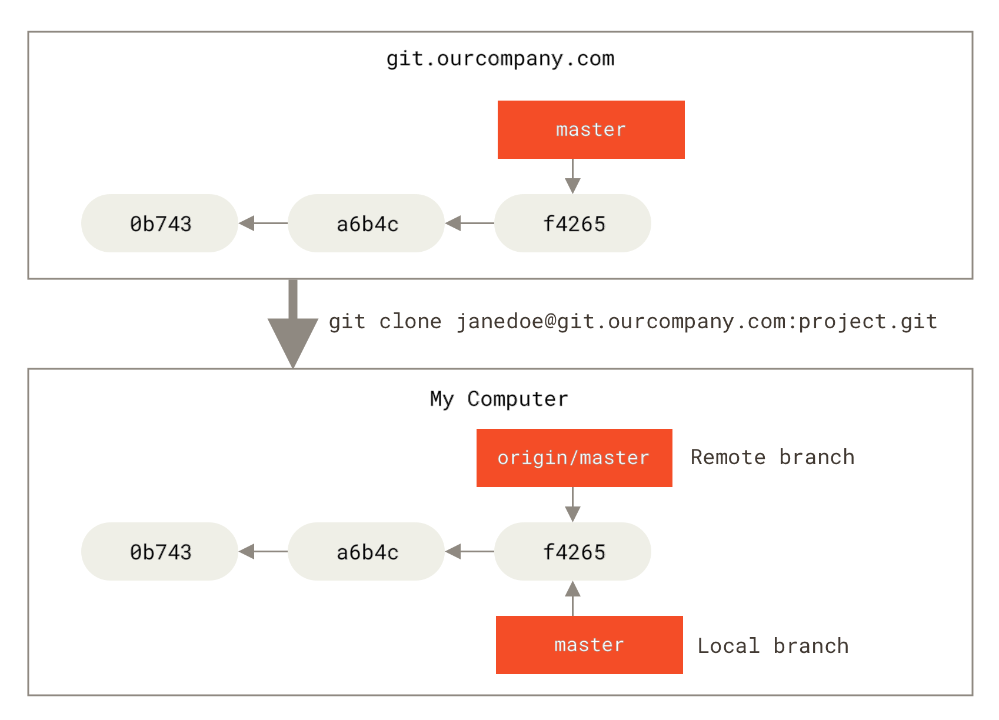
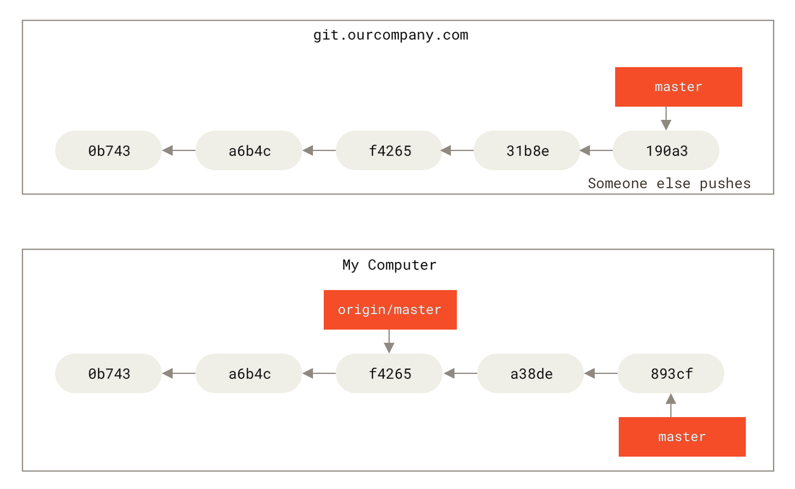
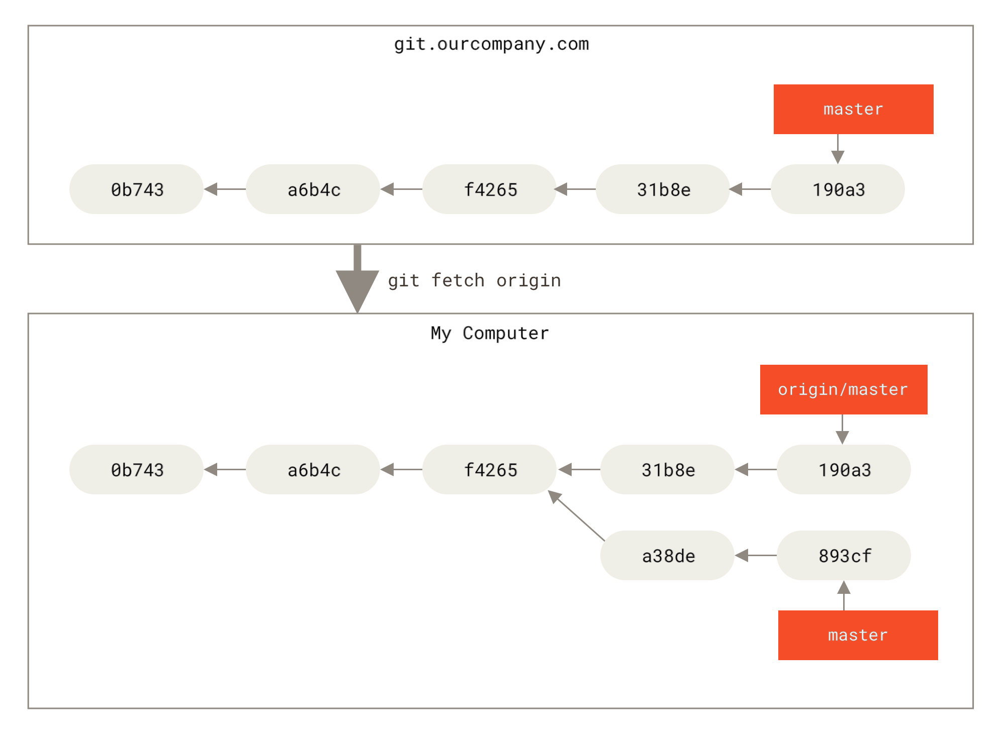
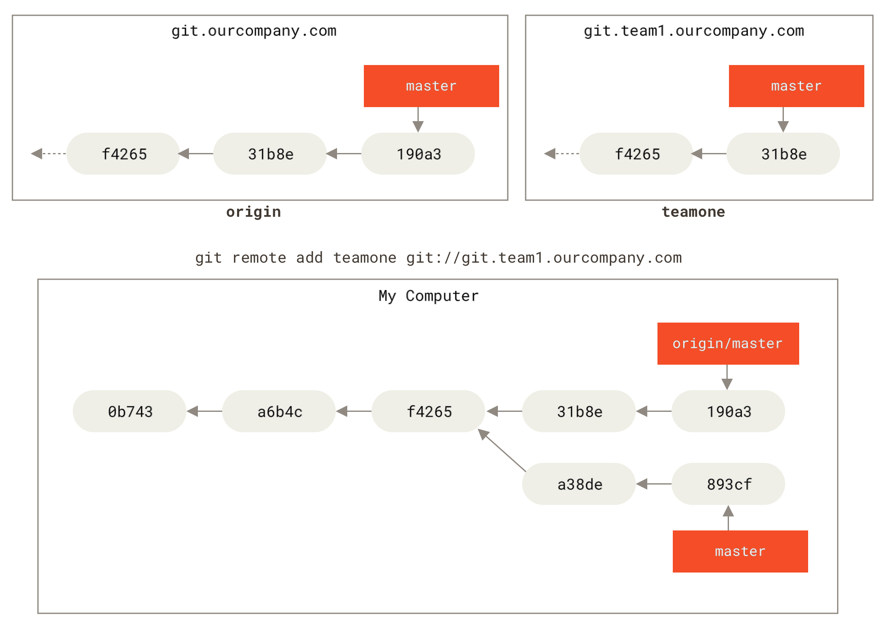
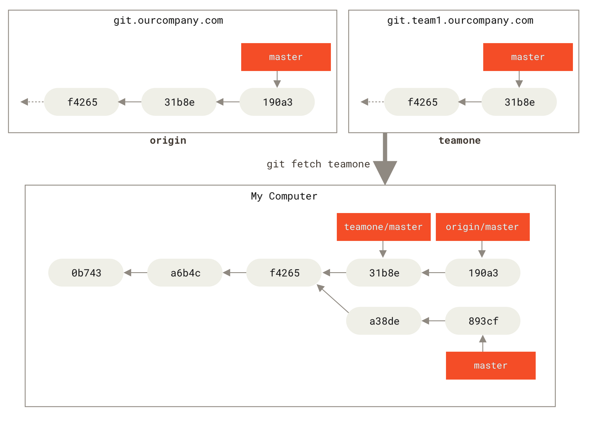

# 13 — Remote Branches

> **Nguồn chính:** Pro Git §3.5 — <https://git-scm.com/book/en/v2/Git-Branching-Remote-Branches>

---

## 1. Remote-tracking branch là gì ⭐

📖 **Nguyên văn**
> "Remote references are references (pointers) in your remote repositories, including branches, tags, and so on.
> You can get a full list of remote references explicitly with `git ls-remote <remote>`, or `git remote show <remote>` for remote branches as well as more information.
> Nevertheless, a more common way is to take advantage of **remote-tracking branches**."

🇻🇳 **Dịch**
> "Remote reference là các tham chiếu (con trỏ) nằm trong remote repository của bạn, gồm branch, tag, v.v.
> Bạn có thể lấy danh sách đầy đủ bằng `git ls-remote <remote>`, hoặc `git remote show <remote>` để xem remote branch kèm thêm thông tin.
> Tuy nhiên, cách phổ biến hơn là tận dụng **remote-tracking branch**."

📖 **Nguyên văn — định nghĩa**
> "Remote-tracking branches are references to the state of remote branches.
> **They’re local references that you can’t move; Git moves them for you whenever you do any network communication**, to make sure they accurately represent the state of the remote repository.
> **Think of them as bookmarks, to remind you where the branches in your remote repositories were the last time you connected to them.**"

🇻🇳 **Dịch**
> "Remote-tracking branch là các tham chiếu tới trạng thái của các branch trên remote.
> **Chúng là tham chiếu local mà bạn KHÔNG thể tự di chuyển; Git di chuyển chúng giúp bạn mỗi khi bạn thực hiện giao tiếp mạng**, để đảm bảo chúng phản ánh chính xác trạng thái của remote repository.
> **Hãy coi chúng như những cái kẹp sách, nhắc bạn nhớ các branch trên remote repository đang ở đâu vào lần cuối bạn kết nối tới.**"

📖 **Nguyên văn — cách đặt tên**
> "Remote-tracking branch names take the form `<remote>/<branch>`.
> For instance, if you wanted to see what the `master` branch on your `origin` remote looked like as of the last time you communicated with it, you would check the `origin/master` branch."

🇻🇳 **Dịch**
> "Tên remote-tracking branch có dạng `<remote>/<branch>`.
> Ví dụ, nếu muốn xem branch `master` trên remote `origin` trông thế nào tính tới lần cuối bạn giao tiếp với nó, bạn xem branch `origin/master`."

> [!note] "origin" không đặc biệt
> 📖 "Just like the branch name “master” does not have any special meaning in Git, neither does “origin”.
> While “master” is the default name for a starting branch when you run `git init` […], “origin” is the default name for a remote when you run `git clone`.
> **If you run `git clone -o booyah` instead, then you will have `booyah/master` as your default remote branch.**"
>
> 🇻🇳 "Cũng như tên branch “master” không mang ý nghĩa đặc biệt nào trong Git, “origin” cũng vậy.
> “master” là tên mặc định của branch khởi đầu khi chạy `git init`, còn “origin” là tên mặc định cho một remote khi chạy `git clone`.
> **Nếu bạn chạy `git clone -o booyah`, bạn sẽ có `booyah/master` làm remote branch mặc định.**"


*Figure 30. Server and local repositories after cloning — nguồn: [Pro Git §3.5](https://git-scm.com/book/en/v2/Git-Branching-Remote-Branches)*

---

## 2. Khi local và remote rẽ nhánh

📖 **Nguyên văn**
> "If you do some work on your local `master` branch, and, in the meantime, someone else pushes to `git.ourcompany.com` and updates its `master` branch, then your histories move forward differently.
> Also, **as long as you stay out of contact with your `origin` server, your `origin/master` pointer doesn’t move**."

🇻🇳 **Dịch**
> "Nếu bạn làm việc trên branch `master` local, trong khi đó người khác push lên `git.ourcompany.com` và cập nhật branch `master` ở đó, thì hai lịch sử tiến lên theo hướng khác nhau.
> Đồng thời, **chừng nào bạn còn chưa liên lạc với server `origin`, con trỏ `origin/master` của bạn sẽ không nhúc nhích**."


*Figure 31. Local and remote work can diverge — nguồn: Pro Git §3.5*

📖 **Nguyên văn — fetch**
> "To synchronize your work with a given remote, you run a `git fetch <remote>` command […].
> This command looks up which server “origin” is […], fetches any data from it that you don’t yet have, and updates your local database, **moving your `origin/master` pointer to its new, more up-to-date position**."

🇻🇳 **Dịch**
> "Để đồng bộ công việc với một remote, chạy lệnh `git fetch <remote>`. […]
> Lệnh này tra xem “origin” là server nào […], lấy về mọi dữ liệu bạn chưa có, và cập nhật database local, **đẩy con trỏ `origin/master` tới vị trí mới, cập nhật hơn**."


*Figure 32. git fetch updates your remote-tracking branches — nguồn: Pro Git §3.5*

## 3. Nhiều remote cùng lúc

📖 **Nguyên văn**
> "let’s assume you have another internal Git server that is used only for development by one of your sprint teams. […]
> Name this remote `teamone`, which will be your shortname for that whole URL."

🇻🇳 **Dịch**
> "Giả sử bạn có thêm một Git server nội bộ khác chỉ dùng cho việc phát triển của một sprint team. […]
> Đặt tên remote này là `teamone`, làm shortname cho cả URL đó."


*Figure 33. Adding another server as a remote — nguồn: Pro Git §3.5*

📖 **Nguyên văn**
> "Because that server has a subset of the data your `origin` server has right now, **Git fetches no data but sets a remote-tracking branch called `teamone/master`** to point to the commit that `teamone` has as its `master` branch."

🇻🇳 **Dịch**
> "Vì server đó chỉ có một tập con dữ liệu mà server `origin` đang có, **Git không tải dữ liệu nào về mà chỉ đặt một remote-tracking branch tên `teamone/master`** trỏ tới commit mà `teamone` đang coi là branch `master` của nó."


*Figure 34. Remote-tracking branch for teamone/master — nguồn: Pro Git §3.5*

---

## 4. Pushing

📖 **Nguyên văn**
> "**Your local branches aren’t automatically synchronized to the remotes you write to — you have to explicitly push the branches you want to share.**
> That way, you can use private branches for work you don’t want to share, and push up only the topic branches you want to collaborate on."

🇻🇳 **Dịch**
> "**Các branch local của bạn KHÔNG tự động đồng bộ lên các remote bạn có quyền ghi — bạn phải push tường minh những branch muốn chia sẻ.**
> Nhờ vậy, bạn có thể dùng branch riêng tư cho việc không muốn chia sẻ, và chỉ push lên những topic branch muốn cộng tác."

📖 **Nguyên văn — cú pháp đầy đủ**
> "This is a bit of a shortcut.
> Git automatically expands the `serverfix` branchname out to `refs/heads/serverfix:refs/heads/serverfix`, which means, **“Take my `serverfix` local branch and push it to update the remote’s `serverfix` branch.”** […]
> You can use this format to push a local branch into a remote branch that is named differently.
> If you didn’t want it to be called `serverfix` on the remote, you could instead run `git push origin serverfix:awesomebranch`."

🇻🇳 **Dịch**
> "Đây là cách viết tắt.
> Git tự động mở rộng tên branch `serverfix` thành `refs/heads/serverfix:refs/heads/serverfix`, nghĩa là **“Lấy branch `serverfix` local của tôi và push nó để cập nhật branch `serverfix` trên remote.”** […]
> Bạn có thể dùng dạng này để push một branch local lên một remote branch có tên khác.
> Nếu không muốn nó tên `serverfix` trên remote, bạn chạy `git push origin serverfix:awesomebranch`."

> [!tip] Đỡ phải gõ mật khẩu mỗi lần
> 📖 "If you don’t want to type it every single time you push, you can set up a “credential cache”. The simplest is just to keep it in memory for a few minutes, which you can easily set up by running `git config --global credential.helper cache`."
> 🇻🇳 Dùng credential cache để không phải gõ user/password mỗi lần push qua HTTPS.

📖 **Nguyên văn — điểm rất hay nhầm**
> "It’s important to note that **when you do a fetch that brings down new remote-tracking branches, you don’t automatically have local, editable copies of them**.
> In other words, in this case, you don’t have a new `serverfix` branch — **you have only an `origin/serverfix` pointer that you can’t modify**."

🇻🇳 **Dịch**
> "Quan trọng: **khi bạn fetch và kéo về các remote-tracking branch mới, bạn KHÔNG tự động có bản copy local có thể sửa được của chúng**.
> Nói cách khác, trong trường hợp này bạn không có branch `serverfix` mới — **bạn chỉ có con trỏ `origin/serverfix` mà bạn không sửa được**."

📖 **Nguyên văn — tạo branch local từ remote**
> "To merge this work into your current working branch, you can run `git merge origin/serverfix`.
> If you want your own `serverfix` branch that you can work on, you can base it off your remote-tracking branch:"
> ```
> $ git checkout -b serverfix origin/serverfix
> Branch serverfix set up to track remote branch serverfix from origin.
> ```

🇻🇳 **Dịch**
> "Để merge phần việc này vào branch đang làm, chạy `git merge origin/serverfix`.
> Nếu muốn có branch `serverfix` của riêng mình để làm việc, hãy tạo nó dựa trên remote-tracking branch."

---

## 5. Tracking Branches & Upstream ⭐

📖 **Nguyên văn**
> "Checking out a local branch from a remote-tracking branch automatically creates what is called a **“tracking branch”** (and the branch it tracks is called an **“upstream branch”**).
> Tracking branches are local branches that have a direct relationship to a remote branch.
> **If you’re on a tracking branch and type `git pull`, Git automatically knows which server to fetch from and which branch to merge in.**"

🇻🇳 **Dịch**
> "Việc checkout một branch local từ một remote-tracking branch tự động tạo ra cái gọi là **“tracking branch”** (và branch mà nó track được gọi là **“upstream branch”**).
> Tracking branch là các branch local có quan hệ trực tiếp với một remote branch.
> **Nếu bạn đang ở một tracking branch và gõ `git pull`, Git tự biết phải fetch từ server nào và merge branch nào vào.**"

📖 **Nguyên văn — các cách viết tắt**
> "The simple case is the example you just saw, running `git checkout -b <branch> <remote>/<branch>`.
> This is a common enough operation that Git provides the `--track` shorthand:"
> ```
> $ git checkout --track origin/serverfix
> ```
> "In fact, this is so common that there’s even a shortcut for that shortcut.
> **If the branch name you’re trying to checkout (a) doesn’t exist and (b) exactly matches a name on only one remote, Git will create a tracking branch for you:**"
> ```
> $ git checkout serverfix
> Branch serverfix set up to track remote branch serverfix from origin.
> ```

🇻🇳 **Dịch**
> "Trường hợp đơn giản là ví dụ bạn vừa thấy: `git checkout -b <branch> <remote>/<branch>`.
> Thao tác này phổ biến tới mức Git cung cấp cách viết tắt `--track`. […]
> Thực tế nó phổ biến đến mức có cả cách viết tắt của cách viết tắt.
> **Nếu tên branch bạn định checkout (a) chưa tồn tại và (b) khớp chính xác một tên trên đúng một remote, Git sẽ tự tạo tracking branch cho bạn.**"

📖 **Nguyên văn — tên local khác tên remote**
> ```
> $ git checkout -b sf origin/serverfix
> Branch sf set up to track remote branch serverfix from origin.
> ```
> "Now, your local branch `sf` will automatically pull from `origin/serverfix`."

📖 **Nguyên văn — đổi upstream sau**
> "If you already have a local branch and want to set it to a remote branch you just pulled down, or want to change the upstream branch you’re tracking, you can use the `-u` or `--set-upstream-to` option to `git branch`."
> ```
> $ git branch -u origin/serverfix
> ```

🇻🇳 **Dịch**
> "Nếu bạn đã có branch local và muốn gán nó vào một remote branch vừa kéo về, hoặc muốn đổi upstream branch đang track, dùng option `-u` hoặc `--set-upstream-to` của `git branch`."

> [!note] Upstream shorthand
> 📖 "When you have a tracking branch set up, you can reference its upstream branch with the `@{upstream}` or `@{u}` shorthand.
> So if you’re on the `master` branch and it’s tracking `origin/master`, you can say something like `git merge @{u}` instead of `git merge origin/master`."
> 🇻🇳 Khi đã có tracking branch, tham chiếu tới upstream của nó bằng `@{upstream}` hoặc `@{u}`.

### `git branch -vv` — xem ahead/behind

📖 **Nguyên văn**
> ```
> $ git branch -vv
>   iss53     7e424c3 [origin/iss53: ahead 2] Add forgotten brackets
>   master    1ae2a45 [origin/master] Deploy index fix
> * serverfix f8674d9 [teamone/server-fix-good: ahead 3, behind 1] This should do it
>   testing   5ea463a Try something new
> ```
> "So here we can see that our `iss53` branch is tracking `origin/iss53` and is “ahead” by two, meaning that **we have two commits locally that are not pushed to the server**. […]
> our `serverfix` branch is tracking the `server-fix-good` branch on our `teamone` server and is ahead by three and behind by one, meaning that **there is one commit on the server we haven’t merged in yet and three commits locally that we haven’t pushed**.
> Finally we can see that our `testing` branch is not tracking any remote branch."

🇻🇳 **Dịch**
> "Ở đây ta thấy branch `iss53` đang track `origin/iss53` và “ahead” 2, nghĩa là **ta có 2 commit ở local chưa push lên server**. […]
> Branch `serverfix` đang track branch `server-fix-good` trên server `teamone`, ahead 3 và behind 1, nghĩa là **có 1 commit trên server ta chưa merge vào và 3 commit ở local ta chưa push**.
> Cuối cùng, branch `testing` không track remote branch nào."

> [!warning] Con số ahead/behind là dữ liệu CŨ
> 📖 "It’s important to note that **these numbers are only since the last time you fetched from each server**.
> **This command does not reach out to the servers**, it’s telling you about what it has cached from these servers locally.
> If you want totally up to date ahead and behind numbers, you’ll need to fetch from all your remotes right before running this."
> ```
> $ git fetch --all; git branch -vv
> ```
>
> 🇻🇳 "Các con số này **chỉ tính từ lần cuối bạn fetch từ mỗi server**. **Lệnh này không hề kết nối tới server**, nó chỉ báo lại thứ đã cache ở local."

---

## 6. Pulling

📖 **Nguyên văn**
> "While the `git fetch` command will fetch all the changes on the server that you don’t have yet, **it will not modify your working directory at all**.
> It will simply get the data for you and let you merge it yourself.
> However, there is a command called `git pull` which is essentially **a `git fetch` immediately followed by a `git merge`** in most cases."

🇻🇳 **Dịch**
> "Trong khi lệnh `git fetch` lấy về mọi thay đổi trên server mà bạn chưa có, **nó hoàn toàn không đụng tới working directory của bạn**.
> Nó chỉ lấy dữ liệu về và để bạn tự merge.
> Tuy nhiên có lệnh `git pull` mà về bản chất là **`git fetch` rồi ngay lập tức `git merge`** trong hầu hết trường hợp."

📖 **Nguyên văn**
> "If you have a tracking branch set up […], `git pull` will look up what server and branch your current branch is tracking, fetch from that server and then try to merge in that remote branch."

🇻🇳 **Dịch**
> "Nếu bạn đã thiết lập tracking branch […], `git pull` sẽ tra xem branch hiện tại đang track server nào, branch nào, fetch từ server đó rồi thử merge remote branch ấy vào."

---

## 7. Xoá remote branch

📖 **Nguyên văn**
> "You can delete a remote branch using the `--delete` option to `git push`."
> ```
> $ git push origin --delete serverfix
> To https://github.com/schacon/simplegit
>  - [deleted]         serverfix
> ```
> "Basically all this does is to **remove the pointer from the server**.
> The Git server will generally keep the data there for a while until a garbage collection runs, so **if it was accidentally deleted, it’s often easy to recover**."

🇻🇳 **Dịch**
> "Bạn xoá một remote branch bằng option `--delete` của `git push`. […]
> Về cơ bản việc này chỉ **gỡ con trỏ khỏi server**.
> Git server thường vẫn giữ dữ liệu ở đó một thời gian cho tới khi garbage collection chạy, nên **nếu lỡ tay xoá nhầm thì thường vẫn khôi phục được dễ dàng**."

---

## Tóm tắt

| Khái niệm | Là gì |
|---|---|
| **Remote branch** | Branch thật nằm trên server |
| **Remote-tracking branch** (`origin/main`) | Kẹp sách ở local, ghi nhớ vị trí branch trên server lần cuối kết nối. Bạn **không** sửa được |
| **Tracking branch** | Branch local có quan hệ trực tiếp với một remote branch |
| **Upstream branch** | Remote branch mà tracking branch đang theo dõi |

```bash
git fetch origin                        # cập nhật mọi origin/*
git fetch --all; git branch -vv         # ahead/behind chính xác
git push origin serverfix               # chia sẻ branch
git push origin serverfix:awesome       # push lên tên khác
git checkout --track origin/serverfix   # tạo tracking branch
git checkout serverfix                  # viết tắt, nếu tên khớp duy nhất
git branch -u origin/serverfix          # gán/đổi upstream
git merge @{u}                          # merge upstream
git push origin --delete serverfix      # xoá branch trên server
```

## Liên kết
- Bài trước: [[12 - Branch Management và Branching Workflows]]
- Bài kế: [[14 - Rebasing]]
- `git remote` cơ bản: [[08 - Working with Remotes]]

## Nguồn tham khảo
- Pro Git §3.5: <https://git-scm.com/book/en/v2/Git-Branching-Remote-Branches>
- Hình Figure 30–34 lấy từ trang trên, lưu trong `assets/`
