# 14 — Rebasing

> **Nguồn chính:** Pro Git §3.6 — <https://git-scm.com/book/en/v2/Git-Branching-Rebasing>

📖 **Nguyên văn**
> "In Git, there are **two main ways to integrate changes from one branch into another: the `merge` and the `rebase`**.
> In this section you’ll learn what rebasing is, how to do it, why it’s a pretty amazing tool, and in what cases you won’t want to use it."

🇻🇳 **Dịch**
> "Trong Git có **hai cách chính để tích hợp thay đổi từ branch này sang branch khác: `merge` và `rebase`**.
> Phần này bạn sẽ học rebase là gì, làm thế nào, vì sao nó là công cụ khá tuyệt vời, và những trường hợp nào thì bạn không nên dùng."

---

## 1. The Basic Rebase

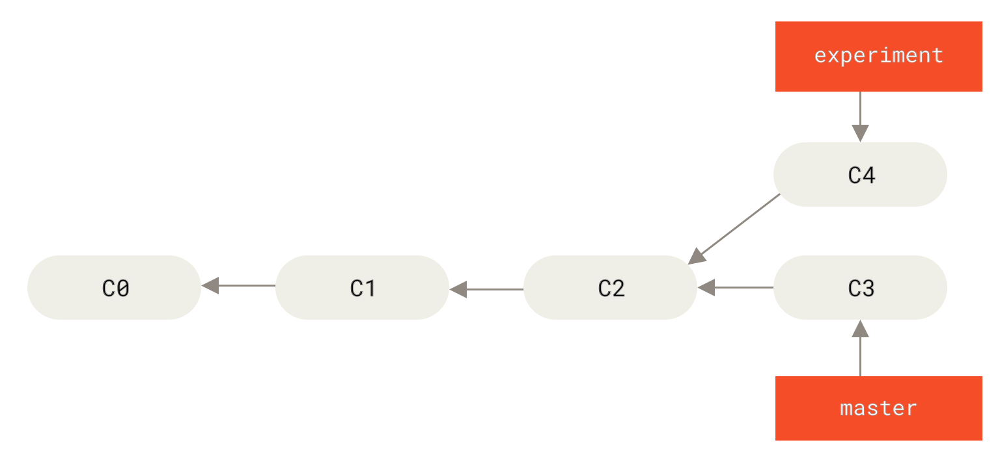
*Figure 35. Simple divergent history — nguồn: [Pro Git §3.6](https://git-scm.com/book/en/v2/Git-Branching-Rebasing)*

📖 **Nguyên văn — cách merge**
> "The easiest way to integrate the branches […] is the `merge` command.
> It performs a three-way merge between the two latest branch snapshots (C3 and C4) and the most recent common ancestor of the two (C2), creating a new snapshot (and commit)."

🇻🇳 **Dịch**
> "Cách dễ nhất để tích hợp hai branch […] là lệnh `merge`.
> Nó thực hiện three-way merge giữa hai snapshot mới nhất của hai branch (C3 và C4) và tổ tiên chung gần nhất của chúng (C2), tạo ra một snapshot (và commit) mới."

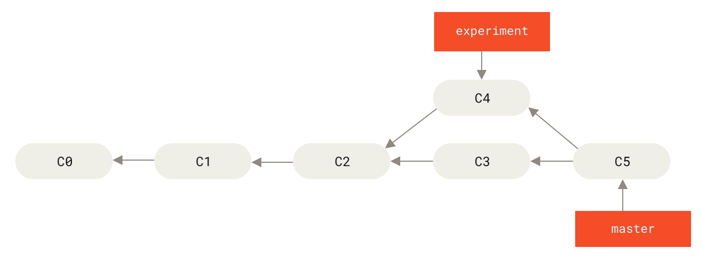
*Figure 36. Merging to integrate diverged work history — nguồn: Pro Git §3.6*

📖 **Nguyên văn — cách rebase**
> "However, there is another way: **you can take the patch of the change that was introduced in C4 and reapply it on top of C3**.
> In Git, this is called **rebasing**.
> With the `rebase` command, you can take all the changes that were committed on one branch and **replay** them on a different branch."
> ```
> $ git checkout experiment
> $ git rebase master
> First, rewinding head to replay your work on top of it...
> Applying: added staged command
> ```

🇻🇳 **Dịch**
> "Tuy nhiên còn một cách khác: **bạn có thể lấy patch của thay đổi mà C4 tạo ra và áp lại nó lên trên C3**.
> Trong Git việc này gọi là **rebasing**.
> Với lệnh `rebase`, bạn lấy toàn bộ thay đổi đã commit trên một branch và **phát lại (replay)** chúng trên một branch khác."

📖 **Nguyên văn — cơ chế**
> "This operation works by going to the common ancestor of the two branches (the one you’re on and the one you’re rebasing onto), **getting the diff introduced by each commit of the branch you’re on, saving those diffs to temporary files, resetting the current branch to the same commit as the branch you are rebasing onto, and finally applying each change in turn**."

🇻🇳 **Dịch**
> "Thao tác này hoạt động bằng cách đi tới tổ tiên chung của hai branch (branch bạn đang đứng và branch bạn rebase lên), **lấy diff mà mỗi commit của branch bạn đang đứng tạo ra, lưu các diff đó vào file tạm, reset branch hiện tại về đúng commit của branch bạn đang rebase lên, và cuối cùng áp từng thay đổi một theo thứ tự**."

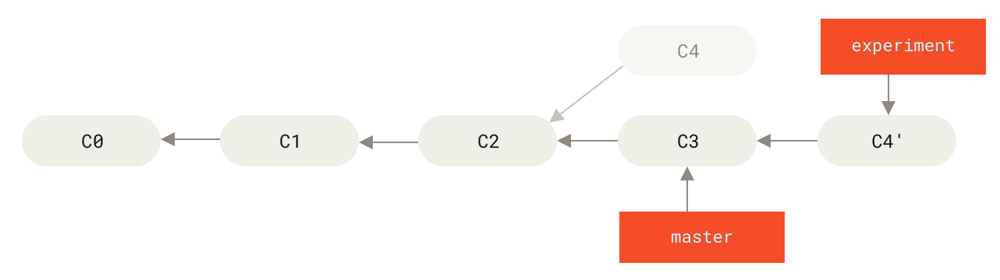
*Figure 37. Rebasing the change introduced in C4 onto C3 — nguồn: Pro Git §3.6*

📖 **Nguyên văn**
> "At this point, you can go back to the `master` branch and do a fast-forward merge."
> ```
> $ git checkout master
> $ git merge experiment
> ```

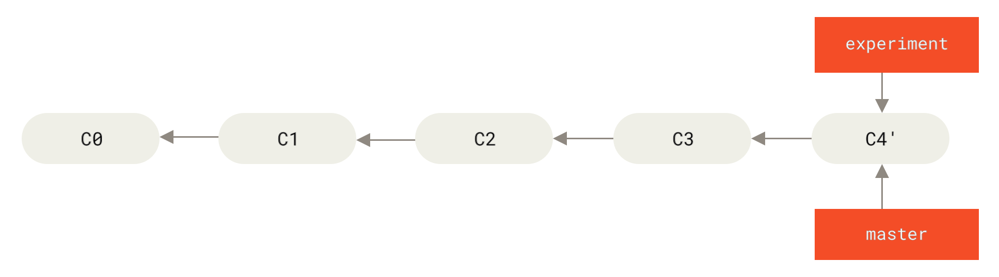
*Figure 38. Fast-forwarding the master branch — nguồn: Pro Git §3.6*

### Kết quả giống nhau, lịch sử khác nhau ⭐

📖 **Nguyên văn**
> "Now, the snapshot pointed to by C4' is **exactly the same** as the one that was pointed to by C5 in the merge example.
> **There is no difference in the end product of the integration, but rebasing makes for a cleaner history.**
> If you examine the log of a rebased branch, it looks like a linear history: **it appears that all the work happened in series, even when it originally happened in parallel**."

🇻🇳 **Dịch**
> "Snapshot mà C4' trỏ tới **giống hệt** snapshot mà C5 trỏ tới trong ví dụ merge.
> **Không có khác biệt nào ở sản phẩm cuối của việc tích hợp, nhưng rebase cho ra lịch sử sạch hơn.**
> Nếu xem log của một branch đã rebase, nó trông như một lịch sử tuyến tính: **trông như thể mọi việc diễn ra tuần tự, dù ban đầu chúng diễn ra song song**."

📖 **Nguyên văn — dùng khi đóng góp code**
> "Often, you’ll do this to make sure your commits apply cleanly on a remote branch — perhaps in a project to which you’re trying to contribute but that you don’t maintain.
> In this case, you’d do your work in a branch and then rebase your work onto `origin/master` when you were ready to submit your patches to the main project.
> **That way, the maintainer doesn’t have to do any integration work — just a fast-forward or a clean apply.**"

🇻🇳 **Dịch**
> "Bạn thường làm vậy để chắc rằng commit của mình áp lên remote branch một cách sạch sẽ — ví dụ khi đóng góp cho một project bạn không phải người bảo trì.
> Trường hợp này, bạn làm việc trong một branch rồi rebase công việc của mình lên `origin/master` khi sẵn sàng gửi patch cho project chính.
> **Nhờ vậy, maintainer không phải làm việc tích hợp nào cả — chỉ cần fast-forward hoặc áp patch sạch.**"

📖 **Nguyên văn — câu tổng kết quan trọng**
> "Note that the snapshot pointed to by the final commit you end up with, whether it’s the last of the rebased commits for a rebase or the final merge commit after a merge, **is the same snapshot — it’s only the history that is different**.
> **Rebasing replays changes from one line of work onto another in the order they were introduced, whereas merging takes the endpoints and merges them together.**"

🇻🇳 **Dịch**
> "Lưu ý rằng snapshot mà commit cuối cùng trỏ tới — dù đó là commit cuối trong loạt commit đã rebase, hay merge commit cuối sau khi merge — **đều là cùng một snapshot; chỉ có lịch sử là khác**.
> **Rebase phát lại các thay đổi từ một dòng công việc lên một dòng khác theo đúng thứ tự chúng được tạo ra, còn merge thì lấy hai điểm cuối và hoà chúng lại với nhau.**"

💡 **Ví dụ đời sống**
- **Merge** = hai người viết chung một cuốn sổ, tới cuối ngồi lại ghi thêm một trang "chúng tôi đã gộp hai phần này lại". Trang gộp đó là bằng chứng lịch sử.
- **Rebase** = bạn chép lại phần của mình vào cuối phần của người kia, như thể bạn viết sau họ ngay từ đầu. Sổ đọc mượt hơn, nhưng "sự thật" là hai người viết song song đã bị xoá.

---

## 2. More Interesting Rebases — `--onto`

📖 **Nguyên văn**
> "You branched a topic branch (`server`) to add some server-side functionality to your project, and made a commit.
> Then, you branched off that to make the client-side changes (`client`) and committed a few times.
> Finally, you went back to your `server` branch and did a few more commits."

🇻🇳 **Dịch**
> "Bạn tách một topic branch (`server`) để thêm chức năng phía server và tạo một commit.
> Rồi bạn tách tiếp từ đó để làm các thay đổi phía client (`client`) và commit vài lần.
> Cuối cùng bạn quay lại branch `server` và commit thêm vài cái nữa."

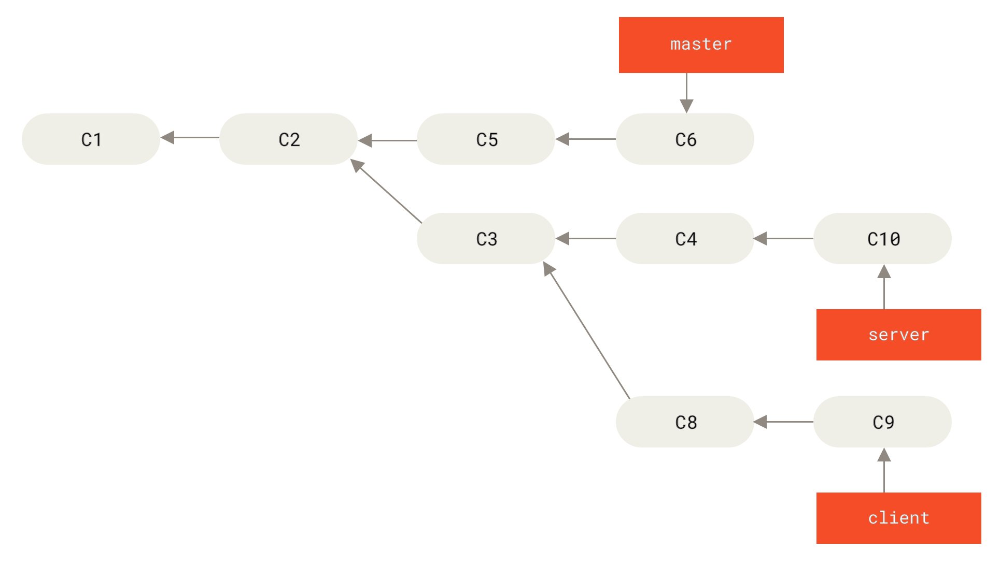
*Figure 39. A history with a topic branch off another topic branch — nguồn: Pro Git §3.6*

📖 **Nguyên văn**
> "Suppose you decide that you want to merge your client-side changes into your mainline for a release, but you want to hold off on the server-side changes until it’s tested further.
> You can take the changes on `client` that aren’t on `server` (C8 and C9) and replay them on your `master` branch by using the `--onto` option of `git rebase`:"
> ```
> $ git rebase --onto master server client
> ```
> "This basically says, **“Take the `client` branch, figure out the patches since it diverged from the `server` branch, and replay these patches in the `client` branch as if it was based directly off the `master` branch instead.”**"

🇻🇳 **Dịch**
> "Giả sử bạn quyết định muốn merge các thay đổi phía client vào nhánh chính để release, nhưng muốn hoãn các thay đổi phía server cho tới khi test kỹ hơn.
> Bạn có thể lấy các thay đổi trên `client` mà không có trên `server` (C8 và C9) và phát lại chúng lên branch `master` bằng option `--onto` của `git rebase`. […]
> Lệnh này về cơ bản nói: **“Lấy branch `client`, tìm ra các patch kể từ lúc nó rẽ khỏi branch `server`, và phát lại các patch đó trong branch `client` như thể nó được tạo trực tiếp từ branch `master`.”**"

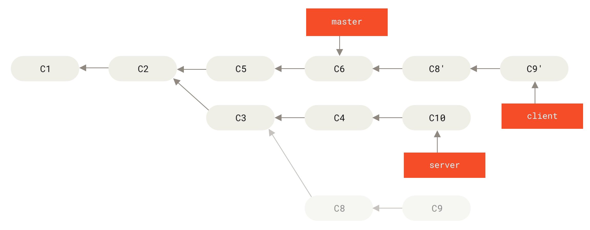
*Figure 40. Rebasing a topic branch off another topic branch — nguồn: Pro Git §3.6*

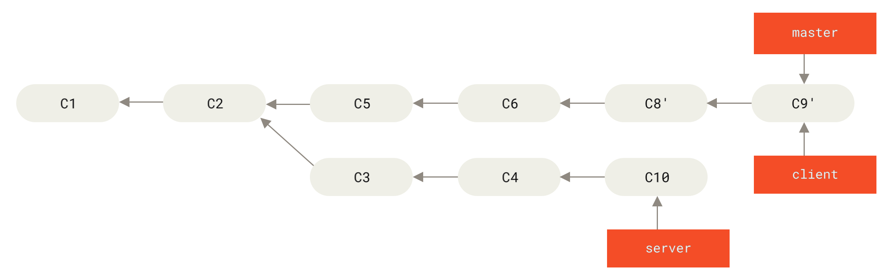
*Figure 41. Fast-forwarding your master branch to include the client branch changes — nguồn: Pro Git §3.6*

📖 **Nguyên văn — rebase không cần checkout**
> "You can rebase the `server` branch onto the `master` branch **without having to check it out first** by running `git rebase <basebranch> <topicbranch>` — which checks out the topic branch (in this case, `server`) for you and replays it onto the base branch (`master`)."
> ```
> $ git rebase master server
> ```

🇻🇳 **Dịch**
> "Bạn có thể rebase branch `server` lên branch `master` **mà không cần checkout nó trước**, bằng cách chạy `git rebase <branch-gốc> <topic-branch>` — lệnh này tự checkout topic branch (ở đây là `server`) giúp bạn rồi phát lại nó lên branch gốc (`master`)."

*Figure 42. Rebasing your server branch on top of your master branch — nguồn: Pro Git §3.6*

*Figure 43. Final commit history — nguồn: Pro Git §3.6*

---

## 3. The Perils of Rebasing ⭐⭐

> [!danger] Quy tắc quan trọng nhất của cả chương
> 📖 "Ahh, but the bliss of rebasing isn’t without its drawbacks, which can be summed up in a single line:
> **Do not rebase commits that exist outside your repository and that people may have based work on.**
> If you follow that guideline, you’ll be fine. If you don’t, people will hate you, and you’ll be scorned by friends and family."
>
> 🇻🇳 "Nhưng niềm vui của rebase không phải không có mặt trái, và có thể tóm gọn trong một dòng:
> **Đừng rebase những commit đã tồn tại bên ngoài repository của bạn và có thể đã có người dựa vào đó để làm việc.**
> Theo đúng nguyên tắc đó thì bạn ổn. Không theo thì người ta sẽ ghét bạn, và bạn sẽ bị bạn bè lẫn người thân khinh bỉ."

📖 **Nguyên văn — vì sao**
> "When you rebase stuff, **you’re abandoning existing commits and creating new ones that are similar but different**.
> If you push commits somewhere and others pull them down and base work on them, and then you rewrite those commits with `git rebase` and push them up again, **your collaborators will have to re-merge their work and things will get messy** when you try to pull their work back into yours."

🇻🇳 **Dịch**
> "Khi rebase, **bạn đang vứt bỏ các commit hiện có và tạo ra các commit mới tương tự nhưng khác biệt**.
> Nếu bạn đã push commit lên đâu đó, người khác đã pull về và dựa trên chúng để làm việc, rồi bạn viết lại các commit ấy bằng `git rebase` và push lên lại, **đồng nghiệp của bạn sẽ phải merge lại công việc của họ và mọi thứ sẽ rối tung lên** khi bạn kéo công việc của họ về."

### Kịch bản thảm hoạ, từng bước

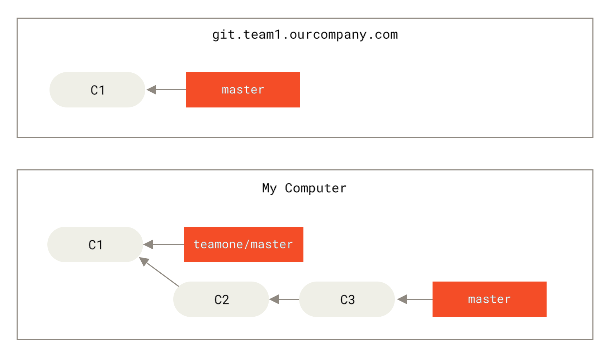
*Figure 44. Clone a repository, and base some work on it — nguồn: Pro Git §3.6*

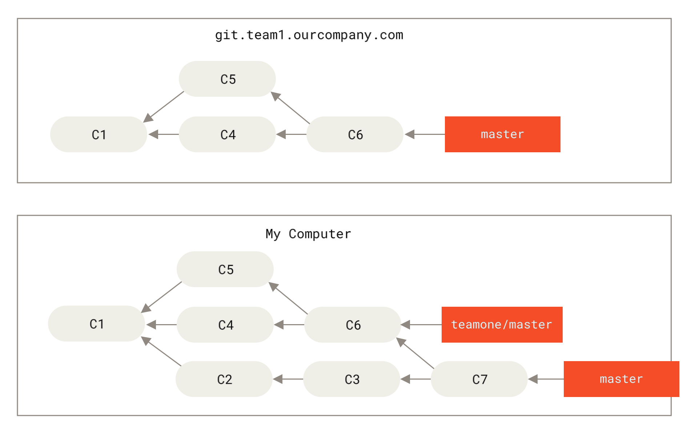
*Figure 45. Fetch more commits, and merge them into your work — nguồn: Pro Git §3.6*

📖 **Nguyên văn**
> "Next, the person who pushed the merged work decides to go back and rebase their work instead; they do a **`git push --force`** to overwrite the history on the server.
> You then fetch from that server, bringing down the new commits."

🇻🇳 **Dịch**
> "Tiếp theo, người đã push phần việc đã merge quyết định quay lại và rebase công việc của họ; họ chạy **`git push --force`** để ghi đè lịch sử trên server.
> Sau đó bạn fetch từ server đó, kéo về các commit mới."

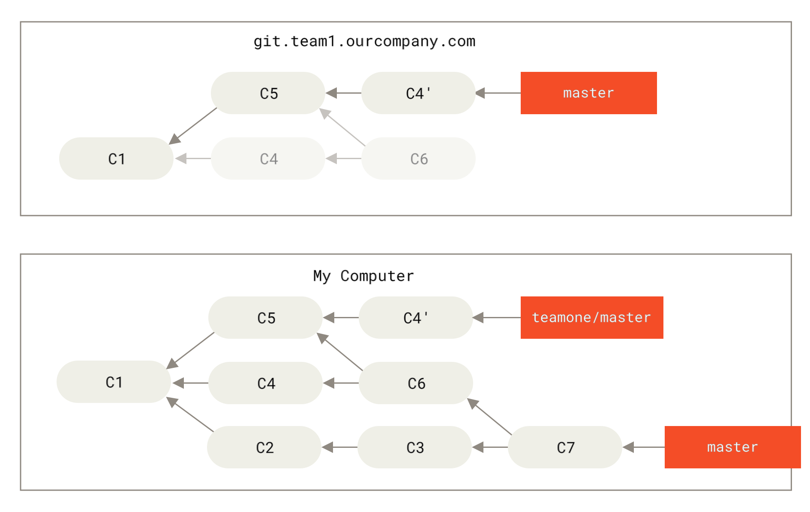
*Figure 46. Someone pushes rebased commits, abandoning commits you've based your work on — nguồn: Pro Git §3.6*

📖 **Nguyên văn**
> "Now you’re both in a pickle.
> If you do a `git pull`, you’ll create a merge commit which includes both lines of history."

🇻🇳 **Dịch**
> "Giờ thì cả hai bạn đều rắc rối.
> Nếu bạn `git pull`, bạn sẽ tạo ra một merge commit bao gồm cả hai dòng lịch sử."

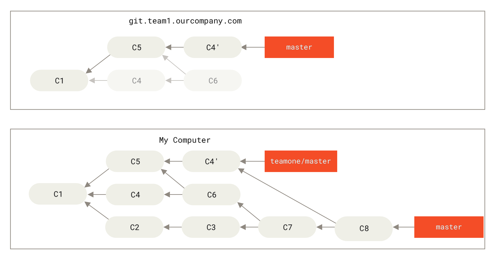
*Figure 47. You merge in the same work again into a new merge commit — nguồn: Pro Git §3.6*

📖 **Nguyên văn**
> "If you run a `git log` when your history looks like this, **you’ll see two commits that have the same author, date, and message, which will be confusing**.
> Furthermore, if you push this history back up to the server, you’ll reintroduce all those rebased commits to the central server, which can further confuse people.
> It’s pretty safe to assume that the other developer doesn’t want C4 and C6 to be in the history; that’s why they rebased in the first place."

🇻🇳 **Dịch**
> "Nếu chạy `git log` khi lịch sử trông như vậy, **bạn sẽ thấy hai commit có cùng author, cùng ngày, cùng message — rất khó hiểu**.
> Hơn nữa, nếu bạn push lịch sử này lên server, bạn sẽ đưa lại toàn bộ những commit đã bị rebase lên server trung tâm, làm mọi người càng rối.
> Khá chắc là lập trình viên kia không muốn C4 và C6 nằm trong lịch sử; đó chính là lý do họ rebase ngay từ đầu."

---

## 4. Rebase When You Rebase — lối thoát

📖 **Nguyên văn**
> "It turns out that **in addition to the commit SHA-1 checksum, Git also calculates a checksum that is based just on the patch introduced with the commit. This is called a “patch-id”.**
> If you pull down work that was rewritten and rebase it on top of the new commits from your partner, Git can often successfully figure out what is uniquely yours and apply them back on top of the new branch."

🇻🇳 **Dịch**
> "Hoá ra **ngoài SHA-1 checksum của commit, Git còn tính một checksum chỉ dựa trên patch mà commit đó tạo ra. Cái này gọi là “patch-id”.**
> Nếu bạn kéo về phần việc đã bị viết lại rồi rebase công việc của mình lên trên các commit mới của đồng nghiệp, Git thường có thể nhận ra đâu là phần riêng của bạn và áp chúng lên branch mới."

📖 **Nguyên văn — Git làm 4 bước**
> "if instead of doing a merge […] we run `git rebase teamone/master`, Git will:
> 1. Determine what work is unique to our branch (C2, C3, C4, C6, C7)
> 2. Determine which are not merge commits (C2, C3, C4)
> 3. Determine which have not been rewritten into the target branch (just C2 and C3, since C4 is the same patch as C4')
> 4. Apply those commits to the top of `teamone/master`"

🇻🇳 **Dịch**
> "Nếu thay vì merge […] ta chạy `git rebase teamone/master`, Git sẽ:
> 1. Xác định phần việc nào là riêng của branch ta (C2, C3, C4, C6, C7)
> 2. Xác định cái nào không phải merge commit (C2, C3, C4)
> 3. Xác định cái nào chưa được viết lại vào branch đích (chỉ C2 và C3, vì C4 cùng patch với C4')
> 4. Áp các commit đó lên trên `teamone/master`"

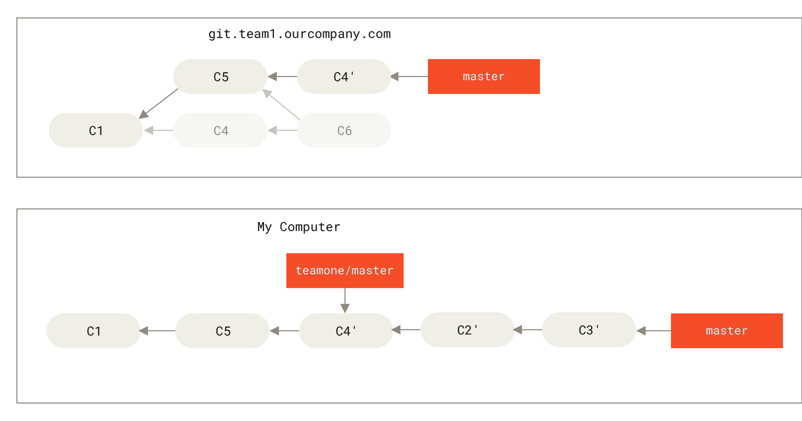
*Figure 48. Rebase on top of force-pushed rebase work — nguồn: Pro Git §3.6*

📖 **Nguyên văn — giới hạn**
> "**This only works if C4 and C4' that your partner made are almost exactly the same patch.**
> Otherwise the rebase won’t be able to tell that it’s a duplicate and will add another C4-like patch (which will probably fail to apply cleanly)."

🇻🇳 **Dịch**
> "**Việc này chỉ hiệu quả nếu C4 và C4' mà đồng nghiệp bạn tạo ra gần như là cùng một patch.**
> Nếu không, rebase sẽ không nhận ra đó là bản trùng và sẽ thêm một patch giống C4 nữa (mà nhiều khả năng sẽ áp không sạch)."

📖 **Nguyên văn — `pull --rebase`**
> "You can also simplify this by running a **`git pull --rebase`** instead of a normal `git pull`.
> Or you could do it manually with a `git fetch` followed by a `git rebase teamone/master` in this case.
> If you are using `git pull` and want to make `--rebase` the default, you can set the `pull.rebase` config value with something like **`git config --global pull.rebase true`**."

🇻🇳 **Dịch**
> "Bạn cũng có thể đơn giản hoá bằng cách chạy **`git pull --rebase`** thay cho `git pull` thường.
> Hoặc làm thủ công bằng `git fetch` rồi `git rebase teamone/master`.
> Nếu dùng `git pull` và muốn `--rebase` thành mặc định, đặt giá trị config `pull.rebase`."

📖 **Nguyên văn — ba mức an toàn**
> "**If you only ever rebase commits that have never left your own computer, you’ll be just fine.**
> **If you rebase commits that have been pushed, but that no one else has based commits from, you’ll also be fine.**
> **If you rebase commits that have already been pushed publicly, and people may have based work on those commits, then you may be in for some frustrating trouble, and the scorn of your teammates.**"

🇻🇳 **Dịch**
> "**Nếu bạn chỉ rebase những commit chưa bao giờ rời khỏi máy mình, bạn hoàn toàn ổn.**
> **Nếu bạn rebase những commit đã push nhưng chưa ai dựa vào đó để commit tiếp, bạn cũng ổn.**
> **Nếu bạn rebase những commit đã push công khai và có thể đã có người dựa vào đó làm việc, thì bạn sắp gặp rắc rối khó chịu, kèm theo sự khinh bỉ của đồng đội.**"

---

## 5. Rebase vs. Merge — cuộc tranh luận ⭐

📖 **Nguyên văn — phe 1**
> "One point of view on this is that **your repository’s commit history is a record of what actually happened**.
> It’s a historical document, valuable in its own right, and shouldn’t be tampered with.
> From this angle, changing the commit history is almost blasphemous; you’re lying about what actually transpired.
> So what if there was a messy series of merge commits? That’s how it happened, and the repository should preserve that for posterity."

🇻🇳 **Dịch**
> "Một quan điểm cho rằng **lịch sử commit của repository là bản ghi chép về những gì đã thực sự xảy ra**.
> Nó là một tài liệu lịch sử, tự thân có giá trị, và không nên bị can thiệp.
> Nhìn từ góc này, thay đổi lịch sử commit gần như là báng bổ; bạn đang nói dối về những gì đã diễn ra.
> Thì đã sao nếu có một mớ merge commit lộn xộn? Nó đã xảy ra như thế, và repository nên giữ lại cho hậu thế."

📖 **Nguyên văn — phe 2**
> "The opposing point of view is that **the commit history is the story of how your project was made**.
> **You wouldn’t publish the first draft of a book, so why show your messy work?**
> When you’re working on a project, you may need a record of all your missteps and dead-end paths, but when it’s time to show your work to the world, you may want to tell a more coherent story of how to get from A to B."

🇻🇳 **Dịch**
> "Quan điểm đối lập cho rằng **lịch sử commit là câu chuyện về cách project của bạn được tạo ra**.
> **Bạn đâu có xuất bản bản nháp đầu tiên của một cuốn sách, vậy sao lại phơi ra phần việc lộn xộn của mình?**
> Khi đang làm project, bạn có thể cần bản ghi về mọi bước đi sai và ngõ cụt; nhưng khi tới lúc trình bày công việc ra thế giới, bạn có thể muốn kể một câu chuyện mạch lạc hơn về cách đi từ A tới B."

📖 **Nguyên văn — kết luận của sách**
> "Now, to the question of whether merging or rebasing is better: **hopefully you’ll see that it’s not that simple**.
> Git is a powerful tool, and allows you to do many things to and with your history, but **every team and every project is different**. […]
>
> **You can get the best of both worlds: rebase local changes before pushing to clean up your work, but never rebase anything that you’ve pushed somewhere.**"

🇻🇳 **Dịch**
> "Về câu hỏi merge hay rebase tốt hơn: **hy vọng bạn thấy rằng nó không đơn giản như vậy**.
> Git là công cụ mạnh, cho phép bạn làm rất nhiều thứ với lịch sử của mình, nhưng **mỗi team và mỗi project đều khác nhau**. […]
>
> **Bạn có thể lấy điều tốt nhất của cả hai thế giới: rebase các thay đổi local trước khi push để dọn dẹp công việc của mình, nhưng đừng bao giờ rebase bất cứ thứ gì bạn đã push đi đâu đó.**"

---

## Bảng so sánh

| | Merge | Rebase |
|---|---|---|
| Lịch sử | Giữ nguyên sự thật, có merge commit | Tuyến tính, sạch |
| Commit cũ | Giữ nguyên | Bị **thay bằng commit mới** (SHA khác) |
| Snapshot kết quả | Giống nhau | Giống nhau |
| An toàn khi đã push | ✅ | 🔴 **Không** |
| Dùng khi | Tích hợp branch chung | Dọn branch local trước khi push / gửi patch |

```bash
git rebase master                        # rebase branch hiện tại lên master
git rebase master server                 # rebase server lên master, không cần checkout
git rebase --onto master server client   # chỉ lấy phần client rẽ khỏi server
git pull --rebase                        # pull nhưng rebase thay vì merge
git config --global pull.rebase true     # đặt làm mặc định
```

## Liên kết
- Bài trước: [[13 - Remote Branches]]
- Quay lại mục lục: [[00 - Tổng hợp (Version Control)]]
- So sánh với merge: [[11 - Basic Branching and Merging]]
- `pull.rebase` từng nhắc ở: [[08 - Working with Remotes]]

## Nguồn tham khảo
- Pro Git §3.6: <https://git-scm.com/book/en/v2/Git-Branching-Rebasing>
- Hình Figure 35–48 lấy từ trang trên, lưu trong `assets/`
