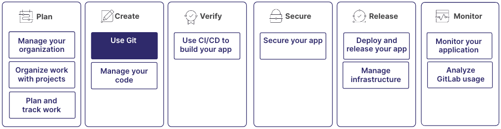

# 01 — Repo Hosting Services là gì

> **Nguồn chính:** roadmap.sh — node *Repo Hosting Services* (backend roadmap) — <https://roadmap.sh/backend>
> Bài này mở đầu phần 04: định nghĩa repo hosting service, phân biệt **Git** (công cụ) với **GitHub/GitLab/Bitbucket** (dịch vụ host), và so sánh ba dịch vụ phổ biến dựa trên tài liệu chính thống của chính họ.

---

## 1. Repo hosting service là gì

📖 **Nguyên văn** — roadmap.sh, node *Repo Hosting Services*
> "Repo hosting services provide storage, management, and collaboration tools for version-controlled code repositories. Support Git, Mercurial, Subversion with features like branching, pull requests, issue tracking, code review, and CI/CD integration. Popular services: GitHub, GitLab, Bitbucket."

🇻🇳 **Dịch**
> "Repo hosting service cung cấp nơi lưu trữ, công cụ quản lý và cộng tác cho các code repository được quản lý phiên bản. Hỗ trợ Git, Mercurial, Subversion với các tính năng như branching, pull request, issue tracking, code review và tích hợp CI/CD. Các dịch vụ phổ biến: GitHub, GitLab, Bitbucket."

Ba tài nguyên chính thống mà node này trỏ tới:

- [@official@GitHub](https://github.com)
- [@official@GitLab](https://about.gitlab.com/)
- [@official@BitBucket](https://bitbucket.org/product/guides/getting-started/overview)

> [!note] Bối cảnh từ phần trước
> Node ngay trước đó trong roadmap là *Version Control Systems*:
> "Version Control Systems (VCS) manage and track code changes over time, enabling efficient collaboration. Record file changes, allow reverting to previous versions, and maintain modification history. Can be centralized (Subversion) or distributed (Git, Mercurial) for collaboration and code integrity."
> Tức là: VCS lo phần **theo dõi thay đổi**; repo hosting service lo phần **lưu trữ tập trung + cộng tác** trên nền VCS đó.

💡 **Ví dụ đời sống**
Git giống như **cuốn sổ ghi chép có đánh số trang và ghi rõ ngày sửa** để trên bàn làm việc của bạn — nó tự nó đã ghi lại được toàn bộ lịch sử. Repo hosting service giống như **một thư viện công cộng**: bạn gửi bản sao cuốn sổ lên đó, đồng nghiệp mượn về đọc, ghi chú, đề xuất sửa, rồi thủ thư (quy trình review) quyết định có ghép phần sửa vào bản chính hay không. Cuốn sổ vẫn là cuốn sổ; thư viện là dịch vụ mọc thêm xung quanh nó.

---

## 2. Điểm người mới hay nhầm: Git ≠ GitHub

Đây là chỗ dễ nhầm nhất khi mới học, nên tách riêng một mục.

📖 **Nguyên văn** — GitLab Docs, *Get started with Git*
> "Git is a version control system you use to track changes to your code and collaborate with others.
> GitLab is a web-based Git repository manager that provides CI/CD and other features to help you
> manage your software development lifecycle."

🇻🇳 **Dịch**
> "Git là một version control system bạn dùng để theo dõi thay đổi trong code và cộng tác với người khác.
> GitLab là một trình quản lý Git repository trên nền web, cung cấp CI/CD và các tính năng khác giúp bạn
> quản lý vòng đời phát triển phần mềm."

Cùng một cách diễn đạt phía Bitbucket:

📖 **Nguyên văn** — Bitbucket, *A brief overview of Bitbucket*
> "Bitbucket Cloud is a Git based code hosting and collaboration tool, built for teams."

🇻🇳 **Dịch**
> "Bitbucket Cloud là một công cụ host code và cộng tác dựa trên Git, xây dựng cho các team."

Rút ra:

| | Git | GitHub / GitLab / Bitbucket |
|---|---|---|
| Bản chất | Version control system, chạy trên máy bạn | Dịch vụ web host repository |
| Cài ở đâu | Cài local (`git` CLI) | Không cài, dùng qua trình duyệt / URL |
| Không có nó thì | Không commit, không branch được | Vẫn commit/branch local bình thường, chỉ mất chỗ chia sẻ |
| Ai tạo | Công cụ mã nguồn mở | GitHub Inc., GitLab, Atlassian |

> [!tip] Cách nhớ nhanh
> Lệnh bạn gõ bắt đầu bằng `git ...` → đó là **Git**. Thứ bạn mở trong trình duyệt để bấm nút "Merge" → đó là **dịch vụ host**.

Khái niệm nối dịch vụ host với máy local chính là **remote** — đã học ở [[08 - Working with Remotes]].


*Figure 1. Use Git in the Create stage of the GitLab DevOps lifecycle. — nguồn: [GitLab Docs — Get started with Git](https://gitlab.com/gitlab-org/gitlab/-/raw/master/doc/topics/git/get_started.md)*

---

## 3. Repository là gì (theo GitHub Docs)

📖 **Nguyên văn** — GitHub Docs, *About repositories*
> "A repository is the most basic element of GitHub. It's a place where you can store your code, your files, and each file's revision history. Repositories can have multiple collaborators and can be either public or private."

🇻🇳 **Dịch**
> "Repository là thành phần cơ bản nhất của GitHub. Đó là nơi bạn lưu code, file của bạn, và lịch sử sửa đổi của từng file. Repository có thể có nhiều collaborator và có thể ở chế độ public hoặc private."

📖 **Nguyên văn** — GitLab Docs, *Get started with Git*, mục *Repositories*
> "A Git repository is a directory that contains all the files, folders, and version
> history of your project.
> It serves as a central hub where Git manages and tracks changes to your code."

🇻🇳 **Dịch**
> "Một Git repository là một thư mục chứa toàn bộ file, folder và lịch sử phiên bản của project.
> Nó đóng vai trò trung tâm nơi Git quản lý và theo dõi các thay đổi trong code của bạn."

### Thuật ngữ repository theo GitHub Docs

📖 **Nguyên văn** — GitHub Docs, *About repositories*, bảng *Repository terminology*
> "**Branch** — A parallel version of your code that is contained within the repository, but does not affect the primary or main branch.
> **Clone** — To download a full copy of a repository's data from GitHub.com, including all versions of every file and folder.
> **Fork** — A new repository that shares code and visibility settings with the original "upstream" repository.
> **Merge** — To take the changes from one branch and apply them to another.
> **Pull request** — A request to merge changes from one branch into another.
> **Remote** — A repository stored on GitHub, not on your computer.
> **Upstream** — The branch on an original repository that has been forked or cloned. The corresponding branch on the cloned or forked repository is called the "downstream.""

🇻🇳 **Dịch**
> "**Branch** — Một phiên bản song song của code, nằm bên trong repository nhưng không ảnh hưởng tới branch chính (primary/main).
> **Clone** — Tải về một bản sao đầy đủ dữ liệu của repository từ GitHub.com, gồm mọi phiên bản của mọi file và folder.
> **Fork** — Một repository mới dùng chung code và thiết lập visibility với repository "upstream" gốc.
> **Merge** — Lấy thay đổi từ một branch và áp vào branch khác.
> **Pull request** — Một yêu cầu merge thay đổi từ branch này sang branch khác.
> **Remote** — Một repository được lưu trên GitHub, không phải trên máy tính của bạn.
> **Upstream** — Branch trên repository gốc đã bị fork hoặc clone. Branch tương ứng trên bản clone/fork được gọi là "downstream"."

> [!note] Đối chiếu với phần 03
> `branch`, `merge`, `remote`, `upstream` đã được giải thích theo Pro Git ở [[10 - Branches in a Nutshell]], [[11 - Basic Branching and Merging]], [[08 - Working with Remotes]] và [[13 - Remote Branches]]. Định nghĩa của GitHub ngắn hơn vì viết cho người dùng dịch vụ, không phải cho người dùng công cụ.

### Visibility — public vs private

📖 **Nguyên văn** — GitHub Docs, *About repository visibility*
> "You can restrict who has access to a repository by choosing a repository's visibility: public or private.
> Public repositories are accessible to everyone on the internet.
> Private repositories are only accessible to you, people you explicitly share access with, and, for organization repositories, certain organization members."

🇻🇳 **Dịch**
> "Bạn có thể giới hạn ai được truy cập repository bằng cách chọn visibility: public hoặc private.
> Public repository thì ai trên internet cũng truy cập được.
> Private repository chỉ bạn, những người bạn chia sẻ quyền một cách tường minh, và — với repository của organization — một số thành viên nhất định của organization mới truy cập được."

> [!warning] Public repository là lộ toàn bộ codebase
> 📖 "Public repositories expose your codebase to everyone, increasing the risk that attackers might exploit vulnerabilities or access sensitive information."
> 🇻🇳 "Public repository phơi bày codebase của bạn cho tất cả mọi người, làm tăng rủi ro kẻ tấn công khai thác lỗ hổng hoặc truy cập thông tin nhạy cảm."
> GitHub Docs khuyến nghị bật các tính năng bảo mật như Dependabot, secret scanning, push protection, code scanning và thêm file `SECURITY.md`.

---

## 4. Remote repository — cách máy local nói chuyện với dịch vụ host

📖 **Nguyên văn** — GitHub Docs, *About remote repositories*
> "GitHub's collaborative approach to development depends on publishing commits from your local repository to GitHub for other people to view, fetch, and update."
>
> "A remote URL is Git's fancy way of saying "the place where your code is stored." That URL could be your repository on GitHub, or another user's fork, or even on a completely different server."
>
> "You can only push to two types of URL addresses:
> An HTTPS URL like `https://github.com/user/repo.git`
> An SSH URL, like `git@github.com:user/repo.git`
> Git associates a remote URL with a name, and your default remote is usually called `origin`."

🇻🇳 **Dịch**
> "Cách cộng tác trong phát triển phần mềm của GitHub dựa trên việc publish các commit từ local repository của bạn lên GitHub để người khác xem, fetch và cập nhật."
>
> "Remote URL là cách nói hoa mỹ của Git cho "nơi code của bạn được lưu". URL đó có thể là repository của bạn trên GitHub, hoặc fork của người khác, hoặc thậm chí nằm trên một server hoàn toàn khác."
>
> "Bạn chỉ có thể push tới hai loại địa chỉ URL:
> Một HTTPS URL như `https://github.com/user/repo.git`
> Một SSH URL, như `git@github.com:user/repo.git`
> Git gắn một remote URL với một cái tên, và remote mặc định của bạn thường được gọi là `origin`."

📖 **Nguyên văn** — mục *Creating remote repositories*
> "You can use the `git remote add` command to match a remote URL with a name.
> For example, you'd type the following in the command line:
> ```
> git remote add origin <REMOTE_URL>
> ```
> This associates the name `origin` with the `REMOTE_URL`.
> You can use the command `git remote set-url` to change a remote's URL."

🇻🇳 **Dịch**
> "Bạn dùng lệnh `git remote add` để gắn một remote URL với một cái tên.
> Ví dụ, gõ như sau trên command line:
> ```
> git remote add origin <REMOTE_URL>
> ```
> Lệnh này gắn tên `origin` với `REMOTE_URL`.
> Bạn dùng lệnh `git remote set-url` để đổi URL của một remote."

💡 **Ví dụ đời sống**
`origin` giống như số điện thoại bạn lưu trong danh bạ dưới tên "Nhà". Bạn không cần nhớ dãy số, chỉ cần bấm "Nhà". `git remote add origin <URL>` = lưu số vào danh bạ với tên "Nhà"; `git remote set-url` = sửa lại số khi nhà đổi số. Còn chọn **HTTPS hay SSH** giống như chọn đi bằng cửa chính có bảo vệ kiểm tra giấy tờ mỗi lần (HTTPS + token), hay dùng chìa khoá riêng đã đăng ký sẵn (SSH key).

### HTTPS URL

📖 **Nguyên văn** — mục *Cloning with HTTPS URLs*
> "The `https://` clone URLs are available on all repositories, regardless of visibility. `https://` clone URLs work even if you are behind a firewall or proxy."
>
> "When you `git clone`, `git fetch`, `git pull`, or `git push` to a private remote repository using HTTPS URLs on the command line, Git will ask for your GitHub username and password. When Git prompts you for your password, enter your personal access token. Alternatively, you can use a credential helper like Git Credential Manager. Password-based authentication for Git has been removed in favor of more secure authentication methods."

🇻🇳 **Dịch**
> "Các clone URL dạng `https://` có sẵn ở mọi repository, bất kể visibility. Clone URL `https://` vẫn hoạt động ngay cả khi bạn đứng sau firewall hoặc proxy."
>
> "Khi bạn `git clone`, `git fetch`, `git pull` hoặc `git push` tới một private remote repository bằng HTTPS URL trên command line, Git sẽ hỏi username và password GitHub của bạn. Khi Git hỏi password, hãy nhập personal access token của bạn. Ngoài ra bạn có thể dùng credential helper như Git Credential Manager. Xác thực bằng password cho Git đã bị gỡ bỏ để thay bằng các phương thức xác thực an toàn hơn."

> [!warning] Password GitHub không dùng để push được nữa
> Tài liệu nói rõ: "Password-based authentication for Git has been removed". Khi Git hỏi password qua HTTPS, thứ phải nhập là **personal access token**.

### SSH URL

📖 **Nguyên văn** — mục *Cloning with SSH URLs*
> "SSH URLs provide access to a Git repository via SSH, a secure protocol. To use these URLs, you must generate an SSH keypair on your computer and add the public key to your account on GitHub."
>
> "When you `git clone`, `git fetch`, `git pull`, or `git push` to a remote repository using SSH URLs, you'll be prompted for a password and must provide your SSH key passphrase."

🇻🇳 **Dịch**
> "SSH URL cho phép truy cập Git repository qua SSH, một giao thức bảo mật. Để dùng các URL này, bạn phải tạo một SSH keypair trên máy và thêm public key vào tài khoản GitHub của bạn."
>
> "Khi bạn `git clone`, `git fetch`, `git pull` hoặc `git push` tới remote repository bằng SSH URL, bạn sẽ được hỏi password và phải nhập SSH key passphrase của mình."

> [!tip] Mẹo từ chính GitHub Docs
> - Nếu muốn dùng SSH nhưng không kết nối được qua port 22: "you might be able to use SSH over the HTTPS port."
> - SSH URL còn dùng được như "a secure way of deploying your code to production servers", kết hợp SSH agent forwarding để khỏi phải quản lý key trên server.

---

## 5. So sánh GitHub / GitLab / Bitbucket

> [!note] Nguyên tắc của bảng này
> Chỉ ghi những đặc điểm **kiểm chứng được từ tài liệu chính thống của chính dịch vụ đó**. Đặc điểm nào không tìm thấy trong nguồn thì để trống chứ không suy đoán. Bảng này **không** phải so sánh giá hay thị phần.

| Tiêu chí | GitHub | GitLab | Bitbucket |
|---|---|---|---|
| Tự mô tả | "A repository is the most basic element of GitHub. It's a place where you can store your code, your files, and each file's revision history." | "GitLab is a web-based Git repository manager that provides CI/CD and other features to help you manage your software development lifecycle." | "Bitbucket Cloud is a Git based code hosting and collaboration tool, built for teams." |
| Tên gọi yêu cầu gộp code | **Pull request** — "A request to merge changes from one branch into another." | **Merge request** — "After a feature is complete or a bug is fixed, you can merge your branch into the default branch. You can do this in a merge request." | **Pull Request** — "They provide a user-friendly web interface for discussing proposed changes before integrating them into the official project." |
| Branch mặc định | (docs dùng "primary or main branch") | "In GitLab, the default branch is usually called `main`." | "Whenever you create a git repository, a branch named "main" is created, and becomes the active branch." |
| Visibility | public / private; "Repositories in organizations that use GitHub Enterprise Cloud and are owned by an enterprise account can also be created with internal visibility." | — | Ở cấp Project: "Projects can be either visible or hidden from public view." |
| Hình thức triển khai | (không nêu trong 2 trang docs đã đọc) | GitLab.com, GitLab Self-Managed, GitLab Dedicated | Cloud ("hosted on Atlassian's servers and accessed via a URL") và Data Center ("our self-managed option") |
| Gói/tier nêu trong docs | GitHub Free, GitHub Pro, GitHub Team, GitHub Enterprise Cloud | Free, Premium, Ultimate | Cloud (có gói Premium), Data Center |
| CI/CD tích hợp | — (không nêu trong 2 trang docs đã đọc) | "provides CI/CD and other features" | Bitbucket Pipelines — "an integrated CI/CD service, built into Bitbucket" |
| Cộng tác / quản lý việc | issues, GitHub Discussions, Projects | merge request | Issue tracking (Cloud) hoặc tích hợp Jira Software; wiki qua Confluence |
| Đơn vị nhóm repository | organization | — | Project — "A project is a container for repositories." |

📖 **Nguyên văn** — Bitbucket, *Bitbucket hosting options*
> "Bitbucket Cloud is hosted on Atlassian's servers and accessed via a URL. Bitbucket Cloud has an exclusive built-in CI/CD tool, Pipelines, that enables you to build, test, and deploy directly from within Bitbucket."
> "Bitbucket Data Center is our self-managed option. It can be hosted on a single or a cluster of servers in your environment."

🇻🇳 **Dịch**
> "Bitbucket Cloud được host trên server của Atlassian và truy cập qua một URL. Bitbucket Cloud có công cụ CI/CD tích hợp riêng là Pipelines, cho phép bạn build, test và deploy ngay bên trong Bitbucket."
> "Bitbucket Data Center là lựa chọn self-managed của chúng tôi. Nó có thể được host trên một server đơn lẻ hoặc một cụm server trong môi trường của bạn."

📖 **Nguyên văn** — GitLab Docs, *Reduce repository size*, khối thông tin đầu trang
> "Tier: Free, Premium, Ultimate
> Offering: GitLab.com, GitLab Self-Managed, GitLab Dedicated"

🇻🇳 **Dịch**
> "Gói: Free, Premium, Ultimate
> Hình thức triển khai: GitLab.com, GitLab Self-Managed, GitLab Dedicated"

🇻🇳 Khối `Tier / Offering` này xuất hiện ở đầu mọi trang GitLab Docs, cho biết tính năng đó có ở gói nào và ở hình thức triển khai nào. Ở đây nó chứng minh GitLab có cả bản cloud (`GitLab.com`) lẫn bản **self-managed** — tự cài trên server của mình.

📖 **Nguyên văn** — GitHub Docs, *About collaboration*
> "With GitHub Free for personal accounts and organizations, you can work with unlimited collaborators on unlimited public repositories with a full feature set, or unlimited private repositories with a limited feature set. To get advanced tooling for private repositories, you can upgrade to GitHub Pro, GitHub Team, or GitHub Enterprise Cloud."

🇻🇳 **Dịch**
> "Với GitHub Free cho tài khoản cá nhân và organization, bạn có thể làm việc với số collaborator không giới hạn trên số public repository không giới hạn với đầy đủ tính năng, hoặc private repository không giới hạn nhưng bộ tính năng bị giới hạn. Muốn có công cụ nâng cao cho private repository thì nâng cấp lên GitHub Pro, GitHub Team hoặc GitHub Enterprise Cloud."

> [!tip] Khác biệt dễ nhớ nhất giữa 3 dịch vụ
> Cùng một hành động "xin gộp branch này vào branch kia": GitHub và Bitbucket gọi là **pull request**, GitLab gọi là **merge request**. Cùng một khái niệm, khác tên gọi — đọc tài liệu của bên nào thì dùng từ của bên đó.

---

## 6. Tóm tắt

- **Repo hosting service** = nơi lưu trữ + công cụ quản lý và cộng tác cho repository (roadmap.sh).
- **Git** là công cụ chạy trên máy bạn; **GitHub / GitLab / Bitbucket** là dịch vụ web host repository đó. Không có dịch vụ host, Git vẫn chạy; chỉ là không có chỗ chung để cả team làm việc.
- **Repository** theo GitHub = nơi lưu code, file và lịch sử sửa đổi từng file; có nhiều collaborator; public hoặc private.
- Kết nối local ↔ dịch vụ host bằng **remote URL**, chỉ hai dạng push được: **HTTPS** (nhập personal access token) và **SSH** (cần SSH keypair). Tên remote mặc định là `origin`.
- Ba dịch vụ khác nhau ở tên gọi tính năng và mô hình triển khai; điểm khác dễ nhận nhất là *pull request* (GitHub, Bitbucket) vs *merge request* (GitLab).

---

## Liên kết
- Bài trước: [[00 - Tổng hợp (Repo Hosting Services)]]
- Bài kế: [[02 - GitHub - Account Setup and Configuration]]
- Cross-link phần 03: [[08 - Working with Remotes]] (khái niệm remote, `git remote add`, fetch/pull/push), [[10 - Branches in a Nutshell]], [[11 - Basic Branching and Merging]], [[13 - Remote Branches]]

## Nguồn tham khảo
- roadmap.sh — node *Repo Hosting Services* : <https://raw.githubusercontent.com/nilbuild/developer-roadmap/master/roadmaps/backend/content/repo-hosting-services%40NvUcSDWBhzJZ31nzT4UlE.md>
- roadmap.sh — node *Version Control Systems* : <https://raw.githubusercontent.com/nilbuild/developer-roadmap/master/roadmaps/backend/content/version-control-systems%40ezdqQW9wTUw93F6kjOzku.md>
- GitHub Docs — About repositories : <https://docs.github.com/en/repositories/creating-and-managing-repositories/about-repositories>
- GitHub Docs — About remote repositories : <https://docs.github.com/en/get-started/git-basics/about-remote-repositories>
- GitLab Docs — Get started with Git : <https://gitlab.com/gitlab-org/gitlab/-/raw/master/doc/topics/git/get_started.md>
- GitLab Docs — Reduce repository size : <https://gitlab.com/gitlab-org/gitlab/-/raw/master/doc/topics/git/repository.md>
- Bitbucket — A brief overview of Bitbucket : <https://bitbucket.org/product/guides/getting-started/overview>
- Hình Figure 1 lấy từ GitLab Docs (`doc/topics/git/img/get_started_git_v16_11.png`), lưu trong `assets/get_started_git_v16_11.png`
