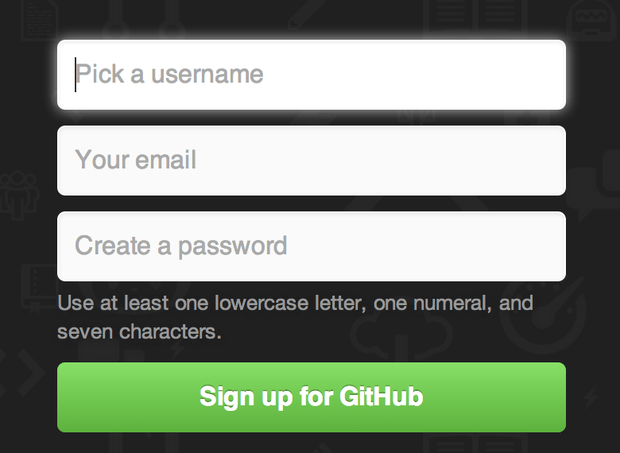
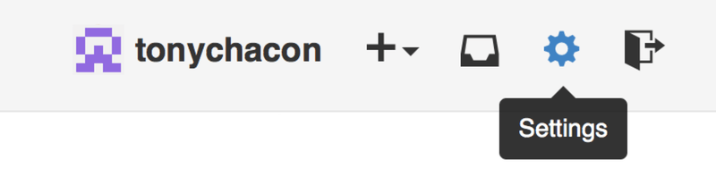
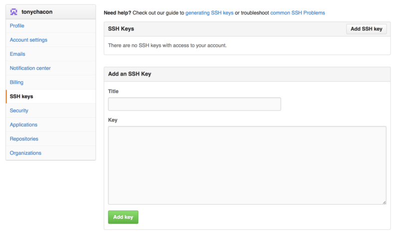
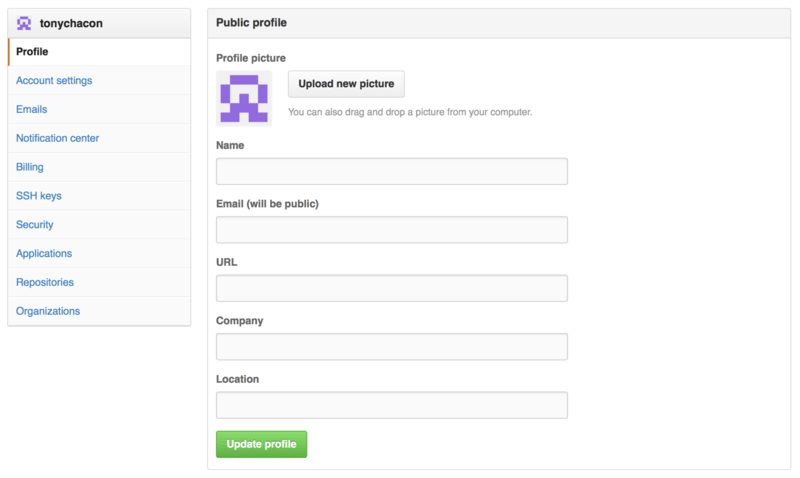
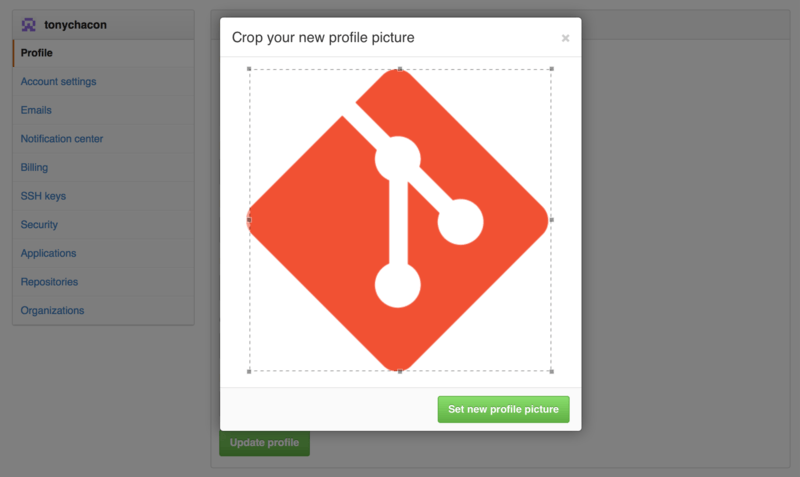
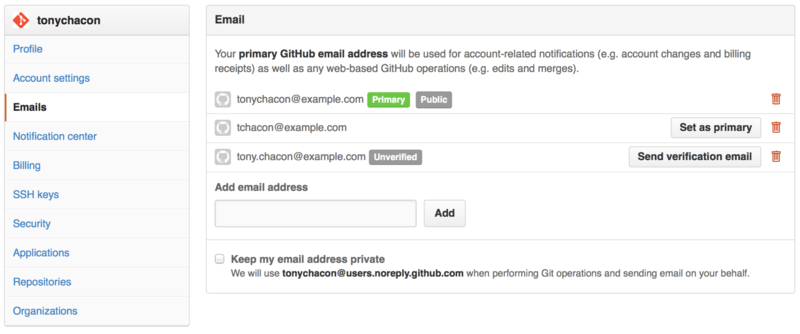
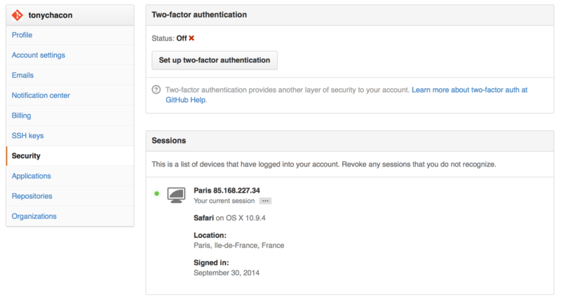

# 02 — GitHub: Account Setup and Configuration

> **Nguồn chính:** Pro Git, 2nd Edition — §6.1 GitHub - Account Setup and Configuration — https://git-scm.com/book/en/v2/GitHub-Account-Setup-and-Configuration
> Bài này bám đúng mục 6.1 của sách: mở account, cấu hình SSH access, avatar, email addresses và Two Factor Authentication.

---

## GitHub là gì trong bức tranh chung

📖 **Nguyên văn**
> "GitHub is the single largest host for Git repositories, and is the central point of collaboration for millions of developers and projects.
> A large percentage of all Git repositories are hosted on GitHub, and many open-source projects use it for Git hosting, issue tracking, code review, and other things.
> So while it's not a direct part of the Git open source project, there's a good chance that you'll want or need to interact with GitHub at some point while using Git professionally."

🇻🇳 **Dịch**
> "GitHub là host lớn nhất cho các Git repository, và là điểm trung tâm của việc cộng tác giữa hàng triệu developer và project.
> Một tỷ lệ lớn tất cả Git repository được host trên GitHub, và nhiều open-source project dùng nó cho việc host Git, issue tracking, code review, và nhiều thứ khác.
> Nên dù nó không phải là một phần trực tiếp của Git open source project, khả năng cao là bạn sẽ muốn hoặc cần tương tác với GitHub tại một thời điểm nào đó khi dùng Git một cách chuyên nghiệp."

📖 **Nguyên văn**
> "This chapter is about using GitHub effectively.
> We'll cover signing up for and managing an account, creating and using Git repositories, common workflows to contribute to projects and to accept contributions to yours, GitHub's programmatic interface and lots of little tips to make your life easier in general."

🇻🇳 **Dịch**
> "Chương này nói về việc dùng GitHub một cách hiệu quả.
> Chúng ta sẽ đề cập tới việc đăng ký và quản lý một account, tạo và dùng Git repository, các workflow phổ biến để contribute vào project và để chấp nhận contribution vào project của bạn, giao diện lập trình được (programmatic interface) của GitHub và rất nhiều mẹo nhỏ giúp cuộc sống của bạn dễ thở hơn nói chung."

> [!note]
> Sách còn nói rõ: *"If you are not interested in using GitHub to host your own projects or to collaborate with other projects that are hosted on GitHub, you can safely skip to Git Tools."*
> — Nếu bạn không quan tâm tới việc dùng GitHub để host project của mình hay cộng tác với project khác trên GitHub, bạn có thể yên tâm bỏ qua để nhảy tới Git Tools.

💡 **Ví dụ đời sống**
Git giống như cuốn sổ ghi chép cá nhân bạn giữ trong nhà — nó hoạt động hoàn toàn offline, không cần ai cả (xem [[02 - What is Git]]).
GitHub giống như *thư viện công cộng* nơi mọi người mang bản sao sổ của mình tới, đặt lên kệ chung, cho người khác mượn, ghi chú, đề xuất sửa. Thư viện không phát minh ra giấy bút — nó chỉ là nơi tập trung.

---

## Account Setup and Configuration

📖 **Nguyên văn**
> "The first thing you need to do is set up a free user account.
> Simply visit https://github.com, choose a user name that isn't already taken, provide an email address and a password, and click the big green "Sign up for GitHub" button."

🇻🇳 **Dịch**
> "Việc đầu tiên bạn cần làm là tạo một user account miễn phí.
> Chỉ cần truy cập https://github.com, chọn một user name chưa bị người khác lấy, cung cấp một email address và một password, rồi bấm nút màu xanh lá to tướng "Sign up for GitHub"."

*Figure 81. The GitHub sign-up form — nguồn: [Account Setup and Configuration](https://git-scm.com/book/en/v2/GitHub-Account-Setup-and-Configuration)*

📖 **Nguyên văn**
> "The next thing you'll see is the pricing page for upgraded plans, but it's safe to ignore this for now.
> GitHub will send you an email to verify the address you provided.
> Go ahead and do this; it's pretty important (as we'll see later)."

🇻🇳 **Dịch**
> "Thứ tiếp theo bạn thấy sẽ là trang pricing cho các plan nâng cấp, nhưng cứ yên tâm bỏ qua lúc này.
> GitHub sẽ gửi bạn một email để verify địa chỉ bạn đã cung cấp.
> Cứ làm đi; nó khá quan trọng (như ta sẽ thấy ở phần sau)."

> [!tip] Vì sao verify email lại quan trọng?
> Vì GitHub map commit của bạn về user **bằng email address** — xem mục [Your Email Addresses](#your-email-addresses) bên dưới. Email chưa verify thì không thể làm primary address.

📖 **Nguyên văn** (Note trong sách)
> "GitHub provides almost all of its functionality with free accounts, except some advanced features.
> GitHub's paid plans include advanced tools and features as well as increased limits for free services, but we won't be covering those in this book.
> To get more information about available plans and their comparison, visit https://github.com/pricing."

🇻🇳 **Dịch**
> "GitHub cung cấp gần như toàn bộ chức năng của nó với account miễn phí, ngoại trừ một số tính năng nâng cao.
> Các paid plan của GitHub bao gồm công cụ và tính năng nâng cao cũng như giới hạn cao hơn cho các dịch vụ miễn phí, nhưng chúng ta sẽ không đề cập tới chúng trong cuốn sách này.
> Để biết thêm thông tin về các plan hiện có và so sánh giữa chúng, truy cập https://github.com/pricing."

📖 **Nguyên văn**
> "Clicking the Octocat logo at the top-left of the screen will take you to your dashboard page.
> You're now ready to use GitHub."

🇻🇳 **Dịch**
> "Bấm vào logo Octocat ở góc trên bên trái màn hình sẽ đưa bạn tới trang dashboard.
> Giờ bạn đã sẵn sàng dùng GitHub."

---

## SSH Access

📖 **Nguyên văn**
> "As of right now, you're fully able to connect with Git repositories using the https:// protocol, authenticating with the username and password you just set up.
> However, to simply clone public projects, you don't even need to sign up - the account we just created comes into play when we fork projects and push to our forks a bit later."

🇻🇳 **Dịch**
> "Ngay lúc này, bạn hoàn toàn có thể kết nối tới Git repository bằng protocol https://, xác thực bằng username và password bạn vừa tạo.
> Tuy nhiên, để chỉ đơn thuần clone các public project, bạn thậm chí không cần đăng ký — account chúng ta vừa tạo mới phát huy tác dụng khi ta fork project và push lên fork của mình ở phần sau."

📖 **Nguyên văn**
> "If you'd like to use SSH remotes, you'll need to configure a public key.
> If you don't already have one, see Generating Your SSH Public Key.
> Open up your account settings using the link at the top-right of the window:"

🇻🇳 **Dịch**
> "Nếu bạn muốn dùng SSH remote, bạn sẽ cần cấu hình một public key.
> Nếu bạn chưa có sẵn một cái, xem Generating Your SSH Public Key.
> Mở account settings bằng link ở góc trên bên phải cửa sổ:"

> [!note] Cross-link
> Khái niệm **remote** (và chuyện một remote có thể dùng URL dạng `https://` hay `git@github.com:...`) đã được giải thích ở [[08 - Working with Remotes]]. SSH key chính là thứ thay thế cho username/password khi remote URL dùng protocol SSH.

*Figure 82. The "Account settings" link — nguồn: [Account Setup and Configuration](https://git-scm.com/book/en/v2/GitHub-Account-Setup-and-Configuration)*

📖 **Nguyên văn**
> "Then select the "SSH keys" section along the left-hand side."

🇻🇳 **Dịch**
> "Sau đó chọn mục "SSH keys" ở phía bên trái."

*Figure 83. The "SSH keys" link — nguồn: [Account Setup and Configuration](https://git-scm.com/book/en/v2/GitHub-Account-Setup-and-Configuration)*

📖 **Nguyên văn**
> "From there, click the "Add an SSH key" button, give your key a name, paste the contents of your ~/.ssh/id_rsa.pub (or whatever you named it) public-key file into the text area, and click "Add key"."

🇻🇳 **Dịch**
> "Từ đó, bấm nút "Add an SSH key", đặt tên cho key của bạn, dán nội dung file public-key `~/.ssh/id_rsa.pub` (hoặc bất cứ tên nào bạn đặt) vào ô text, rồi bấm "Add key"."

📖 **Nguyên văn** (Note trong sách)
> "Be sure to name your SSH key something you can remember.
> You can name each of your keys (e.g. "My Laptop" or "Work Account") so that if you need to revoke a key later, you can easily tell which one you're looking for."

🇻🇳 **Dịch**
> "Hãy chắc chắn đặt cho SSH key một cái tên bạn nhớ được.
> Bạn có thể đặt tên cho từng key (ví dụ "My Laptop" hay "Work Account") để nếu sau này cần revoke một key, bạn dễ dàng biết được mình đang tìm cái nào."

💡 **Ví dụ đời sống**
SSH key giống như **chìa khoá từ của chung cư**. Mỗi thiết bị bạn dùng (laptop nhà, máy công ty) là một chiếc thẻ riêng. Đặt tên rõ ràng cho từng thẻ giống như dán nhãn "thẻ nhà", "thẻ công ty" — khi mất laptop công ty, bạn chỉ cần huỷ đúng chiếc thẻ đó, các thẻ còn lại vẫn dùng bình thường. Nếu dùng chung một thẻ cho mọi nơi, mất một cái là phải đổi hết.

---

## Your Avatar

📖 **Nguyên văn**
> "Next, if you wish, you can replace the avatar that is generated for you with an image of your choosing.
> First go to the "Profile" tab (above the SSH Keys tab) and click "Upload new picture"."

🇻🇳 **Dịch**
> "Tiếp theo, nếu muốn, bạn có thể thay avatar được tạo tự động cho bạn bằng một ảnh do bạn chọn.
> Trước tiên vào tab "Profile" (nằm phía trên tab SSH Keys) và bấm "Upload new picture"."

*Figure 84. The "Profile" link — nguồn: [Account Setup and Configuration](https://git-scm.com/book/en/v2/GitHub-Account-Setup-and-Configuration)*

📖 **Nguyên văn**
> "We'll choose a copy of the Git logo that is on our hard drive and then we get a chance to crop it."

🇻🇳 **Dịch**
> "Chúng ta sẽ chọn một bản copy của logo Git nằm trên ổ cứng, rồi sau đó có cơ hội crop nó."

*Figure 85. Crop your uploaded avatar — nguồn: [Account Setup and Configuration](https://git-scm.com/book/en/v2/GitHub-Account-Setup-and-Configuration)*

📖 **Nguyên văn**
> "Now anywhere you interact on the site, people will see your avatar next to your username.
> If you happen to have uploaded an avatar to the popular Gravatar service (often used for WordPress accounts), that avatar will be used by default and you don't need to do this step."

🇻🇳 **Dịch**
> "Giờ ở bất cứ đâu bạn tương tác trên site, mọi người sẽ thấy avatar của bạn bên cạnh username.
> Nếu bạn tình cờ đã upload avatar lên dịch vụ Gravatar phổ biến (thường dùng cho account WordPress), avatar đó sẽ được dùng mặc định và bạn không cần làm bước này."

---

## Your Email Addresses

📖 **Nguyên văn**
> "The way that GitHub maps your Git commits to your user is by email address.
> If you use multiple email addresses in your commits and you want GitHub to link them up properly, you need to add all the email addresses you have used to the Emails section of the admin section."

🇻🇳 **Dịch**
> "Cách GitHub map các Git commit của bạn về đúng user của bạn là **dựa vào email address**.
> Nếu bạn dùng nhiều email address trong các commit và muốn GitHub liên kết chúng đúng cách, bạn cần thêm tất cả email address đã dùng vào mục Emails trong phần admin."

*Figure 86. Add all your email addresses — nguồn: [Account Setup and Configuration](https://git-scm.com/book/en/v2/GitHub-Account-Setup-and-Configuration)*

📖 **Nguyên văn**
> "In Add all your email addresses we can see some of the different states that are possible.
> The top address is verified and set as the primary address, meaning that is where you'll get any notifications and receipts.
> The second address is verified and so can be set as the primary if you wish to switch them.
> The final address is unverified, meaning that you can't make it your primary address.
> If GitHub sees any of these in commit messages in any repository on the site, it will be linked to your user now."

🇻🇳 **Dịch**
> "Trong hình *Add all your email addresses* ta có thể thấy vài trạng thái khác nhau có thể xảy ra.
> Địa chỉ trên cùng đã được verify và được đặt làm primary address, nghĩa là đó là nơi bạn nhận mọi notification và receipt.
> Địa chỉ thứ hai đã được verify nên có thể đặt làm primary nếu bạn muốn hoán đổi.
> Địa chỉ cuối cùng chưa được verify, nghĩa là bạn không thể biến nó thành primary address.
> Nếu GitHub thấy bất kỳ địa chỉ nào trong số này xuất hiện trong commit message ở bất kỳ repository nào trên site, nó sẽ được liên kết về user của bạn ngay."

> [!warning]
> Đây là lý do commit của bạn đôi khi hiện lên GitHub mà **không có avatar và không link về profile**: email trong commit (cấu hình bằng `user.email`, xem [[05 - Recording Changes to the Repository]]) chưa được thêm vào account. Git không hề biết GitHub là ai — nó chỉ ghi nguyên chuỗi email bạn đã set vào commit.

💡 **Ví dụ đời sống**
Giống như bạn gửi thư bằng nhiều địa chỉ email khác nhau: email cá nhân, email công ty, email thời sinh viên. Bưu điện (GitHub) chỉ gom tất cả thư về đúng một người nếu bạn **khai báo trước** rằng cả ba hòm thư đó đều là của bạn. Chưa khai thì thư vẫn tồn tại, chỉ là không ai biết nó của ai.

---

## Two Factor Authentication

📖 **Nguyên văn**
> "Finally, for extra security, you should definitely set up Two-factor Authentication or "2FA".
> Two-factor Authentication is an authentication mechanism that is becoming more and more popular recently to mitigate the risk of your account being compromised if your password is stolen somehow.
> Turning it on will make GitHub ask you for two different methods of authentication, so that if one of them is compromised, an attacker will not be able to access your account."

🇻🇳 **Dịch**
> "Cuối cùng, để tăng cường bảo mật, bạn chắc chắn nên thiết lập Two-factor Authentication hay "2FA".
> Two-factor Authentication là một cơ chế xác thực ngày càng phổ biến gần đây nhằm giảm thiểu rủi ro account bị chiếm nếu password của bạn bị đánh cắp bằng cách nào đó.
> Bật nó lên sẽ khiến GitHub hỏi bạn hai phương thức xác thực khác nhau, để nếu một trong hai bị lộ, kẻ tấn công vẫn không thể truy cập account của bạn."

📖 **Nguyên văn**
> "You can find the Two-factor Authentication setup under the Security tab of your Account settings."

🇻🇳 **Dịch**
> "Bạn có thể tìm phần thiết lập Two-factor Authentication trong tab Security của Account settings."

*Figure 87. 2FA in the Security Tab — nguồn: [Account Setup and Configuration](https://git-scm.com/book/en/v2/GitHub-Account-Setup-and-Configuration)*

📖 **Nguyên văn**
> "If you click on the "Set up two-factor authentication" button, it will take you to a configuration page where you can choose to use a phone app to generate your secondary code (a "time based one-time password"), or you can have GitHub send you a code via SMS each time you need to log in.
> After you choose which method you prefer and follow the instructions for setting up 2FA, your account will then be a little more secure and you will have to provide a code in addition to your password whenever you log into GitHub."

🇻🇳 **Dịch**
> "Nếu bạn bấm nút "Set up two-factor authentication", nó sẽ đưa bạn tới trang cấu hình nơi bạn có thể chọn dùng một app trên điện thoại để sinh mã phụ (một "time based one-time password"), hoặc để GitHub gửi cho bạn một mã qua SMS mỗi lần bạn cần đăng nhập.
> Sau khi chọn phương thức bạn thích và làm theo hướng dẫn thiết lập 2FA, account của bạn sẽ an toàn hơn một chút và bạn sẽ phải cung cấp một mã bên cạnh password mỗi khi đăng nhập vào GitHub."

💡 **Ví dụ đời sống**
2FA giống như rút tiền ở ATM: bạn cần **thẻ** (thứ bạn có) và **mã PIN** (thứ bạn biết). Kẻ trộm nhặt được thẻ mà không biết PIN thì vẫn vô dụng. Password là PIN, còn app sinh mã trên điện thoại là chiếc thẻ.

> [!danger]
> Nếu mất thiết bị sinh mã 2FA mà không lưu recovery code, bạn có thể mất quyền truy cập account. Hãy lưu recovery code ở nơi an toàn ngay khi bật 2FA.

---

## Tóm tắt checklist sau khi đọc bài này

| Bước | Mục trong sách | Bắt buộc? |
|---|---|---|
| Tạo free user account tại https://github.com | Account Setup and Configuration | Có |
| Verify email GitHub gửi về | Account Setup and Configuration | Có — *"it's pretty important"* |
| Thêm SSH public key (`~/.ssh/id_rsa.pub`), đặt tên dễ nhớ | SSH Access | Chỉ khi dùng SSH remote |
| Upload avatar (hoặc để Gravatar lo) | Your Avatar | Tuỳ ý — *"if you wish"* |
| Thêm **tất cả** email address đã dùng trong commit | Your Email Addresses | Nên làm |
| Bật 2FA trong tab Security | Two Factor Authentication | *"you should definitely"* |

---

## Liên kết
- Bài trước: [[01 - Repo Hosting Services là gì]]
- Bài kế: [[03 - GitHub - Contributing to a Project]]
- Cross-link phần 03: [[08 - Working with Remotes]] — remote, protocol `https://` vs SSH, fetch/pull/push
- Cross-link phần 03: [[05 - Recording Changes to the Repository]] — commit và cấu hình `user.email` được ghi vào commit
- Cross-link phần 03: [[02 - What is Git]] — Git là VCS phân tán, độc lập với mọi hosting service

## Nguồn tham khảo
- Pro Git, 2nd Edition — §6.1 GitHub - Account Setup and Configuration : https://git-scm.com/book/en/v2/GitHub-Account-Setup-and-Configuration
- GitHub pricing (được sách trích dẫn) : https://github.com/pricing
- GitHub : https://github.com
- Hình Figure 81–87 lấy từ trang trên, lưu trong `assets/` (`signup.png`, `account-settings.png`, `ssh-keys.png`, `your-profile.png`, `avatar-crop.png`, `email-settings.png`, `2fa-1.png`)
