# 03 — GitHub: Contributing to a Project

> **Nguồn chính:** Pro Git 2nd Edition, §6.2 GitHub - Contributing to a Project — https://git-scm.com/book/en/v2/GitHub-Contributing-to-a-Project
> Bài này bám nguyên mục 6.2: fork, GitHub Flow, tạo & lặp Pull Request, advanced Pull Requests, GitHub Flavored Markdown, và cách giữ fork up-to-date.

---

## Mở đầu

📖 **Nguyên văn**
> "Now that our account is set up, let's walk through some details that could be useful in helping you contribute to an existing project."

🇻🇳 **Dịch**
> "Giờ khi account đã được thiết lập xong, hãy cùng đi qua vài chi tiết hữu ích giúp bạn contribute vào một project đã có sẵn."

---

## Forking Projects

📖 **Nguyên văn**
> "If you want to contribute to an existing project to which you don't have push access, you can "fork" the project.
> When you "fork" a project, GitHub will make a copy of the project that is entirely yours; it lives in your namespace, and you can push to it."

🇻🇳 **Dịch**
> "Nếu bạn muốn contribute vào một project đã có mà bạn không có quyền push, bạn có thể "fork" project đó.
> Khi bạn "fork" một project, GitHub sẽ tạo một bản sao của project hoàn toàn thuộc về bạn; nó nằm trong namespace của bạn, và bạn có thể push lên nó."

> [!note] Note (nguyên văn trong sách)
> 📖 "Historically, the term "fork" has been somewhat negative in context, meaning that someone took an open source project in a different direction, sometimes creating a competing project and splitting the contributors.
> In GitHub, a "fork" is simply the same project in your own namespace, allowing you to make changes to a project publicly as a way to contribute in a more open manner."
>
> 🇻🇳 "Trong lịch sử, thuật ngữ "fork" mang nghĩa hơi tiêu cực: ai đó đem một project open source đi theo hướng khác, đôi khi tạo ra một project cạnh tranh và chia rẽ đội ngũ contributor.
> Trên GitHub, "fork" chỉ đơn giản là cùng project đó nằm trong namespace của riêng bạn, cho phép bạn thay đổi project một cách công khai như một cách contribute cởi mở hơn."

📖 **Nguyên văn**
> "This way, projects don't have to worry about adding users as collaborators to give them push access.
> People can fork a project, push to it, and contribute their changes back to the original repository by creating what's called a Pull Request, which we'll cover next.
> This opens up a discussion thread with code review, and the owner and the contributor can then communicate about the change until the owner is happy with it, at which point the owner can merge it in."

🇻🇳 **Dịch**
> "Nhờ vậy, các project không phải lo việc thêm user làm collaborator chỉ để cấp quyền push.
> Mọi người có thể fork một project, push lên bản fork đó, rồi đóng góp thay đổi ngược lại repository gốc bằng cách tạo cái gọi là Pull Request, phần kế tiếp sẽ nói tới.
> Việc này mở ra một discussion thread kèm code review, và owner cùng contributor có thể trao đổi về thay đổi cho đến khi owner hài lòng, lúc đó owner có thể merge nó vào."

💡 **Ví dụ đời sống**
Hãy hình dung một cuốn sách công thức nấu ăn đặt trong thư viện công cộng. Bạn không được phép viết trực tiếp lên cuốn sách gốc. Nhưng bạn được photo nguyên cuốn về nhà (fork) — bản photo đó là của bạn, bạn muốn ghi chú, sửa lượng đường, đổi thời gian nướng đều được. Khi thấy công thức sửa đã ngon hơn, bạn mang trang đó quay lại thư viện và đề nghị thủ thư đưa vào bản gốc (Pull Request). Thủ thư đọc, hỏi lại vài câu, bạn chỉnh thêm, rồi họ dán trang mới vào (merge).

📖 **Nguyên văn**
> "To fork a project, visit the project page and click the "Fork" button at the top-right of the page."

🇻🇳 **Dịch**
> "Để fork một project, vào trang project và bấm nút "Fork" ở góc trên bên phải trang."


*Figure 88. The "Fork" button — nguồn: [Forking Projects](https://git-scm.com/book/en/v2/GitHub-Contributing-to-a-Project)*

📖 **Nguyên văn**
> "After a few seconds, you'll be taken to your new project page, with your own writeable copy of the code."

🇻🇳 **Dịch**
> "Sau vài giây, bạn sẽ được chuyển tới trang project mới của mình, với bản sao code mà bạn có quyền ghi."

---

## The GitHub Flow

📖 **Nguyên văn**
> "GitHub is designed around a particular collaboration workflow, centered on Pull Requests.
> This flow works whether you're collaborating with a tightly-knit team in a single shared repository, or a globally-distributed company or network of strangers contributing to a project through dozens of forks.
> It is centered on the Topic Branches workflow covered in Git Branching."

🇻🇳 **Dịch**
> "GitHub được thiết kế quanh một workflow cộng tác cụ thể, lấy Pull Request làm trung tâm.
> Flow này hoạt động dù bạn cộng tác với một team gắn bó trong một repository chung duy nhất, hay một công ty phân tán toàn cầu hoặc một mạng lưới người lạ cùng contribute vào project qua hàng chục fork.
> Nó xoay quanh workflow Topic Branches đã nói ở phần Git Branching."

> Khái niệm topic branch đã được giải thích ở [[12 - Branch Management và Branching Workflows]].

📖 **Nguyên văn — 8 bước của GitHub Flow**
> "Here's how it generally works:
>
> 1. Fork the project.
> 2. Create a topic branch from `master`.
> 3. Make some commits to improve the project.
> 4. Push this branch to your GitHub project.
> 5. Open a Pull Request on GitHub.
> 6. Discuss, and optionally continue committing.
> 7. The project owner merges or closes the Pull Request.
> 8. Sync the updated `master` back to your fork."

🇻🇳 **Dịch**
> "Đây là cách nó thường vận hành:
>
> 1. Fork project.
> 2. Tạo một topic branch từ `master`.
> 3. Tạo vài commit để cải thiện project.
> 4. Push branch này lên project GitHub của bạn.
> 5. Mở một Pull Request trên GitHub.
> 6. Thảo luận, và nếu cần thì tiếp tục commit.
> 7. Project owner merge hoặc đóng Pull Request.
> 8. Đồng bộ `master` đã cập nhật ngược về fork của bạn."

📖 **Nguyên văn**
> "This is basically the Integration Manager workflow covered in Integration-Manager Workflow, but instead of using email to communicate and review changes, teams use GitHub's web based tools."

🇻🇳 **Dịch**
> "Về cơ bản đây chính là workflow Integration Manager đã nói ở mục Integration-Manager Workflow, chỉ khác là thay vì dùng email để trao đổi và review thay đổi, các team dùng công cụ web của GitHub."

> [!tip] Tip (nguyên văn trong sách)
> 📖 "You can use the official GitHub CLI tool instead of the GitHub web interface for most things.
> The tool can be used on Windows, macOS, and Linux systems.
> Go to the GitHub CLI homepage for installation instructions and the manual."
>
> 🇻🇳 "Bạn có thể dùng GitHub CLI chính thức thay cho giao diện web GitHub trong hầu hết việc. Công cụ này chạy được trên Windows, macOS và Linux."

---

## Creating a Pull Request

📖 **Nguyên văn**
> "Tony is looking for code to run on his Arduino programmable microcontroller and has found a great program file on GitHub at https://github.com/schacon/blink."

🇻🇳 **Dịch**
> "Tony đang tìm code để chạy trên vi điều khiển Arduino và tìm thấy một file chương trình rất hay trên GitHub tại https://github.com/schacon/blink."

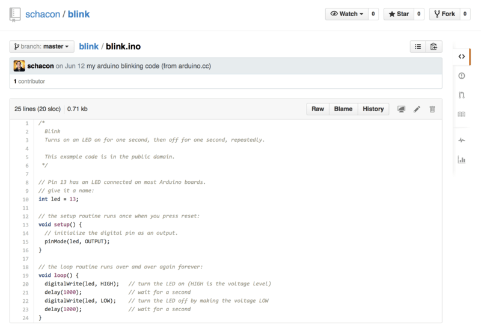
*Figure 89. The project we want to contribute to — nguồn: [Creating a Pull Request](https://git-scm.com/book/en/v2/GitHub-Contributing-to-a-Project)*

📖 **Nguyên văn**
> "The only problem is that the blinking rate is too fast.
> We think it's much nicer to wait 3 seconds instead of 1 in between each state change.
> So let's improve the program and submit it back to the project as a proposed change."

🇻🇳 **Dịch**
> "Vấn đề duy nhất là tốc độ nhấp nháy quá nhanh. Chúng ta nghĩ đợi 3 giây thay vì 1 giây giữa mỗi lần đổi trạng thái sẽ dễ chịu hơn nhiều. Vậy hãy cải thiện chương trình rồi gửi ngược lại project như một thay đổi đề xuất."

📖 **Nguyên văn**
> "First, we click the 'Fork' button as mentioned earlier to get our own copy of the project.
> Our user name here is "tonychacon" so our copy of this project is at https://github.com/tonychacon/blink and that's where we can edit it.
> We will clone it locally, create a topic branch, make the code change and finally push that change back up to GitHub."

🇻🇳 **Dịch**
> "Đầu tiên, ta bấm nút 'Fork' như đã nói để có bản sao project của riêng mình. User name ở đây là "tonychacon" nên bản sao project nằm tại https://github.com/tonychacon/blink và đó là nơi ta có thể sửa. Ta sẽ clone về máy, tạo một topic branch, sửa code và cuối cùng push thay đổi đó lên GitHub."

```console
$ git clone https://github.com/tonychacon/blink (1)
Cloning into 'blink'...

$ cd blink
$ git checkout -b slow-blink (2)
Switched to a new branch 'slow-blink'

$ sed -i '' 's/1000/3000/' blink.ino (macOS) (3)
# If you're on a Linux system, do this instead:
# $ sed -i 's/1000/3000/' blink.ino (3)

$ git diff --word-diff (4)
diff --git a/blink.ino b/blink.ino
index 15b9911..a6cc5a5 100644
--- a/blink.ino
+++ b/blink.ino
@@ -18,7 +18,7 @@ void setup() {
// the loop routine runs over and over again forever:
void loop() {
  digitalWrite(led, HIGH);   // turn the LED on (HIGH is the voltage level)
  [-delay(1000);-]{+delay(3000);+}               // wait for a second
  digitalWrite(led, LOW);    // turn the LED off by making the voltage LOW
  [-delay(1000);-]{+delay(3000);+}               // wait for a second
}

$ git commit -a -m 'Change delay to 3 seconds' (5)
[slow-blink 5ca509d] Change delay to 3 seconds
 1 file changed, 2 insertions(+), 2 deletions(-)

$ git push origin slow-blink (6)
Username for 'https://github.com': tonychacon
Password for 'https://tonychacon@github.com':
Counting objects: 5, done.
Delta compression using up to 8 threads.
Compressing objects: 100% (3/3), done.
Writing objects: 100% (3/3), 340 bytes | 0 bytes/s, done.
Total 3 (delta 1), reused 0 (delta 0)
To https://github.com/tonychacon/blink
 * [new branch]      slow-blink -> slow-blink
```

Chú thích nguyên văn của sách:

| # | Nguyên văn | Dịch |
|---|---|---|
| (1) | "Clone our fork of the project locally." | Clone fork của project về máy. |
| (2) | "Create a descriptive topic branch." | Tạo một topic branch có tên mô tả rõ ràng. |
| (3) | "Make our change to the code." | Sửa code. |
| (4) | "Check that the change is good." | Kiểm tra thay đổi đã ổn chưa. |
| (5) | "Commit our change to the topic branch." | Commit thay đổi vào topic branch. |
| (6) | "Push our new topic branch back up to our GitHub fork." | Push topic branch mới lên fork GitHub của mình. |

📖 **Nguyên văn**
> "Now if we go back to our fork on GitHub, we can see that GitHub noticed that we pushed a new topic branch up and presents us with a big green button to check out our changes and open a Pull Request to the original project.
>
> You can alternatively go to the "Branches" page at `https://github.com/<user>/<project>/branches` to locate your branch and open a new Pull Request from there."

🇻🇳 **Dịch**
> "Giờ nếu quay lại fork trên GitHub, ta thấy GitHub đã nhận ra ta vừa push một topic branch mới và hiện một nút xanh lớn để xem thay đổi và mở Pull Request tới project gốc.
>
> Hoặc bạn có thể vào trang "Branches" tại `https://github.com/<user>/<project>/branches` để tìm branch của mình và mở Pull Request từ đó."

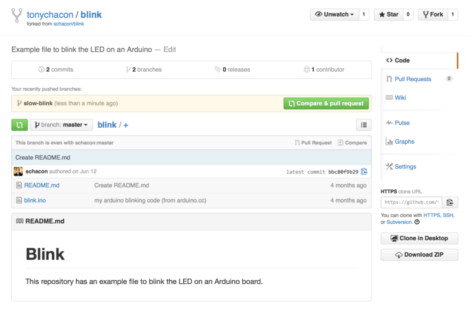
*Figure 90. Pull Request button — nguồn: [Creating a Pull Request](https://git-scm.com/book/en/v2/GitHub-Contributing-to-a-Project)*

📖 **Nguyên văn**
> "If we click that green button, we'll see a screen that asks us to give our Pull Request a title and description.
> It is almost always worthwhile to put some effort into this, since a good description helps the owner of the original project determine what you were trying to do, whether your proposed changes are correct, and whether accepting the changes would improve the original project.
>
> We also see a list of the commits in our topic branch that are "ahead" of the `master` branch (in this case, just the one) and a unified diff of all the changes that will be made should this branch get merged by the project owner."

🇻🇳 **Dịch**
> "Nếu bấm nút xanh đó, ta thấy màn hình yêu cầu đặt title và description cho Pull Request.
> Gần như lúc nào cũng đáng để đầu tư công sức vào việc này, vì một description tốt giúp owner của project gốc xác định được bạn đang cố làm gì, thay đổi bạn đề xuất có đúng không, và việc chấp nhận thay đổi có làm project gốc tốt lên không.
>
> Ta cũng thấy danh sách các commit trong topic branch đang "ahead" so với branch `master` (ở đây chỉ có một) và một unified diff của toàn bộ thay đổi sẽ được áp dụng nếu branch này được project owner merge."

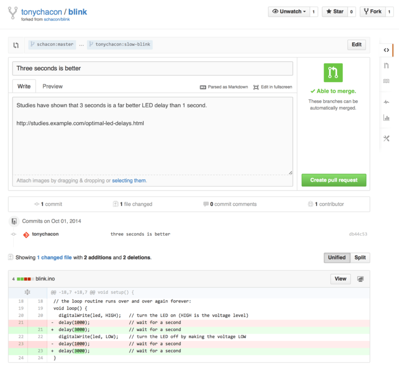
*Figure 91. Pull Request creation page — nguồn: [Creating a Pull Request](https://git-scm.com/book/en/v2/GitHub-Contributing-to-a-Project)*

📖 **Nguyên văn**
> "When you hit the 'Create pull request' button on this screen, the owner of the project you forked will get a notification that someone is suggesting a change and will link to a page that has all of this information on it."

🇻🇳 **Dịch**
> "Khi bạn bấm nút 'Create pull request' ở màn hình này, owner của project bạn đã fork sẽ nhận được notification rằng có người đang đề xuất một thay đổi, kèm link tới trang chứa toàn bộ thông tin đó."

> [!note] Note (nguyên văn trong sách)
> 📖 "Though Pull Requests are used commonly for public projects like this when the contributor has a complete change ready to be made, it's also often used in internal projects at the beginning of the development cycle.
> Since you can keep pushing to the topic branch even after the Pull Request is opened, it's often opened early and used as a way to iterate on work as a team within a context, rather than opened at the very end of the process."
>
> 🇻🇳 "Dù Pull Request thường được dùng cho project public như thế này khi contributor đã có sẵn một thay đổi hoàn chỉnh, nó cũng hay được dùng trong project nội bộ ngay từ đầu chu kỳ phát triển. Vì bạn vẫn có thể tiếp tục push lên topic branch kể cả sau khi Pull Request đã mở, nên PR thường được mở sớm và dùng như cách để cả team lặp công việc trong một ngữ cảnh chung, thay vì mở ở cuối quy trình."

---

## Iterating on a Pull Request

📖 **Nguyên văn**
> "At this point, the project owner can look at the suggested change and merge it, reject it or comment on it.
> Let's say that he likes the idea, but would prefer a slightly longer time for the light to be off than on.
>
> Where this conversation may take place over email in the workflows presented in Distributed Git, on GitHub this happens online.
> The project owner can review the unified diff and leave a comment by clicking on any of the lines."

🇻🇳 **Dịch**
> "Đến đây, project owner có thể xem thay đổi đề xuất rồi merge, từ chối, hoặc comment.
> Giả sử ông ấy thích ý tưởng, nhưng muốn thời gian đèn tắt dài hơn thời gian đèn sáng một chút.
>
> Trong các workflow ở phần Distributed Git, cuộc trao đổi này có thể diễn ra qua email; còn trên GitHub nó diễn ra online.
> Project owner có thể review unified diff và để lại comment bằng cách bấm vào bất kỳ dòng nào."

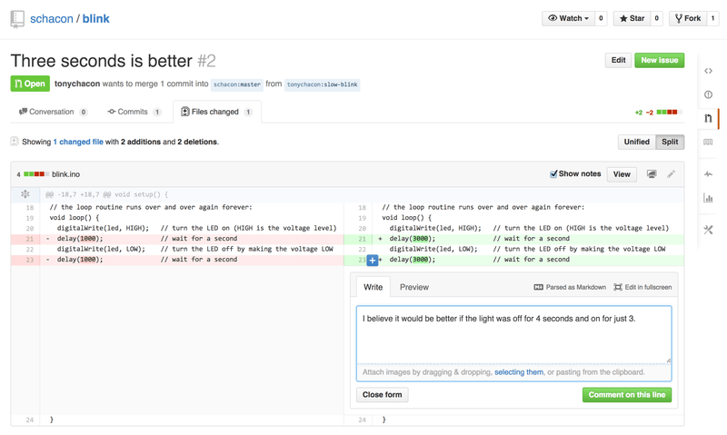
*Figure 92. Comment on a specific line of code in a Pull Request — nguồn: [Iterating on a Pull Request](https://git-scm.com/book/en/v2/GitHub-Contributing-to-a-Project)*

📖 **Nguyên văn**
> "Once the maintainer makes this comment, the person who opened the Pull Request (and indeed, anyone else watching the repository) will get a notification.
> We'll go over customizing this later, but if he had email notifications turned on, Tony would get an email like this:"

🇻🇳 **Dịch**
> "Khi maintainer để lại comment này, người đã mở Pull Request (và cả bất kỳ ai đang watch repository) sẽ nhận được notification. Nếu Tony bật email notification, anh ấy sẽ nhận được email như thế này:"

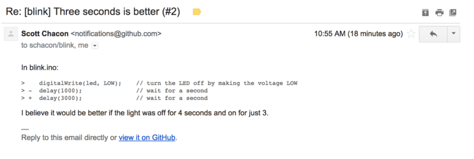
*Figure 93. Comments sent as email notifications — nguồn: [Iterating on a Pull Request](https://git-scm.com/book/en/v2/GitHub-Contributing-to-a-Project)*

📖 **Nguyên văn**
> "Anyone can also leave general comments on the Pull Request.
> In Pull Request discussion page we can see an example of the project owner both commenting on a line of code and then leaving a general comment in the discussion section.
> You can see that the code comments are brought into the conversation as well."

🇻🇳 **Dịch**
> "Bất kỳ ai cũng có thể để lại comment chung trên Pull Request. Ở hình trang thảo luận Pull Request, ta thấy ví dụ project owner vừa comment trên một dòng code vừa để lại comment chung ở phần discussion. Có thể thấy các comment trên code cũng được đưa vào dòng hội thoại."

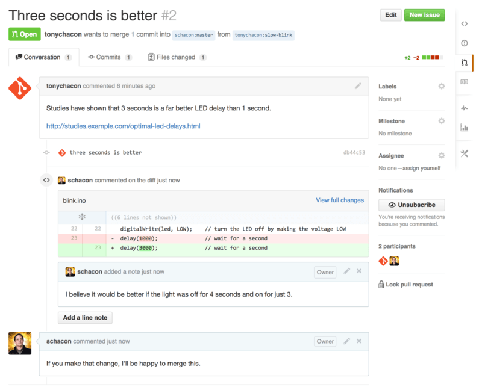
*Figure 94. Pull Request discussion page — nguồn: [Iterating on a Pull Request](https://git-scm.com/book/en/v2/GitHub-Contributing-to-a-Project)*

📖 **Nguyên văn**
> "Now the contributor can see what they need to do in order to get their change accepted.
> Luckily this is very straightforward.
> Where over email you may have to re-roll your series and resubmit it to the mailing list, with GitHub you simply commit to the topic branch again and push, which will automatically update the Pull Request.
> In Pull Request final you can also see that the old code comment has been collapsed in the updated Pull Request, since it was made on a line that has since been changed.
>
> Adding commits to an existing Pull Request doesn't trigger a notification, so once Tony has pushed his corrections he decides to leave a comment to inform the project owner that he made the requested change."

🇻🇳 **Dịch**
> "Giờ contributor thấy rõ mình cần làm gì để thay đổi được chấp nhận. May mắn là rất đơn giản.
> Với email bạn có thể phải làm lại cả loạt patch rồi gửi lại vào mailing list; còn với GitHub bạn chỉ cần commit tiếp vào topic branch rồi push, Pull Request sẽ tự động cập nhật.
> Ở hình Pull Request final bạn cũng thấy comment cũ trên code đã bị thu gọn trong Pull Request đã cập nhật, vì nó được đặt trên một dòng mà nay đã bị thay đổi.
>
> Việc thêm commit vào một Pull Request đang mở không kích hoạt notification, nên sau khi push phần sửa, Tony quyết định để lại comment báo cho project owner biết anh đã làm theo yêu cầu."

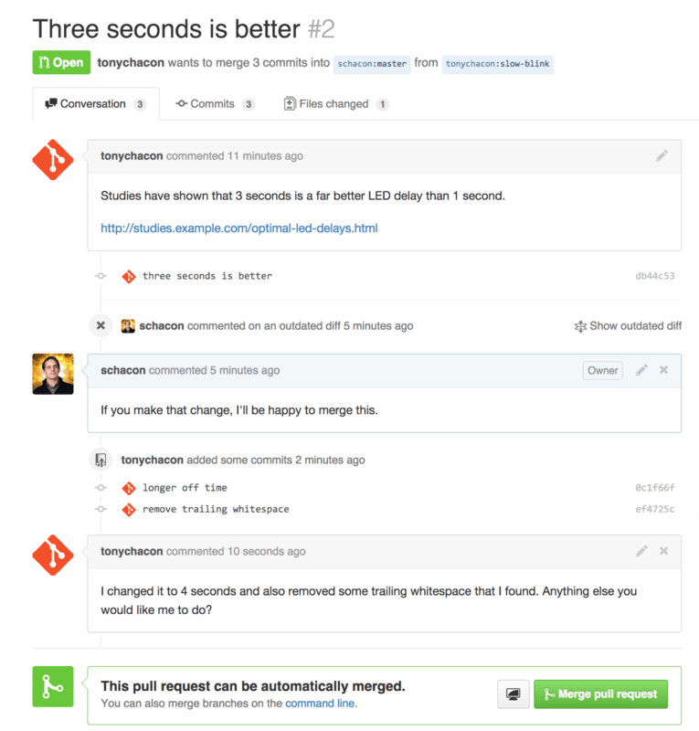
*Figure 95. Pull Request final — nguồn: [Iterating on a Pull Request](https://git-scm.com/book/en/v2/GitHub-Contributing-to-a-Project)*

📖 **Nguyên văn**
> "An interesting thing to notice is that if you click on the "Files Changed" tab on this Pull Request, you'll get the "unified" diff — that is, the total aggregate difference that would be introduced to your main branch if this topic branch was merged in.
> In `git diff` terms, it basically automatically shows you `git diff master...<branch>` for the branch this Pull Request is based on."

🇻🇳 **Dịch**
> "Một điểm thú vị: nếu bạn bấm tab "Files Changed" trên Pull Request này, bạn sẽ có unified diff — tức toàn bộ khác biệt tổng hợp sẽ được đưa vào main branch nếu topic branch này được merge vào.
> Theo ngôn ngữ của `git diff`, về cơ bản nó tự động hiện cho bạn `git diff master...<branch>` của branch mà Pull Request này dựa trên."

📖 **Nguyên văn**
> "The other thing you'll notice is that GitHub checks to see if the Pull Request merges cleanly and provides a button to do the merge for you on the server.
> This button only shows up if you have write access to the repository and a trivial merge is possible.
> If you click it GitHub will perform a "non-fast-forward" merge, meaning that even if the merge could be a fast-forward, it will still create a merge commit."

🇻🇳 **Dịch**
> "Điều nữa bạn sẽ để ý là GitHub kiểm tra xem Pull Request có merge sạch không và cung cấp một nút để merge ngay trên server.
> Nút này chỉ hiện khi bạn có quyền ghi vào repository và có thể merge một cách đơn giản.
> Nếu bấm, GitHub sẽ thực hiện merge kiểu "non-fast-forward", nghĩa là kể cả khi merge có thể là fast-forward thì nó vẫn tạo ra một merge commit."

> Khái niệm fast-forward / merge commit đã giải thích ở [[11 - Basic Branching and Merging]].

📖 **Nguyên văn**
> "If you would prefer, you can simply pull the branch down and merge it locally.
> If you merge this branch into the `master` branch and push it to GitHub, the Pull Request will automatically be closed.
>
> This is the basic workflow that most GitHub projects use.
> Topic branches are created, Pull Requests are opened on them, a discussion ensues, possibly more work is done on the branch and eventually the request is either closed or merged."

🇻🇳 **Dịch**
> "Nếu muốn, bạn cũng có thể pull branch về và merge ở local. Nếu bạn merge branch này vào branch `master` rồi push lên GitHub, Pull Request sẽ tự động được đóng.
>
> Đây là workflow cơ bản mà hầu hết project trên GitHub dùng: tạo topic branch, mở Pull Request trên đó, thảo luận diễn ra, có thể làm thêm việc trên branch, và cuối cùng request được đóng hoặc merge."

> [!note] Not Only Forks (nguyên văn trong sách)
> 📖 "It's important to note that you can also open a Pull Request between two branches in the same repository.
> If you're working on a feature with someone and you both have write access to the project, you can push a topic branch to the repository and open a Pull Request on it to the `master` branch of that same project to initiate the code review and discussion process.
> No forking necessary."
>
> 🇻🇳 "Cần lưu ý bạn cũng có thể mở Pull Request giữa hai branch trong cùng một repository. Nếu bạn làm một feature cùng người khác và cả hai đều có quyền ghi vào project, bạn có thể push một topic branch lên repository rồi mở Pull Request từ nó tới branch `master` của chính project đó để khởi động quá trình code review và thảo luận. Không cần fork."

---

## Advanced Pull Requests

📖 **Nguyên văn**
> "Now that we've covered the basics of contributing to a project on GitHub, let's cover a few interesting tips and tricks about Pull Requests so you can be more effective in using them."

🇻🇳 **Dịch**
> "Giờ khi đã đi qua phần cơ bản của việc contribute vào một project trên GitHub, hãy xem vài tip và trick thú vị về Pull Request để bạn dùng chúng hiệu quả hơn."

### Pull Requests as Patches

📖 **Nguyên văn**
> "It's important to understand that many projects don't really think of Pull Requests as queues of perfect patches that should apply cleanly in order, as most mailing list-based projects think of patch series contributions.
> Most GitHub projects think about Pull Request branches as iterative conversations around a proposed change, culminating in a unified diff that is applied by merging."

🇻🇳 **Dịch**
> "Điều quan trọng cần hiểu là nhiều project không thực sự coi Pull Request như hàng đợi các patch hoàn hảo phải áp dụng sạch sẽ theo thứ tự, như cách hầu hết project dựa trên mailing list nghĩ về các loạt patch đóng góp.
> Hầu hết project GitHub xem branch của Pull Request như những cuộc hội thoại lặp đi lặp lại quanh một thay đổi được đề xuất, kết tinh lại thành một unified diff được áp dụng bằng cách merge."

📖 **Nguyên văn**
> "This is an important distinction, because generally the change is suggested before the code is thought to be perfect, which is far more rare with mailing list based patch series contributions.
> This enables an earlier conversation with the maintainers so that arriving at the proper solution is more of a community effort.
> When code is proposed with a Pull Request and the maintainers or community suggest a change, the patch series is generally not re-rolled, but instead the difference is pushed as a new commit to the branch, moving the conversation forward with the context of the previous work intact."

🇻🇳 **Dịch**
> "Đây là khác biệt quan trọng, vì nhìn chung thay đổi được đề xuất trước khi code được coi là hoàn hảo — điều hiếm hơn nhiều với kiểu đóng góp patch series qua mailing list.
> Nó cho phép trao đổi sớm hơn với maintainer, nên việc đi tới giải pháp đúng mang tính nỗ lực cộng đồng hơn.
> Khi code được đề xuất bằng Pull Request và maintainer hoặc cộng đồng gợi ý thay đổi, loạt patch thường không bị làm lại từ đầu; thay vào đó phần khác biệt được push thành một commit mới lên branch, đẩy cuộc hội thoại tiến lên trong khi vẫn giữ nguyên ngữ cảnh của công việc trước đó."

📖 **Nguyên văn**
> "For instance, if you go back and look again at Pull Request final, you'll notice that the contributor did not rebase his commit and send another Pull Request.
> Instead they added new commits and pushed them to the existing branch.
> This way if you go back and look at this Pull Request in the future, you can easily find all of the context of why decisions were made.
> Pushing the "Merge" button on the site purposefully creates a merge commit that references the Pull Request so that it's easy to go back and research the original conversation if necessary."

🇻🇳 **Dịch**
> "Chẳng hạn, nếu quay lại xem hình Pull Request final, bạn sẽ thấy contributor không rebase commit rồi gửi một Pull Request khác. Thay vào đó họ thêm commit mới và push lên branch đang có.
> Nhờ vậy, sau này khi xem lại Pull Request, bạn dễ dàng tìm được toàn bộ ngữ cảnh vì sao các quyết định được đưa ra.
> Việc bấm nút "Merge" trên trang web cố tình tạo ra một merge commit tham chiếu tới Pull Request, để dễ quay lại tra cứu cuộc hội thoại gốc khi cần."

> Về rebase, xem [[14 - Rebasing]].

### Keeping up with Upstream

📖 **Nguyên văn**
> "If your Pull Request becomes out of date or otherwise doesn't merge cleanly, you will want to fix it so the maintainer can easily merge it.
> GitHub will test this for you and let you know at the bottom of every Pull Request if the merge is trivial or not."

🇻🇳 **Dịch**
> "Nếu Pull Request của bạn bị lỗi thời hoặc không merge sạch được, bạn sẽ muốn sửa để maintainer merge dễ dàng.
> GitHub sẽ kiểm tra giúp bạn và báo ở cuối mỗi Pull Request xem merge có đơn giản hay không."

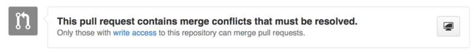
*Figure 96. Pull Request does not merge cleanly — nguồn: [Keeping up with Upstream](https://git-scm.com/book/en/v2/GitHub-Contributing-to-a-Project)*

📖 **Nguyên văn**
> "You have two main options in order to do this.
> You can either rebase your branch on top of whatever the target branch is (normally the `master` branch of the repository you forked), or you can merge the target branch into your branch.
>
> Most developers on GitHub will choose to do the latter, for the same reasons we just went over in the previous section.
> What matters is the history and the final merge, so rebasing isn't getting you much other than a slightly cleaner history and in return is far more difficult and error prone."

🇻🇳 **Dịch**
> "Bạn có hai lựa chọn chính.
> Hoặc rebase branch của bạn lên trên target branch (thường là branch `master` của repository bạn đã fork), hoặc merge target branch vào branch của bạn.
>
> Hầu hết developer trên GitHub chọn cách sau, vì đúng những lý do vừa nói ở phần trước.
> Cái quan trọng là history và lần merge cuối cùng, nên rebase chẳng đem lại gì nhiều ngoài history sạch hơn một chút, đổi lại thì khó hơn nhiều và dễ sai hơn."

📖 **Nguyên văn**
> "If you want to merge in the target branch to make your Pull Request mergeable, you would add the original repository as a new remote, fetch from it, merge the main branch of that repository into your topic branch, fix any issues and finally push it back up to the same branch you opened the Pull Request on."

🇻🇳 **Dịch**
> "Nếu bạn muốn merge target branch vào để Pull Request merge được, bạn sẽ thêm repository gốc thành một remote mới, fetch từ nó, merge main branch của repository đó vào topic branch của bạn, sửa các vấn đề phát sinh và cuối cùng push lên đúng branch mà bạn đã mở Pull Request."

> Remote `upstream` và remote-tracking branch đã giải thích ở [[13 - Remote Branches]] và [[08 - Working with Remotes]].

```console
$ git remote add upstream https://github.com/schacon/blink (1)

$ git fetch upstream (2)
remote: Counting objects: 3, done.
remote: Compressing objects: 100% (3/3), done.
Unpacking objects: 100% (3/3), done.
remote: Total 3 (delta 0), reused 0 (delta 0)
From https://github.com/schacon/blink
 * [new branch]      master     -> upstream/master

$ git merge upstream/master (3)
Auto-merging blink.ino
CONFLICT (content): Merge conflict in blink.ino
Automatic merge failed; fix conflicts and then commit the result.

$ vim blink.ino (4)
$ git add blink.ino
$ git commit
[slow-blink 3c8d735] Merge remote-tracking branch 'upstream/master' \
    into slower-blink

$ git push origin slow-blink (5)
Counting objects: 6, done.
Delta compression using up to 8 threads.
Compressing objects: 100% (6/6), done.
Writing objects: 100% (6/6), 682 bytes | 0 bytes/s, done.
Total 6 (delta 2), reused 0 (delta 0)
To https://github.com/tonychacon/blink
   ef4725c..3c8d735  slower-blink -> slow-blink
```

| # | Nguyên văn | Dịch |
|---|---|---|
| (1) | "Add the original repository as a remote named `upstream`." | Thêm repository gốc thành remote tên `upstream`. |
| (2) | "Fetch the newest work from that remote." | Fetch phần việc mới nhất từ remote đó. |
| (3) | "Merge the main branch of that repository into your topic branch." | Merge main branch của repository đó vào topic branch của bạn. |
| (4) | "Fix the conflict that occurred." | Sửa conflict phát sinh. |
| (5) | "Push back up to the same topic branch." | Push ngược lên đúng topic branch đó. |

📖 **Nguyên văn**
> "Once you do that, the Pull Request will be automatically updated and re-checked to see if it merges cleanly."

🇻🇳 **Dịch**
> "Khi bạn làm xong, Pull Request sẽ tự động cập nhật và được kiểm tra lại xem có merge sạch không."

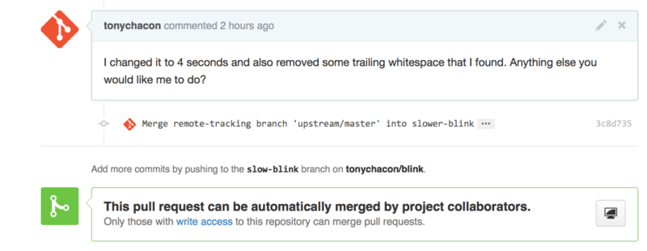
*Figure 97. Pull Request now merges cleanly — nguồn: [Keeping up with Upstream](https://git-scm.com/book/en/v2/GitHub-Contributing-to-a-Project)*

📖 **Nguyên văn**
> "One of the great things about Git is that you can do that continuously.
> If you have a very long-running project, you can easily merge from the target branch over and over again and only have to deal with conflicts that have arisen since the last time that you merged, making the process very manageable."

🇻🇳 **Dịch**
> "Một điểm tuyệt vời của Git là bạn có thể làm việc đó liên tục. Nếu project chạy rất dài, bạn có thể merge từ target branch hết lần này đến lần khác và chỉ phải xử lý những conflict phát sinh kể từ lần merge trước, khiến quy trình rất dễ quản lý."

> [!danger] Đừng force push lên branch của PR đang mở
> 📖 "If you absolutely wish to rebase the branch to clean it up, you can certainly do so, but it is highly encouraged to not force push over the branch that the Pull Request is already opened on.
> If other people have pulled it down and done more work on it, you run into all of the issues outlined in The Perils of Rebasing.
> Instead, push the rebased branch to a new branch on GitHub and open a brand new Pull Request referencing the old one, then close the original."
>
> 🇻🇳 "Nếu bạn thực sự muốn rebase branch cho gọn history thì hoàn toàn có thể, nhưng rất khuyến nghị KHÔNG force push đè lên branch mà Pull Request đang mở. Nếu người khác đã pull nó về và làm thêm việc trên đó, bạn sẽ gặp đúng mọi vấn đề nêu ở The Perils of Rebasing. Thay vào đó, hãy push branch đã rebase thành một branch mới trên GitHub, mở một Pull Request hoàn toàn mới có tham chiếu tới cái cũ, rồi đóng PR gốc."
>
> Xem [[14 - Rebasing]] — mục The Perils of Rebasing.

### References

📖 **Nguyên văn**
> "Your next question may be "How do I reference the old Pull Request?".
> It turns out there are many, many ways to reference other things almost anywhere you can write in GitHub.
>
> Let's start with how to cross-reference another Pull Request or an Issue.
> All Pull Requests and Issues are assigned numbers and they are unique within the project.
> For example, you can't have Pull Request #3 and Issue #3.
> If you want to reference any Pull Request or Issue from any other one, you can simply put `#<num>` in any comment or description.
> You can also be more specific if the Issue or Pull request lives somewhere else; write `username#<num>` if you're referring to an Issue or Pull Request in a fork of the repository you're in, or `username/repo#<num>` to reference something in another repository."

🇻🇳 **Dịch**
> "Câu hỏi tiếp theo có thể là "Làm sao tham chiếu tới Pull Request cũ?".
> Hóa ra có rất, rất nhiều cách tham chiếu tới thứ khác ở gần như mọi nơi bạn có thể viết trên GitHub.
>
> Bắt đầu với cách cross-reference một Pull Request hoặc Issue khác.
> Mọi Pull Request và Issue đều được gán số và số đó là duy nhất trong project.
> Ví dụ, bạn không thể có Pull Request #3 và Issue #3 cùng lúc.
> Nếu muốn tham chiếu tới bất kỳ Pull Request hay Issue nào từ một cái khác, chỉ cần viết `#<num>` trong comment hoặc description.
> Bạn cũng có thể cụ thể hơn nếu Issue/Pull Request nằm ở nơi khác: viết `username#<num>` nếu tham chiếu tới Issue/Pull Request trong một fork của repository bạn đang ở, hoặc `username/repo#<num>` để tham chiếu tới thứ trong repository khác."

📖 **Nguyên văn**
> "Let's look at an example.
> Say we rebased the branch in the previous example, created a new pull request for it, and now we want to reference the old pull request from the new one.
> We also want to reference an issue in the fork of the repository and an issue in a completely different project.
> We can fill out the description just like Cross references in a Pull Request."

🇻🇳 **Dịch**
> "Xem một ví dụ. Giả sử ta đã rebase branch ở ví dụ trước, tạo một pull request mới cho nó, và giờ muốn tham chiếu pull request cũ từ cái mới. Ta cũng muốn tham chiếu một issue trong fork của repository và một issue ở project hoàn toàn khác. Ta có thể điền description đúng như hình Cross references in a Pull Request."

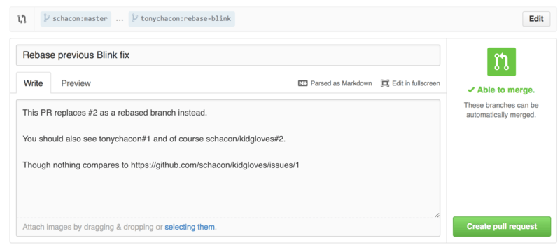
*Figure 98. Cross references in a Pull Request — nguồn: [References](https://git-scm.com/book/en/v2/GitHub-Contributing-to-a-Project)*

📖 **Nguyên văn**
> "When we submit this pull request, we'll see all of that rendered like Cross references rendered in a Pull Request."

🇻🇳 **Dịch**
> "Khi submit pull request này, ta sẽ thấy tất cả được render như hình Cross references rendered in a Pull Request."

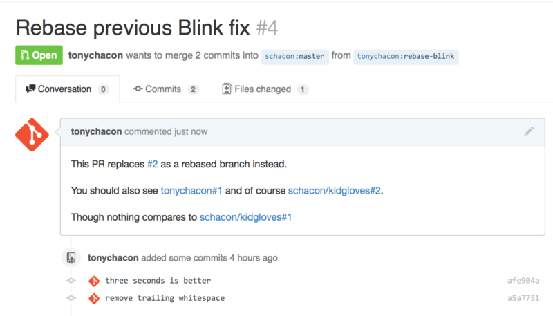
*Figure 99. Cross references rendered in a Pull Request — nguồn: [References](https://git-scm.com/book/en/v2/GitHub-Contributing-to-a-Project)*

📖 **Nguyên văn**
> "Notice that the full GitHub URL we put in there was shortened to just the information needed.
>
> Now if Tony goes back and closes out the original Pull Request, we can see that by mentioning it in the new one, GitHub has automatically created a trackback event in the Pull Request timeline.
> This means that anyone who visits this Pull Request and sees that it is closed can easily link back to the one that superseded it."

🇻🇳 **Dịch**
> "Để ý là URL GitHub đầy đủ ta đặt vào đã được rút gọn chỉ còn thông tin cần thiết.
>
> Giờ nếu Tony quay lại và đóng Pull Request gốc, ta thấy nhờ việc nhắc tới nó trong PR mới, GitHub đã tự động tạo một trackback event trong timeline của Pull Request.
> Nghĩa là bất kỳ ai ghé Pull Request này và thấy nó đã đóng đều dễ dàng lần ngược tới cái đã thay thế nó."

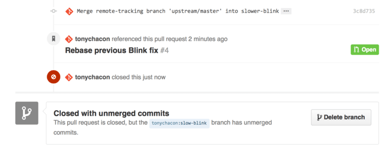
*Figure 100. Link back to the new Pull Request in the closed Pull Request timeline — nguồn: [References](https://git-scm.com/book/en/v2/GitHub-Contributing-to-a-Project)*

📖 **Nguyên văn**
> "In addition to issue numbers, you can also reference a specific commit by SHA-1.
> You have to specify a full 40 character SHA-1, but if GitHub sees that in a comment, it will link directly to the commit.
> Again, you can reference commits in forks or other repositories in the same way you did with issues."

🇻🇳 **Dịch**
> "Ngoài số issue, bạn cũng có thể tham chiếu một commit cụ thể bằng SHA-1.
> Bạn phải ghi đủ SHA-1 40 ký tự, nhưng nếu GitHub thấy nó trong comment, nó sẽ link thẳng tới commit đó.
> Tương tự, bạn có thể tham chiếu commit trong fork hoặc repository khác đúng theo cách đã làm với issue."

> SHA-1 và cách Git định danh object đã nói ở [[02 - What is Git]].

---

## GitHub Flavored Markdown

📖 **Nguyên văn**
> "Linking to other Issues is just the beginning of interesting things you can do with almost any text box on GitHub.
> In Issue and Pull Request descriptions, comments, code comments and more, you can use what is called "GitHub Flavored Markdown".
> Markdown is like writing in plain text but which is rendered richly."

🇻🇳 **Dịch**
> "Link tới Issue khác mới chỉ là khởi đầu của những thứ thú vị bạn có thể làm với gần như mọi ô text trên GitHub.
> Trong description của Issue và Pull Request, trong comment, code comment và nhiều nơi khác, bạn có thể dùng cái gọi là "GitHub Flavored Markdown".
> Markdown giống như viết plain text nhưng được render ra dạng phong phú."

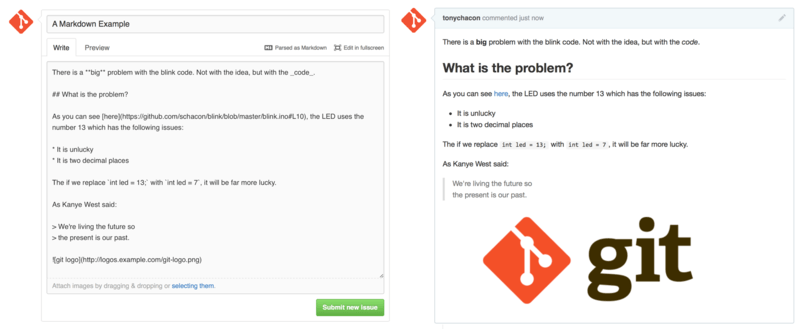
*Figure 101. An example of GitHub Flavored Markdown as written and as rendered — nguồn: [GitHub Flavored Markdown](https://git-scm.com/book/en/v2/GitHub-Contributing-to-a-Project)*

📖 **Nguyên văn**
> "The GitHub flavor of Markdown adds more things you can do beyond the basic Markdown syntax.
> These can all be really useful when creating useful Pull Request or Issue comments or descriptions."

🇻🇳 **Dịch**
> "Phiên bản Markdown của GitHub bổ sung nhiều thứ vượt ngoài cú pháp Markdown cơ bản. Tất cả đều rất hữu ích khi viết comment hoặc description cho Pull Request và Issue."

### Task Lists

📖 **Nguyên văn**
> "The first really useful GitHub specific Markdown feature, especially for use in Pull Requests, is the Task List.
> A task list is a list of checkboxes of things you want to get done.
> Putting them into an Issue or Pull Request normally indicates things that you want to get done before you consider the item complete."

🇻🇳 **Dịch**
> "Tính năng Markdown riêng của GitHub đầu tiên thực sự hữu ích, đặc biệt khi dùng trong Pull Request, là Task List.
> Task list là một danh sách checkbox những việc bạn muốn hoàn thành.
> Đặt nó vào Issue hay Pull Request thường có nghĩa đây là những việc cần xong trước khi coi mục đó là hoàn tất."

📖 **Nguyên văn**
> "You can create a task list like this:"

🇻🇳 **Dịch**
> "Bạn có thể tạo một task list như thế này:"

```markdown
- [X] Write the code
- [ ] Write all the tests
- [ ] Document the code
```

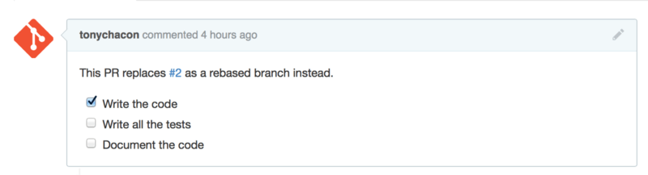
*Figure 102. Task lists rendered in a Markdown comment — nguồn: [Task Lists](https://git-scm.com/book/en/v2/GitHub-Contributing-to-a-Project)*

📖 **Nguyên văn**
> "This is often used in Pull Requests to indicate what all you would like to get done on the branch before the Pull Request will be ready to merge.
> The really cool part is that you can simply click the checkboxes to update the comment — you don't have to edit the Markdown directly to check tasks off.
>
> What's more, GitHub will look for task lists in your Issues and Pull Requests and show them as metadata on the pages that list them out.
> For example, if you have a Pull Request with tasks and you look at the overview page of all Pull Requests, you can see how far done it is.
> This helps people break down Pull Requests into subtasks and helps other people track the progress of the branch."

🇻🇳 **Dịch**
> "Cái này hay được dùng trong Pull Request để cho biết những gì bạn muốn hoàn thành trên branch trước khi PR sẵn sàng merge.
> Điểm rất hay là bạn chỉ cần bấm vào checkbox để cập nhật comment — không phải sửa Markdown trực tiếp để tick xong việc.
>
> Hơn nữa, GitHub sẽ tìm task list trong Issue và Pull Request của bạn và hiển thị chúng dưới dạng metadata trên các trang liệt kê.
> Ví dụ, nếu Pull Request có task và bạn xem trang tổng quan mọi Pull Request, bạn thấy được tiến độ tới đâu.
> Điều này giúp mọi người chia nhỏ Pull Request thành subtask và giúp người khác theo dõi tiến độ của branch."

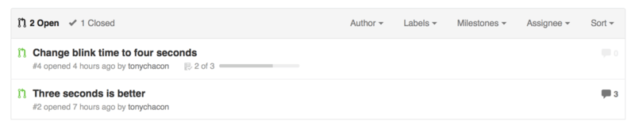
*Figure 103. Task list summary in the Pull Request list — nguồn: [Task Lists](https://git-scm.com/book/en/v2/GitHub-Contributing-to-a-Project)*

📖 **Nguyên văn**
> "These are incredibly useful when you open a Pull Request early and use it to track your progress through the implementation of the feature."

🇻🇳 **Dịch**
> "Chúng cực kỳ hữu ích khi bạn mở Pull Request sớm và dùng nó để theo dõi tiến độ trong suốt quá trình implement feature."

### Code Snippets

📖 **Nguyên văn**
> "You can also add code snippets to comments.
> This is especially useful if you want to present something that you could try to do before actually implementing it as a commit on your branch.
> This is also often used to add example code of what is not working or what this Pull Request could implement.
>
> To add a snippet of code you have to "fence" it in backticks."

🇻🇳 **Dịch**
> "Bạn cũng có thể thêm code snippet vào comment.
> Rất hữu ích khi bạn muốn trình bày thứ mình định thử làm trước khi thực sự implement thành commit trên branch.
> Nó cũng hay được dùng để đưa code ví dụ về cái đang không chạy, hoặc cái mà Pull Request này có thể implement.
>
> Để thêm một đoạn code, bạn phải "fence" nó bằng dấu backtick."

````markdown
```java
for(int i=0 ; i < 5 ; i++)
{
   System.out.println("i is : " + i);
}
```
````

📖 **Nguyên văn**
> "If you add a language name like we did there with 'java', GitHub will also try to syntax highlight the snippet."

🇻🇳 **Dịch**
> "Nếu bạn thêm tên ngôn ngữ như ta vừa làm với 'java', GitHub cũng sẽ cố syntax highlight đoạn code đó."

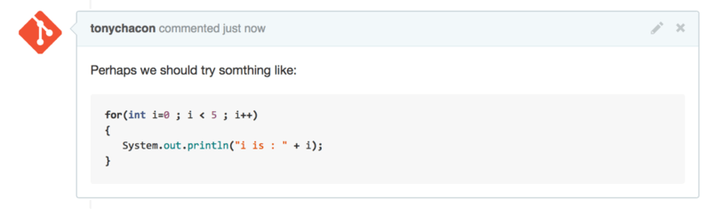
*Figure 104. Rendered fenced code example — nguồn: [Code Snippets](https://git-scm.com/book/en/v2/GitHub-Contributing-to-a-Project)*

### Quoting

📖 **Nguyên văn**
> "If you're responding to a small part of a long comment, you can selectively quote out of the other comment by preceding the lines with the `>` character.
> In fact, this is so common and so useful that there is a keyboard shortcut for it.
> If you highlight text in a comment that you want to directly reply to and hit the `r` key, it will quote that text in the comment box for you."

🇻🇳 **Dịch**
> "Nếu bạn đang trả lời một phần nhỏ trong comment dài, bạn có thể trích chọn lọc từ comment kia bằng cách đặt ký tự `>` ở đầu dòng.
> Thực tế việc này phổ biến và hữu ích tới mức có cả keyboard shortcut.
> Nếu bạn bôi đen đoạn text trong comment muốn trả lời trực tiếp rồi bấm phím `r`, nó sẽ trích đoạn text đó vào ô comment giúp bạn."

📖 **Nguyên văn — ví dụ trong sách**
```markdown
> Whether 'tis Nobler in the mind to suffer
> The Slings and Arrows of outrageous Fortune,

How big are these slings and in particular, these arrows?
```

🇻🇳 Ví dụ minh hoạ cú pháp quoting: hai dòng đầu bắt đầu bằng `>` là phần trích lại comment của người khác (ở đây là câu thơ trong *Hamlet*: "Liệu có cao thượng hơn chăng khi trong tâm trí ta chịu đựng / Những mũi lao và mũi tên của số phận nghiệt ngã"), dòng cuối không có `>` là phần trả lời của mình ("Mấy cái lao này to cỡ nào, và nhất là mấy mũi tên kia?").

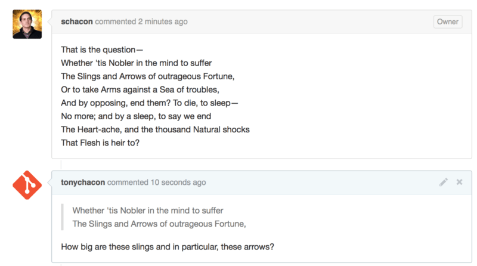
*Figure 105. Rendered quoting example — nguồn: [Quoting](https://git-scm.com/book/en/v2/GitHub-Contributing-to-a-Project)*

### Emoji

📖 **Nguyên văn**
> "Finally, you can also use emoji in your comments.
> This is actually used quite extensively in comments you see on many GitHub Issues and Pull Requests.
> There is even an emoji helper in GitHub.
> If you are typing a comment and you start with a `:` character, an autocompleter will help you find what you're looking for."

🇻🇳 **Dịch**
> "Cuối cùng, bạn cũng có thể dùng emoji trong comment.
> Thực tế nó được dùng khá nhiều trong comment trên nhiều GitHub Issue và Pull Request.
> GitHub thậm chí có emoji helper.
> Nếu bạn đang gõ comment và bắt đầu bằng ký tự `:`, một autocompleter sẽ giúp bạn tìm thứ đang cần."

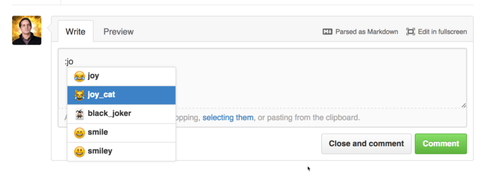
*Figure 106. Emoji autocompleter in action — nguồn: [Emoji](https://git-scm.com/book/en/v2/GitHub-Contributing-to-a-Project)*

📖 **Nguyên văn**
> "Emojis take the form of `:<name>:` anywhere in the comment.
> For instance, you could write something like this:"

🇻🇳 **Dịch**
> "Emoji có dạng `:<name>:` đặt ở bất kỳ đâu trong comment.
> Ví dụ, bạn có thể viết kiểu như thế này:"

```markdown
I :eyes: that :bug: and I :cold_sweat:.

:trophy: for :microscope: it.

:+1: and :sparkles: on this :ship:, it's :fire::poop:!

:clap::tada::panda_face:
```

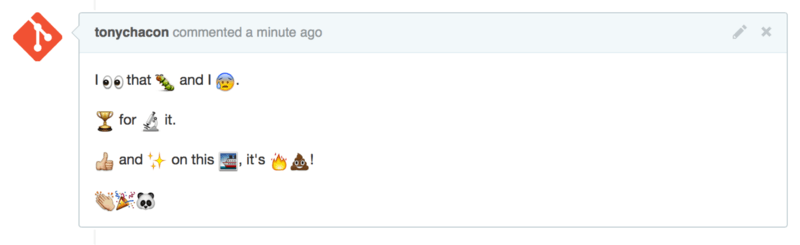
*Figure 107. Heavy emoji commenting — nguồn: [Emoji](https://git-scm.com/book/en/v2/GitHub-Contributing-to-a-Project)*

📖 **Nguyên văn**
> "Not that this is incredibly useful, but it does add an element of fun and emotion to a medium that is otherwise hard to convey emotion in."

🇻🇳 **Dịch**
> "Không hẳn là cực kỳ hữu ích, nhưng nó thêm chút vui vẻ và cảm xúc vào một phương tiện vốn rất khó truyền tải cảm xúc."

> [!note] Note (nguyên văn trong sách)
> 📖 "There are actually quite a number of web services that make use of emoji characters these days.
> A great cheat sheet to reference to find emoji that expresses what you want to say can be found at:
> https://www.webfx.com/tools/emoji-cheat-sheet/"
>
> 🇻🇳 "Thực ra ngày nay có khá nhiều web service sử dụng ký tự emoji. Một bảng cheat sheet rất tốt để tra cứu, tìm emoji diễn tả đúng điều bạn muốn nói, có thể xem tại: https://www.webfx.com/tools/emoji-cheat-sheet/"

### Images

📖 **Nguyên văn**
> "This isn't technically GitHub Flavored Markdown, but it is incredibly useful.
> In addition to adding Markdown image links to comments, which can be difficult to find and embed URLs for, GitHub allows you to drag and drop images into text areas to embed them."

🇻🇳 **Dịch**
> "Về mặt kỹ thuật thì đây không phải GitHub Flavored Markdown, nhưng nó cực kỳ hữu ích.
> Ngoài việc thêm link ảnh kiểu Markdown vào comment — vốn khó tìm và khó nhúng URL — GitHub cho phép bạn kéo thả ảnh vào ô text để nhúng chúng."

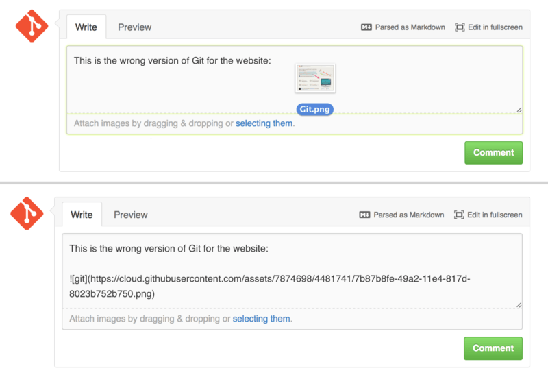
*Figure 108. Drag and drop images to upload them and auto-embed them — nguồn: [Images](https://git-scm.com/book/en/v2/GitHub-Contributing-to-a-Project)*

📖 **Nguyên văn**
> "If you look at Drag and drop images to upload them and auto-embed them, you can see a small "Parsed as Markdown" hint above the text area.
> Clicking on that will give you a full cheat sheet of everything you can do with Markdown on GitHub."

🇻🇳 **Dịch**
> "Nếu nhìn vào hình trên, bạn thấy một dòng gợi ý nhỏ "Parsed as Markdown" phía trên ô text. Bấm vào đó sẽ cho bạn cheat sheet đầy đủ mọi thứ có thể làm với Markdown trên GitHub."

---

## Keep your GitHub public repository up-to-date

📖 **Nguyên văn**
> "Once you've forked a GitHub repository, your repository (your "fork") exists independently from the original.
> In particular, when the original repository has new commits, GitHub informs you by a message like:
>
> `This branch is 5 commits behind progit:master.`
>
> But your GitHub repository will never be automatically updated by GitHub; this is something that you must do yourself.
> Fortunately, this is very easy to do."

🇻🇳 **Dịch**
> "Khi bạn đã fork một repository GitHub, repository của bạn ("fork" của bạn) tồn tại độc lập với bản gốc.
> Cụ thể, khi repository gốc có commit mới, GitHub báo cho bạn bằng thông điệp kiểu:
>
> `This branch is 5 commits behind progit:master.`
>
> Nhưng repository GitHub của bạn sẽ không bao giờ được GitHub tự động cập nhật; đây là việc bạn phải tự làm. May mắn là nó rất dễ."

📖 **Nguyên văn**
> "One possibility to do this requires no configuration.
> For example, if you forked from https://github.com/progit/progit2.git, you can keep your `master` branch up-to-date like this:"

🇻🇳 **Dịch**
> "Một cách để làm việc này không cần cấu hình gì cả.
> Ví dụ, nếu bạn fork từ https://github.com/progit/progit2.git, bạn có thể giữ branch `master` của mình luôn cập nhật như sau:"

```console
$ git checkout master (1)
$ git pull https://github.com/progit/progit2.git (2)
$ git push origin master (3)
```

| # | Nguyên văn | Dịch |
|---|---|---|
| (1) | "If you were on another branch, return to `master`." | Nếu bạn đang ở branch khác, quay về `master`. |
| (2) | "Fetch changes from `https://github.com/progit/progit2.git` and merge them into `master`." | Fetch thay đổi từ repo gốc và merge vào `master`. |
| (3) | "Push your `master` branch to `origin`." | Push branch `master` lên `origin`. |

📖 **Nguyên văn**
> "This works, but it is a little tedious having to spell out the fetch URL every time.
> You can automate this work with a bit of configuration:"

🇻🇳 **Dịch**
> "Cách này chạy được, nhưng hơi mệt vì phải gõ URL fetch mỗi lần. Bạn có thể tự động hóa việc này bằng chút cấu hình:"

```console
$ git remote add progit https://github.com/progit/progit2.git (1)
$ git fetch progit (2)
$ git branch --set-upstream-to=progit/master master (3)
$ git config --local remote.pushDefault origin (4)
```

| # | Nguyên văn | Dịch |
|---|---|---|
| (1) | "Add the source repository and give it a name. Here, I have chosen to call it `progit`." | Thêm repository nguồn và đặt tên cho nó. Ở đây tác giả chọn tên `progit`. |
| (2) | "Get a reference on progit's branches, in particular `master`." | Lấy tham chiếu tới các branch của `progit`, đặc biệt là `master`. |
| (3) | "Set your `master` branch to fetch from the `progit` remote." | Đặt branch `master` của bạn fetch từ remote `progit`. |
| (4) | "Define the default push repository to `origin`." | Định nghĩa repository push mặc định là `origin`. |

> Khái niệm upstream branch (`--set-upstream-to`) đã giải thích ở [[13 - Remote Branches]].

📖 **Nguyên văn**
> "Once this is done, the workflow becomes much simpler:"

🇻🇳 **Dịch**
> "Khi đã làm xong bước này, workflow trở nên đơn giản hơn nhiều:"

```console
$ git checkout master (1)
$ git pull (2)
$ git push (3)
```

| # | Nguyên văn | Dịch |
|---|---|---|
| (1) | "If you were on another branch, return to `master`." | Nếu đang ở branch khác, quay về `master`. |
| (2) | "Fetch changes from `progit` and merge changes into `master`." | Fetch thay đổi từ `progit` và merge vào `master`. |
| (3) | "Push your `master` branch to `origin`." | Push branch `master` lên `origin`. |

> [!warning] Mặt trái của cách cấu hình này (nguyên văn trong sách)
> 📖 "This approach can be useful, but it's not without downsides.
> Git will happily do this work for you silently, but it won't warn you if you make a commit to `master`, pull from `progit`, then push to `origin` — all of those operations are valid with this setup.
> So you'll have to take care never to commit directly to `master`, since that branch effectively belongs to the upstream repository."
>
> 🇻🇳 "Cách này có thể hữu ích, nhưng không phải không có nhược điểm. Git sẽ vui vẻ làm việc đó cho bạn một cách im lặng, nhưng nó sẽ không cảnh báo nếu bạn commit vào `master`, pull từ `progit`, rồi push lên `origin` — tất cả thao tác đó đều hợp lệ với thiết lập này. Vậy nên bạn phải cẩn thận đừng bao giờ commit trực tiếp vào `master`, vì branch đó trên thực tế thuộc về upstream repository."

---

## Tóm tắt nhanh

| Bước | Lệnh / thao tác |
|---|---|
| Fork | Bấm nút "Fork" góc trên phải trang project |
| Clone fork | `git clone https://github.com/<you>/<project>` |
| Topic branch | `git checkout -b <descriptive-name>` |
| Kiểm tra diff | `git diff --word-diff` |
| Commit & push | `git commit -a -m '...'` → `git push origin <branch>` |
| Mở PR | Nút xanh trên fork, hoặc trang `/<user>/<project>/branches` |
| Lặp PR | Commit tiếp vào cùng topic branch rồi push (PR tự cập nhật) |
| Sửa PR không merge sạch | `git remote add upstream <url>` → `git fetch upstream` → `git merge upstream/master` → sửa conflict → `git push origin <branch>` |
| Tham chiếu | `#<num>`, `username#<num>`, `username/repo#<num>`, SHA-1 đủ 40 ký tự |
| Sync fork | `git checkout master` → `git pull <upstream-url>` → `git push origin master` |

---

## Liên kết

- Bài trước: [[02 - GitHub - Account Setup and Configuration]]
- Bài kế: [[04 - GitHub - Maintaining a Project]]
- Cross-link phần 03:
  - [[12 - Branch Management và Branching Workflows]] — topic branch, nền tảng của GitHub Flow
  - [[13 - Remote Branches]] — remote `upstream`, remote-tracking branch, `--set-upstream-to`
  - [[14 - Rebasing]] — rebase và The Perils of Rebasing (vì sao không force push lên branch của PR đang mở)
  - [[11 - Basic Branching and Merging]] — merge, fast-forward, conflict
  - [[08 - Working with Remotes]] — `git remote add`, fetch/pull/push
  - [[02 - What is Git]] — SHA-1

## Nguồn tham khảo

- Pro Git 2nd Edition, §6.2 GitHub - Contributing to a Project : https://git-scm.com/book/en/v2/GitHub-Contributing-to-a-Project
- Emoji cheat sheet (link do sách dẫn) : https://www.webfx.com/tools/emoji-cheat-sheet/
- Hình Figure 88–108 lấy từ trang trên (`https://git-scm.com/book/en/v2/images/*.png`), lưu trong `assets/`
