# 04 — GitHub: Maintaining a Project

> **Nguồn chính:** Pro Git 2nd Edition, §6.3 GitHub - Maintaining a Project — https://git-scm.com/book/en/v2/GitHub-Maintaining-a-Project
> Bài này bám đúng mục 6.3: từ tạo repository mới, thêm collaborator, xử lý Pull Request (kể cả Pull Request Refs), mentions/notifications, special files, đến project administration.

---

## Mở đầu — đổi vai từ contributor sang maintainer

📖 **Nguyên văn**
> "Now that we're comfortable contributing to a project, let's look at the other side: creating, maintaining and administering your own project."

🇻🇳 **Dịch**
> "Giờ khi đã quen với việc contribute vào một project, hãy nhìn sang phía bên kia: tạo, maintain và administer project của chính bạn."

Bài [[03 - GitHub - Contributing to a Project]] đứng ở phía contributor (fork → topic branch → Pull Request). Bài này đứng ở phía maintainer: người nhận Pull Request và quyết định merge hay không.

---

## Creating a New Repository

📖 **Nguyên văn**
> "Let's create a new repository to share our project code with.
> Start by clicking the "New repository" button on the right-hand side of the dashboard, or from the + button in the top toolbar next to your username as seen in The "New repository" dropdown."

🇻🇳 **Dịch**
> "Hãy tạo một repository mới để chia sẻ code project của chúng ta.
> Bắt đầu bằng cách click nút "New repository" ở phía bên phải dashboard, hoặc từ nút + trên thanh toolbar trên cùng cạnh username của bạn như trong hình The "New repository" dropdown."

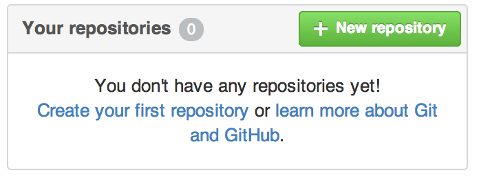
*Figure 109. The "Your repositories" area — nguồn: [GitHub - Maintaining a Project](https://git-scm.com/book/en/v2/GitHub-Maintaining-a-Project)*

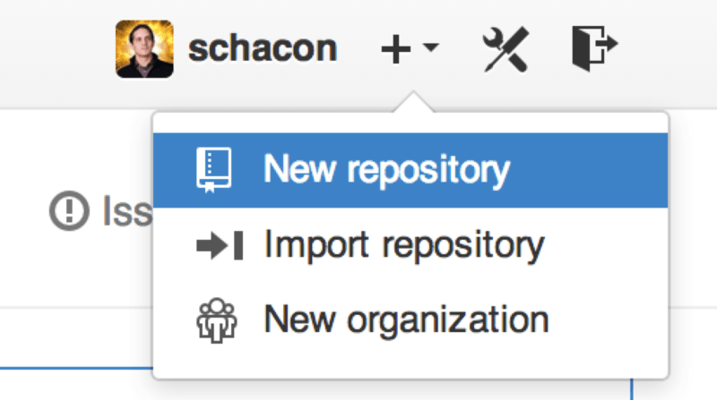
*Figure 110. The "New repository" dropdown — nguồn: [GitHub - Maintaining a Project](https://git-scm.com/book/en/v2/GitHub-Maintaining-a-Project)*

Form tạo repository:

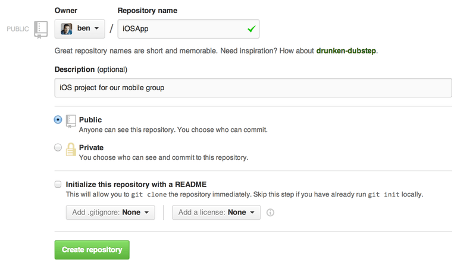
*Figure 111. The "new repository" form — nguồn: [GitHub - Maintaining a Project](https://git-scm.com/book/en/v2/GitHub-Maintaining-a-Project)*

📖 **Nguyên văn**
> "All you really have to do here is provide a project name; the rest of the fields are completely optional.
> For now, just click the "Create Repository" button, and boom — you have a new repository on GitHub, named \<user>/\<project_name>."

🇻🇳 **Dịch**
> "Tất cả những gì bạn thực sự phải làm ở đây là đặt tên project; các field còn lại hoàn toàn tùy chọn.
> Bây giờ, chỉ cần click nút "Create Repository", và bùm — bạn đã có một repository mới trên GitHub, tên là \<user>/\<project_name>."

📖 **Nguyên văn**
> "Since you have no code there yet, GitHub will show you instructions for how to create a brand-new Git repository, or connect an existing Git project."

🇻🇳 **Dịch**
> "Vì bạn chưa có code nào ở đó, GitHub sẽ hiển thị hướng dẫn cách tạo một Git repository hoàn toàn mới, hoặc kết nối một Git project sẵn có."

### Hai dạng URL truy cập

📖 **Nguyên văn**
> "Every project on GitHub is accessible over HTTPS as https://github.com/\<user>/\<project_name>, and over SSH as git@github.com:\<user>/\<project_name>.
> Git can fetch from and push to both of these URLs, but they are access-controlled based on the credentials of the user connecting to them."

🇻🇳 **Dịch**
> "Mọi project trên GitHub đều truy cập được qua HTTPS ở dạng https://github.com/\<user>/\<project_name>, và qua SSH ở dạng git@github.com:\<user>/\<project_name>.
> Git có thể fetch từ và push tới cả hai URL này, nhưng chúng được kiểm soát quyền truy cập dựa trên credentials của user đang kết nối."

> [!note] Note (nguyên văn trong sách)
> "It is often preferable to share the HTTPS based URL for a public project, since the user does not have to have a GitHub account to access it for cloning.
> Users will have to have an account and an uploaded SSH key to access your project if you give them the SSH URL.
> The HTTPS one is also exactly the same URL they would paste into a browser to view the project there."
>
> 🇻🇳 Nên chia sẻ URL dạng HTTPS cho public project, vì user không cần có tài khoản GitHub để clone. Nếu bạn đưa SSH URL, họ bắt buộc phải có account và đã upload SSH key. URL HTTPS cũng chính là URL họ dán vào trình duyệt để xem project.

---

## Adding Collaborators

📖 **Nguyên văn**
> "If you're working with other people who you want to give commit access to, you need to add them as "collaborators".
> If Ben, Jeff, and Louise all sign up for accounts on GitHub, and you want to give them push access to your repository, you can add them to your project.
> Doing so will give them "push" access, which means they have both read and write access to the project and Git repository."

🇻🇳 **Dịch**
> "Nếu bạn làm việc với người khác mà bạn muốn cấp commit access, bạn cần thêm họ làm "collaborators".
> Nếu Ben, Jeff và Louise đều đăng ký tài khoản GitHub, và bạn muốn cho họ push access vào repository của mình, bạn có thể thêm họ vào project.
> Làm vậy sẽ cấp cho họ quyền "push", tức là họ có cả read và write access vào project và Git repository."

💡 **Ví dụ đời sống**
Repository giống một căn hộ. Ai cũng có thể đứng ngoài nhìn qua cửa kính (public read). Fork là chụp ảnh rồi tự dựng một căn y hệt ở chỗ khác. Còn thêm collaborator là đưa hẳn chìa khóa — người đó bước vào và kê lại đồ đạc (push) trực tiếp.

📖 **Nguyên văn**
> "Click the "Settings" link at the bottom of the right-hand sidebar."

🇻🇳 **Dịch**
> "Click vào link "Settings" ở cuối sidebar bên phải."

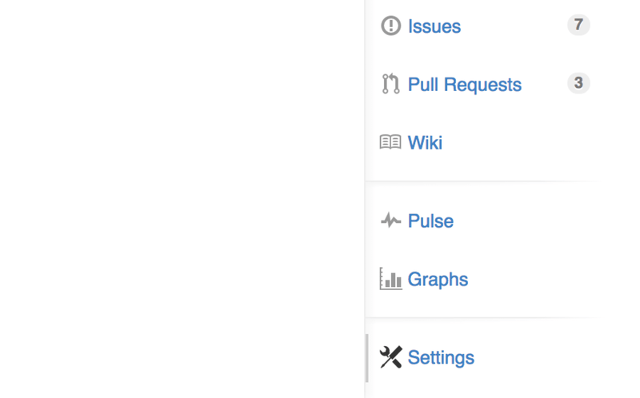
*Figure 112. The repository settings link — nguồn: [GitHub - Maintaining a Project](https://git-scm.com/book/en/v2/GitHub-Maintaining-a-Project)*

📖 **Nguyên văn**
> "Then select "Collaborators" from the menu on the left-hand side.
> Then, just type a username into the box, and click "Add collaborator."
> You can repeat this as many times as you like to grant access to everyone you like.
> If you need to revoke access, just click the "X" on the right-hand side of their row."

🇻🇳 **Dịch**
> "Sau đó chọn "Collaborators" từ menu bên trái.
> Rồi chỉ cần gõ một username vào ô, và click "Add collaborator."
> Bạn có thể lặp lại bao nhiêu lần tùy thích để cấp quyền cho bất kỳ ai.
> Nếu cần thu hồi quyền, chỉ cần click dấu "X" ở bên phải dòng của họ."

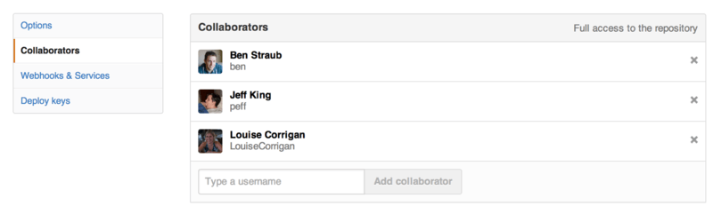
*Figure 113. The repository collaborators box — nguồn: [GitHub - Maintaining a Project](https://git-scm.com/book/en/v2/GitHub-Maintaining-a-Project)*

---

## Managing Pull Requests

📖 **Nguyên văn**
> "Pull Requests can either come from a branch in a fork of your repository or they can come from another branch in the same repository.
> The only difference is that the ones in a fork are often from people where you can't push to their branch and they can't push to yours, whereas with internal Pull Requests generally both parties can access the branch."

🇻🇳 **Dịch**
> "Pull Requests có thể đến từ một branch trong một fork của repository của bạn, hoặc đến từ một branch khác trong chính repository đó.
> Khác biệt duy nhất là PR từ fork thường đến từ những người mà bạn không push được vào branch của họ và họ cũng không push được vào branch của bạn, trong khi với Pull Request nội bộ thì thường cả hai bên đều truy cập được branch."

📖 **Nguyên văn**
> "For these examples, let's assume you are "tonychacon" and you've created a new Arduino code project named "fade"."

🇻🇳 **Dịch**
> "Trong các ví dụ này, hãy giả sử bạn là "tonychacon" và bạn vừa tạo một project code Arduino mới tên là "fade"."

### Email Notifications

📖 **Nguyên văn**
> "Someone comes along and makes a change to your code and sends you a Pull Request.
> You should get an email notifying you about the new Pull Request and it should look something like Email notification of a new Pull Request."

🇻🇳 **Dịch**
> "Một người nào đó xuất hiện, thay đổi code của bạn và gửi cho bạn một Pull Request.
> Bạn sẽ nhận được email thông báo về Pull Request mới này, và nó trông giống như hình Email notification of a new Pull Request."

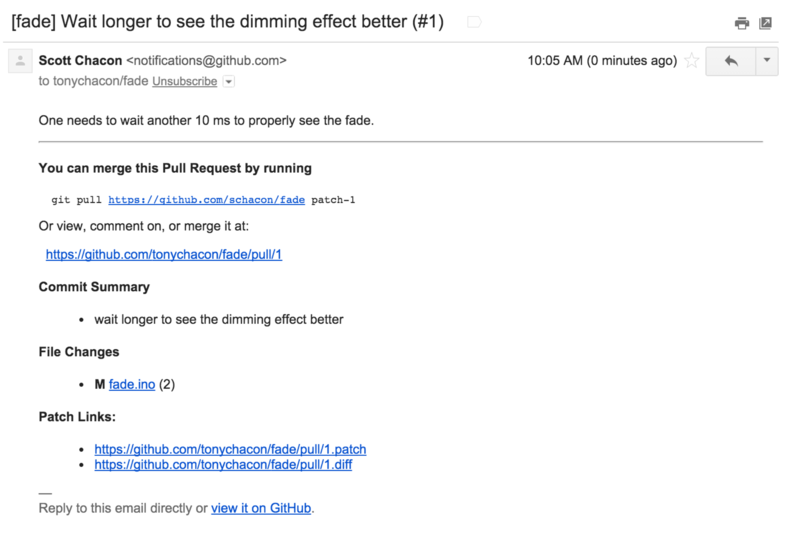
*Figure 114. Email notification of a new Pull Request — nguồn: [GitHub - Maintaining a Project](https://git-scm.com/book/en/v2/GitHub-Maintaining-a-Project)*

📖 **Nguyên văn**
> "There are a few things to notice about this email.
> It will give you a small diffstat — a list of files that have changed in the Pull Request and by how much.
> It gives you a link to the Pull Request on GitHub.
> It also gives you a few URLs that you can use from the command line."

🇻🇳 **Dịch**
> "Có vài điểm đáng chú ý về email này.
> Nó cho bạn một diffstat nhỏ — danh sách các file đã thay đổi trong Pull Request và thay đổi bao nhiêu.
> Nó cho bạn một link tới Pull Request trên GitHub.
> Nó cũng cho bạn vài URL mà bạn có thể dùng từ command line."

📖 **Nguyên văn**
> "If you notice the line that says git pull \<url> patch-1, this is a simple way to merge in a remote branch without having to add a remote.
> We went over this quickly in Checking Out Remote Branches.
> If you wish, you can create and switch to a topic branch and then run this command to merge in the Pull Request changes."

🇻🇳 **Dịch**
> "Nếu để ý dòng ghi git pull \<url> patch-1, đây là cách đơn giản để merge một remote branch vào mà không cần add remote.
> Chúng ta đã lướt qua điều này ở Checking Out Remote Branches.
> Nếu muốn, bạn có thể tạo và switch sang một topic branch rồi chạy lệnh này để merge các thay đổi của Pull Request vào."

> Phần "Checking Out Remote Branches" mà sách nhắc tới đã được ghi ở [[13 - Remote Branches]]; khái niệm topic branch ở [[12 - Branch Management và Branching Workflows]].

📖 **Nguyên văn**
> "The other interesting URLs are the .diff and .patch URLs, which as you may guess, provide unified diff and patch versions of the Pull Request.
> You could technically merge in the Pull Request work with something like this:"

```console
$ curl https://github.com/tonychacon/fade/pull/1.patch | git am
```

🇻🇳 Mọi Pull Request trên GitHub đều có hai URL phái sinh: `<pr-url>.diff` (unified diff) và `<pr-url>.patch` (patch có metadata commit). `git am` áp patch đó vào branch hiện tại, giữ nguyên author và commit message.

### Collaborating on the Pull Request

📖 **Nguyên văn**
> "As we covered in The GitHub Flow, you can now have a conversation with the person who opened the Pull Request.
> You can comment on specific lines of code, comment on whole commits or comment on the entire Pull Request itself, using GitHub Flavored Markdown everywhere."

🇻🇳 **Dịch**
> "Như đã đề cập ở The GitHub Flow, giờ bạn có thể trao đổi với người đã mở Pull Request.
> Bạn có thể comment vào từng dòng code cụ thể, comment vào cả commit, hoặc comment vào toàn bộ Pull Request, dùng GitHub Flavored Markdown ở mọi chỗ."

📖 **Nguyên văn**
> "Every time someone else comments on the Pull Request you will continue to get email notifications so you know there is activity happening.
> They will each have a link to the Pull Request where the activity is happening and you can also directly respond to the email to comment on the Pull Request thread."

🇻🇳 **Dịch**
> "Mỗi lần có người khác comment vào Pull Request bạn sẽ tiếp tục nhận email notifications để biết đang có hoạt động.
> Mỗi email đều có link tới Pull Request nơi hoạt động đang diễn ra, và bạn cũng có thể trả lời thẳng vào email để comment lên thread của Pull Request."

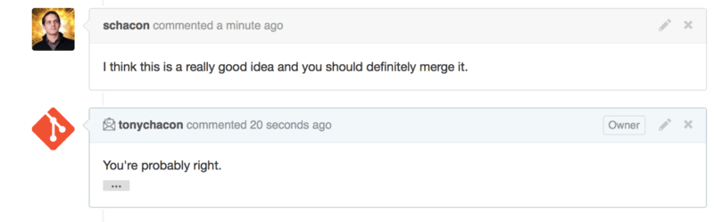
*Figure 115. Responses to emails are included in the thread — nguồn: [GitHub - Maintaining a Project](https://git-scm.com/book/en/v2/GitHub-Maintaining-a-Project)*

📖 **Nguyên văn**
> "Once the code is in a place you like and want to merge it in, you can either pull the code down and merge it locally, either with the git pull \<url> \<branch> syntax we saw earlier, or by adding the fork as a remote and fetching and merging."

🇻🇳 **Dịch**
> "Khi code đã ở trạng thái bạn ưng và muốn merge vào, bạn có thể kéo code về và merge local, hoặc bằng cú pháp git pull \<url> \<branch> đã thấy ở trên, hoặc bằng cách add fork đó làm remote rồi fetch và merge."

📖 **Nguyên văn**
> "If the merge is trivial, you can also just hit the "Merge" button on the GitHub site.
> This will do a "non-fast-forward" merge, creating a merge commit even if a fast-forward merge was possible.
> This means that no matter what, every time you hit the merge button, a merge commit is created."

🇻🇳 **Dịch**
> "Nếu merge đơn giản, bạn cũng có thể chỉ cần bấm nút "Merge" trên site GitHub.
> Việc này sẽ thực hiện một merge "non-fast-forward", tạo ra một merge commit ngay cả khi fast-forward merge là khả thi.
> Nghĩa là dù thế nào đi nữa, mỗi lần bạn bấm nút merge, một merge commit sẽ được tạo ra."

> [!note] Fast-forward vs non-fast-forward
> Phân biệt hai kiểu merge này đã giải thích ở [[11 - Basic Branching and Merging]]. Điểm đáng nhớ: nút Merge của GitHub **luôn** tạo merge commit, nên lịch sử repo giữ lại dấu vết "PR này đã được merge vào lúc nào".

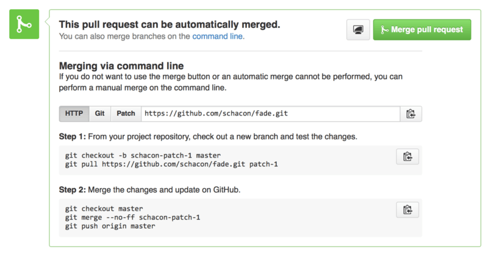
*Figure 116. Merge button and instructions for merging a Pull Request manually — nguồn: [GitHub - Maintaining a Project](https://git-scm.com/book/en/v2/GitHub-Maintaining-a-Project)*

📖 **Nguyên văn**
> "If you decide you don't want to merge it, you can also just close the Pull Request and the person who opened it will be notified."

🇻🇳 **Dịch**
> "Nếu bạn quyết định không muốn merge nó, bạn cũng có thể chỉ đơn giản đóng Pull Request lại và người mở nó sẽ được thông báo."

---

## Pull Request Refs

📖 **Nguyên văn**
> "If you're dealing with a lot of Pull Requests and don't want to add a bunch of remotes or do one time pulls every time, there is a neat trick that GitHub allows you to do.
> This is a bit of an advanced trick and we'll go over the details of this a bit more in The Refspec, but it can be pretty useful."

🇻🇳 **Dịch**
> "Nếu bạn phải xử lý rất nhiều Pull Requests và không muốn add cả đống remote hay pull một lần mỗi lượt, có một mẹo hay mà GitHub cho phép bạn dùng.
> Đây là mẹo hơi nâng cao và chúng ta sẽ đi chi tiết hơn ở The Refspec, nhưng nó khá hữu ích."

📖 **Nguyên văn**
> "GitHub actually advertises the Pull Request branches for a repository as sort of pseudo-branches on the server.
> By default you don't get them when you clone, but they are there in an obscured way and you can access them pretty easily."

🇻🇳 **Dịch**
> "GitHub thực ra có advertise các Pull Request branch của một repository dưới dạng các pseudo-branch trên server.
> Mặc định bạn không nhận được chúng khi clone, nhưng chúng vẫn nằm đó ở dạng ẩn và bạn có thể truy cập khá dễ."

💡 **Ví dụ đời sống**
Như thư viện có kho mở và kho kín. Clone mặc định chỉ đưa bạn phần kho mở (`refs/heads/`). Kho kín (`refs/pull/`) vẫn nằm đó, thủ thư chỉ không tự động đẩy ra — bạn phải hỏi đúng tên tài liệu thì mới được lấy.

### `git ls-remote` — nhìn thấy toàn bộ refs trên server

📖 **Nguyên văn**
> "To demonstrate this, we're going to use a low-level command (often referred to as a "plumbing" command, which we'll read about more in Plumbing and Porcelain) called ls-remote.
> This command is generally not used in day-to-day Git operations but it's useful to show us what references are present on the server."

🇻🇳 **Dịch**
> "Để minh họa, chúng ta sẽ dùng một lệnh low-level (thường gọi là lệnh "plumbing", sẽ đọc thêm ở Plumbing and Porcelain) tên là ls-remote.
> Lệnh này thường không dùng trong thao tác Git hằng ngày nhưng nó hữu ích để cho ta thấy những reference nào đang có trên server."

```console
$ git ls-remote https://github.com/schacon/blink
10d539600d86723087810ec636870a504f4fee4d	HEAD
10d539600d86723087810ec636870a504f4fee4d	refs/heads/master
6a83107c62950be9453aac297bb0193fd743cd6e	refs/pull/1/head
afe83c2d1a70674c9505cc1d8b7d380d5e076ed3	refs/pull/1/merge
3c8d735ee16296c242be7a9742ebfbc2665adec1	refs/pull/2/head
15c9f4f80973a2758462ab2066b6ad9fe8dcf03d	refs/pull/2/merge
a5a7751a33b7e86c5e9bb07b26001bb17d775d1a	refs/pull/4/head
31a45fc257e8433c8d8804e3e848cf61c9d3166c	refs/pull/4/merge
```

📖 **Nguyên văn**
> "Of course, if you're in your repository and you run git ls-remote origin or whatever remote you want to check, it will show you something similar to this."

🇻🇳 **Dịch**
> "Dĩ nhiên, nếu bạn đang ở trong repository của mình và chạy git ls-remote origin hoặc bất kỳ remote nào bạn muốn kiểm tra, nó sẽ hiển thị cho bạn thứ tương tự như thế này."

📖 **Nguyên văn**
> "If the repository is on GitHub and you have any Pull Requests that have been opened, you'll get these references that are prefixed with refs/pull/.
> These are basically branches, but since they're not under refs/heads/ you don't get them normally when you clone or fetch from the server — the process of fetching ignores them normally."

🇻🇳 **Dịch**
> "Nếu repository nằm trên GitHub và bạn có Pull Requests đã được mở, bạn sẽ thấy các reference có prefix refs/pull/.
> Về cơ bản chúng là các branch, nhưng vì chúng không nằm dưới refs/heads/ nên bình thường bạn không nhận được chúng khi clone hay fetch từ server — quá trình fetch mặc định bỏ qua chúng."

### Hai ref cho mỗi Pull Request: `/head` và `/merge`

📖 **Nguyên văn**
> "There are two references per Pull Request - the one that ends in /head points to exactly the same commit as the last commit in the Pull Request branch.
> So if someone opens a Pull Request in our repository and their branch is named bug-fix and it points to commit a5a775, then in our repository we will not have a bug-fix branch (since that's in their fork), but we will have pull/<pr#>/head that points to a5a775.
> This means that we can pretty easily pull down every Pull Request branch in one go without having to add a bunch of remotes."

🇻🇳 **Dịch**
> "Có hai reference cho mỗi Pull Request — cái kết thúc bằng /head trỏ đúng tới cùng commit với commit cuối cùng trong branch của Pull Request.
> Vậy nếu ai đó mở một Pull Request vào repository của ta và branch của họ tên bug-fix trỏ tới commit a5a775, thì trong repository của ta sẽ không có branch bug-fix (vì nó nằm trong fork của họ), nhưng ta sẽ có pull/<pr#>/head trỏ tới a5a775.
> Nghĩa là ta có thể kéo về toàn bộ branch của mọi Pull Request trong một lần mà không cần add cả đống remote."

### Cách 1 — fetch thẳng một ref

```console
$ git fetch origin refs/pull/958/head
From https://github.com/libgit2/libgit2
 * branch            refs/pull/958/head -> FETCH_HEAD
```

📖 **Nguyên văn**
> "This tells Git, "Connect to the origin remote, and download the ref named refs/pull/958/head."
> Git happily obeys, and downloads everything you need to construct that ref, and puts a pointer to the commit you want under .git/FETCH_HEAD.
> You can follow that up with git merge FETCH_HEAD into a branch you want to test it in, but that merge commit message looks a bit weird.
> Also, if you're reviewing a lot of pull requests, this gets tedious."

🇻🇳 **Dịch**
> "Lệnh này nói với Git: "Kết nối tới remote origin, và tải về ref tên refs/pull/958/head."
> Git vui vẻ tuân theo, tải mọi thứ cần để dựng ref đó, và đặt một con trỏ tới commit bạn muốn dưới .git/FETCH_HEAD.
> Bạn có thể theo sau bằng git merge FETCH_HEAD vào branch mà bạn muốn test, nhưng message của merge commit đó trông hơi kỳ.
> Ngoài ra, nếu bạn review nhiều pull request, cách này khá nhàm."

### Cách 2 — thêm refspec vào `.git/config`

📖 **Nguyên văn**
> "There's also a way to fetch all of the pull requests, and keep them up to date whenever you connect to the remote.
> Open up .git/config in your favorite editor, and look for the origin remote.
> It should look a bit like this:"

🇻🇳 **Dịch**
> "Cũng có một cách để fetch tất cả pull requests, và giữ chúng luôn cập nhật mỗi khi bạn kết nối tới remote.
> Mở .git/config bằng editor bạn thích, và tìm tới remote origin.
> Nó sẽ trông đại khái như thế này:"

```ini
[remote "origin"]
    url = https://github.com/libgit2/libgit2
    fetch = +refs/heads/*:refs/remotes/origin/*
```

📖 **Nguyên văn**
> "That line that begins with fetch = is a "refspec."
> It's a way of mapping names on the remote with names in your local .git directory.
> This particular one tells Git, "the things on the remote that are under refs/heads should go in my local repository under refs/remotes/origin.""

🇻🇳 **Dịch**
> "Dòng bắt đầu bằng fetch = chính là một "refspec."
> Đó là cách ánh xạ tên trên remote sang tên trong thư mục .git local của bạn.
> Dòng cụ thể này nói với Git: "những thứ trên remote nằm dưới refs/heads thì đưa vào repository local của tôi dưới refs/remotes/origin.""

📖 **Nguyên văn**
> "You can modify this section to add another refspec:"

🇻🇳 **Dịch**
> "Bạn có thể sửa phần này để thêm một refspec nữa:"

```ini
[remote "origin"]
    url = https://github.com/libgit2/libgit2.git
    fetch = +refs/heads/*:refs/remotes/origin/*
    fetch = +refs/pull/*/head:refs/remotes/origin/pr/*
```

📖 **Nguyên văn**
> "That last line tells Git, "All the refs that look like refs/pull/123/head should be stored locally like refs/remotes/origin/pr/123.""

🇻🇳 **Dịch**
> "Dòng cuối nói với Git: "Tất cả các ref dạng refs/pull/123/head nên được lưu local dưới dạng refs/remotes/origin/pr/123.""

📖 **Nguyên văn**
> "Now, if you save that file, and do a git fetch:"

🇻🇳 **Dịch**
> "Bây giờ, nếu bạn lưu file đó lại và chạy git fetch:"

```console
$ git fetch
# …
 * [new ref]         refs/pull/1/head -> origin/pr/1
 * [new ref]         refs/pull/2/head -> origin/pr/2
 * [new ref]         refs/pull/4/head -> origin/pr/4
# …
```

📖 **Nguyên văn**
> "Now all of the remote pull requests are represented locally with refs that act much like tracking branches; they're read-only, and they update when you do a fetch.
> This makes it super easy to try the code from a pull request locally:"

🇻🇳 **Dịch**
> "Giờ tất cả pull request trên remote được biểu diễn ở local bằng các ref hành xử giống hệt tracking branch; chúng read-only, và cập nhật khi bạn fetch.
> Điều này khiến việc thử code từ một pull request ở local trở nên cực dễ:"

```console
$ git checkout pr/2
Checking out files: 100% (3769/3769), done.
Branch pr/2 set up to track remote branch pr/2 from origin.
Switched to a new branch 'pr/2'
```

> Khái niệm remote-tracking branch và cơ chế fetch đã được giải thích ở [[13 - Remote Branches]].

📖 **Nguyên văn**
> "The eagle-eyed among you would note the head on the end of the remote portion of the refspec.
> There's also a refs/pull/#/merge ref on the GitHub side, which represents the commit that would result if you push the "merge" button on the site.
> This can allow you to test the merge before even hitting the button."

🇻🇳 **Dịch**
> "Những ai tinh mắt sẽ nhận ra chữ head ở cuối phần remote của refspec.
> Phía GitHub còn có ref refs/pull/#/merge, đại diện cho commit sẽ sinh ra nếu bạn bấm nút "merge" trên site.
> Điều này cho phép bạn test kết quả merge ngay cả trước khi bấm nút."

> [!tip] Vì sao nên biết `refs/pull/`
> `/head` = đúng commit cuối của PR branch (kể cả khi branch đó nằm trong fork mà bạn không đụng được). `/merge` = commit giả lập kết quả sau khi bấm Merge. Với maintainer review nhiều PR, một dòng refspec trong `.git/config` thay thế cho việc add hàng chục remote.

---

## Pull Requests on Pull Requests

📖 **Nguyên văn**
> "Not only can you open Pull Requests that target the main or master branch, you can actually open a Pull Request targeting any branch in the network.
> In fact, you can even target another Pull Request."

🇻🇳 **Dịch**
> "Không chỉ mở được Pull Requests nhắm tới branch main hay master, bạn thực ra có thể mở Pull Request nhắm tới bất kỳ branch nào trong network.
> Thực tế, bạn thậm chí có thể nhắm tới một Pull Request khác."

📖 **Nguyên văn**
> "If you see a Pull Request that is moving in the right direction and you have an idea for a change that depends on it or you're not sure is a good idea, or you just don't have push access to the target branch, you can open a Pull Request directly to it."

🇻🇳 **Dịch**
> "Nếu bạn thấy một Pull Request đang đi đúng hướng và bạn có ý tưởng cho một thay đổi phụ thuộc vào nó, hoặc bạn không chắc đó có phải ý hay không, hoặc đơn giản bạn không có push access vào target branch, bạn có thể mở một Pull Request trực tiếp vào nó."

📖 **Nguyên văn**
> "When you go to open a Pull Request, there is a box at the top of the page that specifies which branch you're requesting to pull to and which you're requesting to pull from.
> If you hit the "Edit" button at the right of that box you can change not only the branches but also which fork."

🇻🇳 **Dịch**
> "Khi bạn mở một Pull Request, có một ô ở đầu trang chỉ rõ bạn đang yêu cầu pull vào branch nào và pull từ branch nào.
> Nếu bạn nhấn nút "Edit" ở bên phải ô đó, bạn có thể đổi không chỉ branch mà cả fork nào nữa."

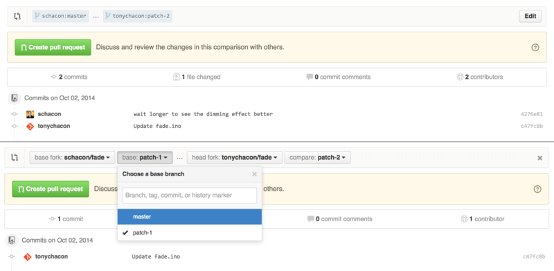
*Figure 117. Manually change the Pull Request target fork and branch — nguồn: [GitHub - Maintaining a Project](https://git-scm.com/book/en/v2/GitHub-Maintaining-a-Project)*

📖 **Nguyên văn**
> "Here you can fairly easily specify to merge your new branch into another Pull Request or another fork of the project."

🇻🇳 **Dịch**
> "Ở đây bạn có thể khá dễ dàng chỉ định merge branch mới của mình vào một Pull Request khác hoặc một fork khác của project."

---

## Mentions and Notifications

📖 **Nguyên văn**
> "GitHub also has a pretty nice notifications system built in that can come in handy when you have questions or need feedback from specific individuals or teams."

🇻🇳 **Dịch**
> "GitHub cũng có sẵn một hệ thống notifications khá tốt, rất tiện khi bạn có câu hỏi hoặc cần feedback từ những cá nhân hay team cụ thể."

📖 **Nguyên văn**
> "In any comment you can start typing a @ character and it will begin to autocomplete with the names and usernames of people who are collaborators or contributors in the project."

🇻🇳 **Dịch**
> "Trong bất kỳ comment nào bạn có thể bắt đầu gõ ký tự @ và nó sẽ tự động gợi ý tên và username của những người là collaborators hoặc contributors trong project."

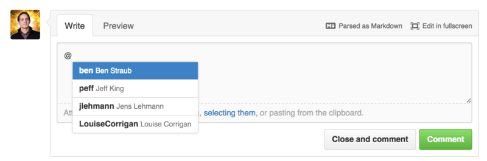
*Figure 118. Start typing @ to mention someone — nguồn: [GitHub - Maintaining a Project](https://git-scm.com/book/en/v2/GitHub-Maintaining-a-Project)*

📖 **Nguyên văn**
> "You can also mention a user who is not in that dropdown, but often the autocompleter can make it faster."

🇻🇳 **Dịch**
> "Bạn cũng có thể mention một user không nằm trong dropdown đó, nhưng thường thì bộ autocomplete sẽ giúp bạn nhanh hơn."

📖 **Nguyên văn**
> "Once you post a comment with a user mention, that user will be notified.
> This means that this can be a really effective way of pulling people into conversations rather than making them poll.
> Very often in  Pull Requests on GitHub people will pull in other people on their teams or in their company to review an Issue or Pull Request."

🇻🇳 **Dịch**
> "Khi bạn đăng một comment có mention user, user đó sẽ được thông báo.
> Nghĩa là đây là cách rất hiệu quả để kéo người khác vào cuộc trò chuyện thay vì bắt họ phải tự đi kiểm tra liên tục.
> Rất thường thấy trong Pull Requests trên GitHub, người ta kéo đồng đội hoặc đồng nghiệp trong công ty vào để review một Issue hay Pull Request."

📖 **Nguyên văn**
> "If someone gets mentioned on a Pull Request or Issue, they will be "subscribed" to it and will continue getting notifications any time some activity occurs on it.
> You will also be subscribed to something if you opened it, if you're watching the repository or if you comment on something.
> If you no longer wish to receive notifications, there is an "Unsubscribe" button on the page you can click to stop receiving updates on it."

🇻🇳 **Dịch**
> "Nếu ai đó bị mention trong một Pull Request hay Issue, họ sẽ được "subscribed" vào đó và tiếp tục nhận notifications mỗi khi có hoạt động xảy ra.
> Bạn cũng sẽ bị subscribe nếu chính bạn mở nó, nếu bạn đang watch repository, hoặc nếu bạn comment vào đó.
> Nếu không muốn nhận notifications nữa, có một nút "Unsubscribe" trên trang mà bạn có thể click để ngừng nhận cập nhật."

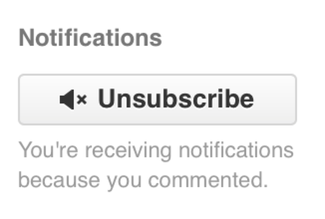
*Figure 119. Unsubscribe from an Issue or Pull Request — nguồn: [GitHub - Maintaining a Project](https://git-scm.com/book/en/v2/GitHub-Maintaining-a-Project)*

### The Notifications Page

📖 **Nguyên văn**
> "When we mention "notifications" here with respect to GitHub, we mean a specific way that GitHub tries to get in touch with you when events happen and there are a few different ways you can configure them.
> If you go to the "Notification center" tab from the settings page, you can see some of the options you have."

🇻🇳 **Dịch**
> "Khi nhắc tới "notifications" ở đây trong ngữ cảnh GitHub, ý chúng tôi là một cách cụ thể mà GitHub dùng để liên lạc với bạn khi có sự kiện xảy ra, và có vài cách khác nhau để bạn cấu hình chúng.
> Nếu bạn vào tab "Notification center" từ trang settings, bạn sẽ thấy một số tùy chọn mình có."

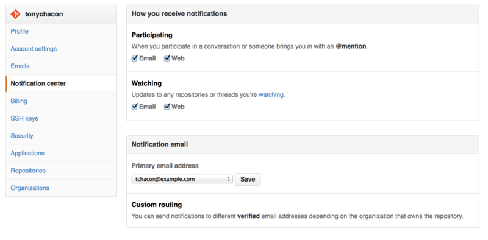
*Figure 120. Notification center options — nguồn: [GitHub - Maintaining a Project](https://git-scm.com/book/en/v2/GitHub-Maintaining-a-Project)*

📖 **Nguyên văn**
> "The two choices are to get notifications over "Email" and over "Web" and you can choose either, neither or both for when you actively participate in things and for activity on repositories you are watching."

🇻🇳 **Dịch**
> "Hai lựa chọn là nhận notifications qua "Email" và qua "Web", và bạn có thể chọn một trong hai, không chọn cái nào, hoặc chọn cả hai — riêng cho trường hợp bạn tham gia trực tiếp và cho hoạt động trên các repository bạn đang watch."

### Web Notifications

📖 **Nguyên văn**
> "Web notifications only exist on GitHub and you can only check them on GitHub.
> If you have this option selected in your preferences and a notification is triggered for you, you will see a small blue dot over your notifications icon at the top of your screen as seen in Notification center."

🇻🇳 **Dịch**
> "Web notifications chỉ tồn tại trên GitHub và bạn chỉ có thể xem chúng trên GitHub.
> Nếu bạn chọn tùy chọn này trong preferences và có một notification được kích hoạt cho bạn, bạn sẽ thấy một chấm xanh nhỏ trên icon notifications ở đầu màn hình, như trong hình Notification center."

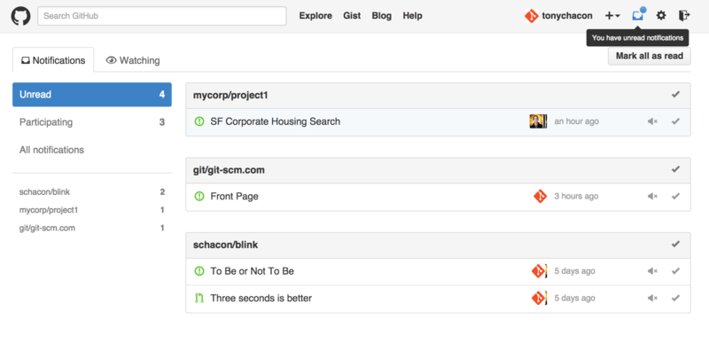
*Figure 121. Notification center — nguồn: [GitHub - Maintaining a Project](https://git-scm.com/book/en/v2/GitHub-Maintaining-a-Project)*

📖 **Nguyên văn**
> "If you click on that, you will see a list of all the items you have been notified about, grouped by project.
> You can filter to the notifications of a specific project by clicking on its name in the left hand sidebar.
> You can also acknowledge the notification by clicking the checkmark icon next to any notification, or acknowledge all of the notifications in a project by clicking the checkmark at the top of the group.
> There is also a mute button next to each checkmark that you can click to not receive any further notifications on that item."

🇻🇳 **Dịch**
> "Nếu click vào đó, bạn sẽ thấy danh sách tất cả các mục bạn được thông báo, nhóm theo project.
> Bạn có thể lọc theo notifications của một project cụ thể bằng cách click tên nó ở sidebar bên trái.
> Bạn cũng có thể xác nhận đã đọc một notification bằng cách click biểu tượng dấu tick cạnh nó, hoặc xác nhận toàn bộ notifications của một project bằng cách click dấu tick ở đầu nhóm.
> Cạnh mỗi dấu tick còn có nút mute để bạn click nếu không muốn nhận thêm notification nào về mục đó."

📖 **Nguyên văn**
> "All of these tools are very useful for handling large numbers of notifications.
> Many GitHub power users will simply turn off email notifications entirely and manage all of their notifications through this screen."

🇻🇳 **Dịch**
> "Tất cả những công cụ này rất hữu ích để xử lý số lượng lớn notifications.
> Nhiều power user của GitHub đơn giản là tắt hẳn email notifications và quản lý toàn bộ notifications của họ qua màn hình này."

### Email Notifications (cấu hình & header)

📖 **Nguyên văn**
> "Email notifications are the other way you can handle notifications through GitHub.
> If you have this turned on you will get emails for each notification.
> We saw examples of this in Comments sent as email notifications and Email notification of a new Pull Request.
> The emails will also be threaded properly, which is nice if you're using a threading email client."

🇻🇳 **Dịch**
> "Email notifications là cách còn lại để bạn xử lý notifications qua GitHub.
> Nếu bạn bật tính năng này, bạn sẽ nhận email cho mỗi notification.
> Chúng ta đã thấy ví dụ ở hình Comments sent as email notifications và Email notification of a new Pull Request.
> Các email cũng được gom thành thread đúng cách, khá tiện nếu bạn dùng một email client hỗ trợ threading."

📖 **Nguyên văn**
> "There is also a fair amount of metadata embedded in the headers of the emails that GitHub sends you, which can be really helpful for setting up custom filters and rules."

🇻🇳 **Dịch**
> "Ngoài ra còn có khá nhiều metadata nhúng trong header của các email GitHub gửi cho bạn, rất hữu ích để thiết lập filter và rule tùy chỉnh."

📖 **Nguyên văn**
> "For instance, if we look at the actual email headers sent to Tony in the email shown in Email notification of a new Pull Request, we will see the following among the information sent:"

🇻🇳 **Dịch**
> "Ví dụ, nếu ta nhìn vào các header email thực tế gửi cho Tony trong email ở hình Email notification of a new Pull Request, ta sẽ thấy những thông tin sau nằm trong đó:"

```
To: tonychacon/fade <fade@noreply.github.com>
Message-ID: <tonychacon/fade/pull/1@github.com>
Subject: [fade] Wait longer to see the dimming effect better (#1)
X-GitHub-Recipient: tonychacon
List-ID: tonychacon/fade <fade.tonychacon.github.com>
List-Archive: https://github.com/tonychacon/fade
List-Post: <mailto:reply+i-4XXX@reply.github.com>
List-Unsubscribe: <mailto:unsub+i-XXX@reply.github.com>,...
X-GitHub-Recipient-Address: tchacon@example.com
```

📖 **Nguyên văn**
> "There are a couple of interesting things here.
> If you want to highlight or re-route emails to this particular project or even Pull Request, the information in Message-ID gives you all the data in \<user>/\<project>/\<type>/\<id> format.
> If this was an issue, for example, the \<type> field would have been "issues" rather than "pull"."

🇻🇳 **Dịch**
> "Có vài điểm thú vị ở đây.
> Nếu bạn muốn highlight hoặc định tuyến lại email theo project cụ thể này hay thậm chí theo Pull Request, thông tin trong Message-ID cho bạn toàn bộ dữ liệu theo định dạng \<user>/\<project>/\<type>/\<id>.
> Nếu đây là một issue, ví dụ vậy, thì field \<type> sẽ là "issues" thay vì "pull"."

📖 **Nguyên văn**
> "The List-Post and List-Unsubscribe fields mean that if you have a mail client that understands those, you can easily post to the list or "Unsubscribe" from the thread.
> That would be essentially the same as clicking the "mute" button on the web version of the notification or "Unsubscribe" on the Issue or Pull Request page itself."

🇻🇳 **Dịch**
> "Các field List-Post và List-Unsubscribe nghĩa là nếu mail client của bạn hiểu chúng, bạn có thể dễ dàng gửi bài vào list hoặc "Unsubscribe" khỏi thread.
> Việc đó về cơ bản giống hệt với click nút "mute" trên bản web của notification, hoặc "Unsubscribe" ngay trên trang Issue hay Pull Request."

📖 **Nguyên văn**
> "It's also worth noting that if you have both email and web notifications enabled and you read the email version of the notification, the web version will be marked as read as well if you have images allowed in your mail client."

🇻🇳 **Dịch**
> "Cũng đáng chú ý là nếu bạn bật cả email lẫn web notifications và bạn đọc bản email của notification, bản web cũng sẽ được đánh dấu đã đọc — với điều kiện mail client của bạn cho phép hiển thị ảnh."

---

## Special Files

📖 **Nguyên văn**
> "There are a couple of special files that GitHub will notice if they are present in your repository."

🇻🇳 **Dịch**
> "Có một vài file đặc biệt mà GitHub sẽ nhận ra nếu chúng tồn tại trong repository của bạn."

### README

📖 **Nguyên văn**
> "The first is the README file, which can be of nearly any format that GitHub recognizes as prose.
> For example, it could be README, README.md, README.asciidoc, etc.
> If GitHub sees a README file in your source, it will render it on the landing page of the project."

🇻🇳 **Dịch**
> "Đầu tiên là file README, có thể ở gần như bất kỳ định dạng nào mà GitHub nhận diện là văn xuôi.
> Ví dụ, nó có thể là README, README.md, README.asciidoc, v.v.
> Nếu GitHub thấy file README trong source của bạn, nó sẽ render file đó trên trang landing của project."

📖 **Nguyên văn**
> "Many teams use this file to hold all the relevant project information for someone who might be new to the repository or project.
> This generally includes things like:"
>
> - "What the project is for"
> - "How to configure and install it"
> - "An example of how to use it or get it running"
> - "The license that the project is offered under"
> - "How to contribute to it"

🇻🇳 **Dịch** — README thường chứa: project dùng để làm gì; cách cấu hình và cài đặt; ví dụ cách dùng hoặc chạy; license project được phát hành theo; cách contribute vào project.

📖 **Nguyên văn**
> "Since GitHub will render this file, you can embed images or links in it for added ease of understanding."

🇻🇳 **Dịch**
> "Vì GitHub sẽ render file này, bạn có thể nhúng ảnh hoặc link vào đó để người đọc dễ hiểu hơn."

### CONTRIBUTING

📖 **Nguyên văn**
> "The other special file that GitHub recognizes is the CONTRIBUTING file.
> If you have a file named CONTRIBUTING with any file extension, GitHub will show Opening a Pull Request when a CONTRIBUTING file exists when anyone starts opening a Pull Request."

🇻🇳 **Dịch**
> "File đặc biệt còn lại mà GitHub nhận diện là file CONTRIBUTING.
> Nếu bạn có file tên CONTRIBUTING với bất kỳ phần mở rộng nào, GitHub sẽ hiển thị màn hình như hình Opening a Pull Request when a CONTRIBUTING file exists mỗi khi có người bắt đầu mở một Pull Request."

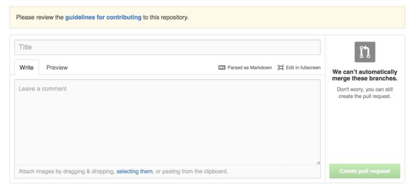
*Figure 122. Opening a Pull Request when a CONTRIBUTING file exists — nguồn: [GitHub - Maintaining a Project](https://git-scm.com/book/en/v2/GitHub-Maintaining-a-Project)*

📖 **Nguyên văn**
> "The idea here is that you can specify specific things you want or don't want in a Pull Request sent to your project.
> This way people may actually read the guidelines before opening the Pull Request."

🇻🇳 **Dịch**
> "Ý tưởng ở đây là bạn có thể nêu rõ những thứ bạn muốn hoặc không muốn có trong một Pull Request gửi tới project của mình.
> Nhờ vậy người ta may ra sẽ thực sự đọc guidelines trước khi mở Pull Request."

---

## Project Administration

📖 **Nguyên văn**
> "Generally there are not a lot of administrative things you can do with a single project, but there are a couple of items that might be of interest."

🇻🇳 **Dịch**
> "Nhìn chung không có nhiều việc quản trị bạn làm được với một project đơn lẻ, nhưng có vài mục có thể đáng quan tâm."

### Changing the Default Branch

📖 **Nguyên văn**
> "If you are using a branch other than "master" as your default branch that you want people to open Pull Requests on or see by default, you can change that in your repository's settings page under the "Options" tab."

🇻🇳 **Dịch**
> "Nếu bạn dùng một branch khác "master" làm default branch — branch mà bạn muốn mọi người mở Pull Requests vào hoặc nhìn thấy mặc định — bạn có thể đổi ở trang settings của repository, trong tab "Options"."

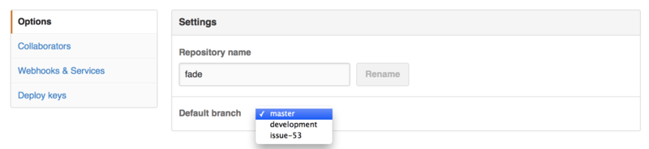
*Figure 123. Change the default branch for a project — nguồn: [GitHub - Maintaining a Project](https://git-scm.com/book/en/v2/GitHub-Maintaining-a-Project)*

📖 **Nguyên văn**
> "Simply change the default branch in the dropdown and that will be the default for all major operations from then on, including which branch is checked out by default when someone clones the repository."

🇻🇳 **Dịch**
> "Chỉ cần đổi default branch trong dropdown và từ đó nó sẽ là mặc định cho mọi thao tác chính, bao gồm cả branch nào được checkout mặc định khi ai đó clone repository."

### Transferring a Project

📖 **Nguyên văn**
> "If you would like to transfer a project to another user or an organization in GitHub, there is a "Transfer ownership" option at the bottom of the same "Options" tab of your repository settings page that allows you to do this."

🇻🇳 **Dịch**
> "Nếu bạn muốn chuyển một project cho user khác hoặc cho một organization trên GitHub, có tùy chọn "Transfer ownership" ở cuối chính tab "Options" trong trang settings của repository cho phép bạn làm việc đó."

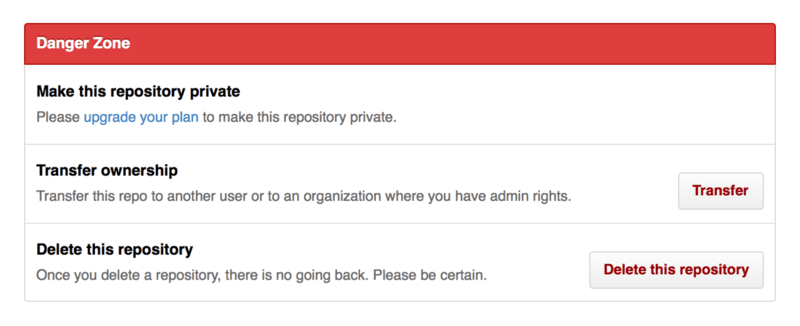
*Figure 124. Transfer a project to another GitHub user or Organization — nguồn: [GitHub - Maintaining a Project](https://git-scm.com/book/en/v2/GitHub-Maintaining-a-Project)*

📖 **Nguyên văn**
> "This is helpful if you are abandoning a project and someone wants to take it over, or if your project is getting bigger and want to move it into an organization."

🇻🇳 **Dịch**
> "Điều này hữu ích nếu bạn đang bỏ dở một project và có người muốn tiếp quản nó, hoặc nếu project của bạn ngày càng lớn và bạn muốn chuyển nó vào một organization."

📖 **Nguyên văn**
> "Not only does this move the repository along with all its watchers and stars to another place, it also sets up a redirect from your URL to the new place.
> It will also redirect clones and fetches from Git, not just web requests."

🇻🇳 **Dịch**
> "Việc này không chỉ chuyển repository cùng toàn bộ watchers và stars sang nơi khác, nó còn thiết lập redirect từ URL cũ của bạn sang nơi mới.
> Nó cũng redirect cả clone và fetch từ Git, chứ không chỉ web request."

> [!danger] Transfer ownership là thao tác đổi chủ sở hữu
> Sau khi transfer, repository thuộc về user/organization nhận. Quyền admin của bạn phụ thuộc vào việc bên nhận có cấp lại hay không. Redirect giúp link cũ không chết, nhưng quyền thì không tự quay về.

---

## Liên kết
- Bài trước: [[03 - GitHub - Contributing to a Project]]
- Bài kế: [[05 - GitHub Flow]]
- Cross-link phần 03:
  - [[11 - Basic Branching and Merging]] — merge, fast-forward vs non-fast-forward (giải thích nút "Merge" của GitHub)
  - [[13 - Remote Branches]] — refs, remote-tracking branch, fetch, "Checking Out Remote Branches"
  - [[12 - Branch Management và Branching Workflows]] — topic branch
  - [[08 - Working with Remotes]] — thêm fork làm remote rồi fetch/merge

## Nguồn tham khảo
- Pro Git 2nd Edition, §6.3 GitHub - Maintaining a Project : https://git-scm.com/book/en/v2/GitHub-Maintaining-a-Project
- Hình Figure 109–124 lấy từ trang trên, lưu trong `assets/`: `newrepo.png`, `new-repo.png`, `newrepoform.png`, `reposettingslink.png`, `collaborators.png`, `maint-01-email.png`, `maint-03-email-resp.png`, `maint-02-merge.png`, `maint-04-target.png`, `maint-05-mentions.png`, `maint-06-unsubscribe.png`, `maint-07-notifications.png`, `maint-08-notifications-page.png`, `maint-09-contrib.png`, `maint-10-default-branch.png`, `maint-11-transfer.png`
