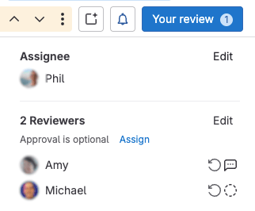
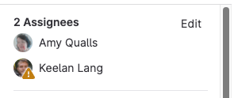
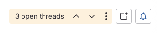
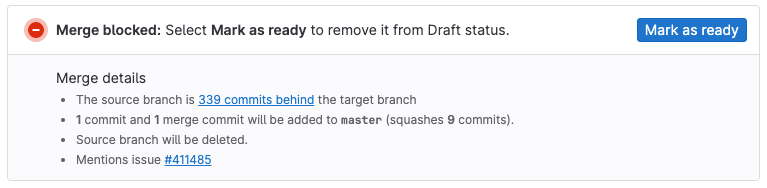
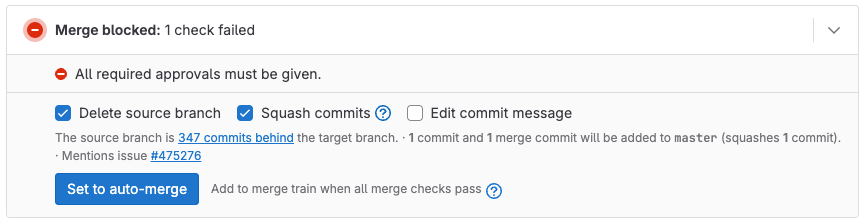
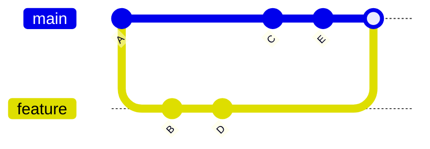

# 06 — GitLab: Merge Requests

> **Nguồn chính:** GitLab Documentation — *Merge requests* (markdown gốc trong repo `gitlab-org/gitlab`) — https://gitlab.com/gitlab-org/gitlab/-/raw/master/doc/user/project/merge_requests/_index.md
> Bài này bám các trang `merge_requests/_index.md`, `merge_requests/methods/_index.md`, `merge_requests/reviews/_index.md`, `merge_requests/drafts.md`, `merge_requests/approvals/_index.md` và `topics/git/merge.md`.

> [!note]
> `docs.gitlab.com` chặn truy cập tự động (Cloudflare), nên toàn bộ trích dẫn dưới đây lấy từ **file markdown gốc** trong repo công khai `gitlab-org/gitlab` — cùng một nội dung sinh ra trang docs. Các directive build của GitLab (``, ``, ``, ``) đã được lược bỏ, chỉ giữ văn bản thật.

---

## Merge request là gì

📖 **Nguyên văn**
> "Merge requests provide a central location for your team to review code, have discussions,
> and track code changes.
> To help describe why a change was made, link a merge request to an issue and
> automatically close the issue when the merge request merges."
>
> "Merge requests help ensure subject matter experts review your proposed changes and
> your organization's security requirements are met.
> When you create your merge request early in the development process, your team has time to catch bugs and code quality problems."

🇻🇳 **Dịch**
> "Merge request cung cấp một nơi tập trung để team review code, thảo luận, và theo dõi các thay đổi code.
> Để mô tả lý do một thay đổi được thực hiện, hãy link merge request với một issue và issue sẽ tự động đóng khi merge request được merge."
>
> "Merge request giúp đảm bảo các chuyên gia về lĩnh vực đó review được thay đổi bạn đề xuất, và các yêu cầu bảo mật của tổ chức bạn được đáp ứng. Khi bạn tạo merge request sớm trong quá trình phát triển, team có thời gian để bắt bug và các vấn đề về chất lượng code."

Khi mở một merge request, GitLab hiển thị:

📖 **Nguyên văn**
> "When viewing a merge request, you see:
>
> - A description of the request.
> - Code changes and inline code reviews.
> - Information about CI/CD pipelines.
> - Mergeability reports.
> - Comments.
> - The list of commits."

🇻🇳 **Dịch**
> "Khi xem một merge request, bạn thấy:
>
> - Phần mô tả của request.
> - Các thay đổi code và phần review code ngay trên dòng (inline).
> - Thông tin về các CI/CD pipeline.
> - Các báo cáo về khả năng merge được (mergeability).
> - Các comment.
> - Danh sách các commit."

💡 **Ví dụ đời sống**
Hình dung merge request như **phiếu đề nghị sửa chữa trong một toà nhà**: bạn không tự ý đục tường (push thẳng vào `main`), mà nộp một phiếu ghi rõ "tôi muốn sửa gì, sửa ở đâu". Ban quản lý (reviewer) xem bản vẽ (diff), hỏi lại vài chỗ (comment), yêu cầu kiểm định an toàn (CI/CD pipeline), rồi mới ký duyệt (approve) cho thi công (merge).

---

## MERGE REQUEST (GitLab) vs PULL REQUEST (GitHub)

> [!warning]
> Đây là chỗ người mới nhầm nhiều nhất. **Merge request và pull request là CÙNG MỘT khái niệm, chỉ khác tên gọi giữa hai nền tảng.** GitLab gọi là *merge request* (viết tắt MR), GitHub gọi là *pull request* (viết tắt PR). Không có chuyện GitLab "thiếu" pull request, hay MR là một thứ gì đó nâng cao hơn PR.

Bằng chứng rõ nhất nằm ở tài liệu import từ GitHub sang GitLab: mọi *pull request* của GitHub được import và trở thành *merge request* của GitLab.

📖 **Nguyên văn** (trang *Import your project from GitHub to GitLab*)
> "For GitLab-specific references, GitLab uses the `#` character for issues and a `!` character for merge requests.
> However, GitHub uses only the `#` character for both issues and pull requests."

🇻🇳 **Dịch**
> "Với cú pháp tham chiếu riêng của GitLab, GitLab dùng ký tự `#` cho issue và ký tự `!` cho merge request. Trong khi đó GitHub chỉ dùng ký tự `#` cho cả issue lẫn pull request."

Danh sách dữ liệu được import cũng liệt kê nguyên văn các mục GitHub và chúng đều đi vào hệ thống merge request của GitLab:

📖 **Nguyên văn**
> "- Pull request assigned reviewers
> - Pull request merged by information
> - Pull request reviews
> - Pull request review comments
> - Pull request review replies to discussions
> - Pull request review suggestions
> - Pull requests"

🇻🇳 **Dịch**
> "- Reviewer được gán cho pull request
> - Thông tin về người đã merge pull request
> - Các bản review của pull request
> - Các comment trong review của pull request
> - Các trả lời vào thảo luận trong review của pull request
> - Các đề xuất sửa (suggestion) trong review của pull request
> - Các pull request"

Bảng đối chiếu nhanh (rút ra từ các trích dẫn trên và từ bảng ánh xạ branch protection rules trong cùng trang):

| Khái niệm | GitHub | GitLab |
|---|---|---|
| Đề nghị gộp branch | pull request (PR) | merge request (MR) |
| Ký tự tham chiếu | `#` cho cả issue và pull request | `#` cho issue, `!` cho merge request |
| Bắt buộc review trước khi merge | **Require a pull request before merging** | tuỳ chọn **No one** trong **Allowed to push and merge** của branch protection settings |
| Bắt buộc Code Owner review | **Require a pull request before merging - Require review from Code Owners** | **Require approval from code owners** branch protection setting |
| Phải resolve hết thảo luận | **Require conversation resolution before merging** | **All threads must be resolved** project setting |

💡 **Ví dụ đời sống**
Giống như "thang máy" và "elevator/lift" — cùng một cái máy, khác cách gọi theo vùng. Điều duy nhất bạn cần đổi khi chuyển từ GitHub sang GitLab là **từ vựng và vài cái nút bấm**, không phải đổi tư duy.

> [!tip]
> Trong hội thoại team, `!123` là cách viết tắt chuẩn của GitLab để nhắc tới merge request số 123, còn `#123` là issue số 123. Trên GitHub thì `#123` có thể là issue **hoặc** PR.

---

## Vòng đời một merge request

### Bước 0 — Từ Git local đến merge request

Trang *Merge your branch into the main branch* mô tả điểm nối giữa Git dòng lệnh và merge request:

📖 **Nguyên văn**
> "After you have created a branch, made the required changes, and committed them locally,
> you push your branch and its commits to GitLab."
>
> "In the response to the `git push`, GitLab provides a direct link to create the merge request. For example:"

🇻🇳 **Dịch**
> "Sau khi bạn đã tạo một branch, thực hiện các thay đổi cần thiết và commit chúng ở local, bạn push branch cùng các commit của nó lên GitLab."
>
> "Trong phần phản hồi của `git push`, GitLab cung cấp một link trực tiếp để tạo merge request. Ví dụ:"

```plaintext
...
remote: To create a merge request for my-new-branch, visit:
remote:   https://gitlab.example.com/my-group/my-project/merge_requests/new?merge_request%5Bsource_branch%5D=my-new-branch
```

📖 **Nguyên văn**
> "To get your branch merged into the main branch:
>
> 1. Go to the page provided in the link that was provided by Git and
>    create your merge request. The merge request's
>    **Source branch** is your branch and the **Target branch** should be the main branch.
> 1. If necessary, have your merge request reviewed.
> 1. Have someone merge your merge request, or merge
>    the merge request yourself, depending on your process."

🇻🇳 **Dịch**
> "Để branch của bạn được merge vào main branch:
> 1. Mở trang theo link mà Git trả về và tạo merge request. **Source branch** của merge request là branch của bạn, còn **Target branch** nên là main branch.
> 2. Nếu cần, cho merge request được review.
> 3. Nhờ người khác merge merge request của bạn, hoặc tự merge, tuỳ theo quy trình của team."

Khái niệm branch, commit, push ở đây đã giải thích ở [[05 - Recording Changes to the Repository]], [[08 - Working with Remotes]] và [[10 - Branches in a Nutshell]].

### Assignee và Reviewer — hai vai trò khác nhau

📖 **Nguyên văn**
> "A merge request has two roles:
>
> - **Assignee**: Owns the merge request and is responsible for its progress.
>   The assignee is usually the author.
> - **Reviewer**: Reviews the changes and provides feedback.
>   A reviewer can request changes or, if eligible, approve the merge request."

🇻🇳 **Dịch**
> "Một merge request có hai vai trò:
> - **Assignee**: sở hữu merge request và chịu trách nhiệm về tiến độ của nó. Assignee thường chính là tác giả.
> - **Reviewer**: review các thay đổi và đưa feedback. Reviewer có thể yêu cầu sửa (request changes), hoặc approve merge request nếu đủ điều kiện."


*Examples of reviewers in various states of review. — nguồn: [Merge request reviews](https://gitlab.com/gitlab-org/gitlab/-/raw/master/doc/user/project/merge_requests/reviews/_index.md)*


*The merge request sidebar displaying multiple assigned users. — nguồn: [Merge requests](https://gitlab.com/gitlab-org/gitlab/-/raw/master/doc/user/project/merge_requests/_index.md)*

### Review: trạng thái và kết quả

📖 **Nguyên văn**
> "The merge request review process ensures that subject matter experts review your proposed changes
> before they are merged. Reviewers add review comments to merge requests, and suggest changes
> the author can apply directly from the GitLab UI."

🇻🇳 **Dịch**
> "Quy trình review merge request đảm bảo rằng các chuyên gia về lĩnh vực đó review những thay đổi bạn đề xuất trước khi chúng được merge. Reviewer thêm các comment review vào merge request, và đề xuất các thay đổi mà tác giả có thể áp dụng trực tiếp từ giao diện GitLab."

Khi submit review, reviewer chọn một trong ba kết quả:

📖 **Nguyên văn**
> "- **Approve**: Leave feedback and approve the changes.
> - **Comment**: Leave general feedback without an explicit approval or change request.
> - **Request changes**: Block the merge request from merging until the author
>   addresses your feedback."

🇻🇳 **Dịch**
> "- **Approve**: để lại feedback và approve thay đổi.
> - **Comment**: để lại feedback chung, không approve cũng không yêu cầu sửa.
> - **Request changes**: chặn merge request không cho merge cho tới khi tác giả xử lý feedback của bạn."

> [!note]
> Có một cơ chế khoá mềm: "A reviewer requesting changes blocks a merge request from merging. When this happens, the merge request reports area shows the message **Change requests must be approved by the requesting user**." — reviewer đã request changes thì chính họ phải review lại và approve để gỡ chặn.

### Thảo luận (threads) chặn merge

📖 **Nguyên văn**
> "Discussions in a merge request include single comments and threads of comments. Open (unresolved)
> threads block the merge of a merge request, but single comments do not."

🇻🇳 **Dịch**
> "Thảo luận trong một merge request bao gồm các comment đơn lẻ và các thread comment. Thread đang mở (chưa resolve) sẽ chặn việc merge của merge request, còn comment đơn lẻ thì không."


*A merge request with three open threads and the thread management options. — nguồn: [Merge requests](https://gitlab.com/gitlab-org/gitlab/-/raw/master/doc/user/project/merge_requests/_index.md)*

### Merge

📖 **Nguyên văn**
> "During the merge request review process, reviewers provide
> feedback on your changes. When a reviewer is satisfied with the changes,
> they can set the merge request to auto-merge, even if some merge checks are failing.
> After all merge checks pass, the merge request is automatically merged, without further action from you."
>
> "Default merge permissions:
>
> - The default branch, typically `main`, is protected.
> - Only Maintainers and higher roles can merge into the default branch.
> - Developers can merge any merge request that targets a non-protected branch."

🇻🇳 **Dịch**
> "Quyền merge mặc định:
> - Default branch, thường là `main`, được bảo vệ (protected).
> - Chỉ Maintainer và các role cao hơn mới merge được vào default branch.
> - Developer merge được mọi merge request nhắm tới một branch không được bảo vệ."

### Close (không merge)

📖 **Nguyên văn**
> "If you decide to permanently stop work on a merge request, close it rather than
> deleting it."
>
> "GitLab closes the merge request, but preserves records of the merge request,
> its comments, and any associated pipelines."

🇻🇳 **Dịch**
> "Nếu bạn quyết định dừng hẳn công việc trên một merge request, hãy close nó thay vì xoá đi."
>
> "GitLab đóng merge request, nhưng vẫn giữ lại hồ sơ của merge request đó, các comment của nó, và mọi pipeline liên quan."

### Ví dụ vòng đời đầy đủ do GitLab mô tả

📖 **Nguyên văn** (mục *Merge request workflows*)
> "For a software developer who works in a team:
>
> 1. You check out a new branch, and submit your changes through a merge request.
> 1. You gather feedback from your team.
> 1. You optimize your code with code quality reports.
> 1. You verify your changes with unit test reports in GitLab CI/CD.
> 1. You avoid dependencies with licenses that are not compatible with your project, with
>    license approval policies.
> 1. You request the approval from your manager.
> 1. Your manager:
>    1. Pushes a commit with their final review.
>    1. Approves the merge request.
>    1. Sets it to auto-merge (formerly **Merge when pipeline succeeds**).
> 1. Your changes get deployed to production with
>    manual jobs for GitLab CI/CD.
> 1. Your implementation ships to your customer."

🇻🇳 **Dịch**
> "Với một software developer làm việc trong team:
>
> 1. Bạn check out một branch mới, và gửi các thay đổi của mình qua một merge request.
> 2. Bạn thu thập feedback từ team.
> 3. Bạn tối ưu code của mình bằng các báo cáo chất lượng code (code quality report).
> 4. Bạn kiểm chứng các thay đổi bằng báo cáo unit test trong GitLab CI/CD.
> 5. Bạn tránh các dependency có license không tương thích với project, nhờ các license approval policy.
> 6. Bạn xin approval từ manager của mình.
> 7. Manager của bạn:
>    1. Push một commit với phần review cuối cùng của họ.
>    2. Approve merge request.
>    3. Đặt nó ở chế độ auto-merge (trước đây là **Merge when pipeline succeeds**).
> 8. Các thay đổi của bạn được deploy lên production bằng các manual job của GitLab CI/CD.
> 9. Phần bạn làm đến tay khách hàng."

---

## Draft merge request

📖 **Nguyên văn**
> "If a merge request isn't ready to merge, you can block it from merging until you
> mark it as ready. Merge requests marked as **Draft**
> cannot merge until you remove the **Draft** flag, even if they meet all other merge criteria"

🇻🇳 **Dịch**
> "Nếu một merge request chưa sẵn sàng để merge, bạn có thể chặn nó không cho merge cho tới khi bạn đánh dấu là ready. Merge request được đánh dấu **Draft** không thể merge cho tới khi bạn gỡ cờ **Draft**, kể cả khi nó đã thoả mọi tiêu chí merge khác."


*A merge request showing the draft status with merge blocked until marked as ready. — nguồn: [Draft merge requests](https://gitlab.com/gitlab-org/gitlab/-/raw/master/doc/user/project/merge_requests/drafts.md)*

Các cách đánh dấu draft:

📖 **Nguyên văn**
> "You can flag a merge request as a draft in several ways:
>
> - Viewing a merge request: In the upper-right corner of the merge request,
>   select **Merge request actions**, then **Mark as draft**.
> - Creating or editing a merge request: You can do either of the following:
>   - Add `[Draft]`, `Draft:` or `(Draft)` to the beginning of the merge request's title.
>   - Select **Mark as draft** below the **Title** field.
> - Commenting in an existing merge request: Add the
>   `/draft` quick action
>   in a comment. To mark a merge request as ready, use the `/ready` quick action.
> - Creating a commit: Add `draft:`, `Draft:`, `fixup!`, or `Fixup!` to the
>   beginning of a commit message targeting the merge request's source branch. This
>   method is not a toggle. Adding this text again in a later commit doesn't mark the
>   merge request as ready."

🇻🇳 **Dịch**
> "Bạn có thể gắn cờ draft cho một merge request theo nhiều cách:
>
> - Khi đang xem một merge request: ở góc trên bên phải của merge request, chọn **Merge request actions**, rồi chọn **Mark as draft**.
> - Khi tạo hoặc sửa một merge request: bạn có thể làm một trong hai cách sau:
>   - Thêm `[Draft]`, `Draft:` hoặc `(Draft)` vào đầu tiêu đề của merge request.
>   - Chọn **Mark as draft** ngay dưới ô **Title**.
> - Khi comment trong một merge request đã có: thêm quick action `/draft` vào một comment. Để đánh dấu merge request là ready, dùng quick action `/ready`.
> - Khi tạo một commit: thêm `draft:`, `Draft:`, `fixup!`, hoặc `Fixup!` vào đầu commit message của commit nhắm tới source branch của merge request. Cách này không phải là một công tắc bật/tắt. Thêm lại đoạn chữ này ở một commit sau đó cũng không đánh dấu merge request là ready."

> [!tip]
> "Draft merge requests run the same pipelines as merge requests marked as ready." — draft vẫn chạy CI đầy đủ, nên rất hợp để mở MR sớm lấy feedback mà không sợ ai lỡ tay merge.

---

## Approvals

📖 **Nguyên văn**
> "To set up a review process for changes in your project, configure merge request approvals.
> They help to ensure that changes are reviewed before they're merged into your project.
> You can configure approvals to be optional or required, depending on your project's needs and GitLab tier."
>
> "- GitLab Free allows
>   all users with at least the Developer role to
>   approve merge requests. These approvals are optional and don't prevent merging without approval."

🇻🇳 **Dịch**
> "Để thiết lập quy trình review cho các thay đổi trong project, hãy cấu hình merge request approvals. Chúng giúp đảm bảo thay đổi được review trước khi merge vào project. Bạn có thể cấu hình approval là tuỳ chọn hoặc bắt buộc, tuỳ nhu cầu project và tier GitLab của bạn."
>
> "GitLab Free cho phép mọi user có ít nhất role Developer approve merge request. Những approval này là tuỳ chọn và không ngăn việc merge khi chưa được approve."


*The merge request widget displays 'All required approvals must be given'. — nguồn: [Merge request reviews](https://gitlab.com/gitlab-org/gitlab/-/raw/master/doc/user/project/merge_requests/reviews/_index.md)*

> [!note]
> Approval rule bắt buộc (số lượng approval tối thiểu, Code Owners, cấu hình toàn instance) là tính năng của **GitLab Premium và Ultimate**, không có ở Free.

---

## Merge methods của GitLab

📖 **Nguyên văn**
> "The merge method you select for your project determines how the changes in your
> merge requests are merged into an existing branch."
>
> "The examples on this page assume a `main` branch with commits A, C, and E, and a
> `feature` branch with commits B and D"

🇻🇳 **Dịch**
> "Merge method bạn chọn cho project quyết định cách các thay đổi trong merge request của bạn được merge vào một branch đã có."
>
> "Các ví dụ trong trang này giả định một branch `main` với các commit A, C, E, và một branch `feature` với các commit B và D."

Chọn merge method tại **Settings > Merge requests > Merge method**, với ba lựa chọn:

📖 **Nguyên văn**
> "1. Select your desired **Merge method** from these options:
>    - Merge commit
>    - Merge commit with semi-linear history
>    - Fast-forward merge"

🇻🇳 **Dịch**
> "1. Chọn **Merge method** bạn muốn trong các tuỳ chọn sau:
>    - Merge commit
>    - Merge commit with semi-linear history
>    - Fast-forward merge"

### 1. Merge commit (mặc định)

📖 **Nguyên văn**
> "By default, GitLab creates a merge commit when a branch is merged into `main`.
> A separate merge commit is always created, regardless of whether or not commits
> are squashed when merging. This strategy can result
> in both a squash commit and a merge commit being added to your `main` branch."
>
> "These diagrams show how the `feature` branch merges into `main` if you use the
> **Merge commit** strategy. They are equivalent to the command `git merge --no-ff <feature>`,
> and selecting `Merge commit` as the **Merge method** in the GitLab UI"

🇻🇳 **Dịch**
> "Mặc định, GitLab tạo một merge commit khi một branch được merge vào `main`. Một merge commit riêng luôn được tạo ra, bất kể commit có được squash khi merge hay không. Chiến lược này có thể khiến cả một squash commit lẫn một merge commit cùng được thêm vào branch `main` của bạn."

Đây chính là `git merge --no-ff` — xem lại cơ chế merge và merge commit ở [[11 - Basic Branching and Merging]].


*A Git graph showing how merge commits are created in GitLab when a feature branch is merged. — nguồn: [Merge methods](https://gitlab.com/gitlab-org/gitlab/-/raw/master/doc/user/project/merge_requests/methods/_index.md)*

### 2. Merge commit with semi-linear history

📖 **Nguyên văn**
> "A merge commit is created for every merge, but the branch is only merged if
> a fast-forward merge is possible. This ensures that if the merge request build
> succeeded, the target branch build also succeeds after the merge."
>
> "When you visit the merge request page with `Merge commit with semi-linear history`
> method selected, you can accept it only if a fast-forward merge is possible.
> When a fast-forward merge is not possible, the user is given the option to rebase"
>
> "This merge method creates a cleaner-looking history, while still enabling you to
> see where every branch began and was merged."

🇻🇳 **Dịch**
> "Một merge commit được tạo cho mỗi lần merge, nhưng branch chỉ được merge nếu fast-forward merge là khả thi. Điều này đảm bảo rằng nếu build của merge request thành công thì build của target branch cũng thành công sau khi merge."
>
> "Merge method này tạo ra history trông sạch hơn, đồng thời vẫn cho bạn thấy mỗi branch bắt đầu và được merge ở đâu."

### 3. Fast-forward merge

📖 **Nguyên văn**
> "Sometimes, a workflow policy might mandate a clean commit history without
> merge commits. In such cases, the fast-forward merge is appropriate. With
> fast-forward merge requests, you can retain a linear Git history without
> creating merge commits."
>
> "A fast-forward merge is only possible when the target branch (such as `main`) has not
> diverged from the source branch's base commit. If the target branch has new commits
> that aren't in the source branch, you must first rebase the source branch."

🇻🇳 **Dịch**
> "Đôi khi chính sách workflow bắt buộc một commit history sạch, không có merge commit. Trong trường hợp đó, fast-forward merge là phù hợp. Với fast-forward merge request, bạn giữ được một Git history tuyến tính mà không tạo merge commit."
>
> "Fast-forward merge chỉ khả thi khi target branch (ví dụ `main`) chưa phân nhánh khỏi base commit của source branch. Nếu target branch có commit mới mà source branch chưa có, bạn phải rebase source branch trước."

Khái niệm fast-forward đã được giải thích ở [[11 - Basic Branching and Merging]]. Không squash:

📖 **Nguyên văn**
> "When squashing is disabled, all commits from the source branch are added directly
> to the target branch, maintaining their individual commit history."
>
> "This method is equivalent to `git merge --ff-only <source-branch>`."

🇻🇳 **Dịch**
> "Khi squash bị tắt, tất cả commit từ source branch được thêm thẳng vào target branch, giữ nguyên lịch sử commit riêng lẻ của chúng."
>
> "Cách này tương đương với `git merge --ff-only <source-branch>`."

Có squash:

📖 **Nguyên văn**
> "When squashing is enabled, all commits from the source branch are first combined
> into a single commit, then fast-forwarded to the target branch."
>
> "This method is equivalent to `git merge --squash <source-branch>` followed by `git commit`."

🇻🇳 **Dịch**
> "Khi squash được bật, tất cả commit từ source branch trước hết được gộp lại thành một commit duy nhất, rồi mới fast-forward vào target branch."
>
> "Cách này tương đương với `git merge --squash <source-branch>` rồi tới `git commit`."

### Rebase trong (semi-)linear merge methods

📖 **Nguyên văn**
> "In these merge methods, you can merge only when your source branch is up-to-date with the target branch:
>
> - Merge commit with semi-linear history.
> - Fast-forward merge.
>
> If a fast-forward merge is not possible but a conflict-free rebase is possible,
> GitLab provides:
>
> - The `/rebase` quick action.
> - The option to select **Rebase** in the user interface."
>
> "You must rebase the source branch locally before a fast-forward merge if both
> conditions are true:
>
> - The target branch is ahead of the source branch.
> - A conflict-free rebase is not possible."

🇻🇳 **Dịch**
> "Với các merge method này, bạn chỉ merge được khi source branch của bạn đã cập nhật so với target branch. Nếu fast-forward merge không khả thi nhưng một rebase không xung đột là khả thi, GitLab cung cấp quick action `/rebase` và nút **Rebase** trên giao diện."

> [!danger]
> Rebase viết lại lịch sử commit. Trước khi bấm **Rebase** hay chạy `/rebase` trên một branch mà người khác cũng đang dùng, đọc lại phần *The Perils of Rebasing* ở [[14 - Rebasing]].

> [!warning]
> GitLab cảnh báo nguyên văn về automatic rebase: "Server-side rebase removes GPG signatures from commits. If your project requires signed commits, consider whether automatic rebase is appropriate." và "Because the CI/CD pipeline does not run again after the automatic rebase, the merged result might differ from the last pipeline run."

### So sánh nhanh ba merge method

| Merge method | Lệnh Git tương đương (theo docs) | History |
|---|---|---|
| Merge commit | `git merge --no-ff <feature>` | Có merge commit, history phân nhánh |
| Merge commit with semi-linear history | cùng lệnh với Merge commit, nhưng source branch phải rebase lên target trước | Có merge commit, nhánh thẳng hàng |
| Fast-forward merge (không squash) | `git merge --ff-only <source-branch>` | Tuyến tính, không merge commit |
| Fast-forward merge (có squash) | `git merge --squash <source-branch>` rồi `git commit` | Tuyến tính, mỗi MR một commit |

---

## Liên kết
- Bài trước: [[05 - GitHub Flow]]
- Bài kế: [[07 - GitLab - Forks và cộng tác]]
- Cross-link phần 03: [[05 - Recording Changes to the Repository]] (commit), [[08 - Working with Remotes]] (push), [[10 - Branches in a Nutshell]] (branch), [[11 - Basic Branching and Merging]] (merge, fast-forward, merge commit), [[12 - Branch Management và Branching Workflows]] (topic branch), [[14 - Rebasing]] (rebase và rủi ro của nó)

## Nguồn tham khảo
- GitLab Docs — *Merge requests* : https://gitlab.com/gitlab-org/gitlab/-/raw/master/doc/user/project/merge_requests/_index.md
- GitLab Docs — *Merge methods* : https://gitlab.com/gitlab-org/gitlab/-/raw/master/doc/user/project/merge_requests/methods/_index.md
- GitLab Docs — *Merge request reviews* : https://gitlab.com/gitlab-org/gitlab/-/raw/master/doc/user/project/merge_requests/reviews/_index.md
- GitLab Docs — *Draft merge requests* : https://gitlab.com/gitlab-org/gitlab/-/raw/master/doc/user/project/merge_requests/drafts.md
- GitLab Docs — *Merge request approvals* : https://gitlab.com/gitlab-org/gitlab/-/raw/master/doc/user/project/merge_requests/approvals/_index.md
- GitLab Docs — *Merge your branch into the main branch* : https://gitlab.com/gitlab-org/gitlab/-/raw/master/doc/topics/git/merge.md
- GitLab Docs — *Import your project from GitHub to GitLab* (đối chiếu pull request ↔ merge request) : https://gitlab.com/gitlab-org/gitlab/-/raw/master/doc/user/project/import/github.md
- Hình `reviewer_list_v18_2.png`, `merge_request_assignees_v16_0.png`, `open_threads_v18_5.png`, `merge_request_draft_blocked_v16_0.png`, `reviews_missing_v17_3.png` lấy từ các trang trên, lưu trong `assets/`
