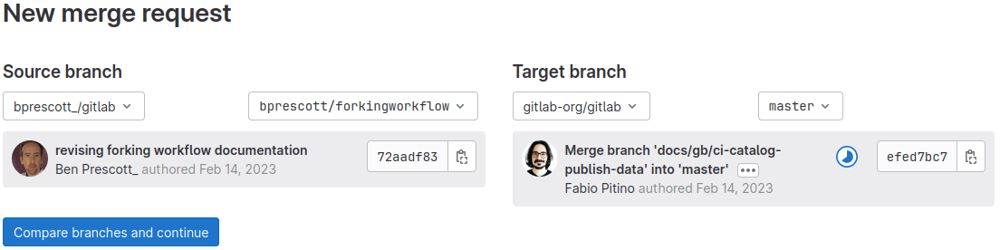

# 07 — GitLab: Forks và cộng tác

> **Nguồn chính:** GitLab Docs — *Forks* — https://docs.gitlab.com/user/project/repository/forking_workflow/
> Bài này bám các mục: `Forks`, `Update a fork` (`doc/topics/git/forks.md`), `Collaborate on merge requests across forks`, `Create a merge request → When you work in a fork`, `Protected branches`.
> (docs.gitlab.com chặn request tự động, nên nội dung trích dẫn dưới đây lấy từ **markdown gốc** trong repo `gitlab-org/gitlab`, nhánh `master` — link raw ghi ở mục *Nguồn tham khảo*.)

---

## 1. Fork trong GitLab là gì

📖 **Nguyên văn**
> "A fork is a personal copy of another project, created in the namespace of your choice.
> Your fork contains a copy of the upstream project's repository and some project settings,
> but not project content like issues, merge requests, or wiki pages.
> You can create merge requests from your fork to target the upstream project."

🇻🇳 **Dịch**
> "Fork là một bản sao cá nhân của một project khác, được tạo trong namespace mà bạn chọn.
> Fork của bạn chứa bản sao repository của upstream project và một số project settings,
> nhưng **không** chứa nội dung project như issues, merge requests, hay wiki pages.
> Bạn có thể tạo merge requests từ fork của mình nhắm tới upstream project."

Hai điểm cần khắc vào đầu:

1. Fork là bản sao **nằm trên server GitLab**, trong namespace của bạn — không phải bản sao trên máy.
2. Fork **chỉ copy repository** (code, branches, tags) chứ không copy issues/merge requests/wiki.

💡 **Ví dụ đời sống**
Upstream project là bản thảo cuốn sách đang nằm trong tủ kính của nhà xuất bản — bạn không có chìa khoá tủ. Fork giống như bạn xin **photo nguyên cuốn về bàn làm việc riêng của mình**: bạn tự do gạch xoá, viết thêm chương mới trên bản photo đó. Nhưng bạn chỉ photo phần *nội dung sách*, chứ không bê theo cả chồng thư góp ý của độc giả (issues) hay biên bản họp toà soạn (merge requests) — đúng như câu "but not project content like issues, merge requests, or wiki pages".

### Fork khác clone thế nào

Nguồn không đặt cạnh nhau hai chữ "fork vs clone", nhưng chính tài liệu đã mô tả rõ từng cái:

- **Clone** — `doc/topics/git/get_started.md`:
  > "Clone a repository: Create a local copy of the repository by cloning it to your machine.
  > You can work on the project without affecting the original repository."

  → clone tạo **local copy** trên máy bạn.

- **Fork** — `forking_workflow.md`:
  > "A fork is a personal copy of another project, created in the namespace of your choice."

  → fork tạo **bản sao trên GitLab**, trong namespace của bạn.

Nói gọn: clone đi từ *server → máy bạn*; fork đi từ *server → server* (namespace khác). Trong quy trình fork-based bạn làm **cả hai**: fork trước trên web, rồi clone cái fork đó về máy.

> [!note]
> `doc/topics/git/forks.md` xếp việc clone fork thành điều kiện tiên quyết của thao tác đồng bộ:
> "Clone your fork locally, if you haven't already." — tức fork và clone là hai bước nối tiếp, không thay thế nhau.

---

## 2. Khi nào cần fork, khi nào chỉ cần branch

Đây là câu trả lời gọn nhất cho câu hỏi "fork-based hay branch trực tiếp":

📖 **Nguyên văn**
> "If you have write access to the original project, you don't need a fork.
> Instead, use branches to manage your work.
> If you don't have write access to a project you want to contribute to, fork it.
> Make your changes in your fork, then submit them through a merge request to the upstream project."

🇻🇳 **Dịch**
> "Nếu bạn có quyền write vào project gốc, bạn **không cần** fork.
> Thay vào đó, dùng branches để quản lý công việc của mình.
> Nếu bạn **không** có quyền write vào project muốn đóng góp, hãy fork nó.
> Thực hiện thay đổi trong fork của bạn, rồi gửi chúng lên upstream project thông qua một merge request."

Và mô tả bối cảnh sử dụng, từ `doc/topics/git/get_started.md`:

📖 **Nguyên văn**
> "Some organizations, particularly those working with open-source projects, may use
> different workflows. For example, forks.
>
> A fork is a personal copy of the repository that exists in your own namespace.
> Use this workflow when contributing to open-source projects or when your team uses a
> centralized repository."

🇻🇳 **Dịch**
> "Một số tổ chức, đặc biệt là những nơi làm việc với các open-source project, có thể dùng
> workflow khác. Ví dụ: forks.
>
> Fork là bản sao cá nhân của repository, tồn tại trong namespace của chính bạn.
> Dùng workflow này khi đóng góp cho open-source project, hoặc khi team bạn dùng một
> repository tập trung."

Tóm tắt thành bảng quyết định (suy ra trực tiếp từ hai đoạn trích trên):

| Tình huống | Mô hình |
|---|---|
| Có write access vào project gốc (team nội bộ) | Branch trực tiếp trong cùng repository |
| Không có write access (đóng góp open-source) | Fork → branch trong fork → merge request |
| Cần tạo confidential merge request cho public project | Fork (xem mục dưới) |

Trường hợp đặc biệt duy nhất mà nguồn nêu ra, buộc phải fork dù bạn có quyền:

📖 **Nguyên văn**
> "To create a confidential merge request,
> use a personal fork of a public project."

🇻🇳 **Dịch**
> "Để tạo một confidential merge request, hãy dùng một personal fork của public project đó."

> [!tip]
> Dùng lại tư duy đã học ở [[12 - Branch Management và Branching Workflows]]: trong cả hai mô hình, đơn vị công việc vẫn là **topic branch**. Fork chỉ đổi *chỗ đặt* topic branch — từ repo chung sang repo riêng của bạn — chứ không đổi cách bạn làm việc hằng ngày.

---

## 3. Quan hệ fork ↔ upstream project

GitLab gọi quan hệ này là **fork relationship**. Nó là thứ khiến bạn tạo được merge request xuyên repository. Và nó có thể **mất**:

📖 **Nguyên văn**
> "If the upstream project is archived, the fork relationship is automatically removed.
> Merge requests that were closed due to a broken fork relationship are not reopened
> if the fork relationship is later restored."

🇻🇳 **Dịch**
> "Nếu upstream project bị archive, fork relationship sẽ tự động bị gỡ bỏ.
> Những merge requests đã bị đóng do fork relationship bị phá vỡ sẽ **không** được mở lại
> nếu fork relationship sau đó được khôi phục."

Bạn cũng có thể chủ động cắt quan hệ (unlink):

📖 **Nguyên văn**
> "Removing a fork relationship unlinks your fork from its upstream project.
> Your fork then becomes an independent project."

🇻🇳 **Dịch**
> "Gỡ bỏ fork relationship sẽ tách fork của bạn khỏi upstream project của nó.
> Fork của bạn khi đó trở thành một project độc lập."

> [!danger]
> Nguyên văn cảnh báo của GitLab:
> > "If you remove a fork relationship, you can't send new merge requests to the source.
> > Any existing open merge requests from the fork to the source are also closed.
> > If anyone has forked your project, their fork also loses the relationship."
>
> Dịch: "Nếu bạn gỡ fork relationship, bạn không thể gửi merge requests mới tới source nữa. Mọi merge requests đang mở từ fork tới source cũng bị đóng. Nếu ai đó đã fork project của bạn, fork của họ cũng mất quan hệ."
> Prerequisite: "You must be a project owner to unlink a fork."

Một chi tiết hay: fork **không tốn dung lượng gấp đôi**.

📖 **Nguyên văn**
> "Your fork uses a deduplication strategy
> to reduce the storage space it needs. Your fork can access the object pool connected to the
> source project."

🇻🇳 **Dịch**
> "Fork của bạn dùng chiến lược deduplication để giảm dung lượng lưu trữ cần thiết.
> Fork của bạn có thể truy cập object pool kết nối tới source project."

---

## 4. Đồng bộ fork với upstream

### 4.1 Ba trạng thái lệch nhau

📖 **Nguyên văn**
> "A fork can fall out of sync with its upstream project, and require an update:
>
> - **Ahead**: Your fork contains new commits not present in the upstream repository.
>   To sync your fork, create a merge request to push your changes to the upstream repository.
> - **Behind**: The upstream repository contains new commits not present in your fork.
>   To sync your fork, pull the new commits into your fork.
> - **Ahead and behind**: Both the upstream repository and your fork contain new commits
>   not present in the other. To fully sync your fork, create a merge request to push
>   your changes up, and pull the upstream repository's new changes into your fork."

🇻🇳 **Dịch**
> "Một fork có thể lệch khỏi upstream project của nó và cần được cập nhật:
>
> - **Ahead**: Fork của bạn chứa các commits mới không có trong upstream repository.
>   Để đồng bộ, tạo một merge request để đẩy thay đổi của bạn lên upstream repository.
> - **Behind**: Upstream repository chứa các commits mới không có trong fork của bạn.
>   Để đồng bộ, pull các commits mới về fork của bạn.
> - **Ahead and behind**: Cả upstream repository lẫn fork của bạn đều có commits mới mà bên kia không có.
>   Để đồng bộ hoàn toàn, tạo một merge request để đẩy thay đổi của bạn lên, và pull các thay đổi mới
>   của upstream repository về fork."

💡 **Ví dụ đời sống**
Giống hai người cùng ghi chép trên hai quyển sổ sao chép từ một bản gốc. *Ahead* = sổ bạn có thêm trang mà bản gốc chưa có. *Behind* = bản gốc có thêm trang mà sổ bạn chưa chép. *Ahead and behind* = cả hai cùng viết thêm, muốn thống nhất thì phải làm hai chiều: gửi trang của mình lên, và chép trang của họ về.

Đây chính là khái niệm ahead/behind của remote-tracking branch đã gặp ở [[13 - Remote Branches]] — chỉ khác là ở đây nó áp lên cả repository, giữa fork và upstream.

### 4.2 Đồng bộ từ UI


*Figure 1. "Information box for a fork some commits behind the upstream project" — nguồn: [Forks → From the UI](https://docs.gitlab.com/user/project/repository/forking_workflow/#from-the-ui)*

Các bước theo nguyên văn tài liệu:

> "1. Below the dropdown list for branch name, find the **Forked from** information box to determine if your fork is ahead, behind, or both.
> 1. If your fork is **ahead** of the upstream project, select **Create merge request** to propose adding your fork's changes to the upstream project.
> 1. If your fork is **behind** the upstream project, select **Update fork** to pull changes from the upstream repository."

Với trường hợp *ahead and behind*:

> "you can update from the UI only if GitLab detects no merge conflicts" — và "If your fork contains merge conflicts, GitLab shows a step-by-step guide to update your fork from the command line."

> [!warning]
> Khi update fork từ UI, GitLab **bỏ qua** một số thiết lập bảo vệ của fork. Nguyên văn:
> > "When you update a fork from the UI, the following repository protection settings on the fork are bypassed:
> > - Push rules configured on the fork.
> > - File locking applied to files in the fork."
>
> Lý do: "This behavior prevents synchronization failures when the upstream project and fork have different protection configurations."
> Prerequisite của cách này: "You must create your fork from an unprotected branch in the upstream project."

### 4.3 Đồng bộ bằng command line

Đây là phần cốt lõi, lấy nguyên từ `doc/topics/git/forks.md` (trang *Update a fork*).

**Bước 1 — kiểm tra xem fork đã có remote `upstream` chưa:**

```shell
git remote -v
```

📖 **Nguyên văn**
> "If your fork doesn't have a remote pointing to the original repository, use one of these examples
> to configure a remote called upstream"

🇻🇳 **Dịch**
> "Nếu fork của bạn chưa có remote trỏ tới repository gốc, dùng một trong các ví dụ sau
> để cấu hình một remote tên là upstream"

```shell
# Set any repository as your upstream after editing <upstream_url>
git remote add upstream <upstream_url>

# Set the main GitLab repository as your upstream
git remote add upstream https://gitlab.com/gitlab-org/gitlab.git
```

Cú pháp `git remote add <tên> <url>` đã học ở [[08 - Working with Remotes]]; `upstream` chỉ là **tên quy ước** đặt cho remote trỏ về repo gốc, để phân biệt với `origin` (fork của bạn).

**Bước 2 — cập nhật fork.** Nguyên văn 4 lệnh, theo đúng thứ tự:

```shell
git checkout main
git fetch upstream
git pull upstream main
git push origin main
```

Giải thích từng lệnh theo chú thích của tài liệu:

| Lệnh | Nguyên văn mô tả | Ý nghĩa |
|---|---|---|
| `git checkout main` | "In your local copy, check out the default branch." | Về default branch của bản local |
| `git fetch upstream` | "Fetch the changes from the upstream repository." | Kéo commits mới của repo gốc về (chưa merge) |
| `git pull upstream main` | "Pull the changes into your fork." | Nhập các thay đổi đó vào branch hiện tại |
| `git push origin main` | "Push the changes to your fork repository on the server." | Đẩy lên fork trên GitLab |

Chú ý hai remote khác nhau trong cùng một quy trình: **đọc từ `upstream`, ghi vào `origin`**. Đó là điểm dễ nhầm nhất của mô hình fork-based.

> [!note]
> Nguyên văn lưu ý giữa chừng: "If Git identifies unstaged changes, commit or stash them before continuing."
> (Nếu Git phát hiện unstaged changes, hãy commit hoặc stash chúng trước khi tiếp tục.)
> Tài liệu cũng nhắc: "Replace `main` with the name of your default branch."

### 4.4 Tự động hoá: fork làm pull mirror (Premium/Ultimate)

📖 **Nguyên văn**
> "A fork can be configured as a mirror of the upstream project if all these conditions are met:
>
> 1. Your subscription is GitLab Premium or GitLab Ultimate.
> 1. You create all changes in branches (not `main`).
> 1. You do not work on merge requests for confidential issues,
>    which requires changes to `main`."
>
> "Repository mirroring keeps your fork synced with the original project.
> This method updates your fork once per hour, with no manual `git pull` required."

🇻🇳 **Dịch**
> "Một fork có thể được cấu hình làm mirror của upstream project nếu thoả tất cả các điều kiện sau:
> (1) subscription là GitLab Premium hoặc Ultimate; (2) bạn tạo mọi thay đổi trong branches (không phải `main`);
> (3) bạn không làm việc với merge requests cho confidential issues, vốn đòi hỏi thay đổi trên `main`."
>
> "Repository mirroring giữ fork của bạn đồng bộ với project gốc.
> Cách này cập nhật fork của bạn **mỗi giờ một lần**, không cần `git pull` thủ công."

---

## 5. Quy trình cộng tác qua fork

Ghép các bước rời rạc trong tài liệu lại thành một mạch: **fork → clone → branch → commit → push → merge request**.

**Fork** (nguyên văn các bước chính trong *Create a fork*):
> "1. On the project's homepage, in the upper-right corner, select **Fork**.
> 1. For **Project URL**, select the namespace your fork should belong to.
> 1. Add a **Project slug**. This value becomes part of the URL to your fork. It must be unique in the namespace.
> 1. Select one of the **Branches to include** options: **All branches** (default) / **Only the default branch**.
> 1. Select the **Visibility level** for your fork.
> 1. Select **Fork project**."

Tuỳ chọn `Only the default branch` được tài liệu giải thích là "Uses the `--single-branch` and `--no-tags` Git options" — tức fork nhẹ hơn, chỉ lấy default branch.

**Branch** — `doc/topics/git/branch.md`:
> "A branch is a copy of the files in the repository at the time you create the branch.
> You can work in your branch without affecting other branches."

```shell
git checkout -b <name-of-branch>
```

Tài liệu cũng nhắc: "GitLab enforces branch naming rules to prevent problems".

**Push + merge request** — từ *Create a merge request → When you work in a fork*:

📖 **Nguyên văn**
> "You can create a merge request from your fork to contribute back to the main project.
>
> 1. In the top bar, select **Search or go to** and find your fork.
> 1. In the left sidebar, select **Code** > **Merge requests**, and select **New merge request**.
> 1. For **Source branch**, select the branch in your fork that contains your changes.
> 1. For **Target branch**: Select the upstream repository, and not your fork. [...]
> 1. Select **Compare branches and continue**.
> 1. Select **Create merge request**. The merge request is created in the target repository,
>    not your fork."

🇻🇳 **Dịch**
> "Bạn có thể tạo merge request từ fork của mình để đóng góp ngược lại project chính.
> Chọn **Source branch** là branch trong fork chứa thay đổi của bạn. Với **Target branch**:
> chọn **upstream repository, không phải fork của bạn**. [...] Merge request được tạo trong
> **target repository, chứ không phải trong fork của bạn**."


*Figure 2. "The dropdown list for selecting the target branch in the upstream repository." — nguồn: [Create a merge request → When you work in a fork](https://docs.gitlab.com/user/project/merge_requests/creating_merge_requests/#when-you-work-in-a-fork)*

> [!warning]
> Nguyên văn về visibility: "If your fork's visibility is more restricted than the parent repository, the target branch defaults to your fork's default branch. This prevents potential exposure of private information in your fork."

**Điều gì xảy ra khi MR nhắm sang repository khác:**

📖 **Nguyên văn**
> "If the merge request targets another repository, it uses:
>
> - The target project's approval rules.
> - Your fork's CI/CD configuration, resources, and project CI/CD variables."

🇻🇳 **Dịch**
> "Nếu merge request nhắm tới một repository khác, nó dùng: approval rules của target project;
> và CI/CD configuration, resources, cùng project CI/CD variables **của fork bạn**."

Sau khi merge xong, có một cái bẫy nhỏ:

📖 **Nguyên văn**
> "After your merge request is merged upstream, the branch in your fork is not automatically considered
> **Merged** for bulk deletion purposes. The branch is only considered merged if your fork's default
> branch contains those changes."

🇻🇳 **Dịch**
> "Sau khi merge request của bạn được merge lên upstream, branch trong fork của bạn **không tự động**
> được coi là **Merged** cho mục đích xoá hàng loạt. Branch chỉ được coi là merged nếu default branch
> của fork bạn đã chứa các thay đổi đó."

→ Cách xử lý mà tài liệu chỉ ra: "To mark these branches as merged in your fork, update your fork to sync with the upstream project." (Tức làm lại đúng mục 4.3.)

---

## 6. Cộng tác hai chiều: upstream member push vào fork

GitLab cho phép maintainer của upstream sửa trực tiếp branch trong fork của contributor — rất tiện để "sửa nốt cái dấu chấm phẩy" thay vì bắt contributor đi vòng.

📖 **Nguyên văn**
> "When you open a merge request from your fork, you can allow upstream
> members to collaborate with you on your branch.
> When you enable this option, members who have permission to merge to the target branch get
> permission to write to the merge request's source branch.
>
> The members of the upstream project can then make small fixes or rebase branches
> before merging.
>
> This feature is available for merge requests across forked projects that are
> publicly accessible."

🇻🇳 **Dịch**
> "Khi bạn mở merge request từ fork của mình, bạn có thể cho phép upstream members cộng tác
> cùng bạn trên branch đó. Khi bật tuỳ chọn này, những member có quyền merge vào target branch
> sẽ nhận được quyền **write** vào source branch của merge request.
>
> Các member của upstream project khi đó có thể sửa vặt hoặc rebase branches trước khi merge.
>
> Tính năng này chỉ có với merge requests xuyên forked projects **publicly accessible**."

Bật/tắt: checkbox **"Allow commits from members who can merge to the target branch"** ở mục **Contribution** khi tạo/sửa merge request. Sau khi tạo, widget hiển thị thông báo **"Members who can merge are allowed to add commits"**.

Điều kiện để push được, nguyên văn:
> "You can push directly to the branch of the forked repository if:
>
> - The author of the merge request enabled contributions from upstream members.
> - You have the Developer, Maintainer, or Owner role for the upstream project."

Lệnh thực tế, với ví dụ của tài liệu (fork là `git@gitlab.com:contributor/forked-project.git`, branch là `fork-branch`):

```shell
git fetch "git@gitlab.com:contributor/forked-project.git" 'fork-branch'
git checkout -b 'contributor/fork-branch' FETCH_HEAD
```

> "These commands fetch the branch from the forked project and create a local branch for you to work on."

Sửa, commit, rồi push ngược lại fork:

```shell
git push git@gitlab.com:contributor/forked-project.git contributor/fork-branch:fork-branch
```

📖 **Nguyên văn** (giải thích dấu hai chấm)
> "The colon (`:`) specifies the source branch and the destination branch. The scheme is:
>
> ```shell
> git push <forked_repository_git_url> <local_branch>:<fork_branch>
> ```"

🇻🇳 **Dịch**
> "Dấu hai chấm (`:`) chỉ định source branch và destination branch. Cú pháp là:
>
> ```shell
> git push <url_git_của_fork> <branch_local>:<branch_trên_fork>
> ```"

🇻🇳 Tức là bên trái dấu `:` là branch ở máy bạn, bên phải là branch trên fork — hai tên **không bắt buộc phải giống nhau**. Cú pháp này đã gặp ở [[13 - Remote Branches]] (`git push origin serverfix:awesomebranch`).

> [!danger]
> Nguyên văn: "If you've amended or squashed any commits, you must use `git push --force`. Proceed with caution as this command rewrites the commit history."
>
> ```shell
> git push --force git@gitlab.com:contributor/forked-project.git contributor/fork-branch:fork-branch
> ```
>
> Đây đúng là "perils of rebasing" đã cảnh báo ở [[14 - Rebasing]]: force push viết lại lịch sử của branch mà **người khác đang dùng**.

---

## 7. Protected branches & project members

Fork-based workflow tồn tại được là nhờ hệ thống phân quyền. Vài điểm nguồn có nói:

📖 **Nguyên văn** (`Protected branches`)
> "Protected branches enforce specific permissions on branches in GitLab to ensure code stability
> and quality. Protected branches:
>
> - Control which users can merge and push code changes.
> - Prevent accidental deletion of critical branches.
> - Enforce code review and approval processes.
> - Manage Code Owner approval requirements.
> - Regulate force push permissions to maintain commit history."

🇻🇳 **Dịch**
> "Protected branches áp đặt các quyền cụ thể lên branches trong GitLab để đảm bảo code ổn định
> và chất lượng. Protected branches: kiểm soát user nào được merge và push; ngăn xoá nhầm các
> branch quan trọng; bắt buộc quy trình code review và approval; quản lý yêu cầu approval của
> Code Owner; điều tiết quyền force push để giữ commit history."

> [!note]
> "The default branch for your repository is protected by default."
> Và để cấu hình: "You must have the Maintainer or Owner role."

Các **role** xuất hiện xuyên suốt tài liệu fork: `Developer`, `Maintainer`, `Owner`.

- Push vào fork với tư cách upstream member: "You have the Developer, Maintainer, or Owner role for the upstream project."
- Thêm assignees/reviewers/labels khi tạo MR: "If you are assigned the Developer, Maintainer, or Owner role, add your desired assignees, reviewers, labels, and milestones."
- Unlink fork: "You must be a project owner to unlink a fork."

Một cái bẫy quyền hạn rất hay gặp, nguyên văn:
> "When a user forks a project, the permissions of the forked copy are not copied
> from the original project. The creator of the fork must grant permissions to the
> forked copy before members in the upstream project can view or merge the changes
> in the merge request."

🇻🇳 Dịch: "Khi một user fork project, permissions của bản fork **không** được copy từ project gốc. Người tạo fork phải cấp quyền cho bản fork trước khi members của upstream project có thể xem hoặc merge các thay đổi trong merge request."

Và chạy CI/CD ở upstream: "To run CI/CD pipelines in the upstream project, you must be a member of that project."

---

## 8. Đối chiếu với fork của GitHub

Cùng một khái niệm, khác tên gọi ở bước cuối. Xem lại [[03 - GitHub - Contributing to a Project]]:

| | GitHub | GitLab |
|---|---|---|
| Bản sao trên server | fork | fork |
| Đề xuất thay đổi | **pull request** | **merge request** |
| Remote trỏ repo gốc | `upstream` (quy ước) | `upstream` (quy ước, nguyên văn trong docs) |
| Cho maintainer sửa branch của bạn | "Allow edits from maintainers" | "Allow commits from members who can merge to the target branch" |

Quy trình thì trùng khớp: fork → clone → topic branch → commit → push lên fork của mình → mở PR/MR nhắm về upstream. Học xong một bên là dùng được bên kia; chỉ cần đổi từ vựng.

---

## Tóm tắt

- **Fork** = "a personal copy of another project, created in the namespace of your choice" — bản sao *trên server*, chỉ gồm repository chứ không gồm issues/MR/wiki.
- **Clone** = "create a local copy of the repository by cloning it to your machine" — bản sao *trên máy*. Trong workflow fork-based, bạn làm cả hai.
- Có write access → dùng branch trực tiếp. Không có → fork.
- Đồng bộ: `git remote add upstream <url>` rồi `git checkout main` → `git fetch upstream` → `git pull upstream main` → `git push origin main`. **Đọc từ `upstream`, ghi vào `origin`.**
- Ba trạng thái lệch: **Ahead** (tạo MR đẩy lên) / **Behind** (pull về) / **Ahead and behind** (làm cả hai).
- MR từ fork được tạo **trong target repository**, dùng approval rules của target nhưng CI/CD config của fork.
- Bật "Allow commits from members who can merge to the target branch" để maintainer sửa nốt/rebase giúp bạn.
- Gỡ fork relationship là thao tác **không đảo ngược êm ái**: mọi MR đang mở tới source đều bị đóng.

---

## Liên kết
- Bài trước: [[06 - GitLab - Merge Requests]]
- Cross-link phần 03:
  - [[08 - Working with Remotes]] — `git remote add`, `git fetch`, `git pull`, `git push`
  - [[13 - Remote Branches]] — khái niệm upstream, ahead/behind
  - [[12 - Branch Management và Branching Workflows]] — topic branch
  - [[14 - Rebasing]] — rủi ro của force push / rewrite history
  - [[03 - GitHub - Contributing to a Project]] — fork & pull request bên GitHub
- Quay lại mục lục: [[00 - Tổng hợp (Repo Hosting Services)]]

## Nguồn tham khảo

Bản render công khai (tham khảo):
- Forks : https://docs.gitlab.com/user/project/repository/forking_workflow/
- Update a fork : https://docs.gitlab.com/topics/git/forks/
- Collaborate on merge requests across forks : https://docs.gitlab.com/user/project/merge_requests/allow_collaboration/
- Create a merge request : https://docs.gitlab.com/user/project/merge_requests/creating_merge_requests/
- Protected branches : https://docs.gitlab.com/user/project/repository/branches/protected/
- Get started with Git : https://docs.gitlab.com/topics/git/get_started/
- Create a Git branch for your changes : https://docs.gitlab.com/topics/git/branch/

Markdown gốc đã fetch để trích nguyên văn (repo `gitlab-org/gitlab`, nhánh `master`):
- https://gitlab.com/gitlab-org/gitlab/-/raw/master/doc/user/project/repository/forking_workflow.md
- https://gitlab.com/gitlab-org/gitlab/-/raw/master/doc/topics/git/forks.md
- https://gitlab.com/gitlab-org/gitlab/-/raw/master/doc/user/project/merge_requests/allow_collaboration.md
- https://gitlab.com/gitlab-org/gitlab/-/raw/master/doc/user/project/merge_requests/creating_merge_requests.md
- https://gitlab.com/gitlab-org/gitlab/-/raw/master/doc/user/project/repository/branches/protected.md
- https://gitlab.com/gitlab-org/gitlab/-/raw/master/doc/topics/git/get_started.md
- https://gitlab.com/gitlab-org/gitlab/-/raw/master/doc/topics/git/branch.md

Hình Figure 1–2 tải từ repo trên, lưu trong `assets/`:
- `update-fork_v16_6.png` — https://gitlab.com/gitlab-org/gitlab/-/raw/master/doc/user/project/repository/img/update-fork_v16_6.png
- `forking_workflow_branch_select_v15_9.png` — https://gitlab.com/gitlab-org/gitlab/-/raw/master/doc/user/project/merge_requests/img/forking_workflow_branch_select_v15_9.png
