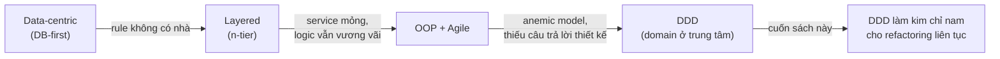

# Chương 1 — Evolution of Domain-Driven Design

> ⚠️ Tóm tắt khái niệm theo mục lục sách + kiến thức DDD chuẩn — không phải bản dịch nguyên văn. Đọc sách gốc để lấy case study chi tiết. Mọi ví dụ đời sống & Joy Loyalty là ví dụ của mình để minh hoạ, không phải từ sách.

## TL;DR
Chương mở đầu trả lời câu hỏi: tại sao cách phát triển phần mềm truyền thống (data-first, layered) ngày càng đuối khi business phức tạp lên, và DDD ra đời để giải quyết điều gì. Ý quan trọng nhất: **phần mềm khó không phải vì code khó, mà vì domain (nghiệp vụ) phức tạp** — nên thiết kế phải xoay quanh domain, không phải database hay framework. Và vì hiểu biết về domain luôn thay đổi, refactoring không phải việc "trả nợ" một lần mà là hoạt động liên tục.

## Nội dung chính

### Progression of software development approaches

Để hiểu DDD giải quyết gì, phải nhìn lại nó đứng trên vai những cách tiếp cận nào — và mỗi cách "gãy" ở đâu khi nghiệp vụ phức tạp lên.

**1. Thời kỳ data-centric (database-first)**

🏪 **Ví dụ đời sống:** Tưởng tượng mở quán phở mà việc đầu tiên là... thiết kế tủ đựng nguyên liệu. Ngăn nào để xương, ngăn nào để bánh phở, dán nhãn đâu ra đấy. Nhưng chưa ai trả lời: nước dùng nấu kiểu gì, khách gọi "tái nạm gầu" thì làm sao? Rồi khi khách đông lên, công thức nấu không được ghi ở đâu cả — nó nằm rải rác trong trí nhớ của từng người đứng bếp, mỗi người nấu một kiểu.

Trong code, đây chính là kiểu thiết kế bắt đầu từ database schema: vẽ ERD/collection trước, code chỉ là lớp CRUD bọc quanh bảng:
- Ổn khi app đơn giản (form nhập liệu, báo cáo). Đau khi business logic xuất hiện: rule không có "nhà", bị vương vãi trong controller, trong query, thậm chí trong UI — y như công thức phở nằm trong đầu mỗi người một mảnh.
- Triệu chứng kinh điển: cùng một rule (vd: "điểm không được âm") bị copy-paste ở 4 chỗ, sửa 3 chỗ quên 1 chỗ → bug.

**2. Layered architecture (n-tier)**

🏪 **Ví dụ đời sống:** Quán phở giờ chia khu hẳn hoi: khu order, khu bếp, khu kho. Trật tự hơn nhiều — ai cũng biết việc nào ở khu nào. Nhưng vẫn không có *cuốn sổ công thức*. Khu bếp chỉ là nơi "lấy nguyên liệu từ kho, làm theo lời khu order dặn" — kiến thức nấu phở vẫn không có chỗ ở chính thức, chỉ là chuyển từ miệng người order xuống tay người đứng bếp.

Trong code: tách presentation / business / data access. Có trật tự hơn, nhưng layer "business" thường thoái hoá thành đống service class **mỏng dính**: nhận param → đọc DB → if-else → ghi DB. Logic thật vẫn không có nhà. Đây chính là hiện trạng nhiều codebase Node.js, kể cả app Joy Loyalty: route handler → service → Firestore:

```js
// Kiểu code layered hiện tại — service biết MỌI THỨ nhưng không model gì cả
async function addPoints(memberId, amount, reason) {
  const doc = await db.collection('members').doc(memberId).get();
  const member = doc.data();
  // rule nghiệp vụ trộn lẫn với chuyện đọc/ghi DB
  if (member.status === 'blocked') throw new Error('blocked');
  const newBalance = (member.pointsBalance || 0) + amount;
  await doc.ref.update({ pointsBalance: newBalance });
  await db.collection('point_logs').add({ memberId, amount, reason, at: Date.now() });
}
```

Hàm này chạy được, nhưng: rule "blocked thì không cộng điểm" sống lẫn với Firestore API; muốn test phải mock DB; và 6 tháng sau sẽ có hàm `addPointsFromCampaign` copy 80% logic này với một biến thể nhỏ.

**3. OOP rồi Agile**

- OOP hứa hẹn model hoá thế giới thực, nhưng thực tế thường thoái hoá thành **anemic model**: class chỉ có getter/setter (hoặc object JS chỉ có data), behavior nằm hết ở service. Như tượng sáp trong bảo tàng — nhìn giống người thật nhưng không tự làm được gì cả; muốn "tượng cử động" phải có người bên ngoài cầm tay nó nhấc lên. Có "object" nhưng không có "orientation".
- Agile rút ngắn vòng phản hồi với business — rất tốt — nhưng Agile là *process*, không trả lời câu hỏi *thiết kế*: "model nghiệp vụ nên nằm ở đâu trong code?". Họp standup mỗi sáng không tự nhiên làm cuốn sổ công thức xuất hiện.

**4. DDD (Eric Evans, 2003)**

Bước tiếp theo: đưa **domain model giàu behavior** vào trung tâm — viết hẳn cuốn sổ công thức và để nó làm trung tâm của quán — và quan trọng hơn: đưa **ngôn ngữ của business vào trong code**. Database, framework, transport (HTTP/Pub/Sub) trở thành chi tiết ở rìa, như chuyện chọn tủ lạnh hãng nào — quan trọng nhưng không phải linh hồn của quán.

Tóm tắt cả hành trình — và câu hỏi mỗi thời kỳ chưa trả lời được:



Lưu ý đọc cho đúng: mỗi bước **không vứt bỏ** bước trước — DDD vẫn dùng layer, vẫn dùng OOP (hoặc closure/function trong JS), vẫn cần Agile. Cái mới là *trọng tâm dịch chuyển*: từ "dữ liệu nằm đâu" sang "nghiệp vụ nói gì".

### What is domain-driven design (DDD)?

DDD là cách tiếp cận thiết kế phần mềm cho **domain phức tạp**, đứng trên vài trụ cột:

**Domain — lĩnh vực nghiệp vụ mà phần mềm phục vụ.**

🏪 Quán cà phê đầu ngõ có chương trình thẻ tích điểm: mua 10 ly tặng 1. Cái "luật chơi" đó — tích thế nào, đổi thế nào, khách bỏ đi lâu quá thì sao — tồn tại từ thời thẻ giấy đục lỗ, *trước cả khi có bất kỳ phần mềm nào*. Domain là của bà chủ quán, không phải của lập trình viên.

Với Joy Loyalty, domain là *loyalty & retention*: tích điểm, đổi thưởng, hạng thành viên, campaign. Merchant đã làm loyalty bằng thẻ giấy từ lâu — app chỉ là cách hiện thực hoá domain đó.

**Ubiquitous language (ngôn ngữ chung)** — một bộ từ vựng thống nhất giữa dev và business, dùng *cả trong hội thoại lẫn trong code*.

🏪 Trong gia đình, món canh của bà ngoại được cả nhà gọi là "canh bà ngoại". Một hôm cô con dâu mới về gọi nó là "canh rau tập tàng" — và thế là bữa đó nấu nhầm món. Khi mỗi người gọi cùng một thứ bằng một tên khác nhau, mỗi lần truyền đạt là một lần dịch, và mỗi lần dịch là một cơ hội hiểu nhầm.

Trong code: nếu PM/support/merchant nói "member **earn points** khi đặt hàng" thì code phải là `member.earnPoints(order)`, không phải `updateUserBalance(uid, delta)`. Khi support báo bug "member không lên tier Gold", dev mở code thấy ngay `tier.evaluate(member)` thay vì phải dịch ngược từ `setLevel(user, 2)` — khoảng cách dịch thuật đó chính là nơi bug và hiểu lầm sinh ra. Lưu ý: ngôn ngữ chung có *phạm vi* — "member" trong context Points khác "member" trong context Notifications (chương 3 đào sâu).

**Model-driven design** — code phản ánh trực tiếp model nghiệp vụ, không phải cấu trúc bảng/collection.

🏪 Bản đồ tàu điện ngầm không vẽ đúng tỉ lệ địa lý — nó vẽ thứ hành khách *cần*: ga nào nối ga nào. Model tốt cũng vậy: không phải bản sao của thực tại (hay của schema DB), mà là cách nhìn *hữu dụng* cho bài toán đang giải. Và khi tuyến mới mở, bản đồ phải in lại.

Model không phải tài liệu Word để ngắm — model *là* code. Code đổi thì hiểu biết đổi, hiểu biết đổi thì code phải đổi theo.

**Hai tầng pattern:**
- *Strategic design* — chia hệ thống lớn thành các bounded context, xác định phần nào đáng đầu tư (chương 3). Như quy hoạch khu phố: khu nào để ở, khu nào buôn bán.
- *Tactical design* — xây model bên trong từng context bằng entity, value object, aggregate, repository... (chương 4). Như thiết kế nội thất từng căn nhà.
- Thứ tự quan trọng: strategic trước, tactical sau. Nội thất đẹp đến mấy mà xây nhà nhầm khu công nghiệp thì vẫn sai — aggregate đẹp đến mấy mà đặt sai context thì vẫn sai.

**Điểm nhấn riêng của cuốn này**: dùng DDD làm **kim chỉ nam cho refactoring** — không viết lại từ đầu (big rewrite hầu như luôn thất bại) mà cải tạo dần hệ thống cũ về phía domain model. Như sửa nhà *trong khi vẫn đang ở*: làm từng phòng, nhà vẫn có chỗ ngủ mỗi đêm — chứ không đập sạch rồi ra khách sạn ở "tạm 6 tháng" (mà ai sửa nhà rồi đều biết 6 tháng đó là bao lâu).

### How DDD changes problem-solving approaches

DDD thay đổi *thứ tự* đặt câu hỏi khi giải quyết vấn đề.

🏪 **Ví dụ đời sống:** Đi khám bệnh, có hai kiểu bác sĩ. Kiểu một: bạn vừa ngồi xuống đã kê đơn kháng sinh — vì "đau họng thì uống kháng sinh, ai chả thế". Kiểu hai: hỏi đau từ bao giờ, có sốt không, nhà có ai bị không... rồi mới kết luận. Kiểu một nhanh, và thường xuyên chữa sai bệnh. Dev "tech-first" chính là bác sĩ kiểu một: nghe yêu cầu xong là kê ngay "thêm collection, thêm endpoint".

**Trước (tech-first):**
1. "Schema/collection thế nào?" → 2. "API endpoint gì?" → 3. "Dùng lib nào?" → 4. (cuối cùng, đôi khi không bao giờ) "Mà nghiệp vụ thật sự muốn gì nhỉ?"

**Sau (domain-first):**
1. "Business problem thật sự là gì? Ai là domain expert? Họ dùng từ gì?" → 2. "Model khái niệm ra sao?" → 3. (cuối cùng) "Persist và expose model đó bằng công nghệ gì?"

Cụ thể hơn:

- Tách **problem space** (vấn đề cần giải) khỏi **solution space** (cách giải bằng phần mềm) — chương 2 đào sâu. Nhiều bug "kỳ lạ" thực ra là hiểu sai vấn đề chứ không phải code sai.
  - Ví dụ Joy Loyalty: ticket "điểm của member bị sai sau khi refund". Tech-first sẽ lao vào trace code trừ điểm. Domain-first hỏi trước: *theo nghiệp vụ*, refund một phần đơn hàng thì điểm trừ theo tỉ lệ, trừ hết, hay không trừ (tuỳ merchant config)? Hoá ra ba merchant muốn ba kiểu — vấn đề không phải bug code mà là model chưa có khái niệm "refund policy".
- Dev nói chuyện **trực tiếp** với domain expert (ở Joy Loyalty: merchant, team support — người nghe merchant phàn nàn mỗi ngày, PM hiểu loyalty program) thay vì chỉ nhận spec qua ticket. Như trò chơi "tam sao thất bản": tin nhắn truyền qua 3 người là méo — ticket là output đã qua một lớp dịch; hội thoại trực tiếp mới lộ ra ngữ cảnh.
- Chấp nhận model **tiến hoá liên tục**: hiểu biết về domain sâu dần thì model phải refactor theo — Evans gọi là *knowledge crunching*. Như bà chủ quán phở năm đầu chỉ biết "khách thích ăn nóng", năm thứ ba biết "khách văn phòng cần nhanh, khách sáng thứ 7 muốn ngồi lâu" — hiểu biết tích luỹ dần qua tiếp xúc, không có buổi "phân tích khách hàng" nào xong một lần là đủ. Hệ quả quan trọng cho cuốn sách này: refactoring không phải "trả nợ kỹ thuật" một lần, mà là **hoạt động học hỏi thường xuyên**.
- **Khi nào KHÔNG cần DDD**: phần CRUD đơn giản (trang settings, quản lý branding email) cứ làm thẳng — áp tactical patterns vào đó là accidental complexity. Như thuê kiến trúc sư thiết kế... cái nhà kho để chổi. DDD (nhất là tactical) dành cho phần lõi phức tạp: tính điểm chồng campaign, rule đổi thưởng, lên/xuống tier theo chu kỳ. Chi phí của DDD là thật (nhiều khái niệm, nhiều lớp), chỉ đáng trả khi essential complexity đủ lớn.

## Sai lầm thường gặp

- **Anemic domain model nhưng tự gọi là DDD**: có folder `models/` chứa object thuần data, toàn bộ rule vẫn trong `services/`. Như treo biển "Phở gia truyền" nhưng nước dùng nấu từ gói gia vị công nghiệp — đổi tên folder không phải DDD.
- **DDD-hoá toàn bộ app**: áp aggregate/repository/factory lên cả trang settings CRUD → phức tạp gấp đôi, giá trị bằng không. Như mặc vest đi đổ rác. DDD chỉ đáng cho core domain.
- **Coi DDD là chuyện thuần kỹ thuật của dev**: bỏ qua ubiquitous language và hội thoại với domain expert, chỉ lấy phần pattern — được bộ khung mà mất linh hồn. Như học thuộc động tác múa mà không nghe nhạc: đúng từng bước, sai cả bài.
- **Ngôn ngữ trong code lệch ngôn ngữ business mà không ai sửa**: support nói "redeem", code viết `exchangeGift()` — mỗi lần trao đổi là một lần dịch, mỗi lần dịch là một cơ hội hiểu nhầm (nhớ món "canh bà ngoại").
- **Big rewrite thay vì refactor**: "code cũ nát quá, đập đi viết lại theo DDD" — mất 6 tháng, hệ thống mới thiếu 1000 edge case mà code cũ đã âm thầm xử lý. Như đập nhà xây lại vì... bếp hơi chật: tốn gấp 10 và phát hiện ra cái nhà cũ chống thấm tốt hơn tưởng. Tinh thần cuốn sách: refactor *dần* về phía domain model.

## Thuật ngữ cần nhớ
| Thuật ngữ | Nghĩa là gì (1 câu) |
|---|---|
| Domain | Lĩnh vực nghiệp vụ phần mềm phục vụ (với Joy: loyalty & retention) — tồn tại trước cả phần mềm |
| Subdomain | Mảng con bên trong domain (points, rewards, tiers...) — chương 2-3 phân loại |
| Ubiquitous language | Bộ từ vựng chung giữa dev và business, dùng nguyên văn trong code |
| Domain model | Mô hình nghiệp vụ thể hiện bằng code có behavior, không chỉ data |
| Model-driven design | Code phản ánh trực tiếp model nghiệp vụ, không phản ánh schema DB |
| Anemic model | Object chỉ chứa data, logic nằm hết ở service — "tượng sáp", anti-pattern DDD muốn tránh |
| Rich domain model | Ngược với anemic: object vừa giữ data vừa chứa behavior/rule của chính nó |
| Strategic design | Tầng pattern chia hệ thống lớn: bounded context, subdomain, context map — "quy hoạch khu phố" |
| Tactical design | Tầng pattern xây model trong từng context: entity, value object, aggregate... — "nội thất từng nhà" |
| Knowledge crunching | Quá trình dev + domain expert cùng "nghiền" kiến thức nghiệp vụ để tinh chỉnh model |
| Layered architecture (n-tier) | Kiến trúc tách presentation/business/data — tiền bối của DDD, hay sinh ra service mỏng + anemic model |
| Big rewrite | Đập hệ thống cũ viết lại từ đầu — rủi ro cao, sách chủ trương refactor dần thay thế |

## Áp dụng cho mình (Joy Loyalty)
- Bắt đầu lập **glossary loyalty**: member, points balance, earning rule, redemption, reward, tier, milestone, campaign, expiry... — thống nhất với PM/support rồi đổi tên dần trong code cho khớp (JS thuần làm tốt việc này, không cần TS).
- Soi codebase hiện tại: chỗ nào service function chỉ đọc Firestore → sửa field → ghi lại, đó là anemic model — ứng viên refactor về domain model có behavior (`account.earnPoints(rule, order)` thay vì `updateMemberPoints(memberId, amount)`).
- Mỗi khi nhận ticket bug về điểm/tier, tập thói quen hỏi ngược về problem space trước ("theo nghiệp vụ thì *đúng* là thế nào, merchant nào muốn gì?") thay vì trace code ngay — làm bác sĩ kiểu hai.
- Đừng DDD-hoá toàn bộ app một lượt: khoanh vùng phần lõi (points/tiers/rewards engine) làm trước; settings, branding, widget config giữ CRUD đơn giản.
