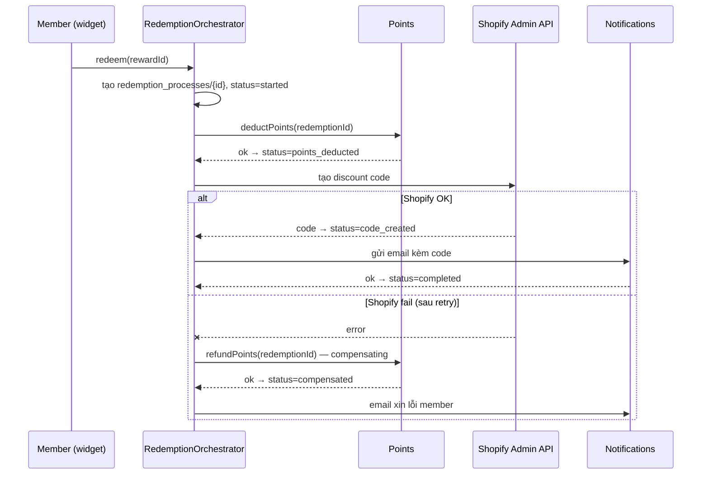

# Chương 12 — Orchestrating Complexity: Advanced Approaches to Business Processes

> ⚠️ Tóm tắt khái niệm theo mục lục sách + kiến thức DDD chuẩn — không phải bản dịch nguyên văn. Đọc sách gốc để lấy case study chi tiết. Ví dụ đời sống & Joy Loyalty là ví dụ của mình để minh hoạ khái niệm, không phải ví dụ trong sách.

## TL;DR
Khi một business process chạm vào nhiều bounded context (đổi thưởng = trừ điểm + tạo discount code trên Shopify + gửi email), ta không còn transaction ACID bao trùm tất cả. Chương này so các cách điều phối process xuyên ranh giới: 2PC (gần như đã bị loại trong cloud), saga (choreography vs orchestration), process manager, compensating transaction, và durable execution để process sống sót qua crash. Hình ảnh xuyên suốt: **chuẩn bị đám cưới** — chuỗi việc đặt cọc nhà hàng → thuê áo → mời khách, nhà hàng huỷ thì phải gọi điện huỷ dây chuyền và đòi cọc, và cần một wedding planner cầm sổ để không quên đang làm tới đâu.

## Nội dung chính

### Two-phase commit (2PC) — chốt kèo du lịch nhóm

🏪 **Ví dụ đời sống.** Trưởng nhóm muốn chốt chuyến du lịch: nhắn từng người "đi được không, giữ chỗ giúp nhé?" — ai cũng phải *giữ lịch trống* trong lúc chờ. Tất cả gật thì chốt đặt vé. Vấn đề: một người **ngủ quên không trả lời**, cả nhóm đứng hình giữ lịch trống vô thời hạn — không ai dám nhận kèo khác. Và tệ nhất: chính trưởng nhóm mất tích giữa chừng thì cả nhóm kẹt cứng, chẳng biết chốt hay huỷ.

**Map sang kỹ thuật:**
- **2PC** = giao thức distributed transaction cổ điển: một coordinator hỏi mọi participant "commit được không?" (phase 1 — prepare, mỗi participant **giữ lock**), tất cả OK thì ra lệnh commit (phase 2), một bên từ chối thì rollback hết.
- Nghe đẹp nhưng bị loại trong hệ hiện đại: coordinator chết giữa chừng thì participant bị **block giữ lock** (cả nhóm giữ lịch trống chờ trưởng nhóm mất tích); không scale, latency cao. Và quyết định nhất: hầu hết hạ tầng cloud — Firestore, Pub/Sub, REST API của Shopify — **không tham gia 2PC được**. Không thể bảo Shopify "giữ lock cái discount code chờ tôi xác nhận".
- Bài học rút ra: giữa các bounded context, chấp nhận **eventual consistency** thay vì cố ép atomicity — tiền đề cho mọi pattern phía sau.

### Saga — đặt tiệc cưới và chuỗi huỷ dây chuyền

🏪 **Ví dụ đời sống.** Chuẩn bị đám cưới không phải một "giao dịch" chốt một phát: đặt cọc nhà hàng *xong hẳn* → rồi thuê áo cưới *xong hẳn* → rồi in thiệp mời khách *xong hẳn*. Mỗi bước hoàn tất thật sự, không có nút "undo tất cả". Đùng một cái nhà hàng báo huỷ: không có phép màu nào quay ngược thời gian — cô dâu chú rể phải **gọi điện huỷ dây chuyền**: trả áo cưới (chịu phí), báo khách hoãn, và **đòi lại tiền cọc**. Mỗi cú điện thoại huỷ đó là một hành động *mới*, có chi phí, có nghiệp vụ riêng — không phải "xoá" hành động cũ.

**Map sang kỹ thuật:**
- **Saga** = chuỗi **local transaction**: mỗi bước commit trọn vẹn trong context của nó rồi phát event/command cho bước sau. Nếu một bước fail, chạy các **compensating action** để bù lại các bước đã commit trước đó. Đổi atomicity lấy availability — không ai phải "giữ lock chờ cả nhóm".
- Hệ quả tư duy quan trọng: hệ thống có những trạng thái **trung gian hợp lệ** (đã trừ điểm nhưng chưa có code — như "đã cọc nhà hàng nhưng chưa thuê áo"). Nghiệp vụ và UI phải chấp nhận và hiển thị được trạng thái này, thay vì giả vờ mọi thứ tức thì.

### Choreography vs Orchestration — tài xế tự nhường khách vs tổng đài taxi

🏪 **Ví dụ đời sống.** Nhóm tài xế taxi tự quản trong group chat: ai thấy khách đặt gần mình thì nhận, bận thì nhắn "tôi kẹt, ai gần đó nhận giúp" — không có sếp, mỗi người tự phản ứng theo tin nhắn của người khác (**choreography**). Chạy mượt khi nhóm nhỏ; nhưng khi 50 tài xế và khách phàn nàn "đặt 30 phút chưa ai đến", **không ai biết đơn đang kẹt ở ai** — phải lội lại cả group chat. Ngược lại, hãng taxi có **tổng đài**: tổng đài nhận cuốc, chỉ định xe, xe báo bận thì tổng đài điều xe khác, khách hỏi thì tổng đài biết ngay đơn đang ở đâu (**orchestration**). Đổi lại, tổng đài sập là cả hãng đứng, và tổng đài ôm việc nhiều quá thì thành nút thắt.

**Map sang kỹ thuật:**
- **Choreography**: không có chỉ huy — mỗi service nghe event của service khác và tự phản ứng. `rewards` phát `RewardRedeemed` → `points` nghe, trừ điểm, phát `PointsDeducted` → `notifications` nghe, gửi email. Ưu: loose coupling, thêm consumer mới không sửa ai. Nhược: flow nằm rải rác khắp nơi, không ai nhìn được toàn cảnh, debug "vì sao đơn này kẹt" rất mệt khi chuỗi dài; sửa thứ tự bước = sửa nhiều service.
- **Orchestration**: một orchestrator nắm flow, gửi **command** cho từng service và chờ kết quả. `RedemptionOrchestrator` → ra lệnh trừ điểm → ra lệnh tạo discount code → ra lệnh gửi email. Ưu: flow đọc được ở một chỗ, dễ trace, dễ xử lý nhánh lỗi. Nhược: orchestrator có thể phình thành "god service" nếu nhồi business logic của context khác vào — orchestrator chỉ được biết *thứ tự và trạng thái*, còn *cách trừ điểm thế nào* vẫn là việc của `points`.

| Tiêu chí | Choreography (tài xế tự nhường) | Orchestration (tổng đài) |
|---|---|---|
| Coupling | Lỏng — producer không biết consumer | Chặt hơn — orchestrator biết các bước |
| Nhìn toàn cảnh flow | Khó, flow rải rác trong nhiều consumer | Dễ, flow nằm một chỗ |
| Debug "đơn kẹt ở đâu" | Lội log nhiều service | Đọc state của orchestrator |
| Thêm consumer phụ (analytics, audit) | Rất dễ — chỉ subscribe thêm | Phải sửa orchestrator (nếu là bước chính) |
| Xử lý lỗi/compensation | Mỗi service tự lo, dễ sót | Tập trung, viết một chỗ |
| Rủi ro | Chuỗi event ngầm khó lường | God service, single point cần bảo vệ |
| Hợp với | 2-3 bước, ít rẽ nhánh, side-effect phụ | Flow dài, nhánh lỗi phức tạp, cần theo dõi trạng thái |

Rule of thumb: 2-3 bước tuyến tính → choreography; flow có tiền bạc, có compensation, cần trả lời "đơn này đang ở đâu" → orchestration.

### Process manager — wedding planner cầm sổ

🏪 **Ví dụ đời sống.** Wedding planner chuyên nghiệp không nhớ mọi thứ trong đầu — chị ấy có **cuốn sổ checklist từng đám cưới**: "Đám cưới Minh & Hoa: cọc nhà hàng ✅ 12/5, áo cưới ✅ 20/5, thiệp ⏳ chờ nhà in". Mỗi khi có diễn biến (nhà in gọi báo xong), chị mở sổ, xem đám này đang ở bước nào, quyết định việc kế tiếp. Đám cưới chuẩn bị 6 tháng — không cuộc gọi nào kéo dài 6 tháng cả, chỉ có *cuốn sổ* sống 6 tháng.

**Map sang kỹ thuật:**
- **Process manager** = component **có state**, sống lâu hơn một request: nhận event, nhớ "process này đang ở bước nào", quyết định command tiếp theo. Bản chất là một **state machine** cho business process — hình hài cụ thể của orchestrator trong code.
- Khác handler thường: handler stateless xử lý xong là quên; process manager **persist state** (Firestore document `redemption_processes/{id}` với field `status`) nên chịu được process kéo dài nhiều phút/ngày, và chịu được instance chết giữa chừng.
- Hợp với process có yếu tố thời gian: campaign "mua trong 7 ngày sau khi nhận voucher thì x2 điểm" — process manager nhớ member nào đang trong cửa sổ 7 ngày, phản ứng khi có order event *hoặc* khi hết hạn (timeout cũng là một loại event).

### Compensating transactions — gọi điện đòi cọc

🏪 **Ví dụ đời sống.** Đòi lại cọc nhà hàng không phải "bấm Ctrl+Z" — đó là một cú điện thoại mới, có thương lượng, có khi chỉ đòi được 80%. Có việc **không huỷ sạch được**: thiệp đã gửi thì không rút lại được, chỉ có thể gửi tin "đám cưới dời ngày" kèm lời xin lỗi. Và nếu lỡ gọi đòi cọc hai lần, nhà hàng cũng chỉ trả tiền **một lần** — họ nhìn theo "đám cưới Minh & Hoa", không phải theo số cuộc gọi.

**Map sang kỹ thuật:**
- Vì không rollback xuyên context được, mỗi bước trong saga cần một **hành động bù nghiệp vụ**: trừ điểm rồi mà tạo discount code fail → **cộng trả điểm** — ghi transaction bù mới, không xoá transaction cũ (khớp ledger append-only của ch11).
- Compensation là **nghiệp vụ, không phải kỹ thuật**: "hoàn điểm" có thể kèm notification xin lỗi member; có hành động không undo sạch (email đã gửi) → chỉ có thể gửi email đính chính. Phải thiết kế compensation **cùng lúc** với bước thuận — khi viết `deductPoints` thì viết luôn `refundPoints`, không phải vá sau khi sự cố đầu tiên nổ ra.
- Mọi bước và mọi compensation đều phải **idempotent**: Pub/Sub deliver at-least-once, lệnh "hoàn 500 điểm cho redemption #123" chạy 2 lần vẫn chỉ hoàn 1 lần — dùng redemption ID làm khoá, như nhà hàng trả cọc theo "đám cưới nào" chứ không theo "cuộc gọi thứ mấy".

**Joy Loyalty — saga "Redeem reward" dạng orchestration, JS thuần:**



```js
// Process manager: state trong Firestore, bước nào xong ghi sổ bước đó
async function handleRedemption(redemptionId, memberId, reward) {
  const ref = db.collection('redemption_processes').doc(redemptionId);

  await deductPoints(memberId, reward.cost, redemptionId); // idempotent theo redemptionId
  await ref.set({ status: 'points_deducted', memberId, updatedAt: Date.now() }, { merge: true });

  try {
    const code = await createShopifyDiscountCode(reward, redemptionId);
    await ref.set({ status: 'code_created', code, updatedAt: Date.now() }, { merge: true });
    await publish('notifications.commands', { type: 'SendRewardEmail', redemptionId, code });
    await ref.set({ status: 'completed', updatedAt: Date.now() }, { merge: true });
  } catch (err) {
    // COMPENSATION: hoàn điểm = ghi transaction bù, không xoá transaction cũ
    await refundPoints(memberId, reward.cost, redemptionId);
    await ref.set({ status: 'compensated', error: err.message, updatedAt: Date.now() }, { merge: true });
    await publish('notifications.commands', { type: 'SendRedemptionFailedEmail', redemptionId });
  }
}

// Idempotency: Pub/Sub redeliver thì lần 2 thành no-op
async function refundPoints(memberId, points, redemptionId) {
  const txId = `refund-${redemptionId}`; // doc ID = idempotency key
  const ref = db.collection('point_transactions').doc(txId);
  await db.runTransaction(async (tx) => {
    if ((await tx.get(ref)).exists) return; // đã hoàn rồi — nhà hàng không trả cọc 2 lần
    tx.set(ref, { memberId, points, type: 'refund', redemptionId, createdAt: Date.now() });
  });
}
```

### Durable execution and recovery — planner ốm thì người thay đọc sổ

🏪 **Ví dụ đời sống.** Wedding planner ốm nhập viện giữa mùa cưới. Nếu mọi thứ nằm trong *đầu* chị ấy — thảm hoạ. Nhưng vì mọi thứ nằm trong *cuốn sổ*, người thay chỉ cần mở sổ: "đám Minh & Hoa xong tới bước áo cưới, tiếp theo là thiệp" — và làm tiếp **đúng chỗ dừng**, không làm lại từ đầu (không cọc nhà hàng lần hai!), không bỏ sót.

**Map sang kỹ thuật:**
- Vấn đề: orchestrator đang chạy giữa chừng thì instance chết (Cloud Run scale to zero, deploy, crash) — process không được phép "bốc hơi" giữa bước 2 và 3.
- **Durable execution** = mô hình thực thi persist state sau mỗi bước, crash thì resume đúng chỗ dừng. Engine chuyên dụng: Temporal, AWS Step Functions, trên GCP có **Google Cloud Workflows**. Cách tự chế đủ dùng cho quy mô nhỏ: process manager + state trong Firestore + Pub/Sub retry — chính là code ở trên (resume được vì mỗi bước idempotent + status ghi trong document).
- Các chiến lược recovery chuẩn đi kèm:
  - **Retry với exponential backoff** cho lỗi tạm thời (Shopify API 429/timeout) — Pub/Sub subscription config được retry policy sẵn.
  - **Dead-letter queue** (Pub/Sub có dead-letter topic) cho message fail mãi — để xem xét riêng, không chặn queue chính.
  - **Timeout/reminder** phát hiện process kẹt: scheduled job quét các document `status` trung gian quá X phút — "đám nào 2 tuần chưa nhúc nhích thì planner chủ động gọi hỏi".
  - **Alert** cho case cần người xử lý tay — luôn có case như vậy, thiết kế sẵn đường cho nó.
- Nguyên tắc chốt chương: đừng giả định process chạy một mạch từ đầu đến cuối — thiết kế mọi process xuyên context như thể nó **chắc chắn sẽ bị ngắt giữa chừng**.

## Sai lầm thường gặp
1. **Giả vờ có transaction xuyên context** — trừ điểm và gọi Shopify trong cùng một hàm, không lưu trạng thái trung gian, tin rằng "chắc không sao đâu": Cloud Run chết giữa hai lệnh là member mất điểm mà không có code, và **không có dấu vết nào để biết**. Như cọc nhà hàng xong không ghi sổ — planner quên là tiền bay.
2. **Quên thiết kế compensation từ đầu** — viết flow thuận xong ship luôn, đến khi Shopify fail lần đầu mới ngồi nghĩ cách hoàn điểm: lúc đó đã có member mất điểm thật, đang chat với support thật. Quy tắc: mỗi bước thuận viết xong phải trả lời được "bước này fail/bước sau fail thì bù thế nào".
3. **Compensation không idempotent** — Pub/Sub redeliver lệnh hoàn điểm → member được hoàn 2 lần → âm quỹ điểm của merchant. Đòi cọc 2 lần mà nhà hàng trả cả 2 lần thì nhà hàng lỗ; mọi thao tác tiền/điểm phải khoá theo ID nghiệp vụ.
4. **Orchestrator thành god service** — tổng đài taxi bắt đầu *tự lái xe*: orchestrator chứa luôn logic tính điểm, format email, build discount payload... Orchestrator chỉ được giữ *thứ tự, trạng thái, quyết định rẽ nhánh*; logic nghiệp vụ ở lại trong context của nó.
5. **Choreography cho flow dài có tiền bạc** — 6 bước chuyền event qua 5 service không ai nắm toàn cảnh, member hỏi "thưởng của tôi đâu" và câu trả lời là một buổi chiều lội log. Flow chạm tiền/điểm + có compensation → orchestration với state đọc được ở một chỗ.

## Thuật ngữ cần nhớ
| Thuật ngữ | Nghĩa là gì (1 câu) |
|---|---|
| 2PC (Two-phase commit) | Giao thức distributed transaction prepare-rồi-commit; blocking, và Firestore/Pub/Sub/Shopify API không tham gia được. |
| Saga | Chuỗi local transaction + compensating action thay cho một transaction phân tán. |
| Local transaction | Mỗi bước commit trọn vẹn trong context của nó — không giữ lock chờ bước khác. |
| Choreography | Saga không chỉ huy: các service tự phản ứng theo event của nhau (nhóm tài xế tự nhường khách). |
| Orchestration | Saga có chỉ huy trung tâm gửi command và theo dõi từng bước (tổng đài taxi). |
| Process manager | Component stateful nhớ process đang ở bước nào và quyết định bước kế tiếp — state machine có sổ ghi. |
| Compensating transaction | Hành động nghiệp vụ bù để "undo" một bước đã commit (hoàn điểm, huỷ code) — cú điện thoại đòi cọc, không phải Ctrl+Z. |
| Idempotency | Thao tác chạy nhiều lần cho kết quả như chạy một lần — bắt buộc vì Pub/Sub at-least-once. |
| Durable execution | Mô hình thực thi persist state từng bước, crash thì resume đúng chỗ dừng (Temporal, Cloud Workflows). |
| Dead-letter queue | Nơi chứa message fail nhiều lần để xem xét riêng, không chặn queue chính (Pub/Sub dead-letter topic). |
| Exponential backoff | Retry với khoảng chờ tăng dần để không dội thêm vào hệ đang quá tải. |
| Timeout / reminder | Cơ chế phát hiện process kẹt ở trạng thái trung gian quá lâu để xử lý hoặc alert. |

## Áp dụng cho mình (Joy Loyalty)
- Flow đổi thưởng (trừ điểm → Shopify tạo discount code → gửi email) là saga điển hình chạm tiền/điểm → làm dạng **orchestration** với process manager nhỏ tự chế: state trong Firestore (`redemption_processes/{redemptionId}` + `status`), các bước trigger qua Pub/Sub — đúng mẫu code ở trên.
- Thiết kế compensation **cùng lúc** với từng bước: tạo code fail → ghi transaction hoàn điểm (append-only, không sửa transaction cũ) + email xin lỗi member. Viết `refundPoints` ngay trong PR có `deductPoints`.
- Mọi bước dùng `redemptionId` làm **idempotency key** (doc ID trong Firestore là chỗ enforce rẻ nhất) — chống Pub/Sub redeliver. Đây là việc đáng làm *ngay bây giờ* kể cả khi còn monolith, vì at-least-once là chuyện hiện tại.
- Bật **dead-letter topic** cho các subscription quan trọng + alert; thêm Cloud Scheduler job quét redemption kẹt ở trạng thái trung gian quá 10-15 phút — "planner gọi hỏi đám cưới im ắng quá lâu".
- Side-effect phụ không chạm tiền (analytics, badge, in-app activity feed) thì cho đi **choreography** — subscribe event `redemption.completed`, thêm bớt thoải mái không đụng orchestrator.
- Khi flow phức tạp dần (tier upgrade nhiều điều kiện, campaign nhiều bước có cửa sổ thời gian), cân nhắc **Google Cloud Workflows** thay vì tự chế thêm — đừng tự xây Temporal mini bằng tay.
