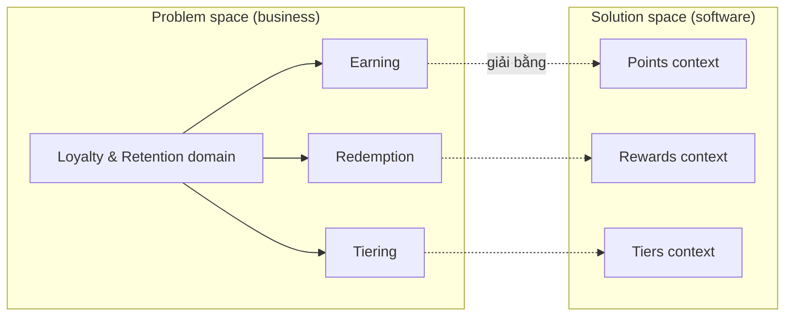

# Chương 2 — Understanding Complexity: Problem and Solution Space

> ⚠️ Tóm tắt khái niệm theo mục lục sách + kiến thức DDD chuẩn — không phải bản dịch nguyên văn. Đọc sách gốc để lấy case study chi tiết. Mọi ví dụ đời sống & Joy Loyalty là ví dụ của mình để minh hoạ, không phải từ sách.

## TL;DR
Trước khi refactor phải hiểu mình đang đối mặt với *loại* phức tạp nào — vì mỗi loại đòi cách xử lý khác nhau. Chương này đưa ra: công cụ phân loại bối cảnh (**[[Glossary - Thuật ngữ#Cynefin|Cynefin]]**), công cụ khám phá domain (**[[Glossary - Thuật ngữ#EventStorming|EventStorming]]**), khung tách **problem space / solution space**, và cảnh báo các **cognitive bias** khiến ta refactor sai hướng. Thông điệp: phần lớn việc domain modeling nằm ở vùng Complex — phải thăm dò bằng thí nghiệm nhỏ, không "phân tích một lần là ra".

## Nội dung chính

### Dealing with complexity

🏪 **Ví dụ đời sống:** Tổ chức một đám cưới. Có những cái khó *bản chất*: mời ai bỏ ai, xếp bàn sao cho hai ông chú từng cãi nhau không ngồi cạnh nhau, chọn ngày hợp cả hai họ — khó kiểu này không cách nào né, chỉ có thể xử lý khéo. Và có những cái khó *tự mình gây ra*: danh sách khách ghi rải rác trong 3 cuốn sổ + 2 file Excel, mỗi bản một kiểu, không bản nào đủ. Cái khó thứ nhất phải chấp nhận sống chung; cái khó thứ hai thì dẹp được — và *nên* dẹp.

Đó chính là hai nguồn phức tạp kinh điển (theo cách phân loại của Fred Brooks):

- **Essential complexity**: phức tạp do bản chất nghiệp vụ — không thể loại bỏ, chỉ có thể quản lý.
  - Joy Loyalty: rule cộng điểm khi 2 campaign chồng nhau (nhân đôi cả hai? lấy max? cộng dồn?), tier downgrade theo chu kỳ 12 tháng, điểm hết hạn theo lô, refund một phần đơn thì trừ điểm thế nào. Dù viết bằng ngôn ngữ gì, kiến trúc gì, các câu hỏi này vẫn phải được trả lời.
- **Accidental complexity**: phức tạp do chính ta tạo ra — abstraction thừa, layer thừa, naming lệch nghiệp vụ, 3 cách gọi Firestore khác nhau trong cùng codebase.
  - Joy Loyalty: cùng một việc "cộng điểm" có 3 đường code (từ webhook, từ admin manual adjust, từ import CSV) với 3 bộ validation hơi khác nhau — sự khác nhau đó không đến từ nghiệp vụ, mà từ lịch sử ai viết lúc nào. Đúng kiểu "3 cuốn sổ khách mời".

Hệ quả cho refactoring:
- Refactoring tốt = **giảm accidental complexity để essential complexity lộ rõ ra**. Sau khi refactor, đọc code phải thấy *rule nghiệp vụ* rõ hơn — nếu chỉ thấy thêm một lớp wrapper "clean" thì là thất bại (dọn nhà mà chỉ là nhét hết đồ vào tủ).
- Không thể "giải" complexity bằng big rewrite — vì rewrite không xoá essential complexity, chỉ tạm giấu nó cho đến khi gặp lại đủ 1000 edge case cũ. Tổ chức lại đám cưới lần hai thì hai ông chú vẫn không ưa nhau.
- Phải hiểu bối cảnh trước khi chọn chiến thuật — đó là lý do cần Cynefin.

### Cynefin framework

🏪 **Ví dụ đời sống — chuyện bếp núc:** Pha mì gói: đọc hướng dẫn sau gói là xong, ai làm cũng ra kết quả giống nhau (**Clear**). Xe máy chết máy giữa đường: mình chịu, nhưng dắt ra thợ thì họ nghe tiếng nổ, phân tích, sửa được — vấn đề khó nhưng *phân tích được nếu có chuyên môn* (**Complicated**). Nuôi con đầu lòng: chẳng cuốn sách nào áp khít con mình, phải thử — bé khóc kiểu này thử bế kiểu kia, quan sát, điều chỉnh; "đáp án" chỉ hiện ra *sau khi* thử (**Complex**). Bếp bùng cháy: không họp bàn nguyên nhân, dập lửa trước đã (**Chaotic**). Còn nửa đêm nghe tiếng động lạ trong nhà chưa rõ là mèo hay trộm: chưa biết mình đang ở tình huống nào — phải xác định đã (**Confusion**).

Cynefin (Dave Snowden) phân loại bối cảnh ra quyết định thành 5 vùng — giá trị của nó là **mỗi vùng đòi một cách hành xử khác nhau**, và áp cách của vùng này lên vùng kia là nguồn thất bại phổ biến:

| Vùng | Nhân–quả | Cách hành xử | Đời sống | Ví dụ Joy Loyalty |
|---|---|---|---|---|
| **Clear** (Obvious) | Hiển nhiên, có best practice | Sense → Categorize → Respond | Pha mì gói | Thêm field vào trang settings, CRUD thuần |
| **Complicated** | Tồn tại nhưng cần chuyên gia phân tích; có *nhiều* good practice | Sense → Analyze → Respond | Sửa xe máy | Tối ưu query Firestore cho leaderboard, thiết kế composite index, chọn chiến lược shard counter |
| **Complex** | Chỉ thấy được *sau khi* làm; phải thí nghiệm | Probe → Sense → Respond | Nuôi con đầu lòng | Thiết kế chương trình tier mới — không ai biết trước member phản ứng thế nào; ship nhỏ sau feature flag, đo, điều chỉnh |
| **Chaotic** | Không nhận diện được; phải hành động ngay | Act → Sense → Respond | Bếp đang cháy | Incident: job cộng điểm chạy double — pause Cloud Scheduler job TRƯỚC, phân tích nguyên nhân SAU |
| **Confusion** (Disorder) | Chưa biết mình ở vùng nào | Tách nhỏ, xếp từng mảnh vào vùng phù hợp | Tiếng động lạ nửa đêm | Ticket mơ hồ "loyalty không hoạt động" — phải bóc tách trước khi làm gì |

Mấy điểm đáng tiền:

- **Phần lớn domain modeling nằm ở vùng Complex.** Không thể "phân tích cho ra" model đúng từ đầu — model đúng *xuất hiện* qua các vòng thử-đo-chỉnh, như cách bố mẹ dần "hiểu" con mình. Đây là nền tảng lý luận cho việc model phải tiến hoá (chương 1) và refactoring là hoạt động liên tục.
- **Bẫy Confusion**: khi không biết mình ở đâu, ta mặc định xử lý theo vùng mình *quen*. Dev quen vùng Complicated nên coi mọi thứ là bài toán phân tích — lao vào thiết kế tier engine trọn gói 3 tuần trên giấy, trong khi vấn đề là Complex và 3 ngày prototype + feedback của merchant beta sẽ dạy nhiều hơn. (Như ông bố kỹ sư lập "bảng quy trình ru ngủ chuẩn" cho em bé — em bé không đọc bảng.)
- **Bẫy trượt từ Clear xuống Chaotic**: hệ thống "đơn giản, chạy ổn bao năm" được tự tin tối đa (không monitoring, không test) — đến khi gãy thì gãy thẳng xuống Chaotic. Như cây cầu khỉ cả làng đi quen mấy chục năm, "có sao đâu" — cho đến hôm nó gãy. Đoạn code cộng điểm "ổn định 2 năm không ai dám đụng" chính là đoạn nguy hiểm nhất.

Bài học cho refactoring: đừng áp "best practice" (tư duy Clear) lên bài toán Complex; với phần lõi domain, thiết kế theo kiểu thăm dò — model nhỏ, feedback nhanh.

### EventStorming

🏪 **Ví dụ đời sống:** Cả nhà chuẩn bị đám cưới, mỗi người giữ một mảnh việc trong đầu: mẹ lo cỗ, bố lo khách, cô dâu lo váy. Một tối, cả nhà dán giấy note lên tường theo dòng thời gian: "đã đặt cỗ", "đã gửi thiệp", "đã thuê xe"... Đến đoạn giữa, hai tờ note đập nhau chan chát: mẹ dán "đã chốt 40 mâm", bố dán "đã mời 60 nhà". Cãi nhau 10 phút ngay tại tường — và *đó chính là giá trị*: phát hiện mâu thuẫn lúc còn dán giấy, rẻ hơn vạn lần phát hiện hôm đãi tiệc.

EventStorming (Alberto Brandolini) chính là phiên bản cho phần mềm: dev + domain expert đứng chung trước một bức tường (hoặc Miro/FigJam) và dán sticky note theo dòng thời gian nghiệp vụ.

- Viên gạch cơ bản: **[[Glossary - Thuật ngữ#Domain event|domain event]]** — sự kiện nghiệp vụ *đã xảy ra*, viết ở **thì quá khứ**: `OrderPlaced`, `PointsEarned`, `RewardRedeemed`, `TierUpgraded`, `PointsExpired`, `CampaignActivated`. Thì quá khứ quan trọng: nó buộc mọi người nói về *sự thật nghiệp vụ* ("đã đặt cỗ") thay vì về chức năng phần mềm ("màn hình X", "API Y").
- Ba mức độ, từ thô đến tinh:
  1. **Big Picture**: quét toàn bộ flow nghiệp vụ bằng event (note cam). Mục tiêu là *coverage* và lộ ra **hotspot** (note tím/đỏ: chỗ mâu thuẫn, chỗ không ai chắc — chỗ "40 mâm vs 60 nhà").
  2. **Process Modeling**: thêm **command** (xanh dương — hành động gây ra event), **actor** (ai ra lệnh), **policy** (tím — "whenever X then Y", phản ứng tự động), **read model** (xanh lá — thông tin actor cần để quyết định).
  3. **Software Design**: gom command + event quanh **[[Glossary - Thuật ngữ#Aggregate|aggregate]]** (vàng) — đầu ra nối thẳng sang tactical design chương 4.
- Giá trị lớn nhất **không phải tấm sơ đồ mà là hội thoại**: chỗ hai người dán hai note mâu thuẫn chính là chỗ [[Glossary - Thuật ngữ#Ubiquitous language|ubiquitous language]] chưa thống nhất.

Walk-through Joy Loyalty (Process Modeling một lát cắt):

```
Actor: Customer đặt hàng trên Shopify
  → Command: (Shopify xử lý) → Event: OrderPlaced  [đến với mình qua webhook orders/create]
  → Policy: "Whenever OrderPlaced, áp earning rules đang active"
  → Command: EarnPoints → Event: PointsEarned
  → Policy: "Whenever PointsEarned, đánh giá điều kiện tier"
  → Command: EvaluateTier → Event: TierUpgraded (nếu đủ điểm)
  → Policy: "Whenever TierUpgraded, gửi email chúc mừng"
```

Ngay lát cắt nhỏ này đã lộ câu hỏi hotspot thực tế: *PointsEarned tính lúc đặt hàng hay lúc đơn fulfilled? Refund thì có event gì — PointsRevoked?* Đó chính là knowledge crunching.

- Với hệ thống cũ cần refactor, EventStorming giúp dựng lại bức tranh nghiệp vụ đang bị chôn trong code — và **các cụm event tách thành "đảo" thường gợi ý ranh giới [[Glossary - Thuật ngữ#Bounded context|bounded context]]** (chương 3): cụm Points, cụm Rewards, cụm Tiers tự nhiên tách nhau trên tường.
- Khi nào không cần: domain nhỏ và mọi người đã đồng thuận sẵn — workshop nửa ngày cho một trang settings là lãng phí (cả nhà họp khẩn cấp để quyết... mua loại nước rửa chén nào).

### Problem and solution space

🏪 **Ví dụ đời sống:** Bệnh nhân bước vào tiệm thuốc: "Bán tôi hộp kháng sinh loại mạnh nhất." Dược sĩ giỏi sẽ hỏi lại: "Anh bị gì đã?" — "Đau đầu ba hôm nay." Hoá ra do mất ngủ vì nhà hàng xóm sửa nhà. Kháng sinh (solution) chẳng liên quan gì đến vấn đề thật (problem). Người ta rất hay *đến gặp mình bằng một giải pháp* — và việc của người thiết kế là hỏi ngược lại về vấn đề.

- **Problem space**: vấn đề business cần giải — "merchant muốn khách quay lại mua nhiều hơn". Gồm domain và các **[[Glossary - Thuật ngữ#Subdomain|subdomain]]** (mảng vấn đề con): earning, redemption, tiering, campaign management, member profile.
- **Solution space**: cách ta giải bằng phần mềm — bounded context, model, service, schema, queue.

Hai lỗi đối xứng nhau:

1. **Nhảy thẳng vào solution space**: nghe yêu cầu xong câu đầu tiên là "thêm field vào collection nào, cần topic Pub/Sub mới không". Joy Loyalty ví dụ: merchant yêu cầu "khách VIP được ưu đãi sinh nhật" — nhảy ngay vào "thêm field `birthday` vào members" trong khi chưa hỏi: VIP là tier hay là segment? Ưu đãi là points hay discount? Sinh nhật theo timezone nào? Một năm được nhận mấy lần?
2. **Ép solution cũ làm khuôn cho problem mới**: codebase hiện tại trở thành "định nghĩa" của nghiệp vụ — cái gì khó nhét vào schema cũ thì coi là "không làm được", dù nghiệp vụ rất hợp lý. Như tiệm may chỉ còn mỗi rập áo cỡ M, nên khẳng định với khách rằng "người anh hơi sai".

Vài nguyên tắc:
- Mapping không nhất thiết 1-1, nhưng lý tưởng là **mỗi bounded context phục vụ gọn một subdomain**.
- Khi refactor: việc đầu tiên là đánh giá lại *độ khớp* giữa solution hiện tại và problem hiện tại — nhiều khi nghiệp vụ đã đổi (vd: từ "điểm theo đơn hàng" sang "điểm theo hành vi: review, follow, referral") mà code vẫn model theo cách hiểu 3 năm trước (mọi thứ xoay quanh order).



### Cognitive biases trong refactoring

Refactoring là chuỗi quyết định dưới sự bất định — và quyết định thì dính thiên kiến. Mỗi bias đều có phiên bản đời thường rất quen:

- **Anchoring bias** (neo vào thông tin đầu tiên). 🏪 Đi chợ, người bán hét 500k — bạn mặc cả "giỏi" xuống 300k và hớn hở, dù món đồ đáng 150k. Con số *đầu tiên* đã đóng cọc cuộc thương lượng. Trong refactoring: cấu trúc collection Firestore hiện tại trở thành "mỏ neo" — hỏi "model points nên thế nào?" mà trong đầu đã mở sẵn `members/{id}` thì câu trả lời đã bị neo.
- **Confirmation bias**. 🏪 Bà mẹ tin con mình ngoan thì cô giáo méc gì cũng nghĩ "chắc bạn kia gây trước" — chỉ thu nhận bằng chứng khớp với niềm tin sẵn có. Trong refactoring: đã quyết "tách Points ra service riêng" thì chỉ thấy lợi ích của tách, bỏ qua feedback support rằng đa số bug nằm ở chỗ khác.
- **Availability bias**. 🏪 Vừa xem tin tai nạn máy bay xong là thấy đi máy bay nguy hiểm hơn đi xe máy — vì hình ảnh máy bay rơi *dễ nhớ hơn*, chứ không phải vì xác suất cao hơn. Trong refactoring: tuần trước vừa cháy incident campaign thì tin rằng campaign là phần phức tạp nhất hệ thống, dồn effort vào đó — trong khi dữ liệu ticket 6 tháng cho thấy tính điểm mới là điểm nóng thật.
- **Sunk cost** (gần với escalation of commitment). 🏪 Phim dở tệ nhưng "lỡ mua vé rồi" nên ngồi chịu trận hết 2 tiếng — mất thêm 2 tiếng để "gỡ" số tiền không bao giờ quay lại. Trong refactoring: "đã viết abstraction này 2 tuần rồi, phải dùng cho bằng được" — dù bằng chứng cho thấy nó sai hướng.

Thuốc giải:
- **Làm việc nhóm có cấu trúc** — EventStorming chính là cơ chế ép nhiều góc nhìn va nhau công khai, khó giấu thiên kiến cá nhân.
- **Chủ động tìm bằng chứng phản bác** thiết kế mình thích (hỏi: "nếu thiết kế này sai, dấu hiệu đầu tiên sẽ là gì?").
- **Quyết định trên dữ liệu thay vì ký ức**: thống kê ticket/incident theo module trước khi chọn vùng refactor.

## Sai lầm thường gặp

- **Xử lý bài toán Complex bằng tư duy Complicated**: thiết kế "đúng một lần" trên giấy cho phần domain chưa ai hiểu rõ, thay vì prototype nhỏ + feedback — kết quả là model rất chi tiết và rất sai. (Bảng quy trình ru ngủ chuẩn — em bé không đọc bảng.)
- **EventStorming chỉ có dev tham gia**: không có domain expert (PM/support/merchant) thì workshop chỉ là dev vẽ lại code lên tường — như họp gia đình bàn đám cưới mà cô dâu chú rể vắng mặt. Mất luôn giá trị chính (hội thoại va chạm).
- **Coi tấm sơ đồ EventStorming là deliverable**: ép board "đầy đủ, đẹp, đóng băng" rồi cất vào Notion — sơ đồ là phụ phẩm, hiểu biết chung mới là sản phẩm. Như giữ khư khư tấm ảnh chụp bảng kế hoạch nhưng chẳng ai nhớ đã thống nhất gì.
- **Đặt tên event theo kỹ thuật thay vì nghiệp vụ**: `MemberDocUpdated`, `WebhookReceived` không phải domain event; `PointsEarned`, `TierUpgraded` mới là. (Không ai dán note "đã nhận cuộc gọi" lên tường đám cưới — người ta dán "đã chốt cỗ".)
- **Chọn vùng refactor theo ký ức incident gần nhất** (availability bias) thay vì theo dữ liệu ticket/độ quan trọng của subdomain.

## Thuật ngữ cần nhớ
| Thuật ngữ | Nghĩa là gì (1 câu) |
|---|---|
| Essential complexity | Phức tạp do bản chất nghiệp vụ — không xoá được, chỉ quản lý được ("xếp bàn hai ông chú") |
| Accidental complexity | Phức tạp do cách ta build (abstraction thừa, naming lệch) — mục tiêu của refactoring ("3 cuốn sổ khách mời") |
| Cynefin | Framework 5 vùng (Clear, Complicated, Complex, Chaotic, Confusion) để chọn cách ra quyết định theo bối cảnh |
| Probe → Sense → Respond | Cách hành xử vùng Complex: thí nghiệm nhỏ → quan sát → điều chỉnh |
| EventStorming | Workshop dán sticky note theo dòng domain event để dev + business cùng khám phá nghiệp vụ |
| Big Picture / Process Modeling / Software Design | Ba mức EventStorming: quét toàn cảnh / thêm command-policy-read model / gom quanh aggregate |
| Domain event | Sự kiện nghiệp vụ đã xảy ra, đặt tên thì quá khứ (`PointsEarned`) |
| Command | Hành động/ý định gây ra event (`EarnPoints`) — note xanh dương trong EventStorming |
| Policy | Quy tắc phản ứng tự động "whenever event X then command Y" — note tím |
| Hotspot | Điểm nóng trên board: mâu thuẫn hiểu biết, câu hỏi chưa ai trả lời được |
| Problem space / Solution space | Vấn đề business cần giải / cách giải bằng phần mềm |
| Subdomain | Mảng vấn đề con trong domain (earning, redemption, tiering...) |
| Anchoring bias | Neo quyết định vào thông tin có sẵn đầu tiên (giá hét đầu tiên ở chợ; schema hiện tại) |
| Confirmation bias | Chỉ tìm bằng chứng ủng hộ phương án mình đã thích |
| Availability bias | Đánh giá tầm quan trọng theo thứ dễ nhớ (tin tai nạn máy bay; incident gần nhất) |

## Áp dụng cho mình (Joy Loyalty)
- Chạy một buổi **EventStorming Big Picture** với PM + support (bắt buộc có người không phải dev): timeline từ `OrderPlaced` → `PointsEarned` → `TierUpgraded` → `RewardRedeemed` → `PointsExpired`; hotspot lộ ra là danh sách ưu tiên refactor thực tế hơn cảm tính. Câu hỏi mồi tốt: "refund thì sao?", "điểm hết hạn thì sao?", "đơn POS thì sao?".
- Trước mỗi quyết định refactor lớn, dán nhãn Cynefin: Clear/Complicated → cứ phân tích và làm; Complex (vd: redesign tier engine) → bản nhỏ sau feature flag cho vài merchant beta, đo rồi mới mở rộng.
- Chống anchoring với schema Firestore: model domain trên giấy/board **trước**, quyết định persistence **sau** — đừng để collection cũ quyết định model mới.
- Trước khi chọn vùng refactor quý này: export ticket support 6 tháng, đếm theo module — quyết định bằng số, không bằng ký ức incident.
