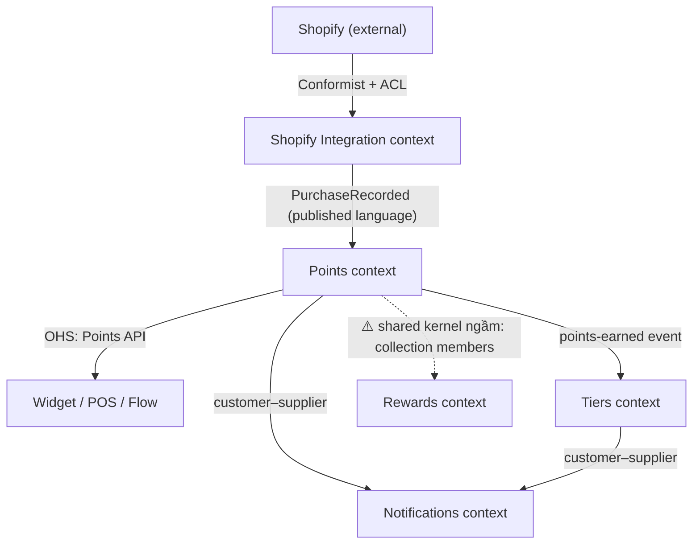

# Chương 3 — Strategic Patterns

> ⚠️ Tóm tắt khái niệm theo mục lục sách + kiến thức DDD chuẩn — không phải bản dịch nguyên văn. Đọc sách gốc để lấy case study chi tiết. Mọi ví dụ đời sống & Joy Loyalty là ví dụ của mình để minh hoạ, không phải từ sách.

## TL;DR
Strategic design trả lời câu hỏi "chia hệ thống lớn thành các phần thế nào và các phần nói chuyện với nhau ra sao". Công cụ chính: **bounded context** (ranh giới của một model + ngôn ngữ), **subdomain types** (core/supporting/generic — để biết đầu tư effort vào đâu), và **context mapping** với 7 pattern quan hệ giữa các context. Tinh thần chung: *không cố xây một model duy nhất cho cả công ty* — chấp nhận nhiều model nhỏ, mỗi cái nhất quán trong ranh giới của nó, và thiết kế có chủ đích cách chúng nói chuyện.

## Nội dung chính

### Bounded contexts và việc chia domain

🏪 **Ví dụ đời sống:** Quán phở có một vị khách tên Hùng. Với **bà chủ đứng quầy**, "khách quen" nghĩa là: nhớ mặt, nhớ khẩu vị ("chú Hùng tái nạm, không hành, thêm quẩy"), thấy là chào. Với **kế toán của quán**, "khách quen" lại là: mã KH-0042, ăn ghi sổ, công nợ 850k, cuối tháng chốt. Cùng một con người — nhưng hai "model" hoàn toàn khác nhau, mỗi model đúng và đủ *cho công việc của người dùng nó*. Và quan trọng nhất: **không ai cố ép hai cuốn sổ thành một**. Bà chủ không cần biết công nợ để chan nước dùng; kế toán không cần biết "không hành" để chốt sổ. Nếu có ai đó "tối ưu" bằng cách gộp thành một cuốn sổ chung ghi đủ mọi thứ — cả hai người đều khổ.

Trong code, mỗi "cuốn sổ" đó là một **bounded context**:

- **Bounded context** = ranh giới (thường là ranh giới team/codebase/module/service) mà bên trong đó một model và một ubiquitous language có nghĩa nhất quán. Ra khỏi ranh giới, cùng một từ có thể mang nghĩa khác — và *điều đó không sao cả*, miễn là ranh giới rõ.
- Ví dụ Joy Loyalty: từ "member" trong context **Points** là *chủ thể có balance và lịch sử giao dịch điểm*; trong context **Tiers** là *người có hạng và tiến độ lên hạng*; trong context **Notifications** chỉ là *người nhận email với locale*. Cố nhét cả ba vào một class `Member` khổng lồ → God object — đúng cái "cuốn sổ chung" làm khổ cả bà chủ lẫn kế toán. Đây chính là bệnh của layered architecture một-model-cho-tất-cả.
- Dấu hiệu nhận diện ranh giới:
  - Cùng một từ **đổi nghĩa khi đổi cuộc hội thoại** ("khách quen" của bà chủ ≠ "khách quen" của kế toán; "reward" với merchant ≠ "reward" với team billing).
  - Cụm event trong EventStorming tách thành các **"đảo"** trên tường (chương 2).
  - Nhóm tính năng **thay đổi vì lý do khác nhau, nhịp khác nhau** — rule tính điểm đổi mỗi khi merchant nghĩ ra campaign mới, còn template email đổi theo mùa marketing.
- Bounded context là khái niệm *thiết kế*, không bắt buộc là microservice — một codebase Cloud Run monolith vẫn có thể chia context rõ ràng bằng module/folder. Hai cuốn sổ của quán phở vẫn nằm chung một quán; quan trọng là *hai cuốn riêng*, không phải hai toà nhà riêng.

### Subdomain types

🏪 **Ví dụ đời sống:** Vẫn quán phở đó. **Nồi nước dùng** là thứ khiến khách xếp hàng — công thức gia truyền, bà chủ tự tay nấu, ai xin cũng không chỉ. **Chỗ ngồi, menu in, chỗ giữ xe** — cần có và phải tươm tất, nhưng khách không quay lại "vì cái menu đẹp"; làm vừa đủ là được. **Điện, nước, wifi** — thiết yếu nhưng chẳng quán nào tự kéo điện riêng; mua của nhà cung cấp như mọi nhà. Sai lầm chí mạng: dồn tiền lát đá hoa cương chỗ giữ xe trong khi nước dùng nêm bằng gói gia vị công nghiệp.

Trong domain cũng vậy — không phải phần nào cũng đáng đầu tư như nhau:

- **Core domain**: thứ làm business thắng đối thủ — phải tự build, dồn người giỏi nhất, áp dụng DDD đầy đủ. Với Joy Loyalty: **engine tính điểm + rule đổi thưởng + cơ chế tier** — đây là "nồi nước dùng", lý do merchant chọn Joy thay vì app khác.
- **Supporting subdomain**: cần thiết nhưng không tạo khác biệt cạnh tranh — build vừa đủ, đơn giản, đừng cầu kỳ. Vd: quản lý branding email, cấu hình widget.
- **Generic subdomain**: bài toán ai cũng có, mua/dùng sẵn là tốt nhất. Vd: gửi email (SendGrid), auth (Shopify OAuth), billing (Shopify Billing API) — "điện nước wifi" của app.
- Sai lầm phổ biến: dồn effort kiến trúc cầu kỳ vào supporting/generic (tự viết email queue xịn) trong khi core (rule engine cộng điểm) vẫn là đống if-else trong service — lát đá chỗ giữ xe, bỏ bê nồi nước dùng.
- Lưu ý: phân loại này **thay đổi theo thời gian và theo công ty**. Với Joy, "gửi notification đa kênh" là supporting; với một công ty làm app push notification, nó là core. Và nếu mai kia thị trường loyalty cạnh tranh bằng analytics, analytics có thể được "thăng hạng" lên core.

### Context mapping

🏪 **Ví dụ đời sống:** Trong bệnh viện, mỗi khoa có "ngôn ngữ" và sổ sách riêng: khoa khám, khoa xét nghiệm, khoa dược, phòng tài vụ. Nhưng bệnh nhân thì đi xuyên qua tất cả. Vậy phải có *quy ước giữa các khoa*: khoa khám ghi chỉ định theo mẫu nào để khoa xét nghiệm đọc được, kết quả trả về theo format nào, và — phần tế nhị — **khoa nào có tiếng nói hơn khoa nào** khi muốn đổi mẫu phiếu. Vẽ ra được tấm bản đồ "khoa nào nói chuyện với khoa nào, theo luật gì, ai phải chiều ai" — đó là context map.

- **Context map** = bản đồ các bounded context và *quan hệ* giữa chúng — bao gồm cả **quan hệ quyền lực giữa các team** (ai phải theo ai khi model thay đổi). Đây là điểm hay bị bỏ sót: context map không chỉ là sơ đồ kỹ thuật, nó là sơ đồ *chính trị* — upstream/downstream là chuyện ai đổi trước, ai phải chạy theo.
- Với hệ thống legacy, vẽ context map của *hiện trạng* (as-is) là bước đầu của refactoring: lộ ra chỗ nào hai context dính nhau qua shared database, chỗ nào một context đang "nuốt" model của context khác.
- Map không tĩnh — khi refactor, ta chủ động dịch chuyển quan hệ (vd: từ shared kernel sang ACL) để gỡ coupling dần.



### Các communication patterns giữa context

Bảy pattern, xếp đại khái từ "dính nhau nhất" đến "rời nhau nhất". Mỗi pattern là một kiểu *quan hệ hàng xóm* rất đời:

**1. Shared kernel** — hai context dùng chung một phần model/code.

🏪 Hai chị em thuê chung nhà, **dùng chung một tủ lạnh**. Tiện và rẻ lúc đầu. Nhưng rồi: chị muốn dọn ngăn đá, phải hỏi em; em mua đồ chất kín, chị hết chỗ. Mọi thay đổi với cái tủ đều cần *cả hai đồng ý* — càng ngày càng mệt.

Trong code: sửa kernel là phải đồng thuận cả hai team. Vd hiện trạng Joy: nhiều module cùng đọc-ghi thẳng collection `members` trên Firestore = **shared kernel ngầm** — dạng nguy hiểm nhất vì share qua database, chẳng có hợp đồng nào, đổi một field là gãy module khác lúc nào không hay.

**2. Customer–supplier** — upstream cung cấp, downstream tiêu thụ, và *downstream có tiếng nói*.

🏪 Quán phở đặt bánh phở mỗi sáng từ **lò bánh quen**. Quán là khách sộp nên có quyền yêu cầu: "mai giao sớm 30 phút, sợi to hơn chút". Lò bánh (supplier) phải cân nhắc nhu cầu của quán (customer) khi thay đổi — vì mất khách là mất tiền.

Trong code: team Points (upstream) cam kết format event `PointsEarned` với team Notifications (downstream); Notifications cần thêm field `locale` thì Points đưa vào backlog tử tế.

**3. Conformist** — downstream dùng nguyên model của upstream, không có quyền đòi hỏi.

🏪 Dân chung cư với **lịch cắt nước của ban quản lý**: thông báo dán thang máy "thứ 5 cắt nước từ 9h-15h" — không ai thương lượng được, chỉ có hứng nước trữ sẵn và sắp xếp đời mình theo lịch của họ.

Trong code: app của mình với **Shopify Admin API** — Shopify đổi gì mình theo nấy, model order/customer của Shopify là luật, API version deprecate là mình phải migrate. Chấp nhận làm conformist với Shopify là quyết định đúng (không có lựa chọn khác) — nhưng đừng để sự "chiều theo" đó lan sâu vào core. Dẫn tới pattern tiếp theo:

**4. Anticorruption layer (ACL)** — lớp dịch ở rìa downstream, chuyển model bên ngoài thành model nội bộ.

🏪 Vị giám đốc có một **trợ lý chuyên lọc thư từ**: thư chào hàng, công văn, email khách — trợ lý đọc hết, tóm tắt lại theo đúng "ngôn ngữ làm việc" của giám đốc, lọc rác, chuẩn hoá format. Giám đốc không bao giờ phải tự đọc 50 kiểu văn phong của 50 đối tác. Đối tác đổi mẫu công văn? Chỉ trợ lý phải học lại — giám đốc không biết, không cần biết.

Trong code: webhook `orders/create` của Shopify đi qua một translator chuyển payload Shopify → `PurchaseRecorded` (ngôn ngữ loyalty nội bộ); core engine không bao giờ thấy JSON Shopify thô:

```js
// acl/shopify-order-translator.js — "trợ lý" đứng ở rìa, dịch Shopify-ese sang loyalty-ese
function toPurchaseRecorded(shopifyOrder) {
  return {
    type: 'PurchaseRecorded',
    memberRef: String(shopifyOrder.customer?.id ?? ''),
    amount: Math.round(parseFloat(shopifyOrder.total_price) * 100), // cents
    currency: shopifyOrder.currency,
    occurredAt: shopifyOrder.created_at,
    channel: shopifyOrder.source_name || 'online_store',
  };
}
// Core chỉ biết PurchaseRecorded. Mai Shopify đổi payload → chỉ sửa file này.
```

**5. Open host service (OHS)** — upstream mở một API/protocol công khai, ổn định, phục vụ *nhiều* downstream thay vì thoả thuận riêng từng cặp.

🏪 **Bưu điện** không thương lượng riêng với từng người gửi hàng. Họ công bố một bộ luật chung: mẫu phiếu gửi, khung giờ, bảng giá, quy cách đóng gói — ai theo đúng thì được phục vụ, một triệu khách như một.

Trong code: Points context expose một Points API chuẩn cho widget, POS extension, Shopify Flow — một contract, nhiều consumer, thay vì mỗi consumer một deal riêng.

**6. Published language** — ngôn ngữ trao đổi chung được tài liệu hoá rõ.

🏪 Chính là **mẫu phiếu gửi của bưu điện** ở trên: in sẵn, công khai, ai cũng điền giống nhau. Trong code: JSON schema của event, OpenAPI spec — thường đi kèm OHS. Vd: schema của event `member.points-earned.v1` được viết ra giấy trắng mực đen, version rõ ràng.

**7. Separate ways** — hai context không tích hợp gì cả.

🏪 Hai quán ăn cạnh nhau cùng cần rau thơm. Có nên xây "hệ thống mua rau chung" không? Không — **mỗi quán tự đi chợ**, mỗi sáng tốn thêm 15 phút nhưng khỏi phải họp hành phối hợp gì với nhà bên. Duplicate một ít còn rẻ hơn chi phí tích hợp.

Trong code: module analytics nội bộ tự đếm số liệu riêng thay vì phụ thuộc real-time vào Points context — chấp nhận số liệu trễ/lệch chút, đổi lấy độc lập hoàn toàn.

**Chọn pattern nào?** Câu hỏi định hướng: (1) Hai bên có *cùng team* không? — shared kernel chỉ tạm chấp nhận được khi cùng team. (2) Mình có *quyền thương lượng* với upstream không? — có thì customer–supplier, không thì conformist + ACL. (3) Có *nhiều* downstream không? — có thì OHS + published language thay vì n thoả thuận riêng. (4) Chi phí tích hợp có *đáng* không? — không thì separate ways, đừng ngại duplicate.

Bảng tra nhanh:

| Pattern | Độ dính (coupling) | Khi nào hợp lý | Hình ảnh |
|---|---|---|---|
| Shared kernel | Rất cao | Cùng team, phần model thật sự chung, tạm thời | Tủ lạnh chung |
| Customer–supplier | Cao | Mình có quyền thương lượng với upstream | Quán phở & lò bánh |
| Conformist | Cao (một chiều) | Upstream quá lớn để thương lượng (Shopify) | Lịch cắt nước chung cư |
| ACL | Trung bình | Luôn nên có khi nhận model từ hệ ngoài/legacy | Trợ lý lọc thư |
| OHS | Thấp | Một upstream phục vụ nhiều downstream | Bưu điện |
| Published language | Thấp | Đi kèm OHS / event liên context | Mẫu phiếu gửi |
| Separate ways | Không | Chi phí tích hợp > giá trị tích hợp | Mỗi quán tự đi chợ |

## Sai lầm thường gặp

- **One model to rule them all**: cố xây một class `Member`/`Order` "chuẩn toàn công ty" dùng chung mọi nơi — chính là ép bà chủ quán và kế toán ghi chung một cuốn sổ. Kết quả: God object, mọi team đều phải họp khi đổi một field.
- **Đánh đồng bounded context với microservice**: vừa học DDD xong là đòi tách 7 service. Ranh giới *logic* (module, folder, quy ước import) phải có trước; tách process/service là quyết định *vận hành* đến sau, khi có nhu cầu scale/deploy độc lập thật.
- **Shared database giữa các context**: hai module cùng đọc-ghi collection `members` mà không qua interface nào — shared kernel ngầm, dạng coupling khó gỡ nhất vì nó vô hình (không có import nào để grep ra).
- **Không có ACL với hệ ngoài**: payload Shopify thô chảy thẳng vào core, field `total_price`, `line_items` xuất hiện trong rule tính điểm — giám đốc tự đọc 50 kiểu công văn. Đến khi Shopify đổi API version, cả core phải mổ ra sửa.
- **Đầu tư ngược độ quan trọng**: kiến trúc event-driven tinh xảo cho phần gửi email (supporting), trong khi rule engine tính điểm (core) là if-else 800 dòng — lát đá hoa cương chỗ giữ xe, nêm nước dùng bằng gói gia vị.

## Thuật ngữ cần nhớ
| Thuật ngữ | Nghĩa là gì (1 câu) |
|---|---|
| Bounded context | Ranh giới mà trong đó một model + ngôn ngữ có nghĩa nhất quán ("cuốn sổ" của bà chủ ≠ của kế toán) |
| Core / Supporting / Generic subdomain | Nồi nước dùng / chỗ ngồi-menu / điện-nước-wifi: tự build kỹ / build vừa đủ / mua sẵn |
| Context map | Bản đồ các context và quan hệ (kỹ thuật + quyền lực team) giữa chúng |
| Upstream / Downstream | Bên cung cấp model-dữ liệu / bên tiêu thụ — upstream đổi thì downstream chịu ảnh hưởng |
| Shared kernel | Hai context share chung một phần model/code ("tủ lạnh chung") |
| Customer–supplier | Quan hệ upstream/downstream trong đó downstream có tiếng nói ("quán phở & lò bánh") |
| Conformist | Downstream chấp nhận nguyên model upstream, không thương lượng ("lịch cắt nước chung cư"; mình với Shopify) |
| Anticorruption layer (ACL) | Lớp dịch model bên ngoài sang model nội bộ để bảo vệ core ("trợ lý lọc thư") |
| Open host service (OHS) | API mở chuẩn hoá phục vụ nhiều consumer ("bưu điện") |
| Published language | Ngôn ngữ trao đổi được tài liệu hoá rõ — JSON schema, OpenAPI ("mẫu phiếu gửi") |
| Separate ways | Cố tình không tích hợp, chấp nhận duplicate ("mỗi quán tự đi chợ") |

## Áp dụng cho mình (Joy Loyalty)
- Vẽ **context map hiện trạng** của app: ứng viên context — Points, Rewards/Redemption, Tiers, Campaigns, Members/Profile, Notifications, Shopify Integration. Đánh dấu đỏ chỗ nào đang share collection Firestore = shared kernel ngầm cần gỡ dần.
- Đặt **ACL cho mọi đầu vào từ Shopify** (webhooks, Admin API): một layer translator riêng (`acl/` folder), core không import trực tiếp payload Shopify. Đây là bước refactor ít rủi ro nhất, làm được ngay tuần này — và là tấm khiên khi Shopify deprecate API version.
- Xếp loại subdomain để phân bổ effort: points/rewards/tiers engine = core (DDD đầy đủ, dồn người giỏi); email/notification = supporting (vừa đủ); auth/billing = generic (dựa hẳn Shopify).
- Không cần tách microservice để có bounded context — bắt đầu bằng tách folder/module theo context trong monolith Cloud Run, đặt quy ước: **cấm import chéo giữa context ngoài interface công khai** (export một file `index.js` mỗi context, review chặt import lậu).
- Khi Points context bắt đầu phục vụ widget + POS + Flow: chuyển từ thoả thuận lẻ tẻ sang **OHS + published language** — một Points API có version, một bộ event schema viết ra rõ ràng.
