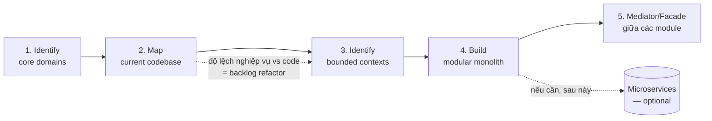

# Chương 6 — Transitioning from Chaos

> ⚠️ Tóm tắt khái niệm theo mục lục sách + kiến thức DDD chuẩn — không phải bản dịch nguyên văn. Đọc sách gốc để lấy case study chi tiết. Ví dụ đời sống & Joy Loyalty là ví dụ của mình, không phải từ sách.

## TL;DR
Chương cốt lõi cho người đang ngồi trên một layered monolith rối: **làm sao đi từ "[[Glossary - Thuật ngữ#Big ball of mud|big ball of mud]]" sang kiến trúc có chủ đích mà không dừng ship feature?** Câu trả lời gói trong một lộ trình: tìm [[Glossary - Thuật ngữ#Subdomain|core domain]] (biết chỗ nào đáng đầu tư) → vẽ bản đồ code hiện tại (biết mình đang đứng đâu) → khoanh [[Glossary - Thuật ngữ#Bounded context|bounded context]] (vẽ ranh giới theo nghiệp vụ, không theo layer) → tổ chức lại thành **[[Glossary - Thuật ngữ#Modular monolith|modular monolith]]** (chưa cần microservices) → cho các module nói chuyện có kỷ luật qua facade/mediator. Tinh thần xuyên suốt: như **sửa nhà đang ở** — từng phòng một, cả nhà vẫn sinh hoạt bình thường.

## Nội dung chính

Lộ trình tổng thể của chương — mỗi bước là input cho bước sau:



### Identifying core domains — tìm "vùng đất vàng"

🏪 **Ví dụ đời sống:** một quán phở nổi tiếng nhờ **nồi nước dùng gia truyền** — đó là thứ khách xếp hàng vì nó, ông chủ canh lửa tự tay, công thức giấu kỹ. Còn giữ xe, rửa chén, in hoá đơn? Quan trọng đấy, nhưng thuê dịch vụ ngoài hay làm "đủ dùng" là được. Sẽ rất dại nếu ông chủ dành cả ngày đi tối ưu chỗ để xe trong khi nước dùng nhạt dần.

Trong code, cái này chính là cách DDD chia domain thành 3 loại:
- **Core domain**: thứ làm business thắng — đáng đầu tư thiết kế kỹ nhất, dev giỏi nhất ngồi đây.
- **Supporting subdomain**: cần thiết nhưng không tạo lợi thế cạnh tranh — làm đủ sạch là được.
- **Generic subdomain**: ai cũng có, nên mua/dùng thư viện/dịch vụ thay vì tự viết.

Hai câu hỏi để nhận diện core: *"nếu phần này tốt hơn đối thủ thì merchant chọn mình?"* và *"phần nào business yêu cầu đổi thường xuyên nhất?"*

Map sang Joy Loyalty:

| Loại | Phần nào | Vì sao |
|---|---|---|
| **Core** | Points engine (rule cộng/trừ điểm, campaigns, tiers) | Lý do merchant trả tiền; logic phức tạp, đổi liên tục |
| Supporting | Rewards redemption (tạo discount code qua Shopify API), member profile, notification trigger | Cần có nhưng app loyalty nào cũng tương tự |
| Generic | Gửi email (SendGrid/ESP), auth (Shopify OAuth), billing (Shopify Billing API) | Mua/dùng sẵn, đừng tự viết |

Hệ quả thực dụng: dồn effort refactoring + DDD tactical patterns vào core; supporting/generic chỉ cần "đủ sạch", thậm chí giữ nguyên kiểu CRUD. Refactor cũng có ngân sách — tiêu vào chỗ sinh lời.

### Mapping current codebases — vẽ bản đồ đống code hiện tại

🏪 **Ví dụ đời sống:** dọn cái nhà kho 10 năm không ai dọn, việc đầu tiên KHÔNG phải là khuân đồ — mà là đi một vòng **ghi ra giấy**: góc này toàn đồ điện, góc kia đồ của bà nội để nhờ, thùng giữa nhà thì tuần nào cũng có người vào lục (chứng tỏ đồ trong đó đang dùng nhiều). Có bản đồ rồi mới biết dọn từ đâu, cái gì đụng vào là cả chồng đổ.

Trong code, cái này chính là bước khảo sát trước khi tái cấu trúc, với các kỹ thuật chuẩn:
- **Dependency graph**: vẽ module nào import module nào — trong layered app thường lộ ra các "god module" (`utils`, `helpers`, `models`) mà mọi thứ đều phụ thuộc, như cái cột giữa nhà kho mà chồng đồ nào cũng tựa vào. Tool JS: `dependency-cruiser`, `madge`.
- **Hotspot analysis**: dùng git history tìm file vừa **đổi thường xuyên** vừa **phức tạp** — đó là nơi refactoring có ROI cao nhất ("thùng đồ tuần nào cũng có người lục"):

```bash
# Top file bị sửa nhiều nhất trong 12 tháng — hotspot thô
git log --since="12 months ago" --format='' --name-only \
  | grep -v '^$' | sort | uniq -c | sort -rn | head -20
```

- **[[Glossary - Thuật ngữ#EventStorming|Event Storming]] / Domain Storytelling**: cùng team (kể cả non-dev) dán sticky note các **[[Glossary - Thuật ngữ#Domain event|domain event]]** theo dòng thời gian ("Order created" → "Points earned" → "Tier upgraded" → "Reward redeemed") để lộ ra ranh giới nghiệp vụ thật, độc lập với cấu trúc code hiện tại. Giống cả nhà ngồi kể lại "một ngày của cái kho này được dùng như thế nào" — người kể chuyện không quan tâm đồ nằm góc nào, chỉ kể chuyện gì xảy ra theo thứ tự nào.
- Điểm mấu chốt: bản đồ nghiệp vụ (từ event storming) và bản đồ code (từ dependency graph) thường **lệch nhau** — độ lệch đó chính là danh sách việc cần refactor. Nghiệp vụ nói "earning và redemption là hai câu chuyện khác nhau", code nói "tất cả nằm trong `orderService.js` 2000 dòng" → đó là việc phải làm.

### Identifying bounded contexts — khoanh ranh giới ngữ cảnh

🏪 **Ví dụ đời sống:** trong một bệnh viện, từ **"hồ sơ" của cùng một con người** mang nghĩa khác nhau ở từng khoa: với phòng tài chính là công nợ và bảo hiểm; với bác sĩ điều trị là bệnh án và đơn thuốc; với bếp ăn là suất ăn kiêng gì. Không ai dại gì bắt cả ba bộ phận dùng chung MỘT tờ hồ sơ khổng lồ có đủ mọi thứ — mỗi khoa giữ hồ sơ riêng theo nhu cầu của mình, chỉ chia sẻ **mã bệnh nhân**. Và đó là điều bình thường, không phải "dữ liệu trùng lặp xấu xí".

Trong code, cái này chính là **bounded context (BC)** = ranh giới mà trong đó một model và một **[[Glossary - Thuật ngữ#Ubiquitous language|ubiquitous language]]** (ngôn ngữ chung giữa dev và business) nhất quán. Cùng một từ ở hai context có thể mang nghĩa khác nhau — đừng cố ép một model dùng chung.

- Ví dụ Joy Loyalty: "**Member**" trong context *Loyalty* là người có balance điểm + tier; "**Customer**" trong context *Shopify Sync* là bản ghi đồng bộ từ Shopify (email, tags, orders count). Layered app hay nhét hết vào một `customer model` to đùng — tách ra mỗi context giữ model riêng, chỉ chia sẻ ID.
- Ba dấu hiệu tìm ranh giới:
  1. Chỗ nào **ngôn ngữ đổi nghĩa** (cùng từ "campaign", marketing hiểu khác dev points).
  2. Chỗ nào **người care khác nhau** (rule điểm là product, billing là finance).
  3. Chỗ nào **dữ liệu đổi theo nhịp khác nhau** (settings đổi vài lần/tháng, transactions ghi nghìn lần/ngày).
- Với Joy Loyalty có thể phác draft: `Points & Earning`, `Rewards & Redemption`, `Tiers`, `Campaigns`, `Shopify Integration`, `Merchant Settings/Billing`.
- **[[Glossary - Thuật ngữ#Context mapping|Context map]]**: tài liệu mô tả các BC và quan hệ giữa chúng — ai upstream/downstream, ai phải conform theo ai, chỗ nào cần **anti-corruption layer (ACL)** — lớp dịch model bên ngoài sang model của mình. ACL giống **phiên dịch viên ở cửa khẩu**: đoàn khách nước ngoài (payload Shopify) nói gì cũng phải qua phiên dịch chuyển thành ngôn ngữ nội bộ, để cách nói của họ không lây lan vào tài liệu của mình:

```js
// modules/shopify-sync/translator.js — ACL: nơi DUY NHẤT hiểu shape Shopify
function toOrderPlacedEvent(shopifyOrder) {
  return {
    type: 'order.placed',
    shopId: shopifyOrder.shop_id,
    orderId: String(shopifyOrder.id),
    customerId: String(shopifyOrder.customer?.id || ''),
    subtotal: Number(shopifyOrder.subtotal_price), // string → number, một lần, ở đây
    currency: shopifyOrder.currency,
    placedAt: shopifyOrder.created_at,
  };
}
// Core points engine chỉ biết `order.placed` — Shopify đổi API version,
// chỉ file này phải sửa.
```

### Building modular monoliths — monolith có phòng ốc, bước đệm an toàn

🏪 **Ví dụ đời sống:** so sánh hai căn nhà cùng diện tích. Căn studio không vách ngăn: nấu ăn ám mùi vào giường, khách đến chơi nhìn thấy cả đống đồ chưa giặt — mọi thứ "dính" vào nhau. Căn còn lại chia phòng có cửa: vẫn là MỘT căn nhà (một hợp đồng điện nước, một địa chỉ), nhưng bếp ra bếp, ngủ ra ngủ; muốn sửa phòng tắm không phải dọn giường. Và nếu sau này cần, một phòng có thể ngăn ra cho thuê riêng — vì tường đã có sẵn. **Modular monolith là căn nhà chia phòng; microservices là tách hẳn ra mấy căn nhà — kèm chi phí mỗi căn một đồng hồ điện nước riêng.**

Trong code, cái này chính là: một deployable duy nhất (một Cloud Run service) nhưng bên trong chia module theo **bounded context**, không phải theo layer kỹ thuật.

So sánh cấu trúc thư mục trước/sau cho Joy Loyalty:

```text
# Layered (hiện tại)                # Modular (đích)
src/                                src/
  controllers/                        modules/
    orderController.js                  points/
    rewardController.js                   index.js        # public API — cổng duy nhất
    tierController.js                     domain/
  services/                                 calculator.js # logic thuần, không Firestore
    orderService.js   # 2000 dòng           rules.js
    pointService.js                       infra/
    rewardService.js                        pointRepo.js   # Firestore ở đây
    tierService.js                        http/
  models/                                   webhookHandler.js
    customer.js       # god model       rewards/
  utils/              # god module        index.js
    helpers.js                            domain/  infra/  http/
                                        tiers/
                                          index.js
                                          domain/  infra/
                                        shopify-sync/
                                          index.js
                                          translator.js   # ACL
                                      shared-kernel/      # càng ít càng tốt
                                        events.js  ids.js
```

- **Quy tắc vàng**: module chỉ được gọi nhau qua **public API** (`index.js` export có chủ đích); cấm import sâu vào `domain/` hay `infra/` của module khác. Giống quy ước "muốn lấy đồ phòng người khác thì gõ cửa, không tự ý mở tủ".
- JS không có enforcement sẵn → chặn bằng máy với ESLint, không bằng kỷ luật miệng:

```js
// .eslintrc.cjs — chặn import xuyên ruột module khác
module.exports = {
  rules: {
    'no-restricted-imports': ['error', {
      patterns: [
        {
          group: ['**/modules/*/domain/*', '**/modules/*/infra/*'],
          message: 'Chỉ được import qua public API của module (modules/<tên>/index.js)',
        },
      ],
    }],
  },
};
// Mạnh tay hơn: dùng dependency-cruiser để assert cả chiều dependency
// (vd: shared-kernel không được import từ bất kỳ module nào).
```

- Vì sao là bước đệm tốt thay vì nhảy thẳng microservices: vẫn một deploy, một Firestore transaction context, không network latency, không distributed failure, không bài toán versioning API giữa service — nhưng ranh giới đã sạch. Nếu sau này một module cần scale riêng, ranh giới có sẵn để tách; nếu không cần, **modular monolith là đích đến hợp lệ**, không phải trạm trung chuyển bắt buộc. Đa số app cỡ Joy Loyalty dừng ở đây là tối ưu.

#### Lộ trình strangler fig cho module đầu tiên (ví dụ: `tiers`)

🏪 **Ví dụ đời sống:** cây đa ([[Glossary - Thuật ngữ#Strangler fig pattern|strangler fig]]) không đốn cây chủ — nó mọc bám quanh, rễ lan dần, đến lúc tự đứng được thì cây chủ bên trong tự lụi đi. Áp vào sửa nhà: xây phòng mới bên cạnh, chuyển đồ sang dần dần, ở ổn rồi mới phá phòng cũ — không có đêm nào phải ngủ ngoài sân.

Lộ trình từng bước cho `tiers` (chọn vì ít dependency nhất):

1. **Tạo vỏ module mới** `src/modules/tiers/` với `index.js` rỗng — chưa ai gọi, zero risk.
2. **Di cư logic thuần trước**: chuyển hàm tính tier (`computeTier(lifetimePoints, tierConfig)`) vào `domain/`, viết unit test cho nó (giờ test được vì là pure function). `tierService.js` cũ giờ chỉ còn gọi sang hàm mới — hành vi không đổi.
3. **Di cư truy cập dữ liệu**: gom các query Firestore liên quan tier vào `infra/tierRepo.js`.
4. **Dựng public API**: `index.js` export đúng những gì context khác cần (`getTierOfMember`, `evaluateTierChange`), không hơn.
5. **Đổi caller**: tìm mọi chỗ đang import `tierService.js` cũ → trỏ sang `modules/tiers`. Mỗi caller một commit nhỏ.
6. **Khoá cửa**: thêm ESLint rule chặn import vào ruột `tiers`; xoá `tierService.js` cũ khi không còn ai import (kiểm bằng `madge`/grep).
7. **Lặp lại** với BC tiếp theo (`merchant-settings`, rồi `rewards`...). Code mới từ giờ **bắt buộc viết theo cấu trúc mới** — cây đa chỉ lớn, không teo lại.

Mỗi bước là một PR nhỏ, main luôn deploy được, feature vẫn ship song song.

### Mediator versus facade — hai cách cho các phòng nói chuyện

🏪 **Ví dụ đời sống:** trong khách sạn có hai kiểu giao tiếp. Kiểu một: khách gọi thẳng **lễ tân** — "cho tôi thêm khăn tắm" — lễ tân là một đầu mối gọn che giấu cả bộ máy buồng phòng phía sau; khách biết rõ mình đang nói chuyện với ai và nhận được phản hồi ngay (facade). Kiểu hai: **loa thông báo nội bộ** — "phòng 301 đã trả phòng" — ai cần thì tự phản ứng: buồng phòng đi dọn, bếp ngừng suất ăn sáng, kế toán chốt bill; người phát loa không biết và không cần biết ai đang nghe (mediator/event).

Trong code:
- **Facade**: module phơi ra một mặt tiền đơn giản, caller gọi **trực tiếp và biết mình đang gọi ai**. Ví dụ: `rewards` gọi `points.deductPoints(memberId, amount)` — đơn giản, dễ trace, có kết quả ngay (thành công/thất bại), nhưng tạo coupling trực tiếp.
- **Mediator**: caller gửi một **message** cho điều phối viên trung tâm, mediator đưa tới handler; sender và receiver **không biết nhau**. Trong JS thuần, một dispatcher vài chục dòng là đủ:

```js
// shared-kernel/bus.js — mediator tối giản cho modular monolith
const handlers = {};   // command: đúng 1 handler
const subscribers = {}; // event: 0..n subscriber

module.exports = {
  handle: (type, fn) => { handlers[type] = fn; },
  send: (type, payload) => handlers[type](payload),          // command
  on: (type, fn) => (subscribers[type] ||= []).push(fn),
  publish: async (type, event) => {                           // event
    for (const fn of subscribers[type] || []) await fn(event);
  },
};

// module tiers đăng ký phản ứng — module points KHÔNG biết tiers tồn tại
bus.on('points.earned', async (e) => tiers.evaluateTierChange(e.memberId));
// thêm "gửi email khi lên tier"? Thêm 1 subscriber, không sửa code cũ nào.
```

- Trade-off:

| | Facade | Mediator |
|---|---|---|
| Độ dễ đọc/trace | Cao — nhảy định nghĩa là thấy | Thấp hơn — phải tìm ai subscribe |
| Coupling | Trực tiếp giữa 2 module | Gần như zero |
| Hợp với | Gọi **đồng bộ cần kết quả ngay** (redeem cần biết trừ điểm được không) | **Side effect / thông báo** (email, analytics, tier check) |

- Thực dụng: dùng **cả hai** — facade cho command đồng bộ giữa module, mediator/event bus cho domain event. Đây chính là nền móng để sang chương 7 (commands/events + [[Glossary - Thuật ngữ#CQRS|CQRS]]): hôm nay bus chạy in-process, mai cần tách service thì thay ruột bus bằng Pub/Sub, hợp đồng message giữ nguyên.

## Sai lầm thường gặp
1. **Chia module theo layer thay vì theo nghiệp vụ** — đổi `controllers/services/models` thành... `modules/api`, `modules/core`, `modules/db`. Vẫn là studio không vách ngăn, chỉ kê lại giường. Module phải mang tên nghiệp vụ: `points`, `rewards`, `tiers`.
2. **Tin cấu trúc folder hiện tại khi vẽ bounded context** — folder hiện tại là sản phẩm của lịch sử deadline, không phải của domain. Phải đi từ event storming/nghiệp vụ, rồi mới so với code.
3. **Ranh giới bằng "kỷ luật miệng"** — không có ESLint/dependency-cruiser chặn, thì PR gấp nào đó sẽ import thẳng `points/infra/pointRepo.js` từ `rewards`, và ranh giới mục từ đó. Như nhà chia phòng nhưng không lắp cửa — ba tháng sau lại thành studio.
4. **Shared-kernel thành bãi rác chung mới** — cái gì lười nghĩ chỗ để là quăng vào `shared-kernel`, tái sinh god module `utils` dưới tên mới. Shared kernel chỉ chứa thứ thật sự chung và ổn định: contract event, ID type, vài helper bất biến.
5. **Nhảy thẳng lên microservices cho "chuẩn ngay từ đầu"** — chưa hiểu ranh giới đã trả phí network, distributed transaction, versioning. Tách nhà khi chưa biết phòng nào dùng làm gì = xây lại tốn gấp ba. Modular monolith trước, đo đạc rồi mới tách (nếu cần).
6. **Strangler fig bỏ dở giữa chừng** — hai cấu trúc song song mãi mãi, người mới không biết viết theo kiểu nào. Phải có quy ước cứng: code mới luôn theo cấu trúc mới + lịch di cư rõ cho phần còn lại.

## Thuật ngữ cần nhớ
| Thuật ngữ | Nghĩa là gì (1 câu) |
|---|---|
| Core domain | Phần nghiệp vụ tạo lợi thế cạnh tranh ("nồi nước dùng"), đáng đầu tư thiết kế nhất. |
| Supporting / Generic subdomain | Phần cần có nhưng không tạo khác biệt / phần nên mua thay vì tự viết. |
| Big ball of mud | Codebase không có ranh giới chủ đích, mọi thứ phụ thuộc mọi thứ. |
| Bounded context | Ranh giới trong đó một model và một ngôn ngữ chung nhất quán. |
| Ubiquitous language | Ngôn ngữ chung dev–business dùng thống nhất trong một context. |
| Context map | Bản đồ các bounded context và quan hệ upstream/downstream giữa chúng. |
| Anti-corruption layer | "Phiên dịch viên" dịch model hệ ngoài (Shopify) sang model nội bộ, chặn model ngoài lây lan. |
| Modular monolith | Một deployable duy nhất, bên trong chia module theo bounded context với ranh giới được enforce. |
| God module | Module mà mọi thứ đều import (`utils`, `models`) — cái cột giữa nhà kho. |
| Hotspot analysis | Tìm file vừa đổi nhiều vừa phức tạp qua git history — nơi refactor có ROI cao nhất. |
| Event Storming | Workshop dán sticky note domain event theo dòng thời gian để khám phá ranh giới nghiệp vụ. |
| Strangler fig | Thay thế dần hệ cũ bằng hệ mới mọc bám quanh nó, thay vì rewrite big bang. |
| Facade | Mặt tiền đơn giản của một module — "lễ tân", caller gọi trực tiếp và biết đích. |
| Mediator | Trung gian nhận message và điều phối tới handler — "loa nội bộ", sender không biết receiver. |
| Shared kernel | Phần code/contract nhỏ dùng chung giữa các context — phải giữ tối thiểu. |

## Áp dụng cho mình (Joy Loyalty)
- Chạy một buổi event storming mini (dù chỉ 2-3 người): liệt kê domain event từ lúc order created đến lúc member đổi reward — output là draft bounded contexts đầu tiên. Đừng tin cấu trúc folder hiện tại.
- Chạy hotspot analysis bằng git log + đếm dòng: xác nhận (hoặc bác bỏ) trực giác "orderService là chỗ đau nhất" bằng số liệu trước khi quyết định thứ tự di cư.
- Đích migrate là **modular monolith trên một Cloud Run service**, không phải microservices — tránh trả phí distributed system khi chưa cần. Tách service chỉ khi có lý do đo được (scale lệch, team tách, deploy độc lập).
- Bắt đầu strangler fig với module ít dependency nhất (gợi ý: `tiers` hoặc `merchant-settings`) theo lộ trình 7 bước ở trên; thêm ESLint `no-restricted-imports` ngay từ module đầu tiên để khoá ranh giới bằng máy.
- Viết anti-corruption layer cho Shopify webhooks: một file translator duy nhất dịch payload Shopify → domain event nội bộ (`order.placed`), để model Shopify không lan vào core points engine — đây cũng là chỗ duy nhất phải sửa khi Shopify bump API version.
- Dựng `shared-kernel/bus.js` in-process ngay từ đầu cho domain event (`points.earned`, `tier.upgraded`) — chuẩn bị sẵn nền cho chương 7, và sau này swap sang Pub/Sub không đổi hợp đồng.
