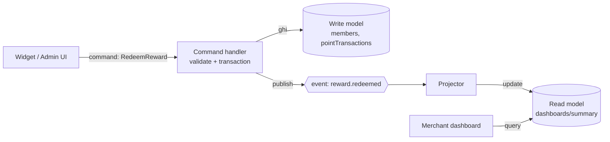

# Chương 7 — Integrating Events with CQRS

> ⚠️ Tóm tắt khái niệm theo mục lục sách + kiến thức DDD chuẩn — không phải bản dịch nguyên văn. Đọc sách gốc để lấy case study chi tiết. Ví dụ đời sống & Joy Loyalty là ví dụ của mình, không phải từ sách.

## TL;DR
Khi [[Glossary - Thuật ngữ#Modular monolith|modular monolith]] đã có ranh giới, câu hỏi tiếp theo là: **các module giao tiếp bằng gì, và đọc/ghi dữ liệu thế nào cho khỏi dẫm chân nhau?** Chương này giới thiệu messaging (phân biệt command vs event — cái sai nhiều nhất trong thực tế), [[Glossary - Thuật ngữ#CQRS|CQRS]] (tách đường ghi khỏi đường đọc), các pattern đồng bộ giữa write model và read model (kèm bài toán dual write + outbox), [[Glossary - Thuật ngữ#Event sourcing|Event Sourcing]] như một lựa chọn lưu trữ, và specification testing — phần thưởng test "miễn phí" của kiến trúc message-based.

## Nội dung chính

### Messages in modular monoliths

🏪 **Ví dụ đời sống:** hai vợ chồng ở chung nhà nói chuyện trực tiếp được, nhưng những thứ quan trọng — tiền học của con, lịch về quê — vẫn nên ghi vào tờ note dán tủ lạnh theo format rõ ràng. Vì sau này nhà có thêm ông bà, người giúp việc (module mới, hoặc tách service), cách giao tiếp đã chuẩn sẵn, không phải dạy lại từ đầu.

Trong code, cái này chính là:
- Trong modular monolith, message **không cần broker thật** (Kafka/Pub/Sub) — một in-process bus (dispatcher map trong JS, như `bus.js` ở chương 6) là đủ. Nhưng **hợp đồng message** phải nghiêm túc như thể đi qua network: tên rõ ràng, payload có schema, version được.
- Ba loại message chuẩn: **Command** (yêu cầu làm gì), **Event** (thông báo điều đã xảy ra), **Query** (hỏi dữ liệu). Phân loại đúng → chọn đúng cơ chế xử lý.
- Lợi ích thiết kế theo message ngay từ trong monolith: sau này nếu tách service, chỉ thay ruột bus bằng Pub/Sub — hợp đồng giữ nguyên, các module không hề biết.

### Commands versus events — phân biệt quan trọng nhất chương

🏪 **Ví dụ đời sống:** trong nhà hàng, tờ **order phục vụ ghi đưa vào bếp** là một *command*: "làm 1 phở tái" — gửi cho đúng một nơi (bếp), bếp có quyền **từ chối** ("hết bánh phở rồi em ơi"). Còn tiếng **chuông 'món xong!' bếp gõ** là một *event*: chuyện đã xảy ra, không ai "từ chối" được nữa; phục vụ nghe thì ra bưng, thu ngân nghe thì cộng vào bill, ai không liên quan thì kệ. Bếp gõ chuông xong không quan tâm ai nghe.

Trong code:
- **Command**: mệnh lệnh, đặt tên ở thì mệnh lệnh (`RedeemReward`, `DeductPoints`), gửi tới **đúng một handler**, có thể bị **reject** (không đủ điểm). Người gửi *muốn* điều gì đó xảy ra.
- **Event**: sự thật đã xảy ra, đặt tên thì quá khứ (`reward.redeemed`, `points.earned`, `tier.upgraded`), **không thể từ chối**, có **0..n subscriber**. Người phát không quan tâm ai nghe.
- Luồng chuẩn: command → handler validate invariant + thực thi → phát event(s) → các module khác phản ứng.
- Ranh giới tinh tế: cái gì **phải atomic** với command thì nằm *trong* handler; side effect **chấp nhận trễ/fail riêng** thì đi qua event. Ví dụ Joy Loyalty: trừ điểm là một phần của transaction redeem (atomic); gửi email và ghi analytics nghe `reward.redeemed` (event).

```js
// modules/rewards/domain/redeemHandler.js — command: 1 handler, có thể reject
bus.handle('RedeemReward', async ({ shopId, memberId, rewardId }) => {
  const member = await memberRepo.get(shopId, memberId);
  const reward = await rewardRepo.get(shopId, rewardId);

  if (member.balance < reward.cost) {
    return { ok: false, reason: 'INSUFFICIENT_POINTS' }; // command bị từ chối
  }

  // atomic: trừ điểm + ghi redemption trong 1 Firestore transaction
  const redemption = await redeemInTransaction(member, reward);

  // event: chuyện đã rồi, ai nghe thì nghe
  await bus.publish('reward.redeemed', {
    shopId, memberId, rewardId,
    pointsSpent: reward.cost,
    redemptionId: redemption.id,
    occurredAt: new Date().toISOString(),
  });
  return { ok: true, redemptionId: redemption.id };
});

// nơi khác — không module nào biết nhau:
bus.on('reward.redeemed', sendRedemptionEmail);     // module notifications
bus.on('reward.redeemed', updateMerchantDashboard); // projector (xem CQRS dưới)
```

- Đặt tên theo [[Glossary - Thuật ngữ#Ubiquitous language|ubiquitous language]]: event chính là sticky note từ buổi [[Glossary - Thuật ngữ#EventStorming|event storming]] ở chương 6.

### Separating command and query responsibility — CQRS

🏪 **Ví dụ đời sống:** thủ kho ghi nhập–xuất vào **sổ kho** rất chi tiết, đúng quy trình, có chữ ký — vì sai một dòng là mất hàng (đường ghi). Nhưng khách đến hỏi "còn áo size M không?" thì không ai lật sổ kho cộng trừ — người ta nhìn cái **bảng tồn kho treo trên tường** được cập nhật sẵn (đường đọc). Hai "giao diện" khác nhau cho hai nhu cầu khác nhau, cùng phản ánh một kho hàng.

Trong code:
- **CQRS (Command Query Responsibility Segregation)**: tách đường **ghi** (command side — model giàu nghiệp vụ, validate invariant như "balance không âm") khỏi đường **đọc** (query side — model phẳng, denormalized, tối ưu cho hiển thị).
- Vì sao cần: model tối ưu cho việc giữ invariant thường rất dở cho việc đọc. "Top 50 member theo điểm tháng này" cho dashboard merchant không liên quan gì đến invariant — bắt nó đi qua domain model chỉ tổ chậm và rối.
- CQRS có **nhiều mức độ**, không bắt buộc full:
  - Mức nhẹ nhất: chỉ **tách code** — command handler và query handler là hai file khác nhau; query được bypass domain model, đọc thẳng DB.
  - Mức nặng hơn: tách **read store riêng** (collection/database khác), đồng bộ qua event.
- Với Firestore điều này rất tự nhiên — Firestore vốn khuyến khích **denormalize theo nhu cầu đọc** (không có JOIN, tính tiền theo document read). Ví dụ Joy Loyalty:

```js
// WRITE SIDE: nguồn sự thật
// members/{memberId}            → { balance, tierId, ... }
// pointTransactions/{txId}      → { memberId, type, points, orderId, at }

// READ SIDE: build sẵn cho dashboard merchant — đọc 1 document là xong
// dashboards/{shopId}/summary   → { totalMembers, pointsIssued30d, topMembers: [...] }

// projector: nghe event, cập nhật read model (eventually consistent)
bus.on('points.earned', async (e) => {
  const ref = db.doc(`dashboards/${e.shopId}/stats/summary`);
  await ref.set({
    pointsIssued30d: FieldValue.increment(e.points),
    updatedAt: FieldValue.serverTimestamp(),
  }, { merge: true });
});
```



### Database synchronization patterns — đồng bộ write model và read model

- Khi read model tách khỏi write model, phải đồng bộ. Hai họ pattern:
  - **Trong cùng transaction**: ghi write model và update read model trong một Firestore transaction/batch — consistent ngay, nhưng command chậm đi và coupling chặt.
  - **Qua event, async**: command ghi xong → phát event → **projector** update read model. Read model thành **eventually consistent** (trễ vài trăm ms đến vài giây) — như bảng tồn kho treo tường có thể chậm hơn sổ kho vài phút, chấp nhận được cho việc *xem*.
  - Trên GCP: **Firestore trigger (Eventarc/Cloud Functions)** hoặc Pub/Sub đóng vai projector tự nhiên — ghi `pointTransactions` xong, trigger tự cập nhật summary.

🏪 **Dual write — ví dụ đời sống:** ghi sổ kho xong rồi *mới* đi treo lại bảng tồn kho là hai động tác rời nhau — ghi sổ xong bị gọi đi việc khác, quên treo bảng, thế là bảng sai cả ngày. Giải pháp: kẹp luôn tờ "cần cập nhật bảng" vào **khay việc chờ** ngay trong lúc ghi sổ (cùng một động tác) — ai rảnh thì lấy tờ trong khay ra xử lý, làm hỏng thì tờ giấy vẫn nằm đó để làm lại.

Trong code:
- **Dual write problem**: ghi DB và publish event là hai thao tác riêng — một trong hai có thể fail, để lại hệ thống lệch (điểm đã trừ nhưng event không phát, hoặc ngược lại).
- **Outbox pattern**: ghi event vào collection `outbox` **trong cùng transaction** với dữ liệu; một worker riêng đọc outbox và publish (chi tiết code ở chương 8). Firestore trigger trên collection chính cũng là một dạng "outbox miễn phí" — vì trigger phát từ chính việc ghi DB thành công.
- UI phải chấp nhận [[Glossary - Thuật ngữ#Eventual consistency|eventual consistency]]: sau khi redeem, balance trên dashboard có thể trễ một nhịp — dùng optimistic update phía client, hoặc đọc write model cho chính member vừa thao tác.

### Event Sourcing integration

🏪 **Ví dụ đời sống:** **sổ cái kế toán** không bao giờ tẩy xoá — sai thì ghi thêm bút toán điều chỉnh. Số dư tài khoản không phải thứ được "lưu", nó là thứ **cộng lại từ các dòng sổ**. Nhờ vậy lúc nào cũng trả lời được "tại sao số dư là 520?" bằng cách chỉ vào từng dòng. So với cách "lưu mỗi số dư hiện tại" (như ghi đè số lên tờ giấy nhớ) — gọn hơn, nhưng mất sạch lịch sử, sai thì không biết sai từ đâu.

Trong code:
- **Event Sourcing (ES)**: thay vì lưu **state hiện tại** (`balance: 520`), lưu **chuỗi event** (`points.earned +500`, `points.earned +100`, `points.redeemed -80`) — state là kết quả **replay** event. Event store là append-only, nguồn sự thật duy nhất.
- Lợi ích: audit trail hoàn hảo (merchant hỏi "sao member này có 520 điểm?" → trả lời từng dòng), debug bằng replay, build read model **mới** từ lịch sử cũ (thêm dashboard mới mà có sẵn data từ 2 năm trước).
- Chi phí: phức tạp hơn hẳn — replay, **snapshot** (chụp state định kỳ để khỏi replay từ đầu), versioning event schema. **Không áp ES toàn hệ thống** — chỉ cho [[Glossary - Thuật ngữ#Aggregate|aggregate]] nào lịch sử *là* nghiệp vụ.
- Nhận xét đắt giá cho Joy Loyalty: **points ledger bản chất đã là event sourcing** — `pointTransactions` là chuỗi event, balance là projection. Mình đã làm ES một cách tự phát; việc cần làm là chính thức hoá:

```js
// balance luôn derive được từ ledger — cấm sửa tay field balance
function computeBalance(transactions) {
  return transactions.reduce((sum, tx) => sum + tx.points, 0); // earn dương, redeem âm
}

// job reconcile định kỳ: phát hiện balance cached lệch khỏi ledger
async function reconcileMember(shopId, memberId) {
  const txs = await pointTxRepo.allOf(shopId, memberId);
  const derived = computeBalance(txs);
  const cached = (await memberRepo.get(shopId, memberId)).balance;
  if (derived !== cached) {
    console.log(JSON.stringify({ severity: 'WARNING', event: 'balance.drift',
      shopId, memberId, cached, derived }));
    await memberRepo.setBalance(shopId, memberId, derived); // ledger thắng
  }
}
```

- ES kết hợp tự nhiên với CQRS: event store là write side, mọi read model đều là projection từ event.

### Specification testing — Given/When/Then

🏪 **Ví dụ đời sống:** cách ta kiểm tra một nhân viên thu ngân mới: "**Giả sử** khách đã mua 2 đơn tổng 150k (chuyện đã xảy ra), **giờ** khách đưa voucher 200k (yêu cầu), **thì** em phải từ chối vì chưa đủ điều kiện." Không cần dựng cả siêu thị để kiểm tra — chỉ cần kịch bản giấy.

Trong code:
- Khi hệ thống mô tả bằng command/event, test viết theo dạng đặc tả **Given–When–Then** rất tự nhiên:

```js
// spec: redeem khi không đủ điểm
specTest('reject redeem khi thiếu điểm', {
  given: [ // các event đã xảy ra
    { type: 'points.earned', points: 100 },
    { type: 'points.earned', points: 50 },
  ],
  when: { type: 'RedeemReward', cost: 200 },     // command
  then: { rejected: 'INSUFFICIENT_POINTS', events: [] }, // không event nào phát
});
```

- Test kiểu này không đụng database, chạy như unit test, và **non-dev đọc được** — nó là tài liệu nghiệp vụ sống. Trong JS thuần chỉ cần helper `given(events).when(command).then(...)` chạy trên pure function của domain.
- Đây là phần thưởng lớn nhất của kiến trúc message-based: logic nghiệp vụ test được hoàn toàn tách khỏi Firestore/Shopify.

## Sai lầm thường gặp
1. **Event đội lốt command** — phát event tên `send.welcome.email` (mệnh lệnh trá hình) rồi kỳ vọng đúng một module xử lý. Đó là command, hãy gửi như command. Event phải là *sự thật quá khứ*, người phát không được "mong đợi" hành động cụ thể — như bếp gõ chuông mà lại quay ra chỉ định "em A phải ra bưng".
2. **Nhét logic phải-atomic vào event subscriber** — trừ điểm trong subscriber của `reward.redeemed`: nếu subscriber fail, reward đã phát mà điểm không trừ. Cái gì là invariant của transaction thì nằm trong command handler.
3. **CQRS full ngay từ đầu cho mọi thứ** — tách read store, event store, projector cho cả màn hình settings CRUD. Như xây bảng tồn kho điện tử cho cái tủ 5 món đồ. Bắt đầu từ mức "tách code", chỉ tách store khi query thật sự đau.
4. **Quên dual write** — `await db.set(...)` rồi `await pubsub.publish(...)` hồn nhiên nối nhau, không outbox/trigger. Chạy êm 6 tháng, đến ngày Pub/Sub timeout thì data lệch không dấu vết.
5. **Sửa tay read model / sửa tay balance khi lệch** — fix triệu chứng, drift sẽ quay lại. Luật: ledger/event là nguồn sự thật, lệch thì **rebuild projection từ nguồn**, và truy bằng được vì sao lệch.
6. **Event chứa cả thế giới** — payload nhét nguyên document member 50 field "cho tiện". Subscriber bắt đầu phụ thuộc field ngẫu nhiên, đổi schema member là vỡ dây chuyền. Event chỉ chứa fact của chính nó + ID để bên nhận tự hỏi thêm.

## Thuật ngữ cần nhớ
| Thuật ngữ | Nghĩa là gì (1 câu) |
|---|---|
| Command | Yêu cầu thực hiện hành động — "tờ order vào bếp": một handler, có thể bị từ chối. |
| Event | Sự thật đã xảy ra — "tiếng chuông món xong": thì quá khứ, nhiều subscriber, không thể từ chối. |
| Query | Câu hỏi đọc dữ liệu, không gây side effect. |
| CQRS | Tách model/đường ghi (sổ kho) khỏi model/đường đọc (bảng tồn kho treo tường). |
| Read model / Projection | Dữ liệu denormalized build từ write model/event, tối ưu cho một nhu cầu đọc. |
| Projector | Thành phần nghe event và cập nhật read model. |
| Eventual consistency | Read model sẽ đúng "sau một lúc", không tức thì sau khi ghi. |
| Dual write problem | Ghi DB và publish event là hai thao tác tách rời, một cái có thể fail. |
| Outbox pattern | Ghi event vào "khay việc chờ" cùng transaction với dữ liệu, worker publish sau. |
| Event Sourcing | Lưu chuỗi event làm nguồn sự thật (sổ cái kế toán), state là kết quả replay. |
| Snapshot | State chụp định kỳ để tránh replay toàn bộ event từ đầu. |
| Specification test | Test dạng Given (events đã xảy ra) – When (command) – Then (events/reject). |

## Áp dụng cho mình (Joy Loyalty)
- Chính thức hoá `pointTransactions` thành ledger append-only và nguồn sự thật duy nhất: balance là projection, có job reconcile định kỳ để phát hiện + sửa drift (ledger thắng) — đây là ES "bản địa" sẵn có của mình.
- Áp CQRS nhẹ trước: tách query của merchant dashboard (leaderboard, member list, thống kê điểm) ra read model riêng trên Firestore — collection summary build bằng Firestore trigger/projector — khỏi đụng vào write path và khỏi đốt tiền document read.
- Định nghĩa danh sách command/event của [[Glossary - Thuật ngữ#Subdomain|core domain]] (`RedeemReward`, `EarnPoints` / `points.earned`, `reward.redeemed`, `tier.upgraded`...) thành module `contracts` riêng — hợp đồng giữa các module, sau này tách service không phải đàm phán lại.
- Quy ước đặt tên cứng: command = mệnh lệnh PascalCase, event = `chuyện.đã.xảy.ra` thì quá khứ — vi phạm naming là review bắt ngay được phân loại sai.
- Viết bộ specification test Given–When–Then cho rule điểm/tier — vừa là test vừa là tài liệu cho teammate và product owner.
