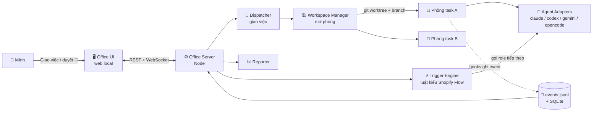

> [!quote] 💬
> "The best way to predict the future is to invent it." — Alan Kay

# 🏢 AI Office — Văn phòng AI cho my-ship

**Ý tưởng:** biến bộ kit [my-ship](https://github.com/MeanHoang/my-ship) thành một **công ty AI có giao diện**. Mỗi task là **một phòng**, trong phòng có các bot theo role. Các bot gọi nhau theo kiểu **Shopify Flow** (trigger → condition → action). Mình chỉ giao việc, duyệt ở các điểm 🚦 và đọc báo cáo.

> [!note] 📝 So sánh dễ hiểu
> Giống một công ty thật:
> - **Lễ tân / trưởng phòng**: nhận yêu cầu rồi giao cho đúng phòng.
> - **Bộ phận hành chính**: mở phòng mới, kê bàn ghế (tạo worktree, cài deps), dọn phòng khi xong việc.
> - **Các nhân viên** (product, scout, dev, QA, reviewer) làm việc trong phòng và chuyền việc cho nhau.
> - **Sếp (mình)**: chỉ ký những việc quan trọng và đọc báo cáo cuối ngày.

Phân tích chi tiết: [[1 - Phân tích yêu cầu]] · Mockup: [[2 - Mockup UI]]

Hướng đã chọn: **B, app riêng chạy cạnh Orca**. Không fork Orca. Orca, git worktree và các CLI agent lo phần chạy. AI Office lo **giao việc, điều phối, hiển thị và báo cáo**.

---

## 🎯 Mục tiêu và không làm
| Mục tiêu | Không làm (v1) |
|---|---|
| Giảm số lần mình phải can thiệp, chỉ dừng ở các 🚦 thật sự cần | Bỏ hẳn con người ra khỏi vòng (không tự push hay deploy) |
| Nhìn một màn hình là biết phòng nào đang làm gì, đang chờ ai | Làm 3D đẹp ngay từ đầu (làm 2D trước) |
| Giao việc ngay trên web, tự sinh phòng mới | Chạy trên cloud (v1 chạy local) |
| Chạy được nhiều model và agent (Claude, Codex, Gemini…) | Tự viết agent runtime (dùng CLI có sẵn) |
| Báo cáo có bằng chứng, chi phí và quyết định | Chat realtime giữa các bot cho vui |

---

## 🧱 Kiến trúc tổng thể


| Thành phần          | Làm gì                                                   | Công nghệ gợi ý                                        |
| ------------------- | -------------------------------------------------------- | ------------------------------------------------------ |
| **Office UI**       | Sơ đồ văn phòng, phòng, bot, form giao việc, màn báo cáo | React + Vite; 2D bằng SVG/Canvas, 3D sau bằng three.js |
| **Office Server**   | API, WebSocket đẩy trạng thái, quản lý tiến trình agent  | Node (Fastify) + SQLite                                |
| **Event bus**       | Mọi thứ xảy ra đều thành một sự kiện                     | `events.jsonl` trong mỗi phòng, gom về SQLite          |
| **Trigger Engine**  | Đọc sự kiện, tra luật, gọi role tiếp theo                | Bảng luật YAML                                         |
| **Agent Adapters**  | Một interface chung cho nhiều CLI agent                  | `claude -p`, `codex exec`, `gemini -p`…                |
| **Orca** (tuỳ chọn) | Mở phòng ra xem terminal, diff, browser khi cần soi kỹ   | Đọc chung các worktree, không cần tích hợp sâu         |

---

## 👥 Các role

### 1️⃣ Role mới
| Role | Ví như | Việc | Model gợi ý |
|---|---|---|---|
| **`dispatcher`** (Trưởng phòng giao việc) | Lễ tân + PM | Nhận yêu cầu (text, link Notion/Jira, ảnh). Phân loại flow (`/ship`, `/ship-fix`, `/ship-bugs`). Ước lượng size. Chia nhỏ nếu cần. Chọn model cho từng role. Đề xuất phương án và **chờ mình duyệt** trước khi mở phòng. | `opus` |
| **`workspace-manager`** (Hành chính) | Bộ phận cơ sở vật chất | Tạo branch và worktree, cài deps, cấp port không trùng, copy `.env` từ nơi an toàn, chạy `install.sh` của my-ship. Dọn phòng sau khi merge. Đây là việc **cơ học**, nên viết bằng script, không cần LLM. | script (không model) |
| **`reporter`** (Thư ký) | Thư ký tổng hợp | Gom sự kiện, ảnh bằng chứng, test output, `decisions.md`, chi phí token thành báo cáo cho từng phòng và báo cáo ngày. | `haiku` / `sonnet` |

### 2️⃣ Role có sẵn trong my-ship (giữ nguyên)
`product` · `scout` · `implementer` · `verifier` · `reviewer` · `parent` (trưởng nhóm của từng phòng, điều phối các role trong phòng).

> [!tip] 💡 Phân tầng rõ ràng
> **Dispatcher** điều phối **giữa các phòng** (task nào mở phòng nào). **Parent** điều phối **trong một phòng** (role nào chạy tiếp). Đừng để dispatcher chen vào việc bên trong phòng.

---

## ⚡ Cơ chế tự động kiểu Shopify Flow

### 1️⃣ Sự kiện (event)
Mỗi dòng trong `events.jsonl` có dạng:
```json
{"ts":"2026-10-12T09:15:02Z","room":"bugfix-tier-click","role":"verifier","type":"verify.failed","model":"sonnet","data":{"phase":2,"evidence":"tmp/shots/p2-after.png"},"cost_usd":0.12}
```
Nguồn phát sự kiện:
- **Hooks của Claude Code**: `SubagentStart` / `SubagentStop` / `Stop` / `PreToolUse` cho các commit.
- **Adapter**: khi một tiến trình CLI agent bắt đầu, kết thúc hoặc lỗi.
- **my-ship**: mỗi khi tick `progress.md`, đổi dòng `NOW`, hoặc có câu hỏi chờ trả lời.

### 2️⃣ Bảng luật (trigger → condition → action)
```yaml
# office/rules.yaml
- on: task.created
  do: dispatcher.classify
- on: dispatcher.proposed
  do: gate.ask_owner              # 🚦 mình duyệt phương án và model
- on: gate.approved
  if: "gate == 'dispatch'"
  do: workspace.create            # sinh phòng mới
- on: workspace.ready
  do: room.start_flow             # parent chạy /ship hoặc /ship-auto
- on: code.done
  do: verifier.run
- on: verify.failed
  if: "attempts < 2"
  do: implementer.retry           # gửi kèm bằng chứng fail
- on: verify.failed
  if: "attempts >= 2"
  do: implementer.escalate        # implementer mới, model opus
- on: verify.passed
  do: commit.auto_on_branch       # chỉ trong chế độ auto, không push
- on: phase.committed
  if: "phases_left == 0"
  do: reviewer.run
- on: review.done
  do: [reporter.room_report, gate.ask_owner]   # 🚦 cho push / tạo MR
- on: decision.risky              # dữ liệu, chi phí, bảo mật, surface khác
  do: gate.park                   # đỗ lại, phòng chuyển sang 🚦
```

> [!warning] ⚠️ Chống vòng lặp và cháy token
> - Mỗi phòng có **ngân sách** (USD hoặc token). Vượt ngân sách thì tự dừng và báo 🚦.
> - Mỗi luật có **số lần chạy tối đa** trong một phòng. Chạy 2 lần liên tiếp không ra tiến triển thì dừng.
> - Engine **cấm** kiểu "A gọi B, B lại gọi A" quá N vòng. Đây chính là bài học vòng lặp "ghi field → event → ghi field" (2.9M reads/min).

---

## 🤖 Hỗ trợ nhiều model và agent

### 1️⃣ Interface adapter chung
```ts
// office/adapters/types.ts
// Mỗi CLI agent cài đặt interface này, Trigger Engine không cần biết bên dưới là agent nào
export interface AgentAdapter {
  id: 'claude' | 'codex' | 'gemini' | 'opencode';
  run(opts: {
    cwd: string;          // worktree của phòng
    role: string;         // implementer, verifier...
    prompt: string;       // role card + block + profile §11
    model: string;        // bắt buộc, không để mặc định
    budgetUsd: number;
  }): AsyncIterable<OfficeEvent>; // stream sự kiện về server
  stop(runId: string): Promise<void>;
}
```

### 2️⃣ Bảng chọn model theo role (chỉnh được trên UI)
```yaml
# office/models.yaml
roles:
  dispatcher:  { agent: claude, model: opus }
  product:     { agent: claude, model: opus }
  scout:       { agent: claude, model: opus }
  implementer: { agent: claude, model: sonnet, fallback: { agent: codex, model: gpt-5-codex } }
  verifier:    { agent: claude, model: sonnet }
  reviewer:    { agent: claude, model: opus, second_opinion: { agent: codex } }  # review chéo 2 model
  reporter:    { agent: claude, model: haiku }
```

```ts
// ❌ Bad — không truyền model: subagent ăn theo model của session (thường là đắt nhất)
await adapter.run({ cwd, role: 'verifier', prompt });
// ✅ Good — luôn truyền model rõ ràng theo models.yaml
await adapter.run({ cwd, role: 'verifier', prompt, model: cfg.roles.verifier.model, budgetUsd: 1 });
```

> [!tip] 💡 Review chéo model
> Code do Claude viết thì để Codex hoặc Gemini review thêm một lượt, như vậy bắt được những lỗi "điểm mù" của chính model đã viết. Cấu hình bằng `second_opinion` trong bảng trên.

---

## 🖥️ Các màn hình

### 1️⃣ Office Floor (màn chính, giống ảnh ClawExperts)
- Sơ đồ mặt bằng văn phòng: **mỗi phòng = một task** (tên branch, % phase).
- Trong phòng là các bàn theo role. Bot **sáng** khi đang làm, **mờ** khi rảnh, **🚦 nhấp nháy** khi chờ mình, **🔴** khi lỗi hoặc vượt ngân sách.
- Hover vào bot để xem nó đang làm gì (lấy từ event mới nhất) và model nó đang dùng.
- Góc trên: tổng số phòng, số bot đang chạy, số 🚦 đang chờ, chi phí hôm nay.
- Nút **"+ Giao việc"** và **"+ Thuê nhân viên"** (thêm role hoặc agent mới).

### 2️⃣ Giao việc (modal)
1. Dán mô tả, link task hoặc ảnh.
2. `dispatcher` trả về: flow đề xuất, size, có cần chia nhiều phòng không, model cho từng role, ngân sách dự kiến.
3. Mình chỉnh nếu cần rồi bấm **"Mở phòng"**. `workspace-manager` tạo phòng và phòng xuất hiện trên sơ đồ.
4. Chọn chế độ: **Có gate** (dừng ở Gate 1/2 và mỗi commit) hoặc **Auto** (sau Gate 2 chạy một mạch, như `/ship-auto`).

### 3️⃣ Chi tiết phòng
- **Timeline sự kiện**: ai làm gì, lúc nào, tốn bao nhiêu.
- **Hộp 🚦**: câu hỏi đang chờ, theo mẫu grill-me (bối cảnh, các lựa chọn, đề xuất). Trả lời ngay tại đây.
- Tab **Plan** (render `plan.html`), **Progress** (`progress.md`), **Decisions**, **Bằng chứng** (ảnh trước/sau, test fail → pass).
- Nút **"Mở trong Orca"** để soi terminal và diff.

### 4️⃣ Báo cáo
| Báo cáo | Nội dung |
|---|---|
| **Theo phòng** (khi xong task) | Đã làm gì · các phase · bằng chứng · các quyết định `[D-auto-N]` nên giữ hay revert · việc đang park · link MR |
| **Theo ngày** | Phòng nào xong, phòng nào kẹt, mình phải xử lý gì sáng mai |
| **Chi phí** | Token và USD theo phòng, role, model. Role nào ngốn nhất. So sánh các model với nhau |
| **Chất lượng** | Số lần verify fail, số lần escalate lên opus, số finding của reviewer. Dùng để chỉnh Standards và model |

---

## 🗂️ Cấu trúc thư mục gợi ý
```
ai-office/
├── apps/ui/                # React — floor, room, assign, report
├── apps/server/            # Node — API, WS, trigger engine, adapters
│   ├── adapters/           # claude.ts, codex.ts, gemini.ts, opencode.ts
│   ├── engine/             # rules runner + guard chống loop/budget
│   └── workspace/          # script tạo/dọn worktree (không LLM)
├── office/
│   ├── rules.yaml          # luật trigger
│   ├── models.yaml         # role → agent/model
│   └── roles/              # dispatcher.md, reporter.md (+ link sang my-ship roles)
└── hooks/office-emit.sh    # hook Claude Code ghi event vào events.jsonl
```

---

## 🛣️ Lộ trình
| Phase | Làm gì | Xong khi |
|---|---|---|
| **P0 — Mockup** | UI 2D với dữ liệu giả (vài phòng, bot, 🚦, báo cáo) | Nhìn vào thấy ưng bố cục |
| **P1 — Chỉ xem** | Hook `office-emit` ghi event, server đọc các worktree có sẵn, UI hiển thị trạng thái thật | Chạy `/ship` bằng tay mà UI phản ánh đúng |
| **P2 — Giao việc** | `dispatcher` + `workspace-manager`. Bấm giao việc là sinh phòng và chạy flow | Giao một bug từ web, phòng tự mở và chạy |
| **P3 — Tự động** | Trigger engine + `rules.yaml` + guard ngân sách/vòng lặp + trả lời 🚦 trên UI | Một task đi từ Gate 2 đến review mà không cần mở terminal |
| **P4 — Đa model** | Adapter Codex/Gemini, `models.yaml`, review chéo | Cùng một phòng dùng 2 agent khác nhau |
| **P5 — Báo cáo + đẹp** | Màn báo cáo chi phí và chất lượng, báo cáo ngày, sau đó mới làm 3D | Sáng nào cũng đọc báo cáo ngày thay vì đi mở từng terminal |

---

## ❓ Câu hỏi còn mở
- Chạy trên **Mac mini công ty** 24/7, hay cả hai máy cùng mở được (sync qua [[mac-windows-sync]])?
- `dispatcher` có được **tự mở phòng** với task nhỏ (`/ship-fix`) không, hay luôn cần mình duyệt?
- Có nối **Notion task board** (skill `joy-my-tasks`) để lấy việc tự động không?
- Ngân sách mặc định mỗi phòng là bao nhiêu?
- Có cần **bảo mật**: chỉ bind `localhost`, không để `.env` lọt vào event log hoặc báo cáo?

> [!danger] ⛔ Tuyệt đối tránh
> - Tự **push, deploy hoặc ghi dữ liệu production** từ luật tự động.
> - Ghi secret (`.env`, token) vào `events.jsonl` hoặc báo cáo. Cần lọc trước khi ghi.
> - Để một role vừa code vừa tự review và tự duyệt chính nó.

---

## 📚 Tham khảo
- [my-ship](https://github.com/MeanHoang/my-ship) — bộ kit gốc: gates, roles, evidence-first, `/ship-auto`.
- [Orca](https://onorca.dev/) — app desktop mã nguồn mở, chạy nhiều agent song song, mỗi task một worktree. Hỗ trợ Claude Code, Codex, Gemini…
- [Claude Code hooks guide](https://code.claude.com/docs/en/hooks-guide) — các hook `SubagentStart/Stop`, `Stop`… dùng để phát sự kiện.
- [Claude Code agent teams](https://code.claude.com/docs/en/agent-teams) — teammate nhắn tin trực tiếp cho nhau, một hướng khác cho giao tiếp giữa các bot.
- [Effective harnesses for long-running agents (Anthropic)](https://www.anthropic.com/engineering/effective-harnesses-for-long-running-agents) — cách giữ agent chạy dài mà không lệch hướng.
- 🔥 Bài "Văn Phòng AI" của ClawExperts / OpenClaw (Facebook) — nguồn cảm hứng cho UI văn phòng. Lưu ý comment: *"visual 3D để giải quyết việc gì"*, nên giá trị thật nằm ở điều phối.
- Liên quan trong vault: [[parallel-agent-workflow-research]] · [[Harness trong AI là gì]] · [[Harness design cho app chạy dài (Anthropic)]] · [[Workflow]]

---

## ✅ Checklist
- [ ] Chốt các câu hỏi còn mở (máy chạy, quyền tự mở phòng của dispatcher, ngân sách)
- [ ] P0: làm mockup UI 2D với dữ liệu giả
- [ ] P1: viết hook `office-emit.sh` và server đọc `events.jsonl`
- [ ] P2: viết role `dispatcher.md` và script `workspace-manager`
- [ ] P3: trigger engine + `rules.yaml` + guard ngân sách/vòng lặp
- [ ] P4: adapter Codex/Gemini + `models.yaml` + review chéo
- [ ] P5: màn báo cáo (phòng / ngày / chi phí / chất lượng), 3D sau cùng
