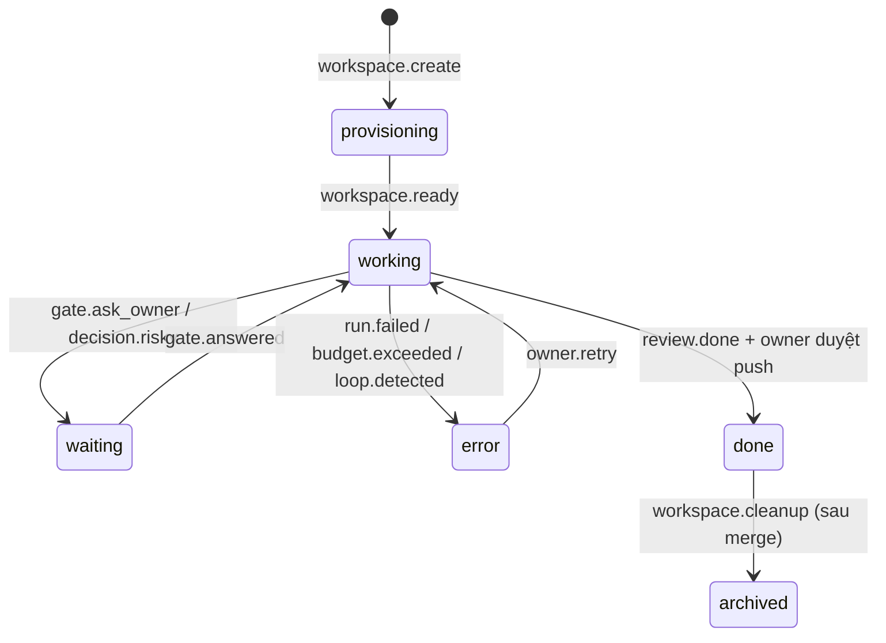

> [!quote] 💬
> "If you can't describe what you are doing as a process, you don't know what you're doing." — W. Edwards Deming

# 📋 AI Office — Phân tích yêu cầu

Tài liệu phân tích chi tiết cho [[0 - Ý tưởng tổng quan]]. Mockup đi kèm: [[2 - Mockup UI]].

---

## 🎯 1. Bài toán
**Hiện trạng:** bộ kit my-ship chạy tốt, nhưng mình vẫn phải can thiệp nhiều:
- Phải mở từng terminal hoặc từng workspace Orca mới biết task đang ở đâu.
- Các role chỉ chạy khi parent gọi. Khi parent dừng chờ thì cả task đứng yên, mình không biết là đang chờ mình.
- Giao việc mới phải tự tạo branch và worktree, tự gõ `/ship`.
- Không có chỗ nào nhìn chung: tốn bao nhiêu token, role nào hay fail, model nào đáng tiền.

**Mục tiêu:** một màn hình duy nhất để **giao việc → theo dõi → duyệt 🚦 → đọc báo cáo**, còn lại các bot tự chạy.

**Đo thành công bằng:**

| Chỉ số | Hiện tại (ước lượng) | Mục tiêu |
|---|---|---|
| Số lần mình phải mở terminal cho mỗi task | nhiều lần | ≤ 1 (chỉ khi muốn soi kỹ) |
| Thời gian một task đứng chờ mà mình không biết | không đo được | thấy 🚦 ngay khi phát sinh |
| Số lần trả lời những câu hỏi lẽ ra bot tự xử được | thường xuyên | gần 0 (luật grill-me) |
| Biết chi phí theo task/role/model | không | có báo cáo hằng ngày |

---

## 👤 2. Người dùng
| Persona | Là ai | Cần gì |
|---|---|---|
| **Owner** (mình) | Dev chính, giao việc, quyết định | Giao nhanh, thấy ngay việc gì chờ mình, tin được bằng chứng |
| **Bot** (role) | product, scout, implementer, verifier, reviewer, parent, dispatcher, reporter | Input rõ ràng (role card + block + profile), đúng model, có ngân sách |
| **Teammate** (sau này) | Đồng nghiệp xem chung | Xem tiến độ và báo cáo, không được giao việc hay duyệt |

---

## 🧾 3. User stories
### Giao việc
- **US-01** Là owner, mình dán mô tả, link task hoặc ảnh lỗi vào ô "Giao việc", để `dispatcher` đề xuất cách làm.
- **US-02** Là owner, mình xem đề xuất của dispatcher (flow, size, có chia phòng không, model từng role, ngân sách) và **sửa được** trước khi duyệt.
- **US-03** Là owner, mình bấm "Mở phòng" thì phòng mới xuất hiện trên sơ đồ trong vòng 1 phút (worktree + deps + port).
- **US-04** Là owner, mình chọn chế độ **Có gate** hoặc **Auto** cho từng phòng.

### Theo dõi
- **US-05** Là owner, nhìn sơ đồ văn phòng là biết phòng nào đang làm, đang chờ mình, lỗi hay đã xong.
- **US-06** Là owner, hover vào một bot là thấy nó đang làm gì, dùng model gì, đã tốn bao nhiêu.
- **US-07** Là owner, mình mở chi tiết phòng để xem timeline sự kiện, plan, progress, decisions và bằng chứng.
- **US-08** Là owner, mình mở phòng trong Orca chỉ với một cú click khi muốn soi terminal hoặc diff.

### Duyệt 🚦
- **US-09** Là owner, mình thấy tất cả câu hỏi đang chờ ở một chỗ (hộp 🚦), mỗi câu theo mẫu grill-me: bối cảnh, các lựa chọn, đề xuất kèm lý do.
- **US-10** Là owner, mình trả lời ngay trên UI và phòng tự chạy tiếp.
- **US-11** Là owner, mình được báo (toast, push notification) khi có 🚦 mới hoặc khi một phòng lỗi.

### Báo cáo
- **US-12** Là owner, xong mỗi phòng mình nhận báo cáo: đã làm gì, bằng chứng, các quyết định `[D-auto-N]`, việc đang park, link MR.
- **US-13** Là owner, sáng nào mình cũng đọc báo cáo ngày: phòng xong, phòng kẹt, việc mình phải làm.
- **US-14** Là owner, mình xem chi phí theo phòng, role và model để chỉnh `models.yaml`.
- **US-15** Là owner, mình xem chất lượng (verify fail, escalate, finding của reviewer) để bổ sung Standards.

### Nhân sự & model
- **US-16** Là owner, mình "thuê" thêm role hoặc agent (Codex, Gemini…) và gán model cho từng role ngay trên UI.
- **US-17** Là owner, mình bật hoặc tắt từng luật trigger và đặt ngân sách mặc định.

---

## ⚙️ 4. Yêu cầu chức năng theo màn hình
### 4.1 Office Floor
| ID | Yêu cầu |
|---|---|
| F-01 | Thanh trên cùng: số phòng, số bot đang chạy, số 🚦 chờ, chi phí hôm nay so với ngân sách ngày |
| F-02 | **Sảnh điều phối (HQ)**: bàn `dispatcher`, `workspace-manager`, `reporter` cùng nút "+ Giao việc" |
| F-03 | Mỗi phòng hiển thị: trạng thái, branch, flow (`/ship`, `/ship-fix`…), chế độ (gate/auto), phase hiện tại / tổng, thanh ngân sách |
| F-04 | Trong phòng là các bàn theo role. Bot có 5 trạng thái: `idle` · `working` · `waiting` (🚦) · `error` · `done` |
| F-05 | Phòng có 🚦 thì nhấp nháy viền vàng và được sắp lên đầu |
| F-06 | Lọc theo trạng thái: tất cả / đang làm / chờ mình / lỗi / xong |
| F-07 | Bật/tắt Day/Night (chế độ sáng/tối) |
| F-08 | Ngăn **Activity** bên phải: feed sự kiện realtime của mọi phòng |

### 4.2 Giao việc (modal 3 bước)
| ID | Yêu cầu |
|---|---|
| A-01 | Bước 1: ô mô tả, link task, đính kèm ảnh, chọn chế độ (Có gate / Auto), project |
| A-02 | Bước 2: dispatcher trả đề xuất gồm flow, size (XS–L), lý do, số phòng, bảng role → agent/model (sửa được), ngân sách |
| A-03 | Bước 3: `workspace-manager` chạy checklist (branch → worktree → deps → port → cài my-ship → ready), mỗi bước có trạng thái |
| A-04 | Xong thì đóng modal, phòng mới xuất hiện trên sơ đồ với hiệu ứng, kèm toast |

### 4.3 Chi tiết phòng
| ID | Yêu cầu |
|---|---|
| R-01 | Header: branch, flow, chế độ, trạng thái, ngân sách đã dùng / tối đa, nút "Mở trong Orca", "Tạm dừng", "Dừng hẳn" |
| R-02 | Stepper: Gate 1 → Gate 2 → Phase 1..N → Review → Ship |
| R-03 | Hàng bot của phòng với trạng thái và model từng bot |
| R-04 | Hộp 🚦 (nếu có): câu hỏi theo mẫu grill-me, các nút lựa chọn, ô trả lời tự do |
| R-05 | Tab **Timeline**: sự kiện theo thời gian (role, loại, model, chi phí) |
| R-06 | Tab **Plan / Progress / Decisions**: render từ `plan.html`, `progress.md`, `decisions.md` |
| R-07 | Tab **Bằng chứng**: ảnh trước/sau, test fail → pass, kèm "fail lại khi gỡ fix" |
| R-08 | Tab **Chi phí**: theo role và model |

### 4.4 Báo cáo
| ID | Yêu cầu |
|---|---|
| B-01 | Báo cáo ngày: số phòng xong / đang làm / kẹt, danh sách việc chờ mình, chi phí |
| B-02 | Chi phí 7 ngày, chồng theo model |
| B-03 | Chi phí theo role (role nào ngốn nhất) |
| B-04 | Chất lượng: verify fail, escalate lên opus, finding của reviewer (must-fix / optional) |
| B-05 | Danh sách báo cáo theo phòng, mở ra xem `report.html` |

### 4.5 Nhân sự & Model
| ID | Yêu cầu |
|---|---|
| S-01 | Bảng role: tên, mô tả, agent, model, model dự phòng, model review chéo |
| S-02 | Danh sách agent đã kết nối (Claude Code, Codex, Gemini, OpenCode) và trạng thái đăng nhập |
| S-03 | Danh sách luật trigger (đọc từ `rules.yaml`), bật/tắt, số lần chạy tối đa |
| S-04 | Ngân sách mặc định theo phòng / ngày, ngưỡng cảnh báo |

---

## 🔄 5. Trạng thái và vòng đời
### 5.1 Phòng


### 5.2 Bot
`idle` → `working` → (`done` | `error` | `waiting`). Một bot `waiting` nghĩa là role đó trả câu hỏi lên parent. Câu hỏi luôn **đi qua parent**, bot không hỏi thẳng mình (theo my-ship).

---

## 📜 6. Danh mục sự kiện
| Type | Phát bởi | Data chính |
|---|---|---|
| `task.created` | UI | mô tả, link, chế độ |
| `dispatcher.proposed` | dispatcher | flow, size, rooms, models, budget |
| `workspace.step` / `workspace.ready` | workspace-manager | bước, branch, path, port |
| `role.started` / `role.finished` | hook `SubagentStart/Stop` | role, model, phase |
| `code.done` | implementer | files, pattern ref |
| `verify.passed` / `verify.failed` | verifier | evidence path, attempts |
| `gate.ask_owner` / `gate.answered` | parent / UI | question, options, answer |
| `decision.auto` | parent (auto) | `[D-auto-N]`, commit sha |
| `decision.risky` | parent | loại (data / cost / security / surface) |
| `phase.committed` | parent | phase, sha |
| `review.done` | reviewer | must-fix, optional |
| `budget.warn` / `budget.exceeded` | engine | used, max |
| `loop.detected` | engine | luật, số lần |
| `report.ready` | reporter | path |

---

## 🗃️ 7. Data model
```ts
// Phòng = một task = một worktree
interface Room {
  id: string; branch: string; title: string;
  flow: '/ship' | '/ship-fix' | '/ship-bugs' | '/ship-auto';
  mode: 'gate' | 'auto';
  status: 'provisioning' | 'working' | 'waiting' | 'error' | 'done' | 'archived';
  phase: { current: number; total: number; label: string };
  budget: { usedUsd: number; maxUsd: number };
  worktreePath: string; port: number;
  bots: Record<RoleId, { state: BotState; model: string; agent: AgentId; task?: string }>;
  gate?: Gate; createdAt: string;
}
interface Gate {
  id: string; kind: 'gate1' | 'gate2' | 'commit' | 'push' | 'park' | 'fe-livefix';
  context: string; options: { key: string; label: string }[];
  recommend: { key: string; why: string }; evidence?: string[];
}
interface OfficeEvent { ts: string; room: string; role: RoleId; type: string; model?: string; costUsd?: number; data?: unknown; }
```
Lưu trữ: `events.jsonl` trong mỗi worktree là nguồn sự thật, gom về SQLite để UI query nhanh. Trạng thái phòng là **projection** từ event, không lưu song song.

---

## 🛡️ 8. Yêu cầu phi chức năng
| Nhóm | Yêu cầu |
|---|---|
| **Bảo mật** | Chỉ bind `127.0.0.1`. Lọc secret (`.env`, token, key) trước khi ghi event hoặc báo cáo. Không có luật nào tự push, deploy hay ghi production |
| **Chi phí** | Ngân sách theo phòng và theo ngày. Cảnh báo ở 80%, dừng ở 100%. Mọi dispatch phải có `model` |
| **Độ bền** | Server chết thì bot vẫn chạy. Mở lại server thì dựng lại trạng thái từ `events.jsonl` |
| **Chống lặp** | Mỗi luật có `max_runs`. 2 vòng liên tiếp không ra tiến triển thì dừng. Phát hiện A↔B gọi nhau quá N lần |
| **Hiệu năng** | UI cập nhật < 1s sau khi có event (WebSocket). Chạy mượt với 10 phòng × 9 bot |
| **Đa nền tảng** | Chạy được trên Mac (chính) và Windows. Hook viết sao cho chạy được cả Git Bash |
| **Khả chuyển** | Không sửa my-ship. Chỉ thêm hook `office-emit` và role `dispatcher`, `reporter` |

---

## ✅ 9. Tiêu chí nghiệm thu v1 (P0–P3)
- [ ] Giao một bug từ web, dispatcher đề xuất, mình duyệt, phòng tự mở và chạy `/ship-fix`
- [ ] Sơ đồ phản ánh đúng trạng thái bot trong vòng 1s
- [ ] 🚦 hiện lên UI, trả lời trên UI thì phòng chạy tiếp mà không cần mở terminal
- [ ] Verify fail 2 lần thì tự escalate implementer lên opus, có ghi vào timeline
- [ ] Vượt ngân sách thì phòng dừng, chuyển 🔴, có toast
- [ ] Không có secret nào trong `events.jsonl` (test bằng gitleaks)
- [ ] Báo cáo phòng có đủ: phase, bằng chứng, decisions, chi phí

---

## ⚠️ 10. Rủi ro
| Rủi ro | Ảnh hưởng | Giảm thiểu |
|---|---|---|
| Bot gọi nhau vô hạn | Cháy token | `max_runs`, phát hiện stall, ngân sách cứng |
| Dispatcher phân loại sai flow | Phòng chạy sai quy trình | Luôn cần mình duyệt ở bước 2 (v1). Flow chỉ được nâng cấp, không hạ cấp |
| Hook không chạy trên Windows | Mất event | Viết hook bằng Node thay vì bash + jq |
| UI đẹp nhưng không ai nhìn | Phí công | Làm 2D trước, đo xem có thay được việc mở terminal không |
| Nhiều phòng cùng chạy dev server | Trùng port, máy lag | workspace-manager cấp port, giới hạn số phòng chạy song song |

---

## ❓ 11. Câu hỏi còn mở
- Chạy 24/7 trên Mac mini hay chỉ khi mở máy?
- Có cho dispatcher **tự mở phòng** với task XS (`/ship-fix`) không?
- Ngân sách mặc định mỗi phòng và mỗi ngày là bao nhiêu?
- Có lấy việc tự động từ Notion task board (`joy-my-tasks`) không?
- Push notification qua đâu: điện thoại (Orca mobile), Slack hay chỉ trình duyệt?

---

## ✅ Checklist
- [x] Xác định bài toán và chỉ số thành công
- [x] User stories theo 5 nhóm
- [x] Yêu cầu chức năng theo từng màn hình
- [x] Vòng đời phòng/bot, danh mục sự kiện, data model
- [x] Yêu cầu phi chức năng, tiêu chí nghiệm thu, rủi ro
- [ ] Chốt các câu hỏi còn mở
- [ ] Duyệt mockup → [[2 - Mockup UI]]
