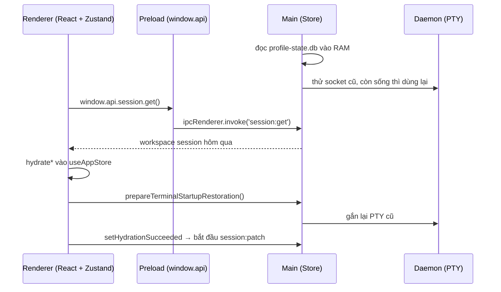

> [!quote] 💬
> "Disconnect without killing: the daemon survives app quit so sessions stay warm for reattach." — comment trong `src/main/daemon/daemon-provider-state.ts:115`

Dịch: tắt app thì chỉ ngắt kết nối, không giết daemon. Daemon sống tiếp để lần sau mở app, terminal vẫn còn "ấm" và gắn lại được.

## Nguồn của note này
- 📖 Bản clone `stablyai/orca` commit `9db7b8b` (2026-10-13). Mọi đường dẫn bên dưới tính từ gốc repo.
- 📖 Phần "Trên máy anh đang chạy gì": lệnh `ps -axo pid,ppid,command | grep -i orca` trên Mac này (Orca 1.4.224), và `ls ~/Library/Application Support/orca/profiles/local-default`.
- 📖 Main / preload / renderer: `src/main/index.ts`, `src/main/window/createMainWindow.ts`, `src/preload/index.ts`, `src/preload/api/session-bridge.ts`.
- 📖 IPC: `src/main/ipc/session.ts`, `src/main/ipc/register-core-handlers/register-core-handlers.ts`, `src/main/jsonl-rpc/peer.ts`, `src/shared/rpc-contract/worktree-params.ts`.
- 📖 Daemon và orcad: `src/main/daemon/daemon-entry.ts`, `src/main/daemon/daemon-provider-state.ts`, `src/main/daemon/daemon-provider-init.ts`, `src/main/daemon/daemon-launch-paths.ts`, `src/main/daemon/client.ts`, `src/main/daemon/AGENTS.md`, `src/main/orcad/orcad-entry.ts`, `src/main/orcad/orcad-command-arguments.ts`, `src/main/startup/main-process-pty-startup.ts`.
- 📖 Worker thread và process-host: `src/main/lazy-worker-thread-host.ts`, `src/main/worker-thread-child-process/worker-thread-child-process.ts`, `src/packages/process-host/README.md`, `AGENTS.md`.
- 📖 Lưu trữ: `src/main/persistence.ts`, `src/main/persistence/loading-store/store.ts`, `src/main/persistence/profile-state/profile-state-writer-thread.ts`, `src/main/persistence/profile-state/profile-state-access.ts`, `src/main/sqlite/sync-database.ts`, `src/main/durable-file-write.ts`, `src/main/startup/main-process-ready-foundation.ts`.
- 📖 State phía renderer: `src/renderer/src/store/index.ts`, `src/renderer/src/app-shell/use-app-startup-hydration.ts`, `src/renderer/src/app-shell/use-app-session-persistence.ts`.
- 📖 Build: `package.json`, `electron.vite.config.ts`, `config/build-plugins/main-build-entry-points.ts`, `config/scripts/build-orcad-node.mjs`.
- 💭 Phần so sánh đời sống và "Bài học" là nhận định của AI.

---
## 🖥️ Trên máy anh đang chạy những tiến trình nào?

Trước khi đọc code, nhìn thực tế. Lệnh `ps` trên Mac này (Orca 1.4.224 đang mở) cho thấy Orca không phải một tiến trình mà là cả chục tiến trình. Tất cả là con của PID 480 (`Orca.app/Contents/MacOS/Orca`), tức tiến trình chính.

| Tiến trình (📖 từ `ps`) | Chạy file gì | Việc của nó |
|---|---|---|
| `Orca` (PID 480) | `out/main/index.js` | Tiến trình chính (main process): Node.js + Electron, giữ state, nói chuyện với OS |
| `Orca Helper (Renderer)` × 6 | `index.html` của renderer | Giao diện React, mỗi cửa sổ / webview một cái |
| `Orca Helper ... daemon-entry.js --socket ...` (PID 1291) | `out/main/daemon-entry.js` | Daemon giữ các terminal (PTY) |
| `Orca Helper ... parcel-watcher-process-entry.js` | `out/main/parcel-watcher-process-entry.js` | Theo dõi file thay đổi, tách riêng cho an toàn |
| `Orca Helper ... session-scanner-service-entry.js` | `out/main/session-scanner-service-entry.js` | Quét lịch sử session của agent (chạy với `--max-old-space-size=384`) |
| `Orca Helper ... computer-sidecar.js` | `out/main/computer-sidecar.js` | Cầu nối cho tính năng Computer Use (xem [[5-Browser & Computer use]]) |
| `Orca Helper --type=gpu-process` / `network` | Chromium | Tiến trình phụ mặc định của Chromium |

💭 Điểm cần nhớ: `Orca Helper` là bản copy của Electron. Khi chạy với một file `.js` làm tham số, nó chạy như Node thường. Orca dùng cách này để tách việc nặng hoặc dễ crash ra khỏi tiến trình chính.

---
## 1. Ba tầng của Electron: main, preload, renderer

> [!note] 📝 So sánh dễ hiểu
> Nghĩ tới một **nhà hàng**:
> - **Main process** là **bếp**: có dao, lửa, kho nguyên liệu (file system, git, terminal, database). Chỉ bếp mới được đụng vào.
> - **Renderer** là **phòng ăn**: đẹp, khách (anh) thấy và bấm được. Nhưng khách không được vào bếp.
> - **Preload** là **quầy order**: cửa sổ nhỏ giữa hai bên. Khách chỉ gọi được món có trong thực đơn (`window.api.*`), không tự cầm dao.

**Cơ chế.** Electron chạy giao diện trong Chromium. Nếu cho trang web dùng thẳng Node.js thì một đoạn JS lạ trong trang có thể đọc ổ đĩa. Vì vậy:
1. 📖 Cửa sổ chính bật `sandbox: true` và nạp `preload/index.js` (`src/main/window/createMainWindow.ts:134-135`).
2. 📖 Preload gom 86 nhóm API (`app`, `repos`, `worktrees`, `pty`, `session`, `git`…) vào một object `api`, rồi đưa ra trang qua `contextBridge.exposeInMainWorld('api', api)` (`src/preload/index.ts:188-196`).
3. Renderer chỉ biết `window.api.session.get()`, không biết `ipcRenderer` hay `fs`.

📖 `src/preload/index.ts:185-196`
```ts
  speech: speechApi
} satisfies PreloadApi

if (process.contextIsolated) {
  try {
    contextBridge.exposeInMainWorld('api', api)
  } catch (error) {
    console.error(error)
  }
} else {
  window.api = api
}
```

📖 `satisfies PreloadApi` (kiểu khai báo ở `src/preload/api-types.ts`) bắt TypeScript kiểm tra: preload phải có đủ mọi hàm mà renderer được hứa. Thiếu một hàm là build lỗi.

📖 Entry của main rất mỏng: `src/main/index.ts` chỉ có 176 dòng. Nó chạy preflight (khoá single instance), đăng ký IPC handler, rồi chờ `app.whenReady()` để gọi `initializeMainProcessReady` (`src/main/index.ts:122-129`). Toàn bộ việc khởi động thật nằm trong thư mục `src/main/startup/`.

---
## 2. Renderer nói chuyện với main: IPC

> [!note] 📝 So sánh dễ hiểu
> Quầy order có **phiếu gọi món đánh số**. Khách ghi "session:get" vào phiếu, đưa qua cửa sổ. Bếp có **một người chuyên trách mỗi loại phiếu**. Làm xong thì trả món qua đúng cửa sổ đó.

**Cơ chế.** Electron có hai đầu:
- Phía preload: `ipcRenderer.invoke('tên-kênh', args)` trả về một Promise.
- Phía main: `ipcMain.handle('tên-kênh', handler)`. Giá trị handler trả về sẽ thành kết quả của Promise kia.

Ví dụ thật, đầu renderer (qua preload):

📖 `src/preload/api/session-bridge.ts:4-14`
```ts
export const sessionApi = {
  // hostId is optional; main defaults it to 'local' so existing omitting call sites keep the local session partition.
  get: (hostId) => ipcRenderer.invoke('session:get', hostId),
  listHostIds: () => ipcRenderer.invoke('session:list-host-ids'),
  set: (args, hostId) => ipcRenderer.invoke('session:set', args, hostId),
  patch: (args, hostId) => ipcRenderer.invoke('session:patch', args, hostId),
  closeTerminalSurface: (args) => ipcRenderer.invoke('session:close-terminal-surface', args),
  flush: () => ipcRenderer.invoke('session:flush'),
  readTerminalScrollback: (args) =>
    ipcRenderer.sendSync('session:read-terminal-scrollback-sync', args)
} satisfies PreloadApi['session']
```

Đầu main nhận phiếu:

📖 `src/main/ipc/session.ts:20-22`
```ts
  ipcMain.handle('session:get', (_event, hostId?: string | null) => {
    return store.getWorkspaceSession(hostId)
  })
```

📖 Handler này được gắn trong `registerCoreHandlers` (`src/main/ipc/register-core-handlers/register-core-handlers.ts:233`). Thư mục `src/main/ipc/` có khoảng 900 file, mỗi file lo một nhóm kênh.

📖 Có một chỗ dùng `sendSync` (gọi đồng bộ, chặn renderer tới khi main trả lời): `readTerminalScrollback`. 💭 Đây là ngoại lệ có chủ đích, dùng lúc tắt app khi không còn thời gian chờ Promise. Bình thường mọi thứ đều là `invoke` bất đồng bộ.

**Hai thứ có chữ "RPC" nhưng KHÔNG phải kênh renderer ↔ main:**
- 📖 `src/shared/rpc-contract/` là các schema `zod` cho **runtime RPC**: API mà Orca CLI, app mobile và `orcad` dùng để điều khiển Orca (ví dụ `worktree-params.ts` dùng `z.string()`, `normalizeExecutionHostId`). Handler nằm ở `src/main/runtime/rpc/methods/`. Chi tiết ở [[6-CLI, RPC & Skills]].
- 📖 `src/main/jsonl-rpc/peer.ts` là client "JSON-lines RPC" để nói chuyện với **agent CLI chạy qua stdin/stdout** (lỗi của nó tên là `'Agent JSON-lines RPC stream closed'`, dòng 28). Người dùng nó là thư mục `src/main/pi/`. Chi tiết ở [[4-Tích hợp agent]].

---
## 3. Daemon terminal: vì sao phải tách khỏi app

> [!note] 📝 So sánh dễ hiểu
> Bếp (main) có lúc phải **đóng cửa sửa chữa** (anh tắt app, app tự update, app crash). Nhưng có những **nồi hầm đang ninh 8 tiếng** (agent đang chạy trong terminal). Nếu nồi nằm trong bếp thì đóng bếp là đổ nồi.
> Orca để nồi ở **một gian riêng có người trông** (daemon). Bếp đóng thì gian đó vẫn sáng đèn. Bếp mở lại, đầu bếp đi sang gian đó, nhận lại đúng nồi cũ.

**Cơ chế.**
1. 📖 Daemon là một tiến trình Node riêng: `daemon-entry.js`, nhận `--socket` và `--token` (`src/main/daemon/daemon-entry.ts:1-8`).
2. 📖 Main mở daemon qua `DaemonSpawner.ensureRunning()` trong `initDaemonPtyProvider` (`src/main/daemon/daemon-provider-init.ts:66-72`). Nếu socket cũ còn trả lời thì dùng lại, không đẻ daemon mới.
3. 📖 Main nói chuyện với daemon bằng Unix socket, dữ liệu là NDJSON (mỗi dòng một JSON). `DaemonClient` import `encodeNdjson` và đặt `REQUEST_TIMEOUT_MS = 30000` (`src/main/daemon/client.ts:4,30`).
4. 📖 Khi tắt app, main chỉ `disconnectOnly()`, không giết daemon (`src/main/daemon/daemon-provider-state.ts:115-120`).

📖 `src/main/daemon/daemon-provider-state.ts:115-128`
```ts
// Disconnect without killing: the daemon survives app quit so sessions stay warm for reattach.
// Leave history sessions marked "unclean" so a daemon crash while Orca is closed stays recoverable.
export async function disconnectDaemon(): Promise<void> {
  await adapter?.disconnectOnly()
  adapter = null
}

/** Kill the daemon and all its sessions. Use for full cleanup only. */
export async function shutdownDaemon(): Promise<void> {
  adapter?.dispose()
  adapter = null
  await spawner?.shutdown()
  spawner = null
}
```

📖 Lần mở sau, cách biết "daemon cũ còn sống" rất đơn giản: thử kết nối vào socket.

📖 `src/main/daemon/daemon-launch-paths.ts:58-62`
```ts
// Why: a socket that accepts a connection proves a daemon survived a previous app session and can be reused.
export function probeDaemonSocket(
  socketPath: string,
  timeoutMs = DAEMON_SOCKET_PROBE_TIMEOUT_MS
): Promise<boolean> {
```

📖 `src/main/daemon/AGENTS.md` ghi lại bài học đắt giá về chuyện ai được xoá file socket: *"Never collapse "can't tell" into "dead."*" (dòng 26). Nghĩa là timeout hay `EPERM` không chứng minh daemon đã chết. Xoá socket khi chưa chắc là cắt đứt mọi terminal đang chạy. File này kể 7 vòng review ra 23 lỗi cùng một kiểu race (dòng 16-18).

📖 AGENTS.md gốc (dòng 82-83) nói thêm: trên Windows daemon chạy từ bản copy trong `%LOCALAPPDATA%` để sống qua auto-update; trên macOS bản đóng gói chạy daemon qua launchd từ bản copy của helper đã ký. 💭 Trên máy anh, `ps` cho thấy daemon (PID 1291) có PPID 480 và chạy từ `app.asar.unpacked` trong `Orca.app`, nên có vẻ đang đi đường fork dự phòng. Chưa verify lý do.

Chi tiết PTY và daemon xem [[2-Terminal & PTY]].

### orcad: Orca chạy không cần Electron

📖 `orcad` là thứ khác với daemon terminal. Comment đầu file nói rõ:

📖 `src/main/orcad/orcad-entry.ts:1-6`
```ts
/**
 * `orcad` — the Orca runtime served without Electron.
 *
 * Installs the Node host adapters, constructs the same `OrcaRuntimeService` the
 * desktop uses, installs a PTY controller via `registerHeadlessPtyRuntime`, and
 * serves runtime RPC. See docs/design/node-only-runtime-backend.html.
```

- 📖 Nó mở WebSocket (`--port`, mặc định bind loopback, `--bind <ip>` để mở ra ngoài) và có thể tạo pairing offer cho mobile (`src/main/orcad/orcad-command-arguments.ts:6-28`).
- 📖 Nó cũng dùng `initDaemonPtyProvider` y như desktop (`src/main/orcad/orcad-daemon-supervision.ts:50`). Tức là `orcad` vẫn đẻ daemon terminal riêng.
- 📖 Script build: `"build:orcad": "pnpm run build:packages && node config/scripts/build-orcad-node.mjs"` (`package.json:48`). Script này đóng gói kèm một bản Node được ghim phiên bản (`config/scripts/build-orcad-node.mjs:2-3`).
- 📖 Comment ở `src/main/startup/main-process-pty-startup.ts:137-139`: GUI daemon trên macOS theo dõi login session, còn *"a headless serve daemon must survive its spawning session ending (SSH disconnect)"*.

💭 Tóm lại có hai tầng tách: **daemon** tách terminal khỏi vòng đời của app; **orcad** tách cả "bộ não" (`OrcaRuntimeService`) khỏi Electron để chạy trên server Linux, VM, máy SSH. Phần dùng orcad ở xa xem [[7-Remote - SSH, WSL, VM]] và [[8-Mobile & Cloud relay]].

---
## 4. Worker thread và `@orca/process-host`: giữ cho main không bị đứng

> [!note] 📝 So sánh dễ hiểu
> Bếp trưởng (main thread) phải luôn rảnh tay để nhận phiếu. Việc chặt xương lâu (quét file lớn, đọc SQLite đồng bộ, mở tiến trình chậm trên Windows) giao cho **phụ bếp** (worker thread). Phụ bếp ngồi chơi quá 2 phút thì cho về, khi nào cần gọi lại.

**Cơ chế.** Node chỉ có một event loop. Một lời gọi đồng bộ mất 2 giây là cả app đứng 2 giây, terminal không nhận phím. Orca có hai cách tránh:
1. **Worker thread** (`node:worker_threads`): cùng tiến trình, khác luồng.
2. **Tiến trình con** chạy bằng `Orca Helper` như ở bảng trên, cho thứ có thể crash (ví dụ `@parcel/watcher`).

📖 `LazyWorkerThreadHost` là khuôn chung: chỉ tạo worker khi cần, tự huỷ khi rảnh.

📖 `src/main/lazy-worker-thread-host.ts:11-18`
```ts
/**
 * Owns the lifetime of one lazily-spawned worker thread: spawn on demand,
 * listener wiring, teardown, and idle expiry. It holds no request state, so
 * every decision about which call a message belongs to stays with its client,
 * and a failed spawn is reported rather than thrown so the client can fail its
 * queued calls closed instead of moving the work back onto the main thread.
 */
export class LazyWorkerThreadHost<TResponse> {
```

📖 Hai chi tiết đáng học trong file này:
- `worker.unref?.()` với comment *"Never keep the app alive for background work."* (dòng 74-75). Worker không giữ app sống khi anh muốn thoát.
- Khi timer rảnh bắn, kiểm tra `isIdle()` thêm một lần nữa (dòng 113-117) để không giết worker đúng lúc vừa có request mới.

📖 Người dùng cụ thể: `worker-thread-child-process.ts` spawn tiến trình con từ worker thread. Lý do ghi ở dòng 13-15: trên Windows, `CreateProcessW` có thể mất vài giây để hash binary, và libuv chạy nó ngay trên loop gọi. Thời gian rảnh là `IDLE_TEARDOWN_MS = 2 * 60_000` (dòng 20).

📖 Danh sách mọi entry chạy trong worker hoặc tiến trình riêng nằm ở `config/build-plugins/main-build-entry-points.ts`: `stt-worker`, `usage-scan-worker-entry` (*"read SQLite synchronously; a worker thread keeps that off the main-process event loop"*), `profile-state-writer-worker-entry`, `parcel-watcher-process-entry` (*"forked with ELECTRON_RUN_AS_NODE so @parcel/watcher faults can't take down the main process (issue #7547)"*), `main-thread-hang-watchdog-entry`…

📖 `src/packages/process-host` là package nội bộ `@orca/process-host`, lo mọi việc spawn tiến trình con. README dòng 3: *"Desktop, the headless server, CLI, SSH relay, and daemon use the same implementation. It has no runtime npm dependencies, Electron imports, or native addons."* 📖 AGENTS.md dòng 78 bắt buộc: trên Windows phải spawn qua `runProcess`/`spawnProcess` của package này, *"never `child_process` directly"*. 💭 Lý do một package riêng: cùng một code spawn chạy được ở cả Electron, Node 18 trên máy SSH, và orcad (README dòng 29 nói `engines` floor là Node 18 vì relay đem package này lên máy từ xa).

---
## 5. Lưu trữ: SQLite + ghi file bền

> [!note] 📝 So sánh dễ hiểu
> Sổ sách nhà hàng: **sổ cái** (SQLite `profile-state.db`) ghi mọi thứ quan trọng. Ghi sổ là việc chậm nên giao cho **một kế toán riêng** (writer worker thread). Còn những tờ giấy rời (file JSON) thì viết ra nháp, kiểm xong mới thay tờ cũ, và **đóng dấu** (fsync) để mất điện không mất chữ.

**Cơ chế, đi từ trên xuống:**
1. 📖 `src/main/persistence.ts` chỉ là cửa export (8 dòng), lớp thật là `Store` ở `src/main/persistence/loading-store/store.ts`.
2. 📖 `Store` bắt buộc có "SQLite profile-state authority" khi muốn ghi: `throw new Error('Writable Store construction requires a SQLite profile-state authority')` (`store.ts:80-82`).
3. 📖 File DB tên `profile-state.db`, nằm cạnh `orca-data.json` trong `profiles/<profileId>/` (`src/main/persistence/profile-state/profile-state-access.ts:36-39`). Trên máy anh, thư mục `~/Library/Application Support/orca/profiles/local-default/` có đúng `profile-state.db`, `profile-state.db-wal`, `orca-data.json` và các bản `orca-data.json.bak.0..4`.
4. 📖 SQLite dùng module có sẵn của Node `node:sqlite` (`DatabaseSync`), không dùng `better-sqlite3` (`src/main/sqlite/sync-database.ts:2,34-40`).
5. 📖 Việc ghi chạy trên một worker thread riêng: `new Worker(workerPath, { workerData, execArgv: [] })` (`src/main/persistence/profile-state/profile-state-writer-thread.ts:18`).

📖 `src/main/persistence/loading-store/store.ts:62-67`
```ts
/** Concrete composition root for profile persistence. */
// oxlint-disable-next-line typescript-eslint/no-unsafe-declaration-merging -- Store installs the exact concrete domain class descriptors and contexts below
export class Store {
  private readonly runtime: StoreRuntimeState
  private readonly domains: StoreDomains
  private readonly state: PersistedState
```

💭 `Store` giữ toàn bộ `PersistedState` trong RAM. Đọc (`getWorkspaceSession`) là đọc RAM, rất nhanh. Ghi thì đổi RAM trước rồi lên lịch ghi xuống DB (có import `scheduleSave` ở dòng 20).

**Ghi file bền (durable write).** Với file thường (JSON), Orca không ghi đè thẳng. Comment đầu file kể lý do:

📖 `src/main/durable-file-write.ts:1-4`
```ts
// Why: rename() is atomic for readers but not durable. Without fsync on the file and its directory,
// a power loss after a successful rename can leave the old contents, or an empty inode — the same
// empty-file symptom as issue #1158, from a different cause. The .bak ring recovers it at up to an
// hour's loss; fsync stops it from happening.
```

📖 Các bước của `writeFileDurableIfCurrent` (comment dòng 104-109, hàm bắt đầu dòng 110): ghi vào file tạm → `handle.sync()` (fsync file) → hỏi `isCurrent()` xem mình còn là bản mới nhất không → `rename` sang tên thật → fsync thư mục. Nếu đã bị bản mới hơn vượt mặt thì xoá file tạm, không publish.

---
## 6. State phía renderer: Zustand chia slice

> [!note] 📝 So sánh dễ hiểu
> Phòng ăn có **một tấm bảng trắng lớn** (store) chia ô: ô repo, ô worktree, ô terminal, ô tab, ô cài đặt… Nhân viên nào cũng nhìn bảng để biết bàn nào đang làm gì. Tấm bảng được **chụp ảnh gửi vào bếp** định kỳ (persist), để mai mở cửa vẽ lại y hệt.

**Cơ chế.**
- 📖 Thư viện: `"zustand": "^5.0.15"` (`package.json:334`), React `~19.2.8` (`package.json:302`).
- 📖 Một store duy nhất `useAppStore`, ghép từ 47 slice: `createRepoSlice`, `createWorktreeSlice`, `createTerminalSlice`, `createTabsSlice`, `createUISlice`… (`src/renderer/src/store/index.ts:77-90`).

📖 `src/renderer/src/store/index.ts:77-87`
```ts
export const useAppStore = create<AppState>()(
  withDevelopmentStoreProbes(
    withReactCommitCascadeWriteProbe((...a) => {
      // Why first: settling inside the bump's own notify means hook subscribers never see it unsettled.
      installSettledSortEpoch(a[2])
      // Why: the inner api is only reachable here, before create() copies subscribe onto the hook.
      installStoreListenerCensus(a[2])
      return {
        ...createRepoSlice(...a),
        ...createSparsePresetsSlice(...a),
        ...createWorktreeSlice(...a),
```

- 📖 Ghi xuống đĩa: `useAppSessionPersistence` đăng ký một subscriber ngoài React, mỗi lần state đổi thì gửi patch qua `window.api.session` (`src/renderer/src/app-shell/use-app-session-persistence.ts:43-56`). Comment dòng 46: dùng Zustand `subscribe()` ngoài React để không làm khoảng 15 component re-render mỗi lần đổi tab.

💭 Renderer là bản sao để vẽ. Nguồn sự thật (source of truth) nằm ở `Store` trong main. Renderer chết (reload) thì main vẫn còn đủ dữ liệu.

---
## 7. Build: một repo, nhiều đầu ra

**Cơ chế.**
- 📖 `package.json:11`: `"main": "./out/main/index.js"`. Đây là file Electron chạy đầu tiên.
- 📖 `package.json:7-10`: `"bin": { "orca": "./out/cli/index.js", ... }`. Lệnh `orca` trong terminal là CLI riêng, build bằng `tsc` (`build:cli`, `package.json:101`), không qua Vite.
- 📖 `electron.vite.config.ts` có 3 khối `main`, `preload`, `renderer` (dòng 214, 270, 277). Khối `main` không có một entry mà có cả danh sách `MAIN_BUILD_ENTRY_POINTS`, xuất ra CommonJS (`format: 'cjs'`, dòng 235-240).

📖 `config/build-plugins/main-build-entry-points.ts` (trích)
```ts
export const MAIN_BUILD_ENTRY_POINTS: Record<string, string> = {
  index: resolve('src/main/index.ts'),
  // Why: sandboxed webview preloads cannot load Rollup helper chunks.
  'browser-window-close-preload': resolve('src/preload/browser-window-close.ts'),
  'doc-preview-link-preload': resolve('src/preload/doc-preview-link.ts'),
  'daemon-entry': resolve('src/main/daemon/daemon-entry.ts'),
  'plugin-host-entry': resolve('src/main/plugins/plugin-host-entry.ts'),
  'computer-sidecar': resolve('src/main/computer/sidecar-entry.ts'),
```

- 📖 Comment trong config (dòng 224-227): `daemon-entry.js` được để ngoài `app.asar` (asar-unpacked) vì `child_process.fork()` phải chạy được file đó từ đĩa. Khớp với `ps` trên máy: `app.asar.unpacked/out/main/daemon-entry.js`.
- 📖 Renderer có 3 trang HTML: `index` (cửa sổ chính), `popout` (dashboard bật ra cửa sổ riêng), `web` (bản chạy trong trình duyệt) (dòng 306-310).

---
## 🔁 Ví dụ xuyên suốt: anh mở Orca, nó khôi phục workspace hôm qua

Tối qua anh để 3 worktree của repo `joy`, mỗi cái có terminal Claude Code đang chạy, rồi tắt Orca. Sáng nay mở lại.

1. **Tắt app tối qua.** Main gọi `disconnectDaemon()`, chỉ ngắt kết nối. Daemon (PID kiểu 1291) vẫn chạy, các PTY vẫn sống (`daemon-provider-state.ts:115-120`). State cuối đã nằm trong `profile-state.db`.
2. **Sáng mở app.** macOS chạy `Orca` → Electron nạp `out/main/index.js`. Main chạy preflight (khoá single instance), đăng ký IPC handler sớm (`src/main/index.ts:91-123`).
3. **Đọc sổ cái.** Trong `initializeReadyFoundation`, main gọi `createProfileStateStoreForStartup({ dataFile, databaseFile, ... })` rồi gán `state.store = store` (`src/main/startup/main-process-ready-foundation.ts:129-145`). Lúc này toàn bộ session của hôm qua đã nằm trong RAM của main.
4. **Mở cửa sổ và tìm daemon cùng lúc.** `launchDesktopMode` chạy song song `openMainWindow()` và `runtimeRpc.start()` (`src/main/startup/main-process-runtime-launch.ts:206-218`). Dịch vụ terminal gọi `initDaemonPtyProvider` (`main-process-pty-startup.ts:134-143`). `ensureRunning()` thấy socket cũ trả lời → dùng lại daemon cũ, không đẻ mới.
5. **Renderer khởi động.** Chromium nạp `index.html`, preload gắn `window.api`. React mount, hook `use-app-startup-hydration` chạy.
6. **Renderer hỏi UI và session.** Đầu tiên `window.api.ui.get()` (dòng 112). Sau đó `fetchWorkspaceSessionWithRuntimeHostOwners(window.api.session, ...)` (dòng 145-153), bên trong gọi `api.get()` → `ipcRenderer.invoke('session:get')` → main trả `store.getWorkspaceSession(hostId)` (`src/main/ipc/session.ts:20-22`).
7. **Đổ vào Zustand.** Renderer gọi `hydrateWorkspaceSession`, `hydrateTabsSession`, `hydrateEditorSession`, `hydrateBrowserSession` (`use-app-startup-hydration.ts:202-211`). Sidebar hiện lại 3 worktree, tab, file đang mở.
8. **Gắn lại terminal.** `window.api.app.prepareTerminalStartupRestoration()` (dòng 217-218). Main nói với daemon qua socket NDJSON để gắn lại PTY cũ, anh thấy Claude Code vẫn ở đúng chỗ.
9. **Mở khoá ghi.** Chỉ khi mọi bước trên xong mới gọi `actions.setHydrationSucceeded(true)` (dòng 297). Comment dòng 296: nếu khởi động lỗi giữa chừng thì không được ghi state dở dang xuống đĩa (issue #1158). Từ đây mỗi thay đổi trong store được subscriber gửi `session:patch` về main.



💭 Bước 9 là chi tiết hay nhất: "chưa đọc xong thì chưa được ghi". Thiếu khoá này, một lỗi giữa lúc khởi động có thể ghi state trống đè lên state tốt của hôm qua.

---
## Bài học cho mình (Joy / Node.js)

1. 💭 **"Chưa load xong thì cấm ghi"** (bước 9). Trong Joy, các command sửa data hay job sync nên có cờ tương tự: chỉ ghi khi đã đọc đủ dữ liệu đầu vào. Ví dụ job tính lại điểm chỉ được ghi khi query lấy đủ mọi trang order, không ghi khi một trang bị THROTTLED.
2. 💭 **Tách thứ sống lâu khỏi thứ hay restart.** Orca để PTY trong daemon để app tắt không giết agent. Với Firebase Functions, tương tự là đừng để việc dài (sync hàng nghìn order) chạy trong một request HTTP. Đẩy qua Pub/Sub / Cloud Tasks, có checkpoint để chạy tiếp được.
3. 💭 **Ghi file "nháp → fsync → rename"** (`durable-file-write.ts`). Script one-off ghi file kết quả (CSV, JSON dry run) nên ghi ra file tạm rồi rename, tránh để lại file rỗng khi script bị kill giữa chừng.
4. 💭 **Không chặn event loop.** Orca đẩy SQLite đồng bộ và spawn chậm sang worker thread. Trong Node backend của Joy, `JSON.parse` một file BigQuery export lớn hoặc vòng lặp tính toán nặng cũng chặn y như vậy. Chia nhỏ (`setImmediate`) hoặc dùng `worker_threads`.

---
## Nguồn
- `README.md`, `AGENTS.md`, `package.json`, `electron.vite.config.ts`
- `config/build-plugins/main-build-entry-points.ts`, `config/scripts/build-orcad-node.mjs`
- `src/main/index.ts`, `src/main/window/createMainWindow.ts`, `src/main/window/main-window-webview-security.ts`
- `src/main/startup/main-process-ready.ts`, `src/main/startup/main-process-ready-foundation.ts`, `src/main/startup/main-process-runtime-launch.ts`, `src/main/startup/main-process-pty-startup.ts`
- `src/preload/index.ts`, `src/preload/api/session-bridge.ts`
- `src/main/ipc/session.ts`, `src/main/ipc/register-core-handlers/register-core-handlers.ts`
- `src/main/jsonl-rpc/peer.ts`, `src/shared/rpc-contract/worktree-params.ts`
- `src/main/daemon/AGENTS.md`, `src/main/daemon/daemon-entry.ts`, `src/main/daemon/daemon-provider-state.ts`, `src/main/daemon/daemon-provider-init.ts`, `src/main/daemon/daemon-launch-paths.ts`, `src/main/daemon/client.ts`
- `src/main/orcad/orcad-entry.ts`, `src/main/orcad/main.ts`, `src/main/orcad/launcher.ts`, `src/main/orcad/orcad-command-arguments.ts`, `src/main/orcad/orcad-daemon-supervision.ts`
- `src/main/lazy-worker-thread-host.ts`, `src/main/worker-thread-child-process/worker-thread-child-process.ts`, `src/packages/process-host/README.md`
- `src/main/persistence.ts`, `src/main/persistence/loading-store/store.ts`, `src/main/persistence/profile-state/profile-state-writer-thread.ts`, `src/main/persistence/profile-state/profile-state-access.ts`, `src/main/sqlite/sync-database.ts`, `src/main/durable-file-write.ts`
- `src/renderer/src/store/index.ts`, `src/renderer/src/app-shell/use-app-startup-hydration.ts`, `src/renderer/src/app-shell/use-app-session-persistence.ts`
- Lệnh `ps` và `ls ~/Library/Application Support/orca` trên máy anh (Orca 1.4.224), chạy ngày 2026-10-14.
- Repo: https://github.com/stablyai/orca (commit `9db7b8b`)
