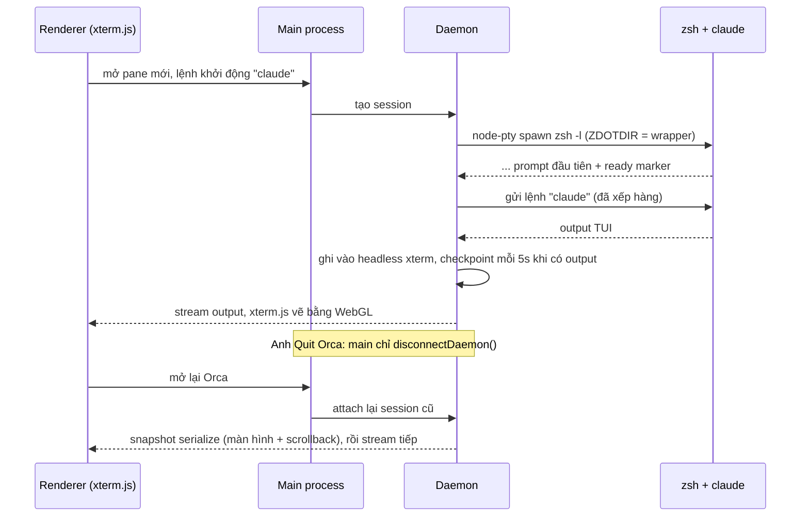

> [!quote] 💬
> "Ghostty-class terminals with WebGL rendering, infinite splits, and scrollback that survives restarts." (README.md:65)

# Orca chạy terminal thật như thế nào

Note này đi theo MỘT ví dụ xuyên suốt: agent chạy `claude` trong một ô terminal (pane) của worktree joy. Anh bấm Quit Orca. Sáng hôm sau mở lại, ô đó vẫn còn nguyên chữ cũ, và nếu `claude` còn sống thì nó vẫn đang chạy.

Bức tranh lớn về các tiến trình xem ở [[1-Kiến trúc tiến trình]]. Note này chỉ đào phần terminal.

## Nguồn của note này

Clone `stablyai/orca` commit `9db7b8b6` (2026-10-13). Từng phần dựa trên:

- PTY và node-pty: `src/main/daemon/pty-subprocess/native-pty-spawn.ts`, `src/main/providers/local-pty-runtime-spawn.ts`
- Daemon sống qua lần Quit: `src/main/startup/main-process-quit.ts`, `src/main/daemon/daemon-provider-state.ts`, `src/main/ipc/pty/kill-all.ts`
- Headless xterm và snapshot: `src/main/daemon/headless-emulator.ts`, `src/main/daemon/session.ts`, `src/main/daemon/daemon-pty-checkpoint-scheduler.ts`, `src/main/daemon/daemon-pty-runtime-state.ts`, `src/main/daemon/terminal-history-session-files.ts`, `src/main/terminal-scrollback-snapshots.ts`, `src/main/terminal-scrollback-snapshot-async-migration.ts`, `src/shared/terminal-scrollback-limits.ts`
- Lịch sử lệnh theo worktree: `src/main/terminal-history.ts`, `src/main/terminal-history-paths.ts`
- xterm.js ở renderer: `src/renderer/src/lib/pane-manager/pane-dom-creation.ts`, `pane-webgl-renderer.ts`, `terminal-webgl-addon-loader.ts`, `pane-split-scroll.ts`
- Shell wrapper, ready marker, OSC 133: `src/main/daemon/shell-ready.ts`, `src/main/zsh-startup-wrapper-builder.ts`, `src/main/shell-templates.ts`, `src/main/shell-ready-marker-scanner.ts`, `src/main/daemon/session-shell-ready-barrier.ts`, `src/main/powershell-osc133-bootstrap.ts`, `src/shared/terminal-osc133-command-finished.ts`
- Kill cây tiến trình: `src/main/pty-descendant-termination.ts`

---

## 1. PTY là gì, và Orca gọi node-pty ở đâu

> [!note] 📝 So sánh dễ hiểu
> Chương trình như `claude` hay `vim` chỉ chịu "nói chuyện" với một cái màn hình thật có bàn phím. PTY (pseudo-terminal, terminal giả) là một cái **điện thoại hai đầu**: một đầu cắm vào chương trình, chương trình tưởng mình đang nói với màn hình thật. Đầu kia Orca cầm: nghe chương trình nói gì (output) và gõ phím thay người dùng (input).

**Cơ chế** (📖 + 💭):
- Hệ điều hành tạo một cặp: đầu "master" (Orca giữ) và đầu "slave" (shell dùng làm stdin/stdout). 💭 Nhờ vậy chương trình biết nó đang trong terminal, bật màu, bật chế độ toàn màn hình, nhận Ctrl+C.
- Node.js không tự tạo PTY được. Orca dùng thư viện native `node-pty`. Hàm `spawn` trả về một `IPty` có `onData`, `write`, `resize`, `kill`.
- 📖 Orca nạp `node-pty` lười (lazy import), chỉ khi cần (`src/main/providers/local-pty-runtime-spawn.ts:11-14`).

**Code thật** 📖 `src/main/daemon/pty-subprocess/native-pty-spawn.ts:49-57`:

```ts
    const proc = nodePty.spawn(wrapped.file, wrapped.args, {
      name: args.env.TERM ?? 'xterm-256color',
      cols: args.cols,
      rows: args.rows,
      cwd,
      env: wrapped.env,
      // Why: bundled ConPTY has the wrap-marker behavior xterm expects.
      ...(process.platform === 'win32' ? { useConptyDll: true } : {})
    })
```

- `name` là giá trị `TERM`, mặc định `xterm-256color` 📖.
- `cols`/`rows` là kích thước ô. Khi anh kéo split, Orca phải gọi resize để chương trình vẽ lại đúng 💭.
- Trên Windows dùng ConPTY bản đóng gói sẵn 📖 (dòng 55-56).

Điểm quan trọng: file này nằm trong `src/main/daemon/`. Tức là PTY không do cửa sổ Orca giữ trực tiếp, mà do một **tiến trình daemon riêng** giữ. Đây là gốc của chuyện "scrollback sống qua restart".

---

## 2. Daemon giữ PTY, Quit Orca không giết `claude`

> [!note] 📝 So sánh dễ hiểu
> Orca giống cái remote TV, daemon là cái đầu thu. Anh tắt remote (Quit Orca) thì đầu thu vẫn chạy, kênh vẫn đang phát. Cầm remote lên lại thì bấm vào là thấy ngay kênh đang chiếu.

**Cơ chế** 📖:
- Lúc thoát app, Orca chỉ **ngắt kết nối** với daemon, không tắt nó. Chỉ khi chạy dev mà tiến trình cha chết thì mới tắt hẳn (`main-process-quit.ts:259-260`).
- `killAllPty()` chỉ giết PTY chạy ngay trong tiến trình (local, không qua daemon). PTY của daemon được giữ lại (`src/main/ipc/pty/kill-all.ts:4-11`).
- Trên macOS bản đóng gói, daemon chạy từ một bản sao riêng tên `Orca Terminal Host.app`, khởi động qua launchd, để quyền truy cập file của macOS không bị mất khi app update (`docs/reference/macos-daemon-tcc-attribution.md:8-24`). Chi tiết thuộc [[1-Kiến trúc tiến trình]].

**Code thật** 📖 `src/main/daemon/daemon-provider-state.ts:115-128`:

```ts
// Disconnect without killing: the daemon survives app quit so sessions stay warm for reattach.
// Leave history sessions marked "unclean" so a daemon crash while Orca is closed stays recoverable.
export async function disconnectDaemon(): Promise<void> {
  await adapter?.disconnectOnly()
  adapter = null
}

/** Kill the daemon and all its sessions. Use for full cleanup only. */
export async function shutdownDaemon(): Promise<void> {
  adapter?.dispose()
  adapter = null
  await spawner?.shutdown()
  spawner = null
}
```

📖 `src/main/startup/main-process-quit.ts:259-260`:

```ts
    // Why: normal quits keep the detached daemon for warm reattach, but a dead dev parent leaves the temp/dev profile ownerless.
    const daemonTeardown = isDevParentShutdownRequested() ? shutdownDaemon() : disconnectDaemon()
```

💭 Hệ quả cho ví dụ: Quit Orca thì `claude` vẫn chạy tiếp trong daemon. Nó chỉ chết nếu máy tắt, daemon crash, hoặc anh đóng pane.

---

## 3. Headless xterm: daemon tự "xem" màn hình để chụp lại

Daemon giữ PTY, nhưng byte thô từ PTY toàn là mã escape (di chuyển con trỏ, xoá dòng, đổi màu). Nếu chỉ lưu byte thô rồi phát lại, TUI như `claude` sẽ vỡ hình 💭. Orca giải bằng cách chạy **một xterm không giao diện** (headless) ngay trong daemon.

> [!note] 📝 So sánh dễ hiểu
> Byte thô giống đoạn ghi âm "lùi 3 bước, xoá dòng, viết chữ đỏ". Headless xterm là người ngồi làm theo đoạn ghi âm đó lên một tờ giấy. Khi cần, Orca chụp ảnh tờ giấy (serialize) thay vì phát lại cả đoạn ghi âm dài.

**Cơ chế** 📖:
- Mỗi session trong daemon có một `HeadlessEmulator` dùng `@xterm/headless` và `@xterm/addon-serialize` (`headless-emulator.ts:1-3`).
- Byte PTY đi qua barrier "shell ready" (phần 5) rồi vào output pipeline, ở đó được ghi vào emulator (`session.ts:91-95`).
- Scrollback mặc định 5000 dòng (`headless-emulator.ts:59`).
- `getSnapshot()` gọi serialize để ra một chuỗi ANSI tái tạo đúng màn hình + scrollback, kèm vị trí con trỏ tuyệt đối (`headless-emulator.ts:252-261`).
- Ghi đồng bộ (`writeSync`) khi cần snapshot, vì "restore snapshots are requested right after PTY bursts; queued writes could snapshot half-cleared TUI rows" (`headless-emulator.ts:218`).

**Code thật** 📖 `src/main/daemon/headless-emulator.ts:88-98`:

```ts
    this.terminal = new Terminal({
      cols: opts.cols,
      rows: opts.rows,
      scrollback: opts.scrollback ?? DEFAULT_SCROLLBACK,
      allowProposedApi: true,
      logLevel: 'off',
      // Why: parse CSI =/>/< u pushes so CSI ? u answers with the flags the hidden app pushed (renderer parity).
      vtExtensions: { kittyKeyboard: true }
    })

    this.serializer = new SerializeAddon()
    this.terminal.loadAddon(this.serializer)
```

📖 Dòng 100-102 còn nạp `Unicode11Addon` với lý do: phải đo độ rộng emoji giống renderer, nếu lệch thì "the mirror accumulates cell-shifted tears".

### Ghi xuống đĩa định kỳ (checkpoint)

Snapshot trong RAM chỉ cứu được khi daemon còn sống. Để chống trường hợp daemon chết (tắt máy), Orca ghi checkpoint xuống đĩa.

- 📖 Bộ hẹn giờ 5 giây (`daemon-pty-runtime-state.ts:149`: `CHECKPOINT_INTERVAL_MS = 5_000`), và chỉ chạy khi có session "bẩn" (có output mới): "a permanent 5s interval woke the main process for idle terminals with nothing to write" (`daemon-pty-checkpoint-scheduler.ts:28`).
- 📖 Không cho 2 lượt checkpoint chồng nhau, vì "concurrent tmp-file writes can lose a rename" (`daemon-pty-checkpoint-scheduler.ts:32`).
- 📖 Mỗi session có các file `checkpoint.json`, `output.log`, `meta.json`, `scrollback.bin` (`terminal-history-session-files.ts:9-12`). 💭 `output.log` là phần output phát sinh sau checkpoint gần nhất (log tăng dần), `checkpoint.json` là ảnh chụp đầy đủ.

### Lớp thứ ba: scrollback do renderer chụp

📖 `src/main/terminal-scrollback-snapshots.ts` lưu scrollback của từng pane thành file `terminal-scrollback/v1-<hash>.bin`, tên file băm từ `tabId` + `leafId` (dòng 23, 45-48). 📖 Trạng thái phiên làm việc cũ chứa chuỗi `buffersByLeafId` ngay trong file session, và `terminal-scrollback-snapshot-async-migration.ts:14-35` chuyển từng chuỗi ra file riêng, chỉ giữ `scrollbackRefsByLeafId`. 📖 Ghi file theo kiểu ghi tạm rồi `rename` (`terminal-scrollback-snapshots.ts:146-151`), giới hạn 5 MB mỗi file (`terminal-scrollback-limits.ts`: `TERMINAL_SCROLLBACK_STORE_BYTE_LIMIT = 5 * 1024 * 1024`).

```ts
    const tmpPath = `${path}.${process.pid}.${Date.now()}.${Math.random().toString(16).slice(2)}.tmp`
    const bytes = trailingUtf8Bytes(args.buffer, TERMINAL_SCROLLBACK_STORE_BYTE_LIMIT)
    let renamed = false
    try {
      writeFileSync(tmpPath, bytes, { mode: 0o600 })
      renameSync(tmpPath, path)
      renamed = true
```

📖 Comment ở `main-process-quit.ts:90`: "defer PTY cleanup to will-quit so the renderer captures scrollback before PTY-exit events unmount TerminalPane". 💭 Tức là renderer kịp chụp scrollback trước khi pane bị gỡ. Lớp này chủ yếu cho PTY chạy trong tiến trình (không qua daemon). Chính xác khi nào renderer ghi lớp này với PTY daemon: chưa verify.

### Đừng nhầm với `terminal-history.ts`

📖 `src/main/terminal-history.ts` KHÔNG lưu chữ trên màn hình. Nó lưu **lịch sử lệnh** (phím mũi tên lên) riêng cho từng worktree bằng cách đặt biến `HISTFILE` trỏ vào `userData/terminal-history/<hash worktree>/zsh_history` (dòng 274-282, `terminal-history-paths.ts:5,12-14`). Nếu anh đã tự đặt `HISTFILE` thì Orca không đè (dòng 240-244, "check-before-set", cùng cách Ghostty, Kitty, VS Code làm). 📖 Lý do có thêm biến `ORCA_HISTFILE`: macOS `/etc/zshrc` gán `HISTFILE` vô điều kiện, nên wrapper phải gán lại sau (dòng 278-282).

---

## 4. xterm.js ở renderer: WebGL và split

> [!note] 📝 So sánh dễ hiểu
> Headless xterm ở daemon là bản nháp không ai nhìn. xterm.js ở renderer là cái màn hình thật anh nhìn. WebGL là nhờ card đồ hoạ vẽ chữ thay vì để trình duyệt dựng từng thẻ HTML, nên chữ chạy nhanh mà máy không nóng.

**Cơ chế** 📖:
- Mỗi pane tạo một `new Terminal(...)` của `@xterm/xterm`, kèm các addon fit, search, serialize, unicode11, web-links (`pane-dom-creation.ts:1-6, 48`).
- Addon WebGL (243 KB) được nạp lười, ngoài đường khởi động, rồi gắn khi pane có kích thước thật (`terminal-webgl-addon-loader.ts:4-14`).
- Nếu WebGL mất context (GPU reset, máy ngủ dậy), pane đó tự rơi về DOM renderer (`pane-webgl-renderer.ts:290-314`). Nếu tạo WebGL lỗi ở chế độ "auto", các pane mới cũng dùng DOM luôn (dòng 319-323).

**Code thật** 📖 `src/renderer/src/lib/pane-manager/pane-webgl-renderer.ts:310-316`:

```ts
      // Why: context loss switches this pane to DOM until the next resume or
      // settled reveal; the bounded loss window refuses unstable retries.
      pane.webglDisabledAfterContextLoss = true
      disposeWebgl(pane, { refreshDimensions: true })
    })
    pane.terminal.loadAddon(addon)
    pane.webglAddon = addon
    refreshTerminalAfterWebglAttach(pane)
```

**Split** 📖: `PaneManager.splitPane(paneId, 'vertical' | 'horizontal')` (`pane-manager.ts:127-133`). Có một bẫy hay ở `pane-split-scroll.ts:88-93`:

```ts
// The optional reattachWebgl callback re-creates the WebGL addon after the
// DOM has settled. splitPane() disposes WebGL before wrapInSplit() to free
// the GPU context slot (Chromium silently kills the oldest context when
// approaching its limit without firing contextlost). Reattaching at 200ms
// — after all layout and reflow have completed — creates a fresh context on
// a stable DOM tree.
```

💭 Chromium giới hạn số WebGL context. Split nhiều pane mà không trả context cũ thì pane cũ nhất bị giết im lặng, chữ đứng hình mà không có lỗi nào. Orca trả context trước, 200ms sau mới tạo lại.

---

## 5. Shell wrapper: chen code của Orca vào shell của anh

Orca cần biết hai việc: (a) shell đã sẵn sàng nhận lệnh chưa, (b) một lệnh vừa bắt đầu hay vừa xong, mã thoát bao nhiêu. Shell không tự báo, nên Orca chen một đoạn script khởi động.

> [!note] 📝 So sánh dễ hiểu
> Giống gắn chuông cửa cho nhà người khác mà không được sửa nhà. Orca không sửa `~/.zshrc` của anh. Nó đứng trước cửa (ZDOTDIR), mời anh vào nhà mình như thường, rồi lắp cái chuông ở lần đầu anh ngồi xuống (prompt đầu tiên).

### 5a. zsh: mượn ZDOTDIR rồi trả lại ngay

📖 `src/main/daemon/shell-ready.ts:140-157`: với zsh, Orca chạy `zsh -l` và đặt `ZDOTDIR` trỏ vào thư mục wrapper của mình. Nếu file wrapper không ghi được thì chạy zsh thường, vì "ZDOTDIR pointed at an incomplete wrapper dir makes zsh skip the user's whole config. Losing Orca's features is recoverable" (dòng 145-147).

📖 `zsh-startup-wrapper-builder.ts:3-23` kể lý do thiết kế: bản cũ giữ ZDOTDIR giả suốt quá trình khởi động và gây cả một họ bug (lịch sử lệnh lưu nhầm chỗ #11044, file người dùng có `emulate sh` làm hỏng wrapper). Bản mới trả ZDOTDIR lại ngay, rồi dồn mọi việc của Orca vào một hook `precmd` chạy ở prompt đầu tiên, tức là SAU `.zprofile`, `/etc/zshrc`, `.zshrc`, `.zlogin`.

Thứ tự file `.zshenv` Orca sinh ra 📖 (`zsh-startup-wrapper-builder.ts:212-222`): trả ZDOTDIR → kênh feature → marker định danh → hàm OSC 133 → khởi tạo trì hoãn → cuối cùng mới `source` `.zshenv` của anh. 📖 "ORDER IS LOAD-BEARING" (dòng 25-30): các hàm phải định nghĩa trước khi source file của người dùng, vì nếu file đó kết thúc bằng `emulate sh` thì cú pháp zsh phía sau sẽ không parse được.

📖 bash thì đơn giản hơn: `bash --rcfile <wrapper>/bash/rcfile` (`shell-ready.ts:160-170`).

### 5b. Ready marker: "tôi sẵn sàng rồi"

📖 Marker là một chuỗi escape riêng của Orca, `\x1b]777;orca-shell-ready ... \x07` (`shell-ready-marker-scanner.ts:1`). Shell in ra nó khi line editor sẵn sàng (khối `zle-line-init` trong `shell-templates.ts:153-170`).

📖 Phía daemon, `SessionShellReadyBarrier`:
- Trong lúc chờ, mọi thứ gõ vào stdin bị **xếp hàng**, chưa gửi cho shell (`session-shell-ready-barrier.ts:82-109`).
- Mỗi chunk output được quét tìm marker. Marker bị **cắt bỏ** trước khi gửi đi, nên anh không bao giờ thấy nó trên màn hình (dòng 111-127).
- Hết 15 giây không thấy marker thì bỏ chờ (dòng 22, 65-67).

📖 Bộ quét chịu được marker bị cắt đôi giữa 2 chunk: nó giữ lại các byte "nghi là đầu marker" trong `heldBytes`, nếu không khớp thì trả lại vào output (`shell-ready-marker-scanner.ts:52-61`):

```ts
    } else if (ch === '\x07') {
      const remaining = data.slice(i + 1)
      state.heldBytes = ''
      state.matchPos = 0
      return {
        output: output + remaining,
        matched: true,
        postMarkerBytesObserved: remaining.length > 0,
        postMarkerOutputIndex: output.length
      }
```

📖 Với zsh còn có đường gửi lệnh khởi động: nếu có biến lệnh khởi động, hook gán `BUFFER` bằng lệnh đó rồi `zle accept-line` (`shell-templates.ts:162-169`). 💭 Đây là cách Orca "gõ" `claude` vào pane mới mà không bị mất ký tự do shell chưa sẵn sàng. Agent được khởi động thế nào xem [[4-Tích hợp agent]].

### 5c. OSC 133: báo đầu và cuối mỗi lệnh

OSC 133 là chuẩn "shell integration" mà nhiều terminal (VS Code, iTerm2, Ghostty...) dùng 💭. Shell in các chuỗi escape vô hình:

| Mã | Ý nghĩa | Ai in trong Orca |
|---|---|---|
| `133;A` | Bắt đầu vẽ prompt | `precmd` (zsh), `prompt` (PowerShell) |
| `133;B` | Prompt xong, chỗ gõ lệnh bắt đầu | PowerShell `prompt` |
| `133;C` | Lệnh bắt đầu chạy | `preexec` (zsh), `PSConsoleHostReadLine` |
| `133;D;<exit>` | Lệnh xong, kèm mã thoát | `precmd` của prompt kế tiếp |

📖 Bản zsh (`zsh-startup-wrapper-builder.ts:93-106`):

```ts
const ZSH_OSC133_FUNCTION_BLOCK = `__orca_osc133_precmd() {
  local exit_code=$?
  if [[ -n "\${__orca_in_command:-}" ]]; then
    builtin printf "\\033]133;D;%s\\007" "$exit_code"
    builtin unset __orca_in_command
  fi
  builtin printf "\\033]133;A\\007"
}
__orca_osc133_preexec() {
  builtin printf "\\033]133;C\\007"
  # Why typeset -g: a plain assignment here creates a global inside a function,
  # which prints a warning above every command under warn_create_global.
  builtin typeset -g __orca_in_command=1
}`
```

💭 Mẹo: `D` chỉ in khi trước đó đã có `C` (biến `__orca_in_command`). Nhấn Enter trên dòng trống sẽ không bị tính là "một lệnh vừa xong".

📖 PowerShell (`powershell-osc133-bootstrap.ts:73-92`) bọc hàm `prompt` của người dùng: in `D` + `A`, gọi prompt gốc, in `B`. Mã thoát chỉ là 0/1 vì PowerShell chỉ có `$?` (dòng 75). 📖 Script được truyền bằng `-EncodedCommand` (base64), vì cách dot-source file `.ps1` như VS Code bị chặn khi execution policy là `Restricted`/`AllSigned`, làm mất OSC 133 âm thầm (dòng 7-23).

📖 Phía đọc: `createOsc133CommandFinishedScanner` quét chunk, chịu được chuỗi bị cắt giữa chừng, gọi callback khi gặp `C` hoặc `D` (`src/shared/terminal-osc133-command-finished.ts:71-80`):

```ts
  const handleOsc133 = (payload: string, endInChunk: number): void => {
    const [sequence, exitCode] = payload.split(';')
    if (sequence === 'C') {
      onCommandStarted?.(endInChunk)
      return
    }
    if (sequence === 'D') {
      onCommandFinished(parseBestEffortExitCode(exitCode))
    }
  }
```

📖 Comment đầu file (dòng 4-8): main dùng scanner này để phát sự kiện `command-finished` cho PTY local/SSH, renderer dùng cùng code cho PTY remote. 💭 Đây là thứ cho Orca biết "agent trong pane đã thoát về shell", để cập nhật trạng thái tab.

---

## 6. Đóng pane: giết cả cây tiến trình mà không giết nhầm

> [!note] 📝 So sánh dễ hiểu
> Đóng pane giống cho một đội thợ nghỉ việc. Shell là đội trưởng, `claude` là thợ, `claude` lại thuê thêm `node`, `git`, MCP server. Đuổi mỗi đội trưởng thì thợ ở lại làm "ma". Nhưng số áo (PID) được tái sử dụng: nếu đi theo danh sách cũ mà đuổi người mặc áo số 1234, có khi đuổi nhầm người của đội khác vừa nhận áo đó.

**Cơ chế** 📖 (`src/main/pty-descendant-termination.ts`):
1. Chụp bảng tiến trình bằng `ps -axo pid=,ppid=,pgid=,lstart=`, ép `LANG=C` để ngày giờ parse giống nhau ở mọi máy (dòng 55-65).
2. Đi theo `ppid` từ PID gốc để tìm con cháu. Nếu gốc không còn trong bảng thì **bỏ cuộc**, vì con cháu thật đã bị chuyển sang PID 1, còn các dòng trỏ vào PID cũ có thể là tiến trình lạ (dòng 163-169).
3. Gửi `SIGTERM` cho con cháu **trước** khi giết gốc, để quan hệ cha con còn nguyên (dòng 310-319).
4. Sau 2 giây (`DESCENDANT_KILL_GRACE_MS`, dòng 12), chụp lại bảng. Chỉ `SIGKILL` tiến trình còn sống có cùng thời điểm khởi động và cùng process group với lúc chụp (dòng 387-398).
5. Tiến trình sinh ra đúng trong giây chụp bảng thì không bao giờ bị `SIGKILL`, vì `lstart` chỉ chính xác tới giây (dòng 346-348).
6. Windows đi đường khác: dùng Job Object Orca tạo ra, chỉ dùng `taskkill /T /F` sau khi xác minh PID đúng là của mình (dòng 262-289).

**Code thật** 📖 `src/main/pty-descendant-termination.ts:163-169`:

```ts
  // Why: a ppid walk is only meaningful while the root is alive in this snapshot.
  // An absent root has already exited — its real descendants reparent to pid 1 and
  // become unreachable by ppid, so any rows still pointing at the vacated PID are a
  // PID-reuse coincidence. Sweeping them could signal an unrelated process, so bail.
  if (!rootRow || duplicateRoot) {
    return { rootPgid: null, descendants: [], capturedAtMs }
  }
```

---

## 7. Ghép lại: ví dụ `claude` từ lúc mở đến lúc mở lại



Từng bước:
1. Pane mới, lệnh khởi động `claude`. Daemon gọi `nodePty.spawn` (`native-pty-spawn.ts:49`) với `zsh -l` và `ZDOTDIR` trỏ vào wrapper (`shell-ready.ts:149-156`).
2. zsh đọc config của anh như thường. Ở prompt đầu, hook của Orca chạy, in ready marker. Daemon cắt marker, mở cổng stdin, lệnh `claude` được đưa vào (`session-shell-ready-barrier.ts:111-127`).
3. `claude` vẽ TUI. Mọi byte vào headless xterm trong daemon. Có output mới thì cứ 5 giây ghi checkpoint xuống đĩa (`daemon-pty-checkpoint-scheduler.ts:28-37`).
4. Anh Quit. `disconnectDaemon()` chạy, daemon sống tiếp, `claude` vẫn chạy (`main-process-quit.ts:260`).
5. Mở lại Orca. Main kết nối lại daemon. Session còn sống nên lấy `getSnapshot()` từ headless xterm (`session.ts:220-223`) và vẽ lại trong renderer. 💭 Đây là "warm reattach", gần như tức thì.
6. Nếu máy đã khởi động lại (daemon chết), Orca đọc `checkpoint.json` + `output.log` để vẽ lại chữ cũ ("cold restore"), nhưng tiến trình `claude` cũ không còn. 📖 Renderer có bước dựng lệnh resume agent khi cold restore (`cold-restore-resume-startup.ts:23-40`). Chi tiết resume phiên `claude` thế nào: chưa verify, xem [[4-Tích hợp agent]].

---

## Bài học cho mình (Joy / Node.js)

1. 💭 **Ghi file tạm rồi `rename`**. Orca dùng cách này cho mọi file trạng thái (`terminal-scrollback-snapshots.ts:146-151`). Script one-off của mình ghi file JSON tiến độ (ví dụ file resume cho lệnh repair store credit) nên làm y vậy: crash giữa chừng thì file cũ còn nguyên, không bị file JSON cụt.
2. 💭 **Không để 2 lượt ghi chồng nhau, và hẹn giờ chỉ khi có việc**. `checkpointInFlight` + timer chỉ bật khi có session bẩn. Trong Firebase Functions hoặc job sync Shopify, cờ "đang chạy" + chỉ lên lịch khi có dữ liệu mới giúp tránh 2 lượt sync ghi đè nhau (giống chuyện Pub/Sub redelivery làm nhân đôi log ở le-petit-society).
3. 💭 **"Không chắc" không được coi là "chết"**. Orca không giết theo PID nếu không chứng minh được danh tính (thời điểm khởi động, process group). Với dữ liệu Joy cũng vậy: lệnh xoá/điều chỉnh điểm chỉ đụng bản ghi chứng minh được là của mình (đúng shop, đúng id gốc), còn lại thì log và bỏ qua.
4. 💭 **Quét stream phải chịu được chuỗi bị cắt giữa 2 chunk**. Cả ready marker lẫn OSC 133 đều giữ "phần đuôi nghi ngờ" sang chunk sau. Khi đọc stream (BigQuery export, CSV lớn, webhook body chia mảnh) mà tìm một dấu hiệu, nhớ giữ phần đuôi chưa trọn.

---

## Nguồn

- README.md:63-67 (https://github.com/stablyai/orca)
- docs/reference/macos-daemon-tcc-attribution.md
- src/main/daemon/AGENTS.md
- src/main/providers/local-pty-runtime-spawn.ts
- src/main/daemon/pty-subprocess/native-pty-spawn.ts
- src/main/startup/main-process-quit.ts
- src/main/daemon/daemon-provider-state.ts
- src/main/ipc/pty/kill-all.ts
- src/main/daemon/headless-emulator.ts
- src/main/daemon/session.ts
- src/main/daemon/daemon-pty-checkpoint-scheduler.ts
- src/main/daemon/daemon-pty-checkpoint-persistence.ts
- src/main/daemon/daemon-pty-runtime-state.ts
- src/main/daemon/history-manager.ts
- src/main/daemon/terminal-history-session-files.ts
- src/main/daemon/terminal-history-cold-restore-info.ts
- src/main/terminal-scrollback-snapshots.ts
- src/main/terminal-scrollback-snapshot-async-migration.ts
- src/shared/terminal-scrollback-limits.ts
- src/main/terminal-history.ts
- src/main/terminal-history-paths.ts
- src/renderer/src/lib/pane-manager/pane-dom-creation.ts
- src/renderer/src/lib/pane-manager/pane-manager.ts
- src/renderer/src/lib/pane-manager/pane-webgl-renderer.ts
- src/renderer/src/lib/pane-manager/terminal-webgl-addon-loader.ts
- src/renderer/src/lib/pane-manager/pane-split-scroll.ts
- src/renderer/src/components/terminal-pane/pty-connection/cold-restore-resume-startup.ts
- src/main/daemon/shell-ready.ts
- src/main/daemon/session-shell-ready-barrier.ts
- src/main/zsh-startup-wrapper-builder.ts
- src/main/shell-templates.ts
- src/main/shell-ready-marker-scanner.ts
- src/main/shell-startup-output-scanner.ts
- src/main/powershell-osc133-bootstrap.ts
- src/shared/terminal-osc133-command-finished.ts
- src/main/pty-descendant-termination.ts
