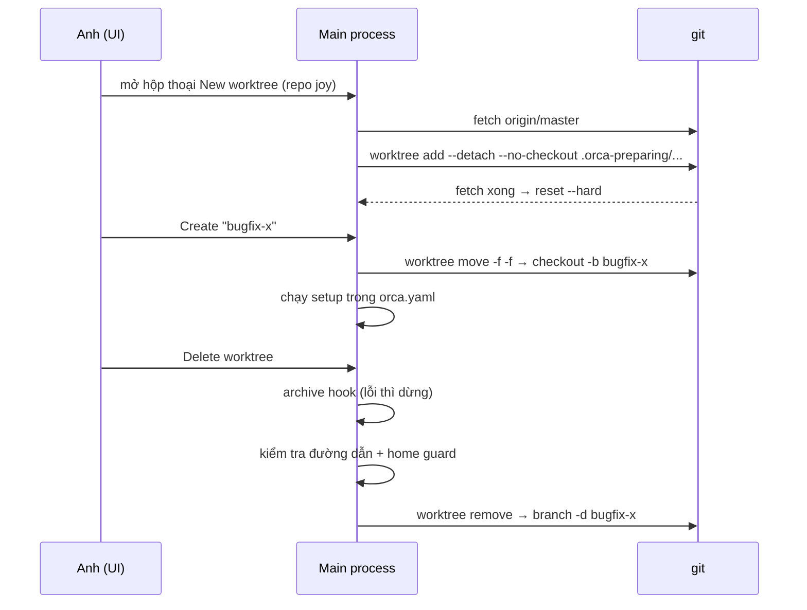

> [!quote] 💬
> "Fan one prompt across five agents, each in its own isolated git worktree — compare the results and merge the winner." (📖 `README.md:51`)

# 3 - Worktree & Git: mỗi task một thư mục riêng

Trong Orca, đơn vị cách ly (isolation unit) là **git worktree**. Mỗi task (sửa bug, làm feature) có một thư mục code riêng, một branch riêng, các agent chạy trong đó. Note này đi theo một ví dụ: anh tạo worktree `bugfix-x` cho repo `joy` từ một Linear issue, để agent làm, rồi xoá đi.

Note liên quan: [[0-Tổng quan]], [[1-Kiến trúc tiến trình]] (main process vs renderer), [[2-Terminal & PTY]] (terminal chạy setup), [[4-Tích hợp agent]].

## Nguồn của note này

- Git worktree là gì: https://git-scm.com/docs/git-worktree (WebFetch 2026-10-14).
- Tạo worktree và "kho chuẩn bị sẵn": `src/main/worktree-create-preparation-pool.ts`, `src/main/worktree-create-preparation.ts`, `src/main/git/worktree-create-preparation.ts`, `src/main/git/worktree-preparation-add.ts`, `src/shared/worktree/create-preparation.ts`.
- Chọn base branch và fetch trước: `src/main/worktree-create-base.ts`, `src/main/worktree-create-base-prefetch.ts`, `src/main/ipc/worktrees/create/register-worktree-prefetch-handler.ts`.
- Hook `orca.yaml`: `orca.yaml` (gốc repo), `src/main/hooks.ts`, `src/main/setup-hook-env-vars.ts`, `src/main/setup-runner-script-text.ts`, `src/main/runtime/runtime-local-worktree-setup.ts`.
- Xoá an toàn: `src/main/ipc/worktrees/removal/execute-worktree-removal.ts`, `src/main/worktree-archive-hook-gate.ts`, `src/main/worktree-removal-safety.ts`, `src/main/worktree-removal-home-guard.ts`, `src/main/git/worktree-removal.ts`, `src/main/git/worktree-branch-removal.ts`, `src/main/worktree-trash.ts`.
- Ghi chú trên diff và tích hợp task: `src/shared/diff-comment-types.ts`, `src/main/folder-workspace-diff-comments.ts`, `src/shared/worktree/meta-types.ts`, `src/main/source-control/forge-provider.ts`, `src/main/linear/linear-sdk.ts`, `src/main/github/gh-utils.ts`, `src/cli/root-help-text-secondary.ts`.

Code đọc từ shallow clone `stablyai/orca` commit `9db7b8b6` (2026-10-13).

---

## 1. Git worktree là gì

> [!note] 📝 So sánh dễ hiểu
> Một repo git giống một kho hàng. Bình thường anh chỉ có **một quầy** (thư mục code) để bày hàng của **một branch**. Muốn xem branch khác phải dọn quầy (stash, checkout). Worktree là mở thêm **quầy thứ hai, thứ ba** cạnh nhau, mỗi quầy bày một branch, nhưng tất cả lấy hàng từ **chung một kho** (`.git`). Không phải clone lại cả repo.

Cơ chế (📖 trích git docs, https://git-scm.com/docs/git-worktree):

- "A git repository can support multiple working trees, allowing you to check out more than one branch at a time."
- Thư mục tạo thêm gọi là "linked worktree", khác với "main worktree" tạo bởi `git init` hoặc `git clone`.
- Lệnh xoá `git worktree remove`: "Only clean worktrees (no untracked files and no modification in tracked files) can be removed. Unclean worktrees or ones with submodules can be removed with `--force`. The main worktree cannot be removed."

Vì sao Orca chọn worktree làm đơn vị cách ly (💭): 5 agent sửa code song song mà dùng chung một thư mục thì đè file lên nhau. Mỗi agent một worktree thì mỗi agent có file riêng, branch riêng, nhưng vẫn chung lịch sử commit, nên so sánh và merge dễ. Anh đang dùng đúng mô hình này: mỗi task Joy một worktree dưới `~/orca/workspaces/joy/`.

---

## 2. Tạo worktree: có "kho chuẩn bị sẵn" (pre-warmed pool) thật

Câu hỏi đặt ra: Orca có làm sẵn worktree trước khi anh bấm Create không? **Có.** 📖

> [!note] 📝 So sánh dễ hiểu
> Giống quán phở thấy khách bước vào cửa là đã trụng sẵn bánh. Khách gọi món xong chỉ cần chan nước, đặt tên bàn. Nếu khách đổi ý (gọi bún) thì đổ bánh đã trụng đi, không sao.

### Cơ chế

Lúc anh **mở hộp thoại tạo worktree** (composer), renderer gọi IPC `worktrees:prefetchCreateBase`. Main process vừa fetch base branch, vừa bắt đầu dựng một checkout "nháp" ở nền. Comment trong code nói thẳng việc này chạy "while the create composer is open" (📖 `src/main/worktree-create-preparation.ts:117-118`).

📖 `src/main/ipc/worktrees/create/register-worktree-prefetch-handler.ts:10-28`:
```ts
  ipcMain.handle(
    'worktrees:prefetchCreateBase',
    async (_event, args: { repoId: string; baseBranch?: string }): Promise<void> => {
      const repo = store.getRepo(args.repoId)
      ...
        await prefetchWorktreeCreateBase({
          ...
          prepareCheckout: (base, beforeMaterialization) =>
            prepareWorktreeCreateForRepo(store, repo, base, beforeMaterialization)
        })
      } catch {
        // Why: optimistic warm-up; the real create path awaits the same refresh and reports failures there.
      }
```

Kho chuẩn bị có giới hạn: tối đa **3** checkout nháp, mỗi cái sống **5 phút** rồi bị huỷ (📖 `src/main/worktree-create-preparation-pool.ts:45-46`):
```ts
export const WORKTREE_CREATE_PREPARATION_TTL_MS = 5 * 60_000
export const WORKTREE_CREATE_PREPARATION_LIMIT = 3
```
Đầy 3 cái thì đuổi cái cũ nhất của cùng repo trước (📖 `pool.ts:99-121`, hàm `enforcePreparationLimit`).

Checkout nháp nằm trong thư mục ẩn `.orca-preparing/<pid>-<uuid>` ở workspace root (📖 `src/shared/worktree/create-preparation.ts:1`, `pool.ts:220-221`).

### Đi theo ví dụ: anh tạo `bugfix-x` cho repo `joy`

1. Anh mở hộp thoại New worktree, chọn repo `joy`. Renderer gọi `prefetchWorktreeCreateBase` (📖 `src/renderer/src/hooks/composer-state/linked-item-lookup-effects.ts:77`).
2. Main chọn base branch (mục 3) và bắt đầu `git fetch` cho base đó.
3. Song song, Orca chạy `git worktree add --detach --no-checkout` vào `.orca-preparing/...`, kèm một **lock reason** để đánh dấu "cái này của Orca" (📖 `src/main/git/worktree-preparation-add.ts:47-58`):
   ```ts
        [
          ...windowsLongPathGitArgs(repoPath),
          'worktree',
          'add',
          '--detach',
          '--no-checkout',
          ...lockArgs,
          worktreePath,
          baseRef
        ],
   ```
4. Fetch xong, Orca bung file ra bằng `git reset --hard <commit>`. Lý do dùng `reset` thay vì checkout: không chạy hook `post-checkout` của người dùng trước khi anh bấm Create (📖 `src/main/git/worktree-create-preparation.ts:73-77`).
5. Anh gõ tên `bugfix-x`, bấm Create. Orca "nhận" checkout nháp (`consumePreparedWorktreeCreate`). Nếu base đã trôi thêm commit thì `reset --hard` lại về commit mới (📖 `git/worktree-create-preparation.ts:189-196`).
6. Dời thư mục nháp sang đường dẫn thật bằng `git worktree move -f -f` (📖 `git/worktree-create-preparation.ts:201-214`):
   ```ts
          // Why: `-f -f` moves the locked preparation while preserving its lock reason (Git >=2.25).
          await gitExecFileAsync(
            [
              ...windowsLongPathGitArgs(repoPath),
              'worktree',
              'move',
              '-f',
              '-f',
              preparedPath,
              worktreePath
            ],
   ```
7. Tạo branch `bugfix-x` ngay tại đó: `git checkout --no-track -b bugfix-x <commit>` (📖 `git/worktree-create-preparation.ts:222-229`).
8. Nếu không có checkout nháp nào khớp (miss) thì Orca đi đường thường: `git worktree add` đầy đủ. Comment xác nhận: "A later create still has the normal add path if speculative preparation fails." (📖 `src/main/worktree-create-preparation.ts:163-165`).

💭 Với repo lớn như `joy`, bước bung file (hàng chục nghìn file) là phần chậm nhất. Làm trước lúc anh còn đang gõ tên giúp cảm giác "bấm là có".

Lock reason quan trọng cho an toàn: code chỉ coi một worktree là "nháp của Orca" khi lock reason khớp, không dựa vào hình dạng đường dẫn, vì người dùng có thể tự đặt đường dẫn giống vậy (📖 `src/shared/worktree/create-preparation.ts:37-40`).

---

## 3. Chọn base branch

> [!note] 📝 So sánh dễ hiểu
> Base branch là "bản gốc" để photo ra bản nháp. Anh chỉ định thì dùng bản anh chỉ. Không chỉ định thì lấy bản mặc định của repo (thường `main`/`master`). Repo có ghi nhớ một bản riêng thì kiểm tra bản đó còn dùng được không, hỏng thì quay về mặc định.

📖 `src/main/worktree-create-base.ts:11-28`:
```ts
  if (args.requestedBaseBranch) {
    return args.requestedBaseBranch
  }

  const defaultBaseRef = await args.resolveDefaultBaseRef()
  const repoWorktreeBaseRef = args.repoWorktreeBaseRef
  if (!repoWorktreeBaseRef) {
    return defaultBaseRef
  }
  ...
  // Stale persisted refs fall back to the detected default; usable custom refs stay authoritative.
  return (await args.isBaseUsable(repoWorktreeBaseRef)) ? repoWorktreeBaseRef : defaultBaseRef
```

Thứ tự ưu tiên: (1) base anh chọn trong hộp thoại → (2) `repo.worktreeBaseRef` đã lưu, nếu còn dùng được → (3) branch mặc định dò được.

Fetch trước (prefetch): nếu base có remote-tracking ref (ví dụ `origin/master`), Orca bắt đầu fetch và cho checkout nháp **chờ** fetch xong rồi mới bung file. Mất mạng thì vẫn giữ tip local (📖 `src/main/worktree-create-base-prefetch.ts:99-107`):
```ts
      if (hasTrackingRef) {
        // Register during fetch, then materialize the settled base once; offline keeps its local tip.
        const beforeMaterialization = refresh.then(
          () => {},
          () => {}
        )
        prepareLocalCheckout(resolvedBaseBranch, beforeMaterialization)
      }
      await refresh
```

💭 Với Joy: base là `master` mới nhất trên GitLab, nên worktree mới không bị "cũ ngay từ lúc sinh" như khi anh quên `git pull` ở checkout chính.

---

## 4. Hook trong `orca.yaml`: setup và archive

> [!note] 📝 So sánh dễ hiểu
> `orca.yaml` là tờ "hướng dẫn mở quầy / đóng quầy" dán ở mỗi quầy. Mở quầy mới (setup): cài hàng, bật đèn. Đóng quầy (archive): kiểm kê, dọn rác. Orca đọc tờ này và tự làm.

### File mẫu

`orca.yaml` ở gốc repo Orca chính là ví dụ (📖 `orca.yaml:1-4`):
```yaml
scripts:
  setup: |
    node config/scripts/run-internal-dev-setup.mjs
    pnpm install
```

Các key cấp cao Orca hiểu (📖 `src/main/hooks.ts:141-148`): `scripts`, `setupAgentStartupPolicy`, `issueCommand`, `defaultTabs`, `environmentRecipes`, `worktree`. Key lạ thì UI gợi ý cập nhật app thay vì báo lỗi parse (📖 `hooks.ts:140`).

### Cơ chế

- Đọc `orca.yaml` **từ chính worktree mới**, không phải checkout chính (📖 `hooks.ts:167-170`, `hooksRoot = worktreePath ?? repo.path`). 💭 Nghĩa là branch nào sửa `orca.yaml` thì worktree của branch đó dùng bản sửa.
- Ngoài file yaml, repo còn có setup "local" lưu trong cài đặt Orca. Chính sách `local-only` / `run-both` quyết định chạy cái nào (📖 `hooks.ts:172-198`).
- Script nhận biến môi trường để biết mình đang ở đâu (📖 `src/main/setup-hook-env-vars.ts:14-23`):
  ```ts
  export function getSetupEnvVars(repo: Repo, worktreePath: string): Record<string, string> {
    return {
      ORCA_ROOT_PATH: repo.path,
      ORCA_WORKTREE_PATH: worktreePath,
      ORCA_WORKSPACE_NAME: getRuntimePathBasename(worktreePath),
      // Compat with conductor.json users
      CONDUCTOR_ROOT_PATH: repo.path,
      GHOSTX_ROOT_PATH: repo.path
    }
  }
  ```
- Setup có 2 cách chạy (📖 `src/main/runtime/runtime-local-worktree-setup.ts:60-81`): (a) tạo **setup runner script** chạy trong một terminal Setup anh nhìn thấy được (xem [[2-Terminal & PTY]]); (b) chạy ngầm bằng `runHook('setup', ...)`, lỗi chỉ ghi log.
- Trên Windows, runner bọc từng dòng bằng `call` và dừng ngay khi một dòng lỗi, giống `set -e` (📖 `src/main/setup-runner-script-text.ts:38-39`):
  ```ts
      // Why: npm/pnpm are Windows batch files; `call` each line and bail on errorlevel for set -e fail-fast behavior.
      runnerScript += `call ${command}\r\nif errorlevel 1 exit /b %errorlevel%\r\n`
  ```
- `runHook` có hạn 2 phút (📖 `hooks.ts:24`, `HOOK_TIMEOUT = 120_000`) và tự giữ deadline thay vì tin `exec({ timeout })`, vì một hook bẫy SIGTERM rồi `exit 0` sẽ bị đọc nhầm là thành công (📖 `hooks.ts:267-271`).

### Ví dụ cho `joy` (💭, chưa thử thật)

```yaml
scripts:
  setup: |
    cp "$ORCA_ROOT_PATH/.env.agent" .env.agent
    yarn install
  archive: |
    echo "done $ORCA_WORKSPACE_NAME"
```
Setup copy file env từ checkout chính sang worktree mới, cài package. Đây là ví dụ minh hoạ, cần kiểm lại tên file env thật của Joy.

---

## 5. Xoá worktree an toàn

> [!note] 📝 So sánh dễ hiểu
> Dọn một quầy thì phải chắc là đang dọn **đúng quầy**, không phải kho chính, không phải cả căn nhà. Trước khi dọn còn phải chạy "kiểm kê đóng quầy" (archive hook). Kiểm kê lỗi thì dừng, không dọn.

### Đi theo ví dụ: anh xoá `bugfix-x`

1. **Archive hook chạy trước tiên**, khi checkout, terminal và agent còn nguyên. Hook lỗi thì ném lỗi, không bước nào phía sau được chạy, trừ khi anh chọn "xoá luôn" (`allowFailedArchiveHook`) (📖 `src/main/ipc/worktrees/removal/execute-worktree-removal.ts:150-168`, `src/main/worktree-archive-hook-gate.ts:9-33`):
   ```ts
   /**
    * The archive-hook precondition for a destructive worktree removal (#19334). Call it while the
    * checkout, its registration, its agents and its ownership evidence are all still intact: on a
    * failure it throws, and no caller may stop a PTY, deregister, or delete before it has returned.
   ```
2. **Kiểm tra đường dẫn nguy hiểm**: từ chối nếu đường dẫn rỗng, trùng repo chính, là ổ gốc `/`, chứa repo chính bên trong, hoặc là thư mục home (📖 `src/main/worktree-removal-safety.ts:55-82`):
   ```ts
     if (!worktreePath.trim()) {
       return true
     }
     if (areWorktreePathsEqual(worktreePath, repoPath)) {
       return true
     }
     ...
     if (containsPath(resolvedWorktreePath, resolvedRepoPath, pathOps)) {
       return true
     }
     // Raw, not `resolvedWorktreePath`: the guard re-reads the path under its own syntax too.
     return isHomeDirectoryRemovalPath(worktreePath, pathOps, home)
   ```
3. **Home guard**: ngoài so với `$HOME` thật, còn chặn mọi đường dẫn "trông giống" home trên POSIX, Windows profile, và home trong WSL (📖 `src/main/worktree-removal-home-guard.ts:111-115`). Nếu không biết home của máy đang chạy lệnh xoá (ví dụ máy SSH chưa báo) thì cũng từ chối (📖 `worktree-removal-safety.ts:107-113`, `isRemovalHomeAuthorityResolved`).
4. Từ chối xoá main worktree và worktree chưa đăng ký với git: `Refusing to delete unregistered worktree path` (📖 `worktree-removal-safety.ts:84-95`).
5. Từ chối nếu bên trong `bugfix-x` có worktree khác lồng vào. Lý do: `git worktree remove --force` coi worktree con như thư mục rác và xoá luôn file của nó (📖 `worktree-removal-safety.ts:128-133`).
6. Chạy `git worktree remove [--force] <path>`, không đặt timeout vì xoá checkout lớn có thể mất 29 giây ở p90 (📖 `src/main/git/worktree-removal.ts:66-85`).
7. Xoá branch `bugfix-x` bằng `git branch -d` (chữ thường), nên commit chưa merge vẫn được giữ. Chỉ khi tạo worktree thất bại mới dùng `-D` (📖 `src/main/git/worktree-branch-removal.ts:22-23, 70`).

Về `worktree-trash.ts`: bản cũ từng đổi tên thư mục vào `.orca-worktree-trash` rồi xoá nền, nhưng thoát app giữa chừng thì sót rác. Giờ không tạo trash nữa, file này chỉ còn dọn rác cũ, và chỉ xoá entry khớp đúng mẫu tên `wt-<số>-<8 hex>` (📖 `src/main/worktree-trash.ts:1-3, 14-17`).

💭 Điểm đáng học: mọi bước "xoá đệ quy" đều đòi **bằng chứng sở hữu** (lock reason, đăng ký git, home đã biết). Thiếu bằng chứng thì kết quả là "không xoá", không phải "đoán là được".

---

## 6. Ghi chú trên diff và tích hợp task

### Ghi chú trên diff (diff comments)

> [!note] 📝 So sánh dễ hiểu
> Như dán giấy nhớ lên đúng dòng code trong bài làm của agent ("dòng này sai currency"), xong gom hết giấy nhớ đưa lại cho agent sửa.

📖 `src/shared/diff-comment-types.ts:1-5`:
```ts
// Why: users leave review notes on specific lines of the modified side of
// a diff so they can be handed back to an AI agent (pasted into a terminal
// or used to bootstrap a new agent session). Stored on WorktreeMeta so the
// existing persistence layer writes them to orca-data.json automatically.
```
Mỗi `DiffComment` có `filePath`, `lineNumber` (và `startLine` nếu chọn nhiều dòng), `body`, `scope` (`unstaged` / `staged` / `branch`), và `sentAt` được đặt khi ghi chú đã gửi cho agent; sửa ghi chú thì `sentAt` bị xoá (📖 `diff-comment-types.ts:27-48`). Với folder workspace (thư mục không phải git), ghi chú được gom theo id workspace (📖 `src/main/folder-workspace-diff-comments.ts:24-37`).

### Gắn task GitHub / GitLab / Linear vào worktree

Metadata của worktree có sẵn chỗ để gắn task (📖 `src/shared/worktree/meta-types.ts:35-45`): `linkedIssue`, `linkedPR` (GitHub), `linkedLinearIssue`, `linkedGitLabMR`, `linkedGitLabIssue`, thêm Bitbucket và Azure DevOps.

| Nguồn | Cách Orca gọi | Bằng chứng |
|---|---|---|
| GitHub | qua CLI `gh` (`ghExecFileAsync`) | 📖 `src/main/github/gh-utils.ts:3` |
| GitLab | qua CLI `glab` (`glabExecFileAsync`) | 📖 `src/main/gitlab/gl-utils.ts:1` |
| Linear | qua thư viện `@linear/sdk` | 📖 `src/main/linear/linear-sdk.ts:1` |
| Tạo PR/MR chung | `forge-provider.ts` chọn GitHub/GitLab/Bitbucket/Gitea/Azure | 📖 `src/main/source-control/forge-provider.ts:26-33` |

Tạo worktree từ Linear bằng CLI (📖 `src/cli/root-help-text-secondary.ts:164`):
```
$ orca worktree create --name linear-task --linear-issue STA-335
```
Cờ tương ứng cho GitLab: `--gitlab-issue`, `--gitlab-mr`; cho GitHub: `--issue`, `--pr` (📖 `root-help-text-secondary.ts:53`).

💭 Vòng đời đầy đủ cho ví dụ của anh: `orca worktree create --name bugfix-x --repo joy --linear-issue JOY-123` → prefetch + checkout nháp → setup hook cài package → agent sửa code → anh để diff comment, gửi lại agent → tạo MR qua `glab` → archive hook → xoá worktree, branch giữ lại nếu chưa merge. Chưa verify cờ `--repo joy` nhận tên repo hay cần selector khác.



---

## Bài học cho mình (Joy / Node.js)

1. 💭 **Làm trước việc chậm khi người dùng còn đang điền form.** Orca dựng checkout lúc hộp thoại mở, có TTL 5 phút và giới hạn 3 cái. Ở Joy admin, có thể gọi trước API nặng (ví dụ load danh sách reward của shop) khi merchant mở modal, có hạn sống và giới hạn số lượng, và luôn còn đường thường nếu bản làm trước hỏng.
2. 💭 **Xoá dữ liệu cần bằng chứng sở hữu, thiếu bằng chứng thì không xoá.** Giống command dọn log trùng của Joy: chỉ xoá record có dấu hiệu chắc chắn do lần sync lỗi tạo ra (field đánh dấu, id chain), không dựa vào "trông giống".
3. 💭 **Hook "dọn dẹp" là điều kiện, không phải lời khuyên.** Orca chạy archive hook trước, lỗi thì không xoá. Với Firebase function xoá shop/uninstall: bước backup hay export phải xong và thành công thì mới xoá Firestore.
4. 💭 **Tự giữ deadline cho tiến trình con.** Orca không tin `exec({ timeout })` vì exit code sau SIGTERM có thể là 0. Script Node gọi lệnh ngoài (ví dụ `gcloud`, `firebase`) nên tự đặt timer và coi "hết giờ" là thất bại rõ ràng, không phải thành công.

## Chưa verify

- Đường dẫn mặc định nơi Orca đặt worktree (`computeWorkspaceRoot`, `getWorktreePathSettings`) chưa đọc kỹ.
- Cách UI source control panel hiển thị diff và nút "gửi ghi chú cho agent" ở renderer chưa mở.
- Ví dụ `orca.yaml` cho Joy ở mục 4 là minh hoạ, chưa chạy thật.

## Nguồn

- https://git-scm.com/docs/git-worktree
- `README.md`
- `orca.yaml`
- `src/main/ipc/worktrees/create/register-worktree-prefetch-handler.ts`
- `src/main/worktree-create-preparation.ts`
- `src/main/worktree-create-preparation-pool.ts`
- `src/main/git/worktree-preparation-add.ts`
- `src/main/git/worktree-create-preparation.ts`
- `src/shared/worktree/create-preparation.ts`
- `src/main/worktree-create-base.ts`
- `src/main/worktree-create-base-prefetch.ts`
- `src/renderer/src/hooks/composer-state/linked-item-lookup-effects.ts`
- `src/main/hooks.ts`
- `src/main/setup-hook-env-vars.ts`
- `src/main/setup-runner-script-text.ts`
- `src/main/runtime/runtime-local-worktree-setup.ts`
- `src/main/ipc/worktrees/removal/execute-worktree-removal.ts`
- `src/main/worktree-archive-hook-gate.ts`
- `src/main/worktree-removal-safety.ts`
- `src/main/worktree-removal-home-guard.ts`
- `src/main/git/worktree-removal.ts`
- `src/main/git/worktree-branch-removal.ts`
- `src/main/worktree-trash.ts`
- `src/shared/diff-comment-types.ts`
- `src/main/folder-workspace-diff-comments.ts`
- `src/shared/worktree/meta-types.ts`
- `src/main/source-control/forge-provider.ts`
- `src/main/github/gh-utils.ts`
- `src/main/gitlab/gl-utils.ts`
- `src/main/linear/linear-sdk.ts`
- `src/cli/root-help-text-secondary.ts`
