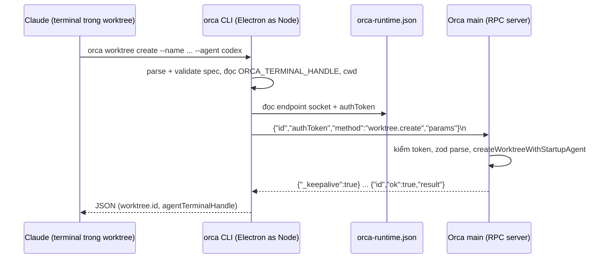

# 6 - CLI, RPC & Skills

> [!quote] 💬
> "Agents drive Orca too — script every workflow with `orca worktree create`, `snapshot`, `click`, and `fill`." (`README.md:149`)

Note này trả lời 4 câu: lệnh `orca` gõ trong terminal thực chất chạy cái gì, nó tìm và nói chuyện với app Orca đang mở bằng cách nào, agent (Claude, Codex…) chạy bên trong Orca học cách dùng CLI từ đâu, và plugin / automation ăn vào chỗ nào. Bối cảnh chung xem [[0-Tổng quan]], các tiến trình xem [[1-Kiến trúc tiến trình]].

## Nguồn của note này

- Lệnh `orca` là gì: `/Applications/Orca.app/Contents/Resources/bin/orca` (script trên máy), `src/cli/index.ts`
- Spec, parse, handler: `src/cli/command-spec.ts`, `src/cli/specs/index.ts`, `src/cli/dispatch.ts`, `src/cli/handler-group-manifest.ts`
- Tìm app + auth: `src/cli/runtime/metadata.ts`, `src/shared/runtime-bootstrap.ts`, `src/main/runtime/runtime-metadata.ts`, `src/main/runtime/runtime-rpc/runtime-rpc-socket-metadata.ts`, `runtime-rpc-state.ts`, `runtime-rpc-request-admission.ts`, `src/main/runtime/rpc/unix-socket-transport.ts`, file thật `~/Library/Application Support/orca/orca-runtime.json`
- Giao thức + phía server: `src/cli/runtime/transport.ts`, `src/cli/runtime/client.ts`, `src/main/runtime/rpc/dispatcher.ts`, `src/main/runtime/rpc/core.ts`, `src/main/runtime/rpc/methods/worktree.ts`, `src/shared/rpc-contract/rpc-params-catalog.generated.ts`
- Ví dụ `worktree create`: `src/cli/handlers/worktree.ts`, `src/cli/specs/core.ts`, `src/main/ipc/pty/provider/local-configure.ts`
- Skills: `skills/orca-cli/SKILL.md`, `skill-stubs/orca-cli.md`, `skill-stubs/_shared/cli-resolution.md`, `skill-guides/orca-cli.md`, `src/cli/specs/skills.ts`, `src/cli/bundled-skill-guides.ts`
- Plugins: `src/main/plugins/plugin-host-process.ts`, `src/shared/plugins/plugin-capabilities.ts`, `src/shared/plugins/plugin-manifest.ts`
- Automations: `src/main/automations/service.ts`, `orca automations create --help`
- Lệnh đã chạy trên máy (chỉ đọc): `orca --help`, `orca worktree create --help`, `orca status`, `orca skills list`, `orca skills get orca-cli`, `orca skills install --skill orca-cli --dry-run`, `orca automations list`, `orca agent-context`, `orca --version`

---

## 1. Lệnh `orca` thực chất là app Orca chạy ở chế độ Node

> [!note] 📝 So sánh dễ hiểu
> Giống cái remote TV: remote không có màn hình, không có kênh, nó chỉ bấm nút gửi tín hiệu tới TV. Lệnh `orca` là cái remote. Mọi dữ liệu (repo, worktree, terminal) nằm trong app Orca đang mở, tức là cái TV.

**Cơ chế.** 📖 Trên máy anh, `/Users/avada/.local/bin/orca` là symlink tới `/Applications/Orca.app/Contents/Resources/bin/orca`. Đó là một script bash. Script này không gọi `node` riêng, mà chạy chính binary Electron của Orca với biến `ELECTRON_RUN_AS_NODE=1`, trỏ vào file `out/cli/index.js` nằm ngoài `app.asar`. Nhờ vậy không cần cài CLI qua npm: cài app là có CLI, và CLI luôn cùng phiên bản với app.

📖 `/Applications/Orca.app/Contents/Resources/bin/orca:22-33` (script cài trên máy, không nằm trong repo):

```bash
ELECTRON="$CONTENTS/MacOS/Orca"
# Why: Orca packages the CLI entrypoint outside app.asar so the public shell
# command can execute it directly with ELECTRON_RUN_AS_NODE, mirroring VS Code's
# launcher model instead of requiring a separate npm-distributed binary.
CLI="$CONTENTS/Resources/app.asar.unpacked/out/cli/index.js"
...
ELECTRON_RUN_AS_NODE=1 exec "$ELECTRON" "$CLI" "$@"
```

📖 `orca --version` trả `1.4.224`. `orca agent-context` báo "249 commands (schema v1)", tức là CLI có 249 lệnh và có thể in toàn bộ danh sách dưới dạng JSON cho agent đọc.

💭 Đây đúng kiểu VS Code làm với lệnh `code`. Cái lợi: không bao giờ có chuyện CLI bản cũ nói chuyện với app bản mới vì hai thứ cài riêng.

---

## 2. Từ chữ gõ vào tới hàm xử lý: spec, parse, handler

> [!note] 📝 So sánh dễ hiểu
> Giống quầy lễ tân khách sạn có tờ menu dịch vụ. Lễ tân đọc menu (spec) để kiểm tra yêu cầu có hợp lệ không, rồi mới gọi đúng bộ phận (handler). Bộ phận nào không ai gọi thì không cần gọi dậy.

**Cơ chế.**
- Mỗi lệnh được mô tả bằng một `CommandSpec`: `path`, `usage`, `allowedFlags`, `examples`, `notes`, cờ `destructive`… 📖 `src/cli/command-spec.ts:1-22`. Help mà anh thấy khi gõ `orca worktree create --help` được in từ chính spec này (`src/cli/specs/core.ts:66-70`).
- Tất cả spec gom thành mảng `COMMAND_SPECS` 📖 `src/cli/specs/index.ts:27-52`.
- `main()` parse argv, in help nếu cần, rồi `validateCommandAndFlags` **trước khi** chạm vào app 📖 `src/cli/index.ts:111-114`. Gõ sai cờ thì báo lỗi ngay, không ra câu "Orca is not running" gây hiểu nhầm.
- `dispatch()` ghép đường dẫn lệnh thành key (`"worktree create"`), tìm nhóm handler, `import()` nhóm đó lúc cần 📖 `src/cli/dispatch.ts:38-54`.

📖 `src/cli/handler-group-manifest.ts:4-10`:

```ts
export type HandlerGroup = {
  name: string
  // Why: eager string keys let dispatch build (and duplicate-check) the whole
  // command table without loading any group's transitive module graph.
  keys: readonly string[]
  load: () => Promise<Record<string, CommandHandler>>
}
```

📖 Ngay cả client nói chuyện với app cũng được nạp lười: comment ở `src/cli/index.ts:46-51` ghi rằng đồ thị `RuntimeClient` chiếm "153 of the CLI's 199 eager modules", nên `--help` và lỗi cú pháp không phải trả giá nạp nó.

💭 Lý do của tất cả việc nạp lười này: agent gọi CLI rất nhiều lần mỗi phút. Mỗi lần khởi động chậm 200ms là cộng dồn thành chậm thấy rõ.

---

## 3. CLI tìm app đang chạy: file metadata + Unix socket + auth token

> [!note] 📝 So sánh dễ hiểu
> Giống quán cà phê dán tờ giấy ở cửa: "Quầy order ở cửa sau, mật khẩu wifi là X". CLI không đoán cổng, nó đọc tờ giấy. App mỗi lần mở lại in tờ giấy mới với mật khẩu mới, và chỉ chủ nhà (user hiện tại) đọc được tờ giấy đó.

**Cơ chế, từng bước.**

1. Khi app khởi động, server RPC sinh một token ngẫu nhiên 24 byte 📖 `src/main/runtime/runtime-rpc/runtime-rpc-state.ts:54`:
   ```ts
   protected readonly authToken = randomBytes(24).toString('hex')
   ```
2. App mở một Unix socket tên `o-<pid>-<4 ký tự runtimeId>.sock` trong thư mục userData (Windows dùng named pipe) 📖 `src/main/runtime/runtime-rpc/runtime-rpc-socket-metadata.ts:58-61`, rồi `chmod 0o600` để chỉ user hiện tại kết nối được 📖 `src/main/runtime/rpc/unix-socket-transport.ts:72-74`.
3. App ghi file `orca-runtime.json` gồm `runtimeId`, `pid`, `transports`, `authToken`, `startedAt` 📖 `runtime-rpc-request-admission.ts:144-153`, qua `writeSecureJsonFile` (file mode `0o600`, 📖 `src/shared/secure-file.ts:172`).
4. CLI tìm thư mục userData: biến `ORCA_USER_DATA_PATH` nếu có, không thì `~/Library/Application Support/orca` trên macOS 📖 `src/cli/runtime/metadata.ts:42-63`. Rồi đọc file và bắt buộc phải có transport `unix`/`named-pipe` và `authToken` 📖 `metadata.ts:11-21`.
5. Mỗi request gửi kèm `authToken`. Server so sánh, sai thì trả `unauthorized` 📖 `runtime-rpc-request-admission.ts:132-138`:

```ts
    if (typeof request.authToken !== 'string' || request.authToken.length === 0) {
      return { error: this.buildError(request.id, 'unauthorized', 'Missing auth token') }
    }
    if (request.authToken === this.authToken) {
      return { request, callerScope: OWNER_RPC_CALLER_SCOPE }
    }
    return { error: this.buildError(request.id, 'unauthorized', 'Invalid auth token') }
```

📖 File thật trên máy anh lúc viết note (token đã che):

```json
{
 "runtimeId": "67ea99e9-2926-4dab-a1fc-bac440834874",
 "pid": 480,
 "transports": [
  { "kind": "unix", "endpoint": "/Users/avada/Library/Application Support/orca/o-480-67ea.sock" },
  { "kind": "websocket", "endpoint": "ws://0.0.0.0:6768" }
 ],
 "authToken": "<redacted>",
 "startedAt": 1791794943736
}
```

📖 `orca status` lúc đó báo `runtimeState: ready`, `runtimeReachable: true`, cùng `runtimeId` như trên.

- Transport `websocket` là cho điện thoại / máy remote (xem [[8-Mobile & Cloud relay]] và [[7-Remote - SSH, WSL, VM]]). CLI cục bộ chỉ dùng `unix`/`named-pipe` 📖 `src/cli/runtime/transport.ts:29`. Khi có `--environment` hoặc `--pairing-code`, client chuyển sang websocket 📖 `src/cli/runtime/client.ts:142-165`.
- 💭 Tại sao cần token khi socket đã `0o600`? Windows named pipe không có chmod (comment ở `runtime-rpc-socket-metadata.ts:54`), và token đổi mỗi lần app khởi động nên token cũ trong file cũ vô dụng.
- 📖 Khi app thoát, nó chỉ xoá metadata nếu `pid` và `runtimeId` trong file còn là của chính nó, tránh xoá nhầm file của bản app mới vừa mở trong lúc auto-update 📖 `src/main/runtime/runtime-metadata.ts:39-69`.

---

## 4. Giao thức: một dòng JSON đi, một dòng JSON về

> [!note] 📝 So sánh dễ hiểu
> Giống gọi tổng đài: anh nói một câu có số phiếu, tổng đài trả lời kèm đúng số phiếu đó. Nếu việc lâu, cứ vài giây tổng đài nói "vẫn đang xử lý" để anh đừng cúp máy.

**Phía CLI.** 📖 `src/cli/runtime/transport.ts`:
- Mở `net.createConnection(transport.endpoint)` (dòng 39), tạo `requestId = randomUUID()` (dòng 42).
- Khi kết nối xong, ghi đúng **một dòng JSON** kết thúc bằng `\n` (NDJSON):

```ts
    socket.on('connect', () => {
      socket.write(
        `${JSON.stringify({
          id: requestId,
          authToken: metadata.authToken,
          method,
          params,
          ...
        })}\n`
      )
    })
```
(📖 `transport.ts:200-214`, đã lược các trường orchestration)

- Đọc từng dòng trả về. Dòng `{"_keepalive":true}` thì `timeout.refresh()` và đọc tiếp (dòng 145-148). Dòng thật được kiểm schema bằng zod, kiểm `id` khớp, kiểm `runtimeId` không đổi giữa chừng (dòng 155-195).
- Timeout mặc định được nới theo từng method trong `resolveMethodTimeoutMs` 📖 `client.ts:188-194` (comment: "Without this, a 5 min wait would still die at the 60 s default").

**Phía server.**
- Socket server giới hạn "30s idle timeout, 1MB max message, 32 max connections" 📖 `unix-socket-transport.ts:1-3, 11-14`.
- Mỗi method được khai báo bằng `defineMethod({ name, permission, params, handler })` 📖 `src/main/runtime/rpc/core.ts:174-178`. `params` là một zod schema, dispatcher parse params trước khi gọi handler 📖 `dispatcher.ts:64-92`.
- Danh mục params cho mọi method được **sinh tự động** vào `src/shared/rpc-contract/rpc-params-catalog.generated.ts` (dòng 1: "GENERATED by config/scripts/generate-rpc-params-catalog.mjs. Do not edit"). 📖 `RPC_PARAMS_BY_METHOD` bắt đầu ở dòng 606, mình đếm được 695 method, ví dụ dòng 1287: `'worktree.create': WorktreeCreate,`. CLI và server cùng import schema ở `src/shared`, nên đổi tên field một phía là TypeScript báo lỗi phía kia.

💭 Lệnh CLI và method RPC là hai tầng khác nhau: lệnh `orca worktree create` (tên có dấu cách, phía CLI) gọi method `worktree.create` (tên có dấu chấm, phía server). Một lệnh có thể gọi nhiều method.

---

## 5. Ví dụ xuyên suốt: agent trong worktree gọi `orca worktree create`

Tình huống: anh mở Claude Code trong một worktree của repo `joy` do Orca quản lý. Claude quyết định tách việc phụ ra worktree mới và chạy:

```text
orca worktree create --name fix-coupon-rounding --agent codex --prompt "Fix rounding in coupon calc" --json
```

1. **Terminal đã được đánh dấu từ trước.** Khi Orca mở terminal cho agent, nó gắn biến `ORCA_TERMINAL_HANDLE` vào env của tiến trình 📖 `src/main/ipc/pty/provider/local-configure.ts:101-112` (comment: "agents need their terminal handle at process start to self-identify"). Phần PTY xem [[2-Terminal & PTY]].
2. **Script `orca` chạy Electron ở chế độ Node** với `cwd` là thư mục worktree hiện tại (mục 1).
3. **Parse + kiểm cờ** theo spec `worktree create` 📖 `src/cli/index.ts:114`, rồi `dispatch` nạp nhóm handler `worktree` 📖 `handler-group-manifest.ts:89-100`.
4. **Handler đọc ai đang gọi** 📖 `src/cli/handlers/worktree.ts:170-174`:
   ```ts
       const callerTerminalHandle =
         typeof process.env.ORCA_TERMINAL_HANDLE === 'string' &&
         process.env.ORCA_TERMINAL_HANDLE.length > 0
           ? process.env.ORCA_TERMINAL_HANDLE
           : undefined
   ```
5. **Không có `--repo` nên suy từ thư mục hiện tại** 📖 `worktree.ts:196-199`:
   ```ts
           // Why: agent shells can lose ORCA_TERMINAL_HANDLE while still running
           // inside an Orca worktree. Cwd keeps CLI-created children nestable and
           // lets create infer the repo for the common current-workspace case.
           cwdParentWorktree = await resolveCurrentWorktreeSelector(cwd, client)
   ```
   Worktree hiện tại thành **cha** của worktree mới (help ghi: "By default, Orca records the new worktree as a child of the caller context"). Muốn độc lập thì thêm `--no-parent`.
6. **Gom params** gồm `repo`, `name`, `parentWorktree`/`cwdParentWorktree`, `callerTerminalHandle`, `cliProvenanceRequest` (để sidebar gắn nhãn "do CLI tạo") 📖 `worktree.ts:212-236`. Vì có `--agent`, handler đi nhánh `createWorktreeWithAgent` 📖 `worktree.ts:237-239`. Không có `--agent` thì gọi thẳng 📖 `worktree.ts:241-243`:
   ```ts
       const result = await withSetupDecisionRecovery(
         client.call<RuntimeWorktreeCreateResult>('worktree.create', create)
       )
   ```
7. **Client đọc `orca-runtime.json`, mở socket, gửi một dòng JSON** có `method: "worktree.create"` và `authToken` (mục 3, 4).
8. **Server kiểm token, parse params bằng schema `WorktreeCreate`, chạy handler** 📖 `src/main/runtime/rpc/methods/worktree.ts:91-95`:
   ```ts
     defineMethod({
       name: 'worktree.create',
       permission: 'workspace',
       params: WorktreeCreate,
       handler: async (params, context) =>
   ```
   Handler gọi `createWorktreeWithStartupAgent(...)` để tạo git worktree, mở terminal đầu tiên và chạy `codex` với prompt (chi tiết git ở [[3-Worktree & Git]], phần chạy agent ở [[4-Tích hợp agent]]).
9. **Trả về JSON**. Với `--agent --json`, help dặn đọc handle của agent mới ở `result.agentTerminalHandle`. Theo skill `orca-cli`, id worktree có dạng `<repoId>::<worktreePath>` và phải copy nguyên để dùng cho lệnh sau.



> [!warning] Khác phiên bản
> 📖 Spec trong source (commit 2026-10-13) có thêm `--model`, `--effort`, `--reference`, `--retry-launch` (`src/cli/specs/core.ts:70`), nhưng `orca worktree create --help` của app v1.4.224 trên máy chưa có các cờ này. Khi dùng thật, tin `--help` của app đang cài.

---

## 6. Các nhóm lệnh chính (lấy từ `orca --help` trên máy)

| Nhóm | Lệnh ví dụ | Dùng để | Gọi tới |
|---|---|---|---|
| Startup | `orca status`, `orca open`, `orca serve` | Kiểm app sống chưa, mở app, chạy runtime không giao diện | runtime cục bộ |
| Worktrees | `orca worktree list --json`, `orca worktree create --name x --no-parent --json` | Quản lý worktree Orca | `worktree.*` |
| Terminals | `orca terminal create --worktree active --command "codex"`, `terminal read`, `terminal send --text "..." --enter`, `terminal wait --for tui-idle` | Mở / đọc / gõ vào terminal của agent khác | `terminal.*` |
| Orchestration | `orca orchestration send`, `task-create`, `dispatch`, `worker-start` | Một agent điều phối nhiều agent con | `orchestration.*` |
| Browser | `orca tab create --url ...`, `snapshot`, `click --element @e3`, `fill`, `screenshot` | Điều khiển trình duyệt nhúng ([[5-Browser & Computer use]]) | `browser.*` |
| Computer Use | `orca computer list-apps`, `get-app-state`, `click` | Điều khiển app desktop khác | `computer.*` |
| Automations | `orca automations list`, `create --trigger daily --time 07:00` | Lịch chạy agent định kỳ | `automations.*` |
| Skills | `orca skills list`, `skills get orca-cli`, `skills install` | Hướng dẫn cho agent (mục 7) | đọc cục bộ, không cần app |
| Repos / Projects / Hosts | `orca repo list`, `orca host list`, `orca environment add` | Đăng ký repo, máy remote | `repo.*`, pairing |

📖 Help gốc liệt kê thêm: `diagnostics memory`, `search`, `account`, `file open`, `linear`, `emulator`. 💭 Cột "Gọi tới" là tiền tố method mình suy từ cách đặt tên trong catalog, từng lệnh chưa verify hết.

---

## 7. Skills: Orca dạy agent cách dùng CLI

> [!note] 📝 So sánh dễ hiểu
> Nhân viên mới (agent) được phát một tấm thẻ nhỏ ghi: "Muốn biết quy trình thì hỏi phòng hành chính, đừng tự đoán". Tấm thẻ là stub. Quy trình đầy đủ nằm ở phòng hành chính (CLI) và luôn đúng phiên bản hiện hành.

**Cơ chế: 3 thư mục, 2 tầng.**
- `skill-stubs/*.md` + `skill-stubs/_shared/cli-resolution.md`: bản nguồn của **stub** ngắn. Khối dùng chung đánh dấu `<!-- shared: resolver -->` được chèn vào 📖 `skill-stubs/orca-cli.md:1-13`.
- `skills/<tên>/SKILL.md`: stub đã ghép, kèm frontmatter `name`/`description`, là thứ được cài vào thư mục skill của Claude Code, Codex… 📖 `skills/orca-cli/SKILL.md` (47 dòng).
- `skill-guides/*.md` (+ `references/`): **hướng dẫn đầy đủ** (`orca-cli.md` 291 dòng), được sinh vào `src/cli/bundled-skill-guides.ts` (dòng 1: "Generated by config/scripts/generate-bundled-skill-guides.mjs") và đóng gói thẳng trong CLI.

Stub chỉ làm 2 việc: chọn đúng lệnh CLI, rồi bảo agent tải bản hướng dẫn khớp phiên bản 📖 `skills/orca-cli/SKILL.md:21-27, 38-40`:

```text
- If the `ORCA_CLI_COMMAND` environment variable is set, use its value. Orca exports this
  for managed WSL sessions.
- Otherwise, in a dev checkout whose session exposes `ORCA_DEV_REPO_ROOT`, use `orca-dev`.
- Otherwise, on Linux outside an Orca-managed terminal, use `orca-ide`. Never run bare
  `orca` there — outside Orca's terminals it normally resolves to the
  GNOME Orca screen reader (`/usr/bin/orca`) and starts speech on the user's machine.
- Otherwise, use `orca`.
...
ORCA skills get orca-cli
```

- 📖 `orca skills get` "Reads bundled guide content locally without contacting the Orca runtime" (`src/cli/specs/skills.ts:54`). Mình đã chạy `orca skills get orca-cli` trên máy: nó in hướng dẫn có các mục "Start Here", "Full Handoffs", ví dụ `ORCA worktree create --name <task-name> --no-parent --agent codex --prompt "<task brief>" --json`.
- 📖 `orca skills list` trên máy liệt kê 8 skill: `computer-use`, `linear-tickets`, `orca-cli`, `orca-emulator`, `orca-emulator-android`, `orca-linear`, `orca-per-workspace-env`, `orchestration`.
- 📖 `orca skills install` gọi `npx skills@<pinned> add <repo>/tree/<commit>`, ghim đúng commit build ra app (`specs/skills.ts:75-78`). Chạy `--dry-run` trên máy ra:
  ```text
  npx --yes skills add https://github.com/stablyai/orca --skill orca-cli --global --agent claude-code --agent codex --agent grok --agent hermes-agent --agent universal -y
  ```
  Tức là nó tự dò thấy máy anh có Claude Code, Codex, Grok, Hermes và cài cho cả bốn.
- `src/main/skills/` (hơn 80 file) là phần app quản lý skill: dò skill đã cài, cài/gỡ theo transaction có journal để khôi phục, đóng gói và chia sẻ bằng link (`orca skills share`). 💭 Mình chỉ đọc tên file, chưa đọc chi tiết từng luồng.

💭 Vì sao tách stub và guide: stub nằm trên đĩa của agent, có thể cũ vài tháng. Guide nằm trong CLI nên luôn khớp với lệnh thật. Agent không bao giờ đoán cờ từ trí nhớ.

---

## 8. Plugins: code bên thứ ba chạy trong tiến trình riêng

> [!note] 📝 So sánh dễ hiểu
> Thợ sửa điện vào nhà được phát thẻ ghi rõ "được vào phòng khách, không vào phòng ngủ". Họ làm việc trong phòng riêng, muốn gì phải nhờ chủ nhà, và chủ nhà kiểm thẻ mỗi lần.

**Cơ chế.**
- Plugin khai báo trong file `orca-plugin.json` 📖 `src/shared/plugins/plugin-manifest.ts:144`, gồm `main`, `contributes.commands`, `contributes.events`, `capabilities` (dòng 96-129).
- Sự kiện plugin được nghe là danh sách đóng: `worktree.created`, `worktree.removed`, `agent.status.changed` 📖 `plugin-manifest.ts:63-67`.
- Quyền cũng là danh sách đóng 📖 `src/shared/plugins/plugin-capabilities.ts:14-22`:
  ```ts
  export const PLUGIN_CAPABILITY_KINDS = [
    'workspace:read',
    'terminal:send',
    'notifications:show',
    'storage',
    'secrets',
    'events:subscribe',
    'settings:own'
  ] as const
  ```
- Mỗi plugin chạy trong một tiến trình con `fork()` với env đã lọc 📖 `src/main/plugins/plugin-host-process.ts:88-99`:
  ```ts
    const child: ChildProcess = fork(entryPath, [], {
      // Why: ELECTRON_RUN_AS_NODE makes the forked Electron binary behave as
      // plain Node. The env is a scrubbed allowlist — never ...process.env,
      // which can carry shell-exported secrets into third-party code.
      env: buildPluginWorkerEnv(),
  ```
- Mọi lời gọi từ plugin về app đi qua một chốt duy nhất kiểm quyền và ghi audit log 📖 `src/main/plugins/plugin-host-methods.ts:8-14`.

💭 Plugin không dùng CLI hay socket RPC như agent; nó nói chuyện qua kênh IPC của `fork`. Chưa verify plugin có thể gọi lệnh `orca` từ bên trong hay không.

---

## 9. Automations: hẹn giờ cho agent

> [!note] 📝 So sánh dễ hiểu
> Đặt báo thức: mỗi phút đồng hồ nhìn danh sách, cái nào tới giờ thì reo. Máy tắt lúc 7h thì khi mở lại, quá hạn lâu quá sẽ ghi "lỡ", không reo bù.

**Cơ chế.**
- `AutomationService` chạy `setInterval` mỗi `DEFAULT_TICK_MS = 60 * 1000` 📖 `src/main/automations/service.ts:40, 119-121`.
- Mỗi tick, duyệt các automation, bỏ qua cái tắt hoặc chưa tới `nextRunAt` 📖 `service.ts:244`. Quá thời gian ân hạn thì ghi `recordMissedRun` thay vì chạy 📖 `service.ts:274-276`.
- Mỗi automation chạy agent (`--provider codex|claude|...`) với `--prompt`, trong worktree có sẵn (`--workspace`) hoặc tạo worktree mới mỗi lần. `--precheck` chạy lệnh trước, exit khác 0 thì bỏ qua lần đó (help `orca automations create`).
- 📖 Máy anh đang có automation thật (`orca automations list`):
  ```text
  4663a5ab-...  my-bot: Ngày đặc biệt 7h  codex  enabled
  Daily at 7:00 AM  next: 2026-10-15T00:00:00.000Z
  ```
- Tạo bằng CLI, ví dụ: `orca automations create --name "daily-report" --trigger daily --time 07:00 --provider claude --prompt "..." --repo path:/Users/avada/WebstormProjects/joy`. 💭 Mình chỉ đọc help, không chạy lệnh tạo.

---

## Bài học cho mình (Joy / Node.js)

- 💭 **Cửa sau cho script nội bộ bằng file metadata + token.** Nếu muốn một CLI nhỏ điều khiển dev stack Joy đang chạy (ví dụ bật/tắt emulator, đẩy dữ liệu seed), làm như Orca: server ghi `{socketPath, token}` vào file `0o600`, CLI đọc file, mỗi request kèm token. Không cần mở cổng HTTP cố định, không cần đoán cổng.
- 💭 **Validate input trước khi chạm tài nguyên đắt.** Orca kiểm cờ trước khi tìm runtime (`index.ts:111-114`). Với Firebase Functions của Joy: parse và validate payload bằng zod ở đầu handler, trước khi đọc Firestore hay gọi Shopify GraphQL, để lỗi người dùng không bị nhìn nhầm thành lỗi hệ thống.
- 💭 **Một schema dùng chung cho cả hai phía.** `src/shared/rpc-contract` là nơi duy nhất định nghĩa params, client và server cùng import. Joy có admin React gọi Functions: đặt schema request ở package dùng chung thay vì viết tay hai lần.
- 💭 **Keepalive cho việc chạy lâu.** Thay vì nâng timeout lên 10 phút, server gửi dòng keepalive và client `timeout.refresh()`. Áp dụng được cho các command sync đơn hàng dài trong Joy nếu chuyển sang dạng stream tiến độ.

## Nguồn

- `README.md:147-151`
- `/Applications/Orca.app/Contents/Resources/bin/orca` (máy local, v1.4.224)
- `src/cli/index.ts`, `src/cli/dispatch.ts`, `src/cli/command-spec.ts`, `src/cli/specs/index.ts`, `src/cli/specs/core.ts`, `src/cli/specs/skills.ts`, `src/cli/handler-group-manifest.ts`
- `src/cli/handlers/worktree.ts`
- `src/cli/runtime/metadata.ts`, `src/cli/runtime/transport.ts`, `src/cli/runtime/client.ts`, `src/cli/runtime-client.ts`
- `src/shared/runtime-bootstrap.ts`, `src/shared/secure-file.ts`, `src/shared/rpc-contract/rpc-params-catalog.generated.ts`
- `src/main/runtime/runtime-rpc.ts`, `src/main/runtime/runtime-metadata.ts`, `src/main/runtime/runtime-rpc/runtime-rpc-state.ts`, `src/main/runtime/runtime-rpc/runtime-rpc-request-admission.ts`, `src/main/runtime/runtime-rpc/runtime-rpc-socket-metadata.ts`
- `src/main/runtime/rpc/unix-socket-transport.ts`, `src/main/runtime/rpc/dispatcher.ts`, `src/main/runtime/rpc/core.ts`, `src/main/runtime/rpc/methods/worktree.ts`
- `src/main/ipc/pty/provider/local-configure.ts`
- `skills/orca-cli/SKILL.md`, `skill-stubs/orca-cli.md`, `skill-stubs/_shared/cli-resolution.md`, `skill-guides/orca-cli.md`, `src/cli/bundled-skill-guides.ts`, `src/main/skills/` (tên file)
- `src/main/plugins/plugin-host-process.ts`, `src/main/plugins/plugin-host-methods.ts`, `src/shared/plugins/plugin-capabilities.ts`, `src/shared/plugins/plugin-manifest.ts`
- `src/main/automations/service.ts`
- `~/Library/Application Support/orca/orca-runtime.json` (máy local, token đã che)
- https://github.com/stablyai/orca (commit 9db7b8b6b29f574f9d10326c4ee89f00290f7042)
- https://www.onorca.dev/docs/cli/overview (link trong README, chưa mở)
