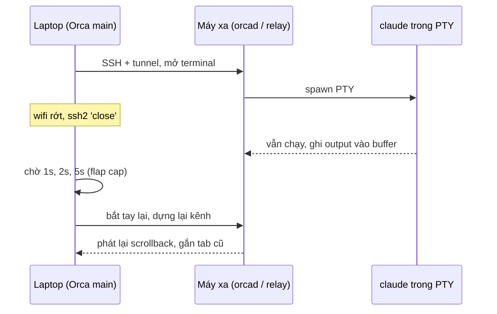

> [!quote] 💬
> "Run agents on a beefy remote box with full file editing, git, and terminals — auto-reconnect and port forwarding included." — mục **SSH Worktrees** trong `README.md` (dòng 107) của repo [stablyai/orca](https://github.com/stablyai/orca)

## Nguồn của note này
- 📖 Bản clone `stablyai/orca` commit `9db7b8b` (2026-10-13). Mọi đường dẫn bên dưới tính từ gốc repo.
- 📖 Docs trong repo: `docs/site/content/docs/ssh.mdx`, `docs/site/content/docs/ways-to-run.mdx`, `docs/site/content/docs/remote-servers.mdx`.
- 📖 Kết nối SSH và tự kết nối lại: `src/main/ssh/ssh-connection.ts`, `ssh-reconnect-ladder.ts`, `ssh-connection-utils.ts`, `ssh-transport-selection.ts`.
- 📖 Server chạy trên máy xa (relay cũ và orcad mới): `src/main/ssh/relay-protocol.ts`, `ssh-host-server-on-connect.ts`, `orcad-remote-launch.ts`, `orcad-managed-tunnel*.ts`, `legacy-relay-bridge/README.md`.
- 📖 Port forwarding: `src/main/ssh/ssh-port-forward.ts`, `ssh2-port-forward-provider.ts`, `system-ssh-forward-process.ts`.
- 📖 Lease terminal và re-adopt: `src/shared/ssh-types.ts`, `src/shared/ssh-pending-pty-kill.ts`, `src/main/ssh/ssh-target-readoption.ts`, test `src/main/persistence-ssh-remote-pty-leases.test.ts`.
- 📖 Execution host: `src/shared/execution-host.ts`, `src/main/repo-execution-host.ts`, `src/main/worktree-create-execution-host-route.ts`, `src/main/providers/execution-host-provider-dispatch.ts`, `src/main/providers/ssh-host-not-served-error.ts`.
- 📖 WSL: `src/main/wsl/wsl-orcad-host-target.ts`, `wsl-host-service.ts`, `wsl-orcad-stdio-bridge.ts`.
- 📖 Ephemeral VM: `src/shared/ephemeral-vm-recipes.ts`, `ephemeral-vm-recipe-runner.ts`, `ephemeral-vm-recipe-process.ts`, `src/shared/orca-yaml-hook-types.ts`.
- 📖 App đang cài: `/Applications/Orca.app/Contents/Resources/relay/` (v1.4.224).
- 💭 Các phần "So sánh dễ hiểu" và "Bài học" là nhận định của AI.

---
## 🗺️ Bức tranh chung: 4 chỗ một worktree có thể chạy

📖 `docs/site/content/docs/ways-to-run.mdx` dòng 8: *"Every worktree runs somewhere — on the machine in front of you, on a box you already own, on a shared always-on server, or on a fresh cloud VM spun up for that one workspace."*

| Chế độ | File và agent nằm ở đâu | Ai giữ "bộ não" (runtime) | Note này nói tới |
| --- | --- | --- | --- |
| Local | Máy anh đang ngồi | Orca trên máy anh | Xem [[3-Worktree & Git]] |
| SSH target | Máy Linux/Mac/Windows ở xa | Orca trên laptop điều khiển, máy xa chạy server phụ | Phần 1–5 |
| WSL (Windows) | Distro Linux trong Windows | Giống SSH, nhưng đi qua `wsl.exe` | Phần 7 |
| Cloud VM (ephemeral VM) | Một VM dùng xong bỏ, mỗi worktree một cái | Script "recipe" của anh tạo VM, Orca nối vào | Phần 8 |
| Remote Orca Server | Máy chạy `orca serve` | Server ở xa giữ hết | Xem [[8-Mobile & Cloud relay]] |

> [!note] 📝 So sánh dễ hiểu
> Anh là quản lý một chuỗi cửa hàng. Local là cửa hàng ngay dưới nhà. SSH target là chi nhánh ở tỉnh khác: anh vẫn ngồi văn phòng (laptop) nhưng gửi một **quản lý ca** (server phụ) xuống đó trông nhân viên (agent). WSL là cái kho sau nhà, đi qua cửa sau chứ không cần ra đường. Ephemeral VM là thuê ki-ốt tạm ở hội chợ: dựng lên cho một việc, xong là dỡ.

---
## 1. Kết nối SSH: hai "đường dây" `ssh2` và `ssh` hệ thống

### Cơ chế
📖 Orca dùng thư viện `ssh2` (viết bằng JS thuần, `package.json` dòng 205: `"ssh2": "^1.17.0"`) làm đường dây mặc định. Nó tạo một `Client` của `ssh2` ngay trong tiến trình chính (main process) của Electron (`src/main/ssh/ssh-connection.ts` dòng 2: `import { Client as SshClient } from 'ssh2'`).

📖 Nhưng có những trường hợp `ssh2` không làm được, Orca chuyển sang gọi binary `ssh` của hệ điều hành (OpenSSH):
- Host có `ProxyCommand`, `ProxyJump` (jump host) hoặc `ProxyUseFdpass` (`ssh-transport-selection.ts` dòng 71–93).
- Khoá phần cứng FIDO2 (`ed25519-sk`, `ecdsa-sk`): `ssh2` không hỏi được thao tác chạm khoá (`requiresSystemSshForSecurityKey`, cùng file dòng 95–113).
- Kerberos/GSSAPI: docs `ssh.mdx` dòng 77 *"the built-in ssh2 client does not speak GSSAPI"*.

> [!note] 📝 So sánh dễ hiểu
> `ssh2` như xe công ty: Orca tự lái, kiểm soát mọi thứ. `ssh` hệ thống như gọi taxi: dùng khi đường đi cần giấy tờ đặc biệt (jump host, khoá cứng) mà xe công ty không có.

### Code thật
📖 `src/main/ssh/ssh-transport-selection.ts` dòng 71–93:
```ts
export function shouldUseSystemSshTransport(
  target: SshTarget,
  resolved: TransportResolvedConfig | null
): boolean {
  if (isOpenSshConfigBackedTarget(target) && resolved) {
    return (
      process.env.ORCA_SSH_FORCE_SYSTEM_TRANSPORT === '1' ||
      resolved.proxyUseFdpass === true ||
      resolved.proxyCommand != null ||
      resolved.proxyJump != null
    )
  }
```
💭 Bài học thiết kế: chọn "đường dây" theo cấu hình thật của host (đọc `~/.ssh/config` qua `ssh -G`), không bắt người dùng tự chọn.

---
## 2. Trên máy xa chạy gì? (relay cũ → orcad mới)

Đây là câu hỏi quan trọng nhất: file, git, terminal đi qua SSH bằng cách nào?

### Thời relay (bản anh đang cài)
📖 Orca upload một file `relay.js` lên máy xa, đặt trong thư mục `~/.orca-remote` (`relay-protocol.ts` dòng 31: `RELAY_REMOTE_DIR = '.orca-remote'`). Bản 1.4.224 trên máy anh có sẵn bundle cho từng nền tảng: `/Applications/Orca.app/Contents/Resources/relay/linux-x64/relay.js`, `darwin-arm64/`, `win32-x64/`… 📖 (đã `ls`).

📖 Laptop và relay nói chuyện bằng JSON-RPC 2.0, mỗi tin nhắn có header 13 byte, *"matching VS Code's PersistentProtocol wire format"* (`relay-protocol.ts` dòng 2). Có keepalive mỗi 5 giây, quá 20 giây không nghe gì là coi như đứt (dòng 40–41).

📖 `src/main/ssh/relay-protocol.ts` dòng 28–41:
```ts
export const RELAY_VERSION = '0.1.0'
export const RELAY_SENTINEL = `ORCA-RELAY v${RELAY_VERSION} READY\n`
export const RELAY_SENTINEL_TIMEOUT_MS = 10_000
export const RELAY_REMOTE_DIR = '.orca-remote'

/** Message type byte. */
export const MessageType = {
  Regular: 1,
  KeepAlive: 9
} as const

/** Keepalive/timeout. */
export const KEEPALIVE_SEND_MS = 5_000
export const TIMEOUT_MS = 20_000
```
📖 Nhiều yêu cầu (đọc file, chạy git, gõ phím vào terminal) chạy chung trên một kênh SSH nhờ bộ ghép kênh `ssh-channel-multiplexer.ts` (684 dòng). Dòng 1–2 của file ghi: *"the SSH relay protocol state machine keeps request, notification, keepalive, and cancellation semantics paired."*

### Thời orcad (source mới nhất)
📖 Trả lời câu "orcad có chạy trên máy xa không": **có**. Comment đầu `src/main/ssh/ssh-host-server-on-connect.ts` dòng 1–11:
```ts
/**
 * Which server an SSH host runs, decided once per connect before any relay is started.
 *
 * Every host runs managed orcad: an empty host deploys it, a host with Orca state converts through
 * the journaled migration, and a converted host connects through its tunnel, updating first when
 * it runs an older build and its terminals allow. A host whose relay terminals are live, or can't
 * be proven exited, keeps the relay this session and converts on a later connect. A host orcad
 * can't run on keeps the pinned-relay ladder, with the reason recorded so the deploy isn't retried
 * on every connect. A host whose sshd refuses port forwarding reaches its server through the
 * stdio bridge (orcad-managed-tunnel-transport.ts) instead.
 */
```
📖 `legacy-relay-bridge/README.md` dòng 5–7: *"Orca 1.4.224 kept SSH terminals alive inside a `relay.js --detached` process on the host. 1.4.225 runs every SSH host on orcad and has no relay client"*. Thư mục này chỉ giữ để các terminal relay cũ chạy nốt trong tab cũ.

⚠️ Chưa verify: `package.json` của bản clone ghi `"version": "1.4.214"`, lệch với con số 1.4.225 trong README trên. Có thể package.json chưa được bump ở nhánh main.

📖 orcad (Orca daemon, xem [[1-Kiến trúc tiến trình]]) được khởi động trên máy xa bằng `nohup`, chỉ nghe ở loopback, rồi laptop mở một đường **SSH port forward** tới cổng đó (`orcad-managed-tunnel-manager.ts` dòng 1–4: *"One SSH forward per managed environment, owned across reconnects and host resume"*).

📖 `src/main/ssh/orcad-remote-launch.ts` dòng 136–141 (lệnh khởi động trên host POSIX):
```ts
          `exec nohup "$orcad_runtime" ${entry}`,
          `--json --bind ${shellEscape(spec.bindHost)} --port ${String(spec.port)}`,
          `> ${readiness} 2>> ${log} < /dev/null &`,
          `echo $! > ${pidFile} && cat ${pidFile}`
```
📖 Cùng file dòng 114–116: trước đó chạy `umask 077` vì *"the readiness file carries the pairing offer's device token"*, nên mọi file sinh ra chỉ chủ sở hữu đọc được.

> [!note] 📝 So sánh dễ hiểu
> Relay giống một **người phiên dịch** anh gửi xuống chi nhánh: anh nói gì qua điện thoại (SSH), họ làm theo. orcad giống **một văn phòng Orca đầy đủ** mở ở chi nhánh: nó tự giữ terminal, git, file; laptop chỉ còn là màn hình nhìn vào qua một đường ống riêng (tunnel).

💭 Hệ quả thực tế: file, git, terminal không còn đi qua "lệnh SSH lẻ" nữa mà đi qua API của orcad trên máy xa, giống hệt cách laptop nói chuyện với một Remote Orca Server. Đó là lý do phần 6 thấy `runtime:<env>` xuất hiện cho cả host SSH.

---
## 3. Tự kết nối lại (auto-reconnect): cái thang thời gian

### Cơ chế
📖 Khi client `ssh2` phát sự kiện `end`, `close` hoặc `error`, Orca bỏ client cũ và lên lịch kết nối lại (`ssh-connection.ts` dòng 1287–1305). Có kiểm tra `this.client !== client` để sự kiện muộn của client cũ không xoá mất kết nối mới.

📖 Thời gian chờ theo một bảng cố định (`ssh-connection-utils.ts` dòng 38–39):
```ts
export const RECONNECT_BACKOFF_MS = [1000, 2000, 5000, 5000, 10000, 10000, 10000, 30000, 30000]
export const CONNECT_TIMEOUT_MS = 30_000
```

📖 Điểm hay nằm ở `ssh-reconnect-ladder.ts`. Nó phân biệt hai loại sự cố:
- **Chập chờn (flap)**: bắt tay SSH thành công rồi lại rớt. Server bên kia vẫn sống và đang đếm ngược "thời gian ân hạn" (grace). Nên chờ ngắn.
- **Bắt tay thất bại**: host chết hẳn. Đi đủ bảng, sau 9 lần bắt tay hỏng liên tiếp thì bỏ cuộc (`give-up` → trạng thái `reconnection-failed`).

📖 `src/main/ssh/ssh-reconnect-ladder.ts` dòng 9–20:
```ts
/**
 * Why: a flap leaves the remote relay in grace, and the shortest grace a target can configure is
 * MIN_SSH_RELAY_GRACE_PERIOD_SECONDS. Retrying later than this cap would let even a full-length
 * handshake plus relay/mux re-establishment finish after grace expires, so the relay would shut
 * down and take every remote PTY with it. Raising the backoff past this bound changes nothing.
 */
export const FLAP_DELAY_CAP_MS = (() => {
  const budgetMs =
    MIN_SSH_RELAY_GRACE_PERIOD_SECONDS * 1000 - CONNECT_TIMEOUT_MS - RELAY_REESTABLISH_BUDGET_MS
  const fitting = RECONNECT_BACKOFF_MS.filter((delayMs) => delayMs < budgetMs)
  return fitting.length > 0 ? Math.max(...fitting) : RECONNECT_BACKOFF_MS[0]
})()
```
💭 Tính tay: grace tối thiểu 60 s (📖 `ssh-types.ts` dòng 6) − bắt tay 30 s − dựng lại relay 20 s (📖 `ssh-reconnect-ladder.ts` dòng 7) = 10 s. Các mức chờ nhỏ hơn 10 s là 1, 2, 5 s, nên khi chập chờn Orca chờ **tối đa 5 giây**. Không đoán bừa con số: nó được suy ra từ ngân sách thời gian.

📖 Thêm một luật: kết nối giữ được ≥ 60 s (`STABLE_CONNECTION_MS`, dòng 5) thì coi là khoẻ, lần rớt sau bắt đầu lại từ 1 s.

> [!note] 📝 So sánh dễ hiểu
> Gọi điện cho shipper. Nếu máy đổ chuông rồi tắt (chập chờn), anh gọi lại ngay vì biết họ vẫn đang cầm máy và sắp hết kiên nhẫn. Nếu thuê bao không liên lạc được (host chết), anh giãn ra 10 s, 30 s, gọi 9 lần không được thì thôi, báo "mất liên lạc".

---
## 4. Terminal sống sót khi mất mạng: lease, grace và re-adopt

### Lease (hợp đồng thuê terminal)
📖 Mỗi terminal chạy trên host SSH được laptop ghi lại thành một **lease** (`SshRemotePtyLease`, `src/shared/ssh-types.ts` dòng 333–354). Trạng thái có 4 giá trị (dòng 331):
```ts
export type SshRemotePtyLeaseState = 'attached' | 'detached' | 'terminated' | 'expired'

export type SshRemotePtyLease = {
  targetId: string
  ptyId: string
  worktreeId?: string
  tabId?: string
  leafId?: string
  state: SshRemotePtyLeaseState
```
📖 Comment dòng 365–372 nói rõ: `expired` *"says only that the CLIENT lost its route, never that the remote shell died"*. Tức là laptop mất đường tới terminal không có nghĩa terminal đã chết. Hàm `sshRemotePtyLeaseAllowsReattach` (dòng 373–383) chỉ cấm gắn lại khi `terminated`, hoặc khi `expired` mà đã có lease mới thắng chỗ đó (`supersededBy`) hay id đã bị cấp cho shell khác (`relayIdRecycled`).

📖 Một chi tiết chống nhầm terminal: relay cũ đánh số lại từ `pty-1` mỗi lần khởi động, nên `pty-1` hôm qua và `pty-1` hôm nay có thể là hai shell khác nhau (bug #16970, 📖 `src/shared/ssh-pending-pty-kill.ts` dòng 8–10). Relay mới cấp id dạng `pty2:<epoch>:<n>`, epoch đổi mỗi lần khởi động, nên id không bao giờ lặp (dòng 19–22).

📖 Test `src/main/persistence-ssh-remote-pty-leases.test.ts` kiểm các tình huống như *"does not restore missing layout bindings without a live SSH lease"* (dòng 376) và *"clears workspace bindings when marking an SSH remote PTY lease terminated"* (dòng 571).

### Grace (thời gian ân hạn)
📖 `ssh-types.ts` dòng 69–71: *"Grace period in seconds before relay shuts down after disconnect. 0 disables expiry. Default: 0 (until reset). Max: 604800 (7 days)."* Docs `ssh.mdx` dòng 52: mặc định bật **Keep terminals alive until reset**, terminal chạy mãi tới khi anh tự tắt; nếu tắt công tắc đó thì chọn từ 60 giây tới 7 ngày.

### Re-adopt (nhận lại workspace mồ côi)
📖 Đây là chuyện khác hẳn mất mạng: anh **xoá** target SSH rồi thêm lại. Repo chỉ lưu id ngẫu nhiên của target, nên target mới có id mới, workspace cũ thành mồ côi. Orca để lại một "bia mộ" (tombstone) lúc xoá, khi thêm lại thì so khớp và trỏ repo về id mới.

📖 `src/main/ssh/ssh-target-readoption.ts` dòng 20–23:
```ts
 * Matching is intentionally strict — configHost (alias) first, then the
 * host+username+port tuple — so we only auto-reattach on a confident identity
 * match and never mislink two genuinely different hosts. Anything that doesn't
 * match cleanly stays a ghost, handled by the forget flow instead.
```

> [!note] 📝 So sánh dễ hiểu
> Lease giống **vé gửi xe**: xe (terminal) vẫn nằm trong bãi (máy xa) dù anh đi đâu. Mất sóng điện thoại không làm mất xe; chỉ cần vé còn hợp lệ là lấy lại được. Grace là thời hạn bãi giữ xe. Re-adopt là khi anh làm mất vé rồi xin vé mới: bãi chỉ trả xe khi biển số, chủ xe khớp chắc chắn.

### Ví dụ cụ thể: anh chạy Claude Code trên máy Linux ở xa, wifi rớt
1. Anh tạo worktree `fix-vip-tier` trên target `dev-box`. Orca đã deploy orcad (hoặc relay với bản 1.4.224) lên `~/.orca-remote` và mở tunnel (📖 phần 2).
2. Anh mở tab terminal, chạy `claude`. Laptop ghi một lease trạng thái `attached` (📖 `ssh-types.ts:333`).
3. Wifi quán cà phê rớt. Socket TCP chết, `ssh2` phát `close` → `onDrop` → `scheduleReconnect()` (📖 `ssh-connection.ts:1287-1305`). Chip trạng thái chuyển vàng "reconnecting" (📖 `ssh.mdx:48`).
4. Trên máy xa, Claude Code **vẫn chạy**: process do server trên host giữ, không phụ thuộc kết nối SSH của laptop. 📖 Docs `ssh.mdx:48`: *"Disconnects don't kill running agents"*.
5. Thang kết nối lại thử sau 1 s, 2 s, 5 s, 5 s… (💭 tối đa 5 s/lần vì đây là chập chờn, bắt tay chưa hỏng lần nào).
6. Wifi có lại, bắt tay thành công → `markConnected` (📖 `ssh-connection.ts:1340`). Comment dòng 1333: `reconnectAttempt=0` được dùng để *"trigger relay re-establishment"*.
7. Orca dựng lại kênh tới server, gắn lại terminal vào đúng tab. 📖 `ssh.mdx:48`: *"Orca reconnects and re-attaches, replaying scrolling output and restoring full-screen app panes from their rendered frame"*. Anh thấy Claude Code đang chạy tiếp, lịch sử còn nguyên.
8. 💭 Nếu laptop ngủ lâu, lúc thức dậy `reconnect()` chủ động phá kết nối cũ vì *"OS sleep/wake can leave ssh2 thinking a dead TCP socket is still connected"* (📖 `ssh-connection.ts:785`), và tunnel orcad có hàm riêng `recoverOrcadManagedTunnelsAfterHostResume` (📖 `orcad-managed-tunnel.ts`).

⚠️ Chưa verify: chi tiết bước 7 trên đường orcad (orcad giữ scrollback ở đâu, gọi API nào để reattach). Note này chỉ đọc phía client SSH.



---
## 5. Port forwarding

### Cơ chế
📖 Docs `ssh.mdx` dòng 100: Orca quét `/proc/net/tcp` trên máy xa để thấy cổng đang nghe, một click là forward về laptop; forward được lưu qua khởi động lại và kết nối lại; cổng đặc quyền tự đổi (remote 80 → local 10080). 📖 Danh sách forward được lưu trong target (`ssh-types.ts` dòng 82: `portForwards?: SavedPortForward[]`).

📖 `SshPortForwardManager` có hai nhà cung cấp, đúng như hai "đường dây" ở phần 1 (`ssh-port-forward.ts` dòng 26–29): `Ssh2PortForwardProvider` và `SystemSshPortForwardProvider` (chạy `ssh -L`).

📖 Với `ssh2`, Orca tự mở một server TCP trên laptop; mỗi kết nối vào được nối ống sang kênh `forwardOut` của SSH. `src/main/ssh/ssh2-port-forward-provider.ts` dòng 24–48 (rút gọn phần đầu):
```ts
    const server = createServer((socket) => {
      activeSockets.add(socket)
      socket.on('close', () => activeSockets.delete(socket))
      socket.on('error', () => socket.destroy())

      // Why: a client whose SSH transport dropped throws synchronously; uncaught, that kills main.
      try {
        client.forwardOut(
          options.localHost,
          options.localPort,
          options.remoteHost,
          options.remotePort,
          (err, channel) => {
```
📖 Dòng 46: `socket.pipe(channel).pipe(socket)`, nối hai chiều.

> [!note] 📝 So sánh dễ hiểu
> Như cái máy chiếu nối dài: dev server Vite chạy ở `localhost:5173` trên máy xa, Orca kéo một sợi cáp để `localhost:5173` trên laptop cũng mở được nó trong trình duyệt.

💭 Chính cơ chế này cũng là "đường ống" laptop dùng để nói chuyện với orcad trên máy xa (phần 2): orcad là một cổng loopback như mọi dev server khác.

---
## 6. Execution host: "việc này chạy ở máy nào?"

### Cơ chế
📖 Mỗi repo/worktree mang một `ExecutionHostId` (`src/shared/execution-host.ts` dòng 8–9):
```ts
export type ExecutionHostKind = 'local' | 'ssh' | 'runtime'
export type ExecutionHostId = typeof LOCAL_EXECUTION_HOST_ID | `ssh:${string}` | `runtime:${string}`
```
- `local`: máy này.
- `ssh:<targetId>`: một host SSH.
- `runtime:<environmentId>`: một server Orca khác (Remote Orca Server, orcad trên host SSH, VM).

📖 Lý do có lớp này là một bug thật. Comment đầu `src/main/worktree-create-execution-host-route.ts` dòng 4–8: hai lối tạo worktree đọc host theo hai cách khác nhau, nên một repo ghi `executionHostId: 'ssh:<target>'` lại chạy `git worktree add` **trên laptop** với đường dẫn của máy xa (#11163).

📖 Luật cứng từ `src/main/providers/execution-host-provider-dispatch.ts` dòng 4–5: *"an id that names no host throws instead of degrading to `local`, so work whose host is unknown never runs on this client"*. Và dòng 28: *"Never degrade to local — that is the whole defect class."*

📖 `src/main/worktree-create-execution-host-route.ts` dòng 21–36:
```ts
export type WorktreeCreateRoute =
  | { kind: 'local'; hostId: typeof LOCAL_EXECUTION_HOST_ID }
  | { kind: 'ssh'; hostId: `ssh:${string}`; connectionId: string }
  | { kind: 'runtime'; hostId: `runtime:${string}`; environmentId: string }

export function resolveWorktreeCreateRoute(repo: Repo): WorktreeCreateRoute {
  const route = resolveGitRouteForHost(getRepoExecutionHostId(repo))
  switch (route.kind) {
    case 'local':
      return { kind: 'local', hostId: route.hostId }
    case 'ssh':
      return { kind: 'ssh', hostId: route.hostId, connectionId: route.connectionId }
    case 'runtime':
      return { kind: 'runtime', hostId: route.hostId, environmentId: route.environmentId }
  }
}
```
📖 `src/main/repo-execution-host.ts` (21 dòng) chỉ là hàm nhỏ đọc id từ repo trong Store, tương thích cả kiểu cũ `connectionId`.

📖 Khi route là `ssh:` mà tiến trình này không phục vụ host đó, nó ném `SshHostNotServedError` với thông báo *"Remote connection dropped. Click Reconnect on the SSH target before retrying."* (`ssh-host-not-served-error.ts` dòng 5–6). Comment dòng 2–3: *"A managed host is reached as `runtime:<env>`."*

> [!note] 📝 So sánh dễ hiểu
> Như phiếu giao hàng ghi rõ kho xuất. Phiếu ghi "kho Hà Nội" mà Hà Nội mất liên lạc thì **dừng và báo lỗi**, chứ không tự xuất từ kho Sài Gòn cho nhanh. Xuất nhầm kho còn tệ hơn giao chậm.

---
## 7. WSL trên Windows (ngắn gọn)

📖 Từ source mới, một distro WSL được coi là một **host** giống SSH: Orca deploy orcad vào distro và nối tới nó. `src/main/wsl/wsl-orcad-host-target.ts` dòng 1–11 định nghĩa `WslOrcadHostTarget` với `kind: 'wsl'`; `OrcadHostTarget = SshTarget | WslOrcadHostTarget` (`src/main/ssh/orcad-host-transport.ts` dòng 7), tức là cùng một bộ code deploy/serve orcad dùng cho cả hai.

📖 Khác biệt chính là đường ống: không dùng SSH và cũng không dùng localhost forwarding của WSL. `src/main/wsl/wsl-orcad-stdio-bridge.ts` dòng 2–5:
```ts
 * The desktop's only way into a WSL distro's orcad (design D2): a loopback listener whose every
 * accepted socket rides its own `wsl.exe` child running the stdio bridge on the distro's pinned
 * Node. WSL localhost forwarding is never used: it refuses connections for 0.2–1 s after a listen
 * and depends on the distro's networking mode.
```
📖 Launch dùng `setsid` thay vì `nohup` cho WSL vì *"`nohup … &` dies with its `wsl.exe --exec` session on a distro without systemd"* (`orcad-remote-launch.ts` dòng 80–81). 📖 Distro đang tắt chỉ được bật khi anh chủ động, không bao giờ cho việc chạy nền (`wsl-host-service.ts` dòng 3–4).

💭 Anh dùng Mac nên phần này chỉ để hiểu: có hơn 100 file `wsl*` trong `src/main`, phần lớn xử lý chuyển đường dẫn Windows ↔ Linux, git, hook của agent.

---
## 8. Ephemeral VM: mỗi worktree một máy dùng xong bỏ

### Cơ chế
📖 Docs `ways-to-run.mdx` dòng 74: *"Each worktree can boot its own on-demand environment — a cloud sandbox, VM, or local Docker container — from a **recipe** checked into the repo (`orca.yaml` + lifecycle scripts)."* Dòng 21: Orca không bán VPS, anh tự mang tài khoản cloud. Trong UI tên là **Cloud VM**, nằm ở Settings → Experimental (dòng 76).

📖 Recipe là 4 lệnh shell: `create`, `suspend`, `resume`, `destroy` (`src/shared/orca-yaml-hook-types.ts` dòng 33–43):
```ts
export type OrcaVmRecipe = {
  id: string
  name: string
  create: string
  checkoutMode?: EphemeralVmCheckoutMode
  description?: string
  suspend?: string
  resume?: string
  destroy?: string
  destroyDisabled?: boolean
}
```

### Recipe runner chạy thế nào
1. 📖 `runEphemeralVmRecipeStart` (`src/shared/ephemeral-vm-recipe-runner.ts` dòng 108–125) gọi `runRecipeCommand` với `command: args.recipe.create`, `mode: 'create'`.
2. 📖 Lệnh được `spawn` với `shell: true`, `cwd` là repo, `detached` trên POSIX (`ephemeral-vm-recipe-process.ts` dòng 48–54).
3. 📖 Orca truyền ngữ cảnh qua biến môi trường: `ORCA_VM_MODE`, `ORCA_VM_INSTANCE_ID`, `ORCA_REPO_PATH`, `ORCA_REPO_BRANCH`, `ORCA_WORKSPACE_NAME`… (cùng file dòng 239–251).
4. 📖 Script phải in ra stdout **đúng một object JSON**. Nếu không: *"Recipe stdout must be one JSON object."* (`ephemeral-vm-recipes.ts` dòng 164). Exit code khác 0 thì báo `Recipe exited with code …`.
5. 📖 JSON đó khai báo cách nối vào VM, một trong hai kiểu (`ephemeral-vm-recipes.ts` dòng 66–85): `orca-server` (VM chạy `orca serve`, trả về `pairingCode`) hoặc `ssh` (trả về host, user, port, identity… để Orca nối như một SSH target). `projectRoot` bắt buộc là đường dẫn tuyệt đối (dòng 175).
6. 📖 SSH target do VM tạo ra bị ẩn khỏi danh sách SSH của người dùng, nhận diện bằng tiền tố id `runtime-ssh-` (`execution-host.ts` dòng 76–80).

> [!note] 📝 So sánh dễ hiểu
> Recipe là **tờ hướng dẫn dựng ki-ốt** anh viết sẵn: "dựng" (create), "tạm đóng" (suspend), "mở lại" (resume), "dỡ" (destroy). Orca chỉ là người đọc tờ hướng dẫn và làm theo; dựng xong ki-ốt phải dán lên cửa một tờ giấy ghi "vào bằng cửa nào" (JSON stdout). Orca không tự biết anh thuê ki-ốt ở đâu.

💭 Vì kết nối kiểu `ssh` dùng lại toàn bộ đường SSH ở phần 1–5, VM được hưởng luôn auto-reconnect, lease terminal, port forward.

---
## Bài học cho mình (Joy / Node.js)
1. 💭 **Tính thời gian chờ từ ngân sách, không đặt bừa.** `FLAP_DELAY_CAP_MS` được suy ra từ "grace − timeout − thời gian dựng lại". Với retry Shopify GraphQL bị `THROTTLED`, nên làm tương tự: lấy số từ chính API (`throttleStatus.restoreRate`, `currentlyAvailable`) để tính thời gian chờ, thay vì `sleep(2000)` cố định.
2. 💭 **Phân biệt "chập chờn" với "chết hẳn" trong retry.** Orca dùng hai bộ đếm riêng: một cho độ trễ, một cho số lần bắt tay hỏng. Trong command chạy batch của Joy (sync order, repair store credit), lỗi mạng tạm thời nên retry nhanh, còn lỗi lặp lại liên tục nên dừng có thể chạy tiếp (resumable) và log rõ shop, record id.
3. 💭 **Không bao giờ âm thầm rơi về mặc định.** `UnresolvableExecutionHostError` ném lỗi thay vì chạy local. Giống ở Joy: không tìm thấy program theo tiền tệ khách trả thì không được tự lấy program tiền tệ chính, phải dừng hoặc log trạng thái.
4. 💭 **"Mất liên lạc" khác "đã chết".** Lease `expired` không có nghĩa shell đã chết. Với Pub/Sub hay Cloud Tasks của Joy: một message timeout không có nghĩa handler chưa chạy; cần khoá/claim (như id `pty2:<epoch>:<n>` không lặp) để lần giao lại không xử lý trùng, đúng bài học vụ duplicate `log_place_order`.

---
## Nguồn
- `README.md` (dòng 105–113)
- `package.json` (dòng 3, 205)
- `docs/site/content/docs/ssh.mdx`
- `docs/site/content/docs/ways-to-run.mdx`
- `docs/site/content/docs/remote-servers.mdx` (dòng 170)
- `src/main/ssh/ssh-connection.ts`
- `src/main/ssh/ssh-connection-utils.ts`
- `src/main/ssh/ssh-reconnect-ladder.ts`
- `src/main/ssh/ssh-transport-selection.ts`
- `src/main/ssh/relay-protocol.ts`
- `src/main/ssh/ssh-channel-multiplexer.ts`
- `src/main/ssh/ssh-host-server-on-connect.ts`
- `src/main/ssh/legacy-relay-bridge/README.md`
- `src/main/ssh/orcad-remote-launch.ts`
- `src/main/ssh/orcad-host-transport.ts`
- `src/main/ssh/orcad-managed-tunnel.ts`
- `src/main/ssh/orcad-managed-tunnel-manager.ts`
- `src/main/ssh/ssh-port-forward.ts`
- `src/main/ssh/ssh2-port-forward-provider.ts`
- `src/main/ssh/system-ssh-forward-process.ts`
- `src/main/ssh/ssh-target-readoption.ts`
- `src/shared/ssh-types.ts`
- `src/shared/ssh-pending-pty-kill.ts`
- `src/main/persistence-ssh-remote-pty-leases.test.ts`
- `src/shared/execution-host.ts`
- `src/main/repo-execution-host.ts`
- `src/main/worktree-create-execution-host-route.ts`
- `src/main/providers/execution-host-provider-dispatch.ts`
- `src/main/providers/ssh-host-not-served-error.ts`
- `src/main/wsl/wsl-orcad-host-target.ts`
- `src/main/wsl/wsl-host-service.ts`
- `src/main/wsl/wsl-orcad-stdio-bridge.ts`
- `src/shared/orca-yaml-hook-types.ts`
- `src/shared/ephemeral-vm-recipes.ts`
- `src/shared/ephemeral-vm-recipe-runner.ts`
- `src/shared/ephemeral-vm-recipe-process.ts`
- `/Applications/Orca.app/Contents/Resources/relay/` (Orca 1.4.224 đã cài)
- https://github.com/stablyai/orca
- https://www.onorca.dev/docs/ssh
