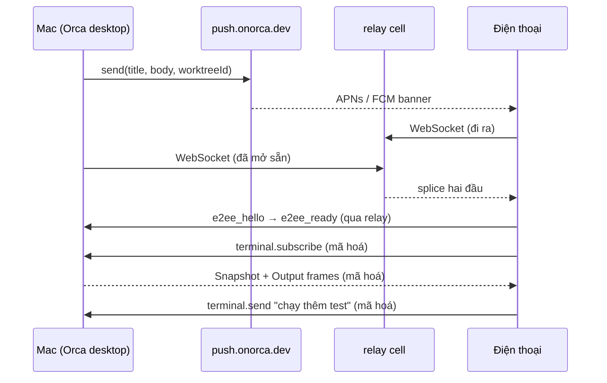

# 8 - Mobile & Cloud relay

> [!quote] 💬
> "Phones and desktops never talk to each other directly: each opens an outbound WebSocket to a relay cell, the relay pairs the two sessions, and it splices frames between them." (`cloud/README.md:3-7`)

Note này giải thích app điện thoại của Orca và cái máy chủ trung gian (relay) trên cloud. Câu hỏi chính: điện thoại nói chuyện với máy Mac thế nào khi anh không ở cùng mạng, ai đọc được dữ liệu, và vì sao điện thoại rung khi agent làm xong. Bối cảnh chung của app xem [[0-Tổng quan]].

## Nguồn của note này

- Stack app mobile: `mobile/package.json`, `mobile/app.json`, `mobile/README.md`
- Ghép cặp bằng QR: `src/shared/pairing.ts`, `src/shared/mobile-relay-pairing-offer.ts`, `src/main/runtime/mobile-pairing-qr.ts`, `mobile/app/pair-scan.tsx`
- Relay: `cloud/README.md`, `cloud/apps/relay/src/splice-forwarder.ts`, `cloud/packages/relay-contract/src/protocol-limits.ts`, `cloud/apps/relay/package.json`, `cloud/infra/terraform/environments/production.tfvars`
- Mã hoá đầu cuối: `src/shared/e2ee-crypto.ts`, `mobile/src/transport/e2ee.ts`, `src/shared/mobile-e2ee-v2-framing.ts`, `src/shared/mobile-e2ee-v2-node-key-schedule.ts`, `src/main/runtime/rpc/mobile-e2ee-v2-desktop-session.ts`
- Stream terminal: `mobile/terminal-output-streaming-findings.md`, `src/main/runtime/rpc/methods/terminal/terminal-subscribe-method.ts`, `src/shared/terminal-stream-protocol.ts`, `mobile/rpc-foundation/`, `mobile/scripts/rpc-recording.mts`
- Thông báo đẩy: `cloud/docs/push-gateway.md`, `cloud/packages/push-contract/src/send-messages.ts`, `src/main/runtime/push/push-dispatcher.ts`, `src/main/runtime/structured-agent-session-mobile-attention.ts`, `mobile/src/notifications/notification-routing.ts`

---

## 1. App mobile làm bằng gì

> [!note] 📝 So sánh dễ hiểu
> App mobile giống cái điều khiển TV. Nó không tự chạy agent, không giữ code. Mọi việc nặng vẫn nằm ở máy Mac (cái TV). Điện thoại chỉ xem màn hình và bấm nút gửi lệnh.

📖 README tự mô tả: "React Native companion app for Orca. Monitor worktrees, view terminal output, and send commands from your phone." (`mobile/README.md:3`)

📖 Các thư viện chính trong `mobile/package.json`:

- `expo` ^55 (dòng 32) và `react-native` ^0.83 (dòng 60): nền tảng app. Expo là bộ công cụ bọc React Native, lo build iOS/Android.
- `expo-router` (dòng 49): điều hướng theo file, giống Next.js. Thư mục `mobile/app/` có `pair-scan.tsx`, `pair-confirm.tsx`, `notifications.tsx`, `h/` (màn theo host).
- `expo-camera` (dòng 34): quét QR.
- `expo-notifications` (dòng 48): nhận thông báo đẩy.
- `expo-secure-store` (dòng 50): lưu khoá bí mật vào Keychain/Keystore.
- `tweetnacl` (dòng 70): mã hoá.
- `@xterm/xterm` (dòng 30) + `react-native-webview` (dòng 68): vẽ terminal. 💭 React Native không có sẵn terminal, nên họ nhét xterm.js (thư viện terminal của web) vào một WebView. File `mobile/src/terminal/TerminalWebView.tsx` là cầu nối.
- `zustand` (dòng 73): quản lý state.

📖 `mobile/app.json` khai báo `"bundleIdentifier": "com.stably.orca.mobile"` và quyền mạng nội bộ: `"NSLocalNetworkUsageDescription": "Orca connects to the desktop app on your LAN."` Có thêm ngoại lệ HTTP cho dải `100.64.0.0/10` (dải IP của Tailscale) 💭, nghĩa là app tính cả trường hợp anh nối qua Tailscale.

📖 Có hai cách nối. Cách trực tiếp trong mạng LAN: desktop mở WebSocket RPC server ở cổng `6768` (`mobile/README.md:7`), điện thoại gõ `ws://<desktop-ip>:6768` (`mobile/README.md:62`). Cách qua relay trên cloud, khi anh ở ngoài nhà. Phần dưới tập trung vào cách thứ hai.

---

## 2. Ghép cặp bằng mã QR

> [!note] 📝 So sánh dễ hiểu
> Giống lúc anh đăng nhập Zalo web bằng cách quét QR. Màn hình máy tính hiện mã, điện thoại quét, xong là hai bên "quen nhau". Điểm khác: trong QR của Orca có sẵn **khoá công khai** của máy Mac. Điện thoại nhận khoá này trực tiếp bằng mắt camera, không qua ai cả.

**Cơ chế** (anh vào Settings > Mobile trên Mac, rồi mở app trên điện thoại bấm quét):

1. Desktop tạo một "lời mời" (pairing offer). Schema của nó nằm ở `src/shared/mobile-relay-pairing-offer.ts:71-84`. Các trường chính: `endpoint`, `deviceToken`, `publicKeyB64` (khoá công khai Curve25519 của desktop), và khối `relay` gồm `directorUrl`, `cellUrl`, `relayHostId`, `inviteToken`, `inviteExpiresAt`. 📖
2. Lời mời chỉ sống tối đa 10 phút (`MAX_INVITE_TTL_MS = 10 * 60 * 1000`, dòng 14), cộng 30 giây bù lệch đồng hồ (dòng 15-18). 📖
3. `encodePairingOffer` biến JSON thành base64url rồi gói thành link `orca://pair?code=...` (`src/shared/pairing.ts:14-27`). 📖
4. `encodeMobilePairingQr` dùng thư viện `qrcode` vẽ link đó thành ảnh data URL, mức sửa lỗi `M` (`src/main/runtime/mobile-pairing-qr.ts:8-17`). 📖 Bản CLI thì in QR thẳng ra terminal (`src/main/server/serve-pairing-output.ts:10`).
5. Điện thoại mở `CameraView` chỉ nhận mã QR (`barcodeTypes: ['qr']`, `mobile/app/pair-scan.tsx:286`), quét được thì gọi `decodePairingUrl` rồi `testAndSave(offer)` (dòng 75-91). 📖 Không quét được thì có nút dán mã bằng tay (`parsePairingCode`, dòng 102).

**Code thật** (`src/shared/pairing.ts:14-27`):

```ts
export function encodePairingOffer(offer: PairingOffer): string {
  const json = JSON.stringify(PairingOfferSchema.parse(offer))
  const base64url = Buffer.from(json, 'utf-8')
    .toString('base64')
    .replace(/\+/g, '-')
    .replace(/\//g, '_')
    .replace(/=+$/, '')
  if (base64url.length > PAIRING_CODE_MAX_CHARACTERS) {
    throw new Error('Pairing offer exceeds safe size')
  }
  // Why: Android camera intents and Expo Router preserve query params more
  // reliably than URL fragments when launching a custom-scheme app.
  return `orca://pair?code=${base64url}`
}
```

📖 Comment ở `mobile-relay-pairing-offer.ts:76-77`: "the desktop's Curve25519 public key is pinned by the pairing offer". 💭 Đây là chỗ quan trọng nhất cho bảo mật: khoá của Mac đi qua camera, không đi qua relay. Nên relay không thể tự đưa một khoá giả cho điện thoại.

---

## 3. Relay trên cloud: chỉ là ống nối

> [!note] 📝 So sánh dễ hiểu
> Relay giống bưu cục chuyển phát. Mac gửi một thùng đã khoá, bưu cục chỉ nhìn nhãn "giao cho ai", không có chìa để mở. Vì Mac ở nhà nằm sau router, không ai gọi vào được, nên cả Mac và điện thoại đều tự chủ động "đi ra" bưu cục, bưu cục nối hai đầu lại.

**Cơ chế** 📖 (`cloud/README.md:3-30`):

- Có hai vai trò cùng chạy một image: **director** (người điều phối, chia host vào cell) và **cell** (chỗ thật sự giữ kết nối WebSocket). Chọn vai bằng biến `ORCA_RELAY_ROLE`.
- `packages/relay-contract`: hợp đồng chung giữa relay, desktop và mobile (khung tin, mã đóng, giới hạn).
- `apps/push`: dịch vụ gửi thông báo đẩy, tách riêng, "not part of the relay data path".

**Hạ tầng** 📖:

- Server viết bằng Node + `hono` + `ws` + `pg` + `tweetnacl` (`cloud/apps/relay/package.json`), image `node:24-alpine` (`cloud/apps/relay/Dockerfile:1`).
- GCP project `onorca-cloud`, region chính `us-central1`, domain `relay.onorca.dev` (`cloud/infra/terraform/environments/production.tfvars:1-4, 19, 33`).
- Director chạy trên Cloud Run, cell chạy trên máy ảo GCE `e2-standard-4`: "Production cells run only on fixed-one GCE MIGs; Cloud Run remains the director." (dòng 27). Có thêm region `asia-east2` (Hong Kong) (dòng 35-37).
- Cơ sở dữ liệu: Cloud SQL PostgreSQL (`cloud/infra/terraform/relay-database.tf`), SQLite cho test (`cloud/README.md:114`).

**Code thật: hàm nối hai ống** (`cloud/apps/relay/src/splice-forwarder.ts:121-132`):

```ts
    source.on('message', (data, binary) => {
      if (closed) return
      const bytes = frameBytes(data)
      if (
        queue.length === 0 &&
        target.readyState === target.OPEN &&
        target.bufferedAmount <= RELAY_ADMISSION_BUDGETS.spliceHighWaterBytes
      ) {
        target.send(data, { binary })
        input.onForwardedBytes?.(bytes)
        return
      }
```

📖 Relay nhận một khung (frame) từ phía này và `target.send` nguyên xi sang phía kia. Nó chỉ đếm số byte. Hàm được gọi hai chiều: `direction(input.client, input.host)` và `direction(input.host, input.client)` (dòng 151-152).

📖 Khi bên nhận chậm, relay xếp hàng và tạm dừng đọc từ bên gửi (`transport(source)?.pause()`, dòng 144). Hàng quá giới hạn thì đóng kết nối với lý do `'relay queue limit exceeded'` (dòng 137). Kẹt quá lâu thì đóng với `'wedged relay link'` (dòng 111). 💭 Đây là kỹ thuật chống nghẽn (backpressure): không để một điện thoại mạng yếu làm phình RAM của cả cell.

📖 Giới hạn trong `cloud/packages/relay-contract/src/protocol-limits.ts:4-13`: mỗi khung tối đa 8 MiB, mỗi host tối đa 8 kết nối, nghỉ 10 phút thì cắt. Comment dòng 4 nói thẳng: "the splice is an opaque E2EE stream". Lý do chọn 8 MiB cũng được ghi: danh sách worktree của desktop có lúc vượt 1 MiB (dòng 5-8).

---

## 4. Mã hoá đầu cuối: relay có đọc được không?

> [!note] 📝 So sánh dễ hiểu
> Hai người muốn nói chuyện bí mật qua một người đưa thư. Mỗi người có một ổ khoá riêng. Họ trao đổi "nửa chìa" công khai, rồi mỗi bên tự ghép ra cùng một chìa chung mà người đưa thư không ghép được. Đó là trao đổi khoá Diffie-Hellman.

**Câu trả lời ngắn: không.** 📖 Relay chỉ chuyển byte (mục 3). 💭 Nội dung terminal, lệnh, danh sách file đều được mã hoá ở Mac và giải mã ở điện thoại. Có một ngoại lệ ở phần thông báo đẩy, xem mục 6.

**Cơ chế, bản v2 đang dùng với relay** (`e2eeFraming: z.literal(2)` trong offer, `mobile-relay-pairing-offer.ts:68`):

1. Điện thoại tạo cặp khoá Curve25519 mới bằng `nacl.box.keyPair()` (`mobile/src/transport/e2ee.ts:26-29`). Trên Hermes (engine JS của React Native) không có `crypto.getRandomValues`, nên họ cắm bộ sinh số ngẫu nhiên của `expo-crypto` vào tweetnacl (dòng 9-15). 📖
2. Điện thoại gửi `e2ee_hello` kèm `clientPublicKeyB64` và một nonce 32 byte (`src/shared/mobile-e2ee-v2-contract.ts:16-18`). 📖
3. Desktop trả `e2ee_ready` kèm `desktopPublicKeyB64` và nonce của nó (`src/main/runtime/rpc/mobile-e2ee-v2-desktop-session.ts:50-58`). 📖 Việc điện thoại so khoá này với khoá đã ghim từ QR: chưa verify dòng code cụ thể ở phía mobile.
4. Hai bên tính bí mật chung bằng `nacl.box.before` (ECDH Curve25519) (`src/shared/e2ee-crypto.ts:15-17`). 📖
5. Từ bí mật chung, chạy HKDF-SHA256 ra 96 byte, cắt làm ba: khoá chiều điện thoại → Mac, khoá chiều Mac → điện thoại, và `sessionId` (`src/shared/mobile-e2ee-v2-node-key-schedule.ts:23-32`). 📖 Bản tóm tắt (transcript) của cả cuộc bắt tay được trộn vào, nên ai sửa lén một trường trong lúc bắt tay thì hai bên ra khoá khác nhau.
6. Mỗi khung tin được niêm bằng `nacl.secretbox` (XSalsa20-Poly1305). Nonce không ngẫu nhiên mà dựng từ `sessionId`, chiều đi và một **bộ đếm** tăng dần (`src/shared/mobile-e2ee-v2-framing.ts:12-26`). 📖

**Code thật** (`src/shared/mobile-e2ee-v2-framing.ts:46-58`):

```ts
  const nonce = encodeNonce(expected)
  if (!equalBytes(args.frame.subarray(0, NONCE_LENGTH), nonce)) {
    return null
  }

  const plaintext = nacl.secretbox.open(args.frame.subarray(NONCE_LENGTH), nonce, args.key)
  if (!plaintext) {
    return null
  }
  const header = encodeHeader(expected)
  if (!equalBytes(plaintext.subarray(0, HEADER_LENGTH), header)) {
    return null
  }
  return plaintext.slice(HEADER_LENGTH)
```

💭 Bên nhận tự tính nonce mong đợi từ bộ đếm của mình (`expectedCounter`). Nếu relay phát lại một khung cũ, đổi thứ tự hay xoá bớt một khung, bộ đếm lệch và khung bị từ chối. Đây là cách chống phát lại (replay) mà không cần lưu danh sách nonce đã dùng. Hai khoá riêng cho hai chiều thì ngăn kẻ ở giữa lấy khung Mac gửi đi rồi "dội" ngược về Mac.

📖 Relay cũng dùng tweetnacl, nhưng cho việc khác: kiểm tra host có đúng là chủ của khoá công khai không. Nó mã hoá một câu đố bằng khoá công khai của host (`nacl.box(plaintext, challengeNonce, hostPublicKey, ephemeral.secretKey)`, `cloud/apps/relay/src/host-session-registry.ts:1505`). Chỉ máy Mac thật mới giải được.

---

## 5. Terminal chạy trên Mac hiện lên điện thoại thế nào

> [!note] 📝 So sánh dễ hiểu
> Giống xem livestream: vào phòng trễ thì trước tiên nhận một "ảnh chụp" màn hình hiện tại (snapshot), sau đó nhận từng khung hình mới (output). Mỗi khung có số thứ tự để biết có bị rớt không.

**Cơ chế** 📖:

- Điện thoại gọi RPC `terminal.subscribe` (`mobile/src/session/mobile-terminal-stream-subscribe.ts:10`). RPC ở đây là JSON dạng `{id, deviceToken, method, params}` (thấy trong golden `mobile/rpc-foundation/goldens/aivault-resume-launch-sent.json`). Chi tiết lớp RPC xem [[6-CLI, RPC & Skills]].
- Phía Mac, handler ở `src/main/runtime/rpc/methods/terminal/terminal-subscribe-method.ts:14-120`. Điện thoại **bắt buộc** dùng luồng nhị phân: `if (isMobile && !useBinaryStream) throw new Error('binary_terminal_stream_required')` (dòng 26-28).
- Nếu terminal chưa có PTY thì handler yêu cầu renderer mount tab rồi chờ tối đa 10 giây (`waitForLeafPtyId(params.terminal, 10_000, ...)`, dòng 49-53). PTY là gì xem [[2-Terminal & PTY]].
- Có PTY rồi thì đăng ký nghe dữ liệu bằng `runtime.subscribeToTerminalData(ptyId, ...)` (`terminal-subscribe-binary.ts:120`), gom lại bằng `createTerminalOutputBatcher` (dòng 88) rồi gửi từng khung nhị phân qua `sendBinary(encodeTerminalStreamFrame(...))` (dòng 86).

**Định dạng khung** (`src/shared/terminal-stream-protocol.ts:70-83`):

```ts
export function encodeTerminalStreamFrame(frame: TerminalStreamFrame): Uint8Array {
  const out = new Uint8Array(HEADER_BYTES + frame.payload.length)
  const view = new DataView(out.buffer, out.byteOffset, out.byteLength)
  view.setUint8(0, TERMINAL_STREAM_KIND)
  view.setUint8(1, TERMINAL_STREAM_VERSION)
  view.setUint8(2, frame.opcode)
  view.setUint8(3, 0)
  view.setUint32(4, frame.streamId, true)
  const seq = Math.max(0, Math.floor(frame.seq))
  view.setUint32(8, Math.floor(seq / 0x100000000), true)
  view.setUint32(12, seq >>> 0, true)
  out.set(frame.payload, HEADER_BYTES)
  return out
}
```

📖 Header 16 byte: loại, phiên bản, opcode, `streamId`, `seq` 64 bit. Danh sách opcode ở dòng 12-38: `Output = 1`, `SnapshotStart/Chunk/End = 2-4`, `Input = 7`, `Resize = 8`, `InputAck = 18`... Comment ở dòng 25-27 cho thấy họ giữ số opcode cố định vì app điện thoại bản cũ (v1.4.120) vẫn đang chạy. 💭 Khung này sau đó lại được bọc trong lớp mã hoá v2 ở mục 4 trước khi qua relay (`selection: { framing: 2, payloadKinds: ['text', 'binary'] }`, `mobile-e2ee-v2-desktop-session.ts:56`).

**Bài học debug có thật** 📖 (`mobile/terminal-output-streaming-findings.md`): ngày 2026-04-28 điện thoại gửi lệnh thì được `ok:true` nhưng không thấy output. Nguyên nhân (dòng 22): "daemon-backed PTYs were forwarding provider data to the desktop renderer, but not into `runtime.onPtyData`". Tức là màn hình Mac vẫn thấy chữ, nhưng nguồn cấp cho điện thoại bị bỏ sót. Họ viết một bản tái hiện không cần điện thoại (`mobile/scripts/test-subscribe.ts`) và ghi lại quy tắc (dòng 56): chạy repro không-điện-thoại trước, lỗi thì sửa cầu WebSocket/runtime/PTY, qua mà điện thoại vẫn trắng thì mới sửa `TerminalWebView`.

**`rpc-foundation`** 📖: thư mục chứa 793 file golden (bản ghi mẫu request/reply RPC) trong `mobile/rpc-foundation/goldens/`. Lệnh `pnpm rpc:record` ghi lại toàn bộ, và "An unchanged behaviour re-records to identical bytes, so ... `git diff` shows only what moved" (`mobile/scripts/rpc-recording.mts:6-8`). 💭 Đây là test chụp nhanh (snapshot test) cho hợp đồng giữa app điện thoại và desktop: đổi gì ở phía Mac làm lệch reply là diff hiện ra ngay.

---

## 6. Thông báo đẩy khi agent xong việc

> [!note] 📝 So sánh dễ hiểu
> Khi app điện thoại đang tắt, không có đường WebSocket nào mở. Muốn gọi nó dậy phải nhờ "tổng đài" của Apple (APNs) hay Google (FCM). Nhưng chỉ ai có giấy phép của Apple (file `.p8`) mới được gọi tổng đài. Orca không muốn nhét giấy phép đó vào mọi máy Mac, nên dựng một văn phòng trung gian giữ giấy phép: push gateway.

**Cơ chế** 📖:

- Push gateway `orca-cloud-push` chạy trên Cloud Run ở `us-central1`, domain `push.onorca.dev`, luôn giữ tối thiểu 1 instance để không bị khởi động lạnh làm thông báo tới trễ (`cloud/docs/push-gateway.md:21-37`).
- "The service is the only place the Apple `.p8` signing key is readable, which is the reason it exists as a service at all." (`push-gateway.md:8-9`)
- Desktop xác thực với gateway bằng chính khoá X25519 dùng cho relay, giải một câu đố mã hoá để lấy phiên 24 giờ, rồi đăng ký push token của từng điện thoại (`cloud/README.md:34-40`).
- Dispatcher trên Mac là "fire-and-forget": gửi socket trước, push sau, push lỗi không làm hỏng gì (`src/main/runtime/push/push-dispatcher.ts:2-5`). Chỉ thử lại một lần sau 2 giây, và chỉ khi lỗi là `'unreachable'` (dòng 15, 238-242).

**Chú ý về bảo mật** 💭: payload gửi lên gateway có `title` (≤ 80 ký tự) và `body` (≤ 180 ký tự) dạng chữ thường (`cloud/packages/push-contract/src/send-messages.ts:27-28`). Nên khác với relay, push gateway **có thấy** nội dung thông báo, và Apple/Google cũng thấy. 📖 README cam kết "Tokens, notification titles, notification bodies, and full host fingerprints never reach a log line." (`cloud/README.md:59-60`). Đó là cam kết không ghi log, không phải mã hoá.

**Code thật: chỗ sinh thông báo "agent xong"** (`src/main/runtime/structured-agent-session-mobile-attention.ts:100-114`):

```ts
      const { title, body } = buildNotificationOptions(
        request,
        getRuntimeDesktopSurface().translateNotification
      )
      const settings = deps.readNotificationSettings()
      // The same eligibility the desktop's own fan-out applies: these preferences gate the phone too.
      const desktopAllowed = settings.enabled && settings.agentTaskComplete
      deps.dispatch({
        type: 'notification',
        emittedAt: deps.now(),
        source: 'agent-task-complete',
        ...(!desktopAllowed ? { desktopAllowed: false } : {}),
        title,
        body,
        worktreeId: scope.workspaceId,
```

📖 Có ba nguồn thông báo: `'agent-task-complete'`, `'terminal-bell'`, `'plugin'`, và hai trạng thái agent: `'needs-input'`, `'finished'` (`cloud/packages/push-contract/src/device-registration-messages.ts:6-11`). Agent tự phát hiện trạng thái thế nào xem [[4-Tích hợp agent]].

---

## 7. Ví dụ đầu cuối: agent xong ở nhà, anh trả lời từ điện thoại

Tình huống: anh để Claude Code chạy trong worktree `joy` trên Mac ở nhà, rồi đi cà phê. Điện thoại đã ghép cặp từ trước.

1. Trước đó, khi ghép cặp: Mac hiện QR `orca://pair?code=...` (`src/shared/pairing.ts:26`). Điện thoại quét (`mobile/app/pair-scan.tsx:82`) và ghim khoá công khai của Mac. 📖
2. Mac giữ sẵn một WebSocket đi ra relay cell `relay.onorca.dev` (`cloud/README.md:3-7`). Router nhà anh không cần mở cổng. 📖
3. Agent xong lượt. `createStructuredAttentionMobileDelivery` dựng `title`/`body` và gọi `dispatch` với `source: 'agent-task-complete'` (`structured-agent-session-mobile-attention.ts:76-120`). 📖
4. `RuntimeMobileNotificationController.dispatch` ghi sự kiện vào bộ nhớ phát lại, gán `notificationSeq`, rồi báo cho các listener (`src/main/runtime/runtime-mobile-notification-controller.ts:119-156`). 📖 Một listener là push dispatcher.
5. Push dispatcher gọi `this.client.send({ registrationIds, notification })` tới `push.onorca.dev` (`push-dispatcher.ts:219-222`). Gateway đẩy qua APNs (iPhone) hoặc FCM (Android). 📖
6. Điện thoại hiện banner. Anh bấm vào. `getNotificationNavigationTarget` đọc `hostId`, `worktreeId`, `paneKey` trong data và dựng đường dẫn tới đúng màn session (`mobile/src/notifications/notification-routing.ts:31-58`). Nếu mất khoá thì đưa về `/pair-scan` (dòng 25-27). 📖
7. App mở WebSocket tới relay cell, bắt tay `e2ee_hello` / `e2ee_ready`, ra khoá phiên (mục 4). 📖
8. App gọi `terminal.subscribe`. Mac gửi snapshot màn hình hiện tại rồi các khung `Output` (mục 5). Anh đọc được câu trả lời cuối của agent. 📖
9. Anh gõ "chạy thêm test cho file X" trong ô chat. App gọi RPC `terminal.send` qua operation `nativeChatTerminalWrite` (`mobile/src/session/mobile-session-write-operations.ts:28-36`). Comment ở dòng 24-25 dặn: nếu mất reply thì coi là "delivery-unknown" và **không gửi lại**, để tránh agent nhận lệnh hai lần. 📖
10. Lệnh đi qua relay dưới dạng khung đã mã hoá, Mac giải mã, ghi vào PTY của agent. Agent chạy tiếp, output lại chảy về điện thoại theo bước 8. 💭



---

## Bài học cho mình (Joy / Node.js)

1. 💭 **Không gửi lại lệnh khi mất reply.** Bước 9 ở trên: một ghi bị mất reply thì là "không biết đã tới chưa", không phải "thất bại". Với Joy, lệnh cộng điểm hay tạo coupon qua Shopify cũng vậy: timeout không có nghĩa là chưa ghi. Cần idempotency key (Orca có `clientMutationId` trong golden RPC) thay vì retry mù.
2. 💭 **Chống nghẽn ở chỗ chuyển tiếp.** `splice-forwarder.ts` tạm dừng đọc bên gửi khi bên nhận chậm và đặt trần byte cho cả process. Khi mình viết function Firebase đọc stream lớn (export BigQuery, sync order) rồi ghi Firestore, nên có trần tương tự thay vì đẩy hết vào mảng trong RAM.
3. 💭 **Thông báo đẩy không phải kênh bí mật.** Orca mã hoá đầu cuối mọi thứ trừ title/body của push. Nếu Joy gửi push/email chứa số dư điểm hay mã coupon, hãy coi như bên thứ ba đọc được, chỉ để thông tin tối thiểu và mở app mới hiện chi tiết.
4. 💭 **Golden test cho hợp đồng API giữa hai app.** 793 file golden trong `rpc-foundation` giúp đổi backend mà không âm thầm làm hỏng app điện thoại bản cũ. Joy có widget storefront và admin cùng gọi backend; ghi lại reply mẫu của các endpoint chính và diff khi đổi code là cách rẻ để bắt lỗi lệch hợp đồng.

---

## Nguồn

- https://github.com/stablyai/orca @ `9db7b8b6b29f574f9d10326c4ee89f00290f7042`
- `mobile/package.json`, `mobile/app.json`, `mobile/README.md`
- `mobile/app/pair-scan.tsx`
- `mobile/src/transport/e2ee.ts`
- `mobile/src/session/mobile-terminal-stream-subscribe.ts`
- `mobile/src/session/mobile-session-write-operations.ts`
- `mobile/src/notifications/notification-routing.ts`
- `mobile/src/terminal/TerminalWebView.tsx` (chỉ xác nhận tồn tại)
- `mobile/terminal-output-streaming-findings.md`
- `mobile/rpc-foundation/goldens/aivault-resume-launch-sent.json`, `mobile/scripts/rpc-recording.mts`
- `src/shared/pairing.ts`, `src/shared/mobile-relay-pairing-offer.ts`
- `src/main/runtime/mobile-pairing-qr.ts`, `src/main/server/serve-pairing-output.ts`
- `src/shared/e2ee-crypto.ts`, `src/shared/mobile-e2ee-v2-contract.ts`, `src/shared/mobile-e2ee-v2-framing.ts`, `src/shared/mobile-e2ee-v2-node-key-schedule.ts`
- `src/main/runtime/rpc/mobile-e2ee-v2-desktop-session.ts`
- `src/main/runtime/rpc/methods/terminal/terminal-subscribe-method.ts`, `src/main/runtime/rpc/methods/terminal/terminal-subscribe-binary.ts`
- `src/shared/terminal-stream-protocol.ts`
- `src/main/runtime/runtime-mobile-notification-controller.ts`
- `src/main/runtime/structured-agent-session-mobile-attention.ts`
- `src/main/runtime/push/push-dispatcher.ts`
- `cloud/README.md`, `cloud/docs/push-gateway.md`
- `cloud/apps/relay/package.json`, `cloud/apps/relay/Dockerfile`, `cloud/apps/relay/src/splice-forwarder.ts`, `cloud/apps/relay/src/host-session-registry.ts`
- `cloud/packages/relay-contract/src/protocol-limits.ts`
- `cloud/packages/push-contract/src/send-messages.ts`, `cloud/packages/push-contract/src/device-registration-messages.ts`
- `cloud/infra/terraform/environments/production.tfvars`, `cloud/infra/terraform/relay-database.tf`
