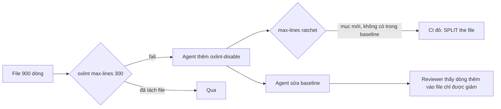

> [!quote] 💬
> "This is a RATCHET: the list may only SHRINK. Do NOT add entries to get CI green — split the oversized file instead."
> (`config/max-lines-baseline.txt:2-3`)

# 9 - Kỹ thuật giữ chất lượng code

Orca là một codebase rất lớn, phần lớn do agent viết (xem [[0-Tổng quan]]). Note này trả lời một câu: làm sao đội Orca giữ cho code không "mục" dần khi hàng trăm PR mỗi tuần đến từ agent. Câu trả lời ngắn: **viết luật cho agent bằng chữ, rồi biến gần như mọi luật thành một script chạy trong CI**. Luật bằng chữ để agent biết. Script để agent không lách được.

## Nguồn của note này

Clone `stablyai/orca` tại commit `9db7b8b6` (2026-10-13).

- Luật cho agent: `AGENTS.md`, `CLAUDE.md`, `.github/pull_request_template.md`
- Luật UI: `docs/STYLEGUIDE.md`
- Chuỗi lint: `package.json` (script `lint`, `audit:anti-slop`, `lint-staged`), `.oxlintrc.json`, `config/oxlint-anti-slop.json`, `config/scripts/sync-anti-slop-plugin.mjs`, `config/scripts/anti-slop-scope-regression.test.mjs`, `config/scripts/check-changed-code-quality.mjs`, `.github/workflows/pr.yml`
- Ratchet: `config/scripts/ratchet-baseline.mjs`, `config/scripts/check-max-lines-ratchet.mjs`, `config/scripts/check-ts-nocheck-ratchet.mjs`, các file `config/*-baseline.txt`
- Reliability gates: `config/reliability-gates.jsonc`, `config/scripts/check-reliability-gates.mjs`
- Test: `config/vitest.config.ts`, `config/scripts/vitest-real-agent-home-write-guard.ts`
- Bằng chứng sửa lỗi: `docs/bug-reproductions/`, `docs/review-evidence/pr-19217/README.md`

---

## 0. Codebase to cỡ nào (tự đếm)

Em tự đếm trong bản clone. Lệnh nằm ngay cạnh số để anh chạy lại được.

| Thứ được đếm | Số | Lệnh |
| --- | --- | --- |
| File được git theo dõi | 35.523 | `git ls-files \| wc -l` |
| File `.ts`/`.tsx` không phải test | 18.301 | `git ls-files \| grep -E '\.(ts\|tsx)$' \| grep -vE '\.(test\|spec)\.' \| wc -l` |
| File test (`.test.`/`.spec.`) | 14.115 | `git ls-files \| grep -E '\.(test\|spec)\.(ts\|tsx\|mts\|mjs)$' \| wc -l` |
| Dòng code sản phẩm trong `src/` (tính cả dòng trống) | 2.056.829 | `find src -type f \( -name '*.ts' -o -name '*.tsx' \) -not -name '*.test.*' \| xargs cat \| wc -l` |
| Dòng code test trong `src/` | 2.538.035 | như trên, đổi thành `-name '*.test.*'` |
| Script trong `config/scripts/` | 869 | `ls config/scripts \| wc -l` |
| Reliability gate | 145 | `grep -c '"id":' config/reliability-gates.jsonc` |

📖 Số đo từ lệnh trên. 💭 Điểm đáng chú ý: **code test nhiều hơn code sản phẩm** (2,5 triệu so với 2,0 triệu dòng trong `src/`). Với code do agent viết, test là thứ duy nhất chứng minh nó chạy đúng, nên đội Orca cho test "phình" có chủ đích.

---

## 1. Luật cho agent: `AGENTS.md` và `CLAUDE.md`

> [!note] 📝 So sánh dễ hiểu
> Giống tờ nội quy dán ở cửa bếp nhà hàng. Đầu bếp mới (agent) vào ca là đọc ngay. Nội quy ngắn, chỉ ghi điều hay sai, và mỗi điều có lý do.

**Cơ chế.** `CLAUDE.md` chỉ có đúng một dòng `@AGENTS.md` 📖 (`CLAUDE.md:1`). Nghĩa là Claude Code đọc `CLAUDE.md`, thấy lệnh import, rồi nạp `AGENTS.md`. Các agent khác (Codex, OpenCode…) đọc thẳng `AGENTS.md`. Một nguồn luật cho mọi agent, không phải giữ hai bản đồng bộ.

`AGENTS.md` chỉ dài 136 dòng 📖 (`wc -l AGENTS.md`). Nội dung chia ba nhóm 📖:

1. **Style** (`AGENTS.md:15-42`): tái sử dụng trước khi viết mới, comment ngắn chỉ nói "tại sao", cấm tắt `max-lines`, cấm đặt tên file `helpers`/`utils`/`common`, hạn chế ép kiểu (`as`).
2. **Cách verify** (`AGENTS.md:44-50`): lệnh typecheck, test, lint cho file đã đổi, và lệnh test với Claude CLI thật khi sửa code structured-session.
3. **Những điều phải cân nhắc** (`AGENTS.md:63-136`): đa nền tảng, SSH, folder workspace, tương thích phiên bản giữa client và host, tương thích Git 2.25, không quét toàn bộ ref của Git.

Đoạn đáng học nhất, về việc cấm tắt luật giới hạn số dòng:

```md
## Lint Rules: Do Not Disable Max Lines

NEVER add a `max-lines` disable (`eslint-disable max-lines`, `oxlint-disable max-lines`, or line-specific variants), and never add a per-file `max-lines` bump in `mobile/.oxlintrc.json`.
```
📖 `AGENTS.md:26-28`

Và luật đặt tên file:

```md
Never use vague names like `helpers`, `utils`, `common`, `misc`, or `shared-stuff` for files, folders, or modules. They carry zero info and tend to become dumping grounds.
```
📖 `AGENTS.md:32`

**PR cũng có luật.** Agent phải điền `.github/pull_request_template.md` cho người review "chưa từng thấy đoạn code này": không dùng tiếng lóng nội bộ, nói trước/sau theo góc nhìn người dùng, cơ chế đã đổi, và vì sao chọn cách này 📖 (`AGENTS.md:52-61`). Template còn bắt buộc mục "Visual Proof" có ảnh trước/sau cho thay đổi UI, và cấm commit file ảnh vào repo 📖 (`.github/pull_request_template.md`, mục Visual Proof).

💭 Điểm hay: hầu như mỗi luật trong `AGENTS.md` đều trỏ tới một script kiểm. Ví dụ luật max-lines ở trên được thông báo lỗi của ratchet trích lại (xem mục 4). Luật bằng chữ không đứng một mình.

---

## 2. Luật UI: `docs/STYLEGUIDE.md`

> [!note] 📝 So sánh dễ hiểu
> Giống bộ nhận diện thương hiệu của một chuỗi cà phê: màu nào, font nào, ly nào. Nhân viên mới không được tự pha màu biển hiệu.

**Cơ chế.** `STYLEGUIDE.md` (337 dòng) quy định màu, chữ, bo góc, bóng, cách chọn component, và luật UX 📖. Nguyên tắc gốc:

```md
- Reach for **muted/accent/border** before reaching for color.
- Reach for **CSS variables** before hardcoding hex.
- Match the nearest **shadcn primitive** before writing custom CSS.
```
📖 `docs/STYLEGUIDE.md:11-13`

Nguồn sự thật cho màu là `src/renderer/src/assets/main.css`; component lấy từ `src/renderer/src/components/ui/` 📖 (`docs/STYLEGUIDE.md:15-23`).

Phần lớn luật này được lint chặn: `AGENTS.md:3` ghi `pnpm run check:code-quality:changed` sẽ fail khi restyle lại một primitive trong `components/ui/`, dùng màu thô, hoặc ghép `className` bằng code; còn `pnpm lint` fail khi có class mà Tailwind không sinh được 📖. Có một bản báo cáo đầy đủ `pnpm run lint:design-system` nhưng nó "not a gate" (không chặn) 📖 (`AGENTS.md:49`).

💭 Cách chia hai tầng này đáng chú ý: **toàn repo** chỉ để báo cáo, còn **dòng đã đổi** thì chặn cứng. Code cũ không cần sửa ngay, nhưng code mới phải sạch.

---

## 3. Chuỗi `pnpm lint`

> [!note] 📝 So sánh dễ hiểu
> Giống dây chuyền kiểm tra hàng ở cửa kho: cân, soi, đếm, dán tem. Một trạm fail là thùng hàng bị trả về.

**Cơ chế.** Script `lint` trong `package.json` là một chuỗi `&&` gồm 23 bước 📖 (`package.json:17`). Bước nào fail là dừng. Các nhóm chính:

| Nhóm | Bước trong chuỗi | Kiểm gì |
| --- | --- | --- |
| Lint thường | `oxlint` | luật trong `.oxlintrc.json`, trong đó có `max-lines` |
| Chống "slop" | `audit:anti-slop` | các mẫu code kiểu AI hay viết (mục 3.1) |
| Chất lượng code | `audit:code-quality:native`, `audit:code-quality:type-aware`, `check:dead-classes` | plugin oxlint riêng, class CSS chết |
| Ratchet | `check:max-lines-ratchet`, `check:ts-nocheck-ratchet`, `check:runtime-electron-ratchet`, `check:focus-read-ratchet`, `check:layout-writer-ratchets`, `check:main-sync-spawn-ratchet`, `check:process-host-imports` (+ `check:compat-boundary-imports`, chưa verify có baseline) | danh sách "nợ cũ" chỉ được giảm (mục 4) |
| Manifest | `check:reliability-gates` | file khai báo gate hợp lệ (mục 5) |
| Đồng bộ sinh code | `verify:rpc-params-catalog`, `verify:acp-protocol`, `verify:skill-bundle-manifest`, `verify:localization-*` | file sinh ra khớp với nguồn |

📖 `package.json:17`. Bảng là em gom nhóm 💭.

**Formatter.** `oxfmt` (cùng họ với `oxlint`, viết bằng Rust) thay cho Prettier: `"format": "oxfmt --write ."` 📖 (`package.json:16`). Lúc commit, `lint-staged` chạy `oxlint`, `oxlint` với config react-doctor, rồi `oxfmt --write` trên file đã stage 📖 (`package.json:346-354`).

**Trên CI.** `pr.yml` không gọi nguyên `pnpm lint` mà tách thành từng step riêng, có tên dễ đọc: "Lint", "Reject low-evidence patterns", "Enforce changed-code quality", "Check reliability gate manifest", "Enforce max-lines ratchet", "Enforce ts-nocheck ratchet"… 📖 (`.github/workflows/pr.yml:234-358`). 💭 Tách step giúp người đọc log CI thấy ngay trạm nào fail.

### 3.1. Anti-slop: chặn "mẫu code ít bằng chứng"

`audit:anti-slop` chạy plugin bên ngoài `oxlint-plugin-anti-slop` (của `dmmulroy`, ghim theo commit) 📖 (`package.json:177`, `package.json:296`):

```json
"audit:anti-slop": "node config/scripts/sync-anti-slop-plugin.mjs && oxlint --config config/oxlint-anti-slop.json src config tests mobile --deny-warnings",
```
📖 `package.json:177`

Trên CI step này tên là **"Reject low-evidence patterns"** 📖 (`.github/workflows/pr.yml:245`). Các luật đang bật mức `error`:

```json
"anti-slop/no-module-mocking": "error",
"anti-slop/no-object-parameters": "error",
"anti-slop/no-reduce-accumulator-copy": "error",
"anti-slop/no-reflect-apply": "error",
"anti-slop/no-reflect-get": "error",
"anti-slop/no-shape-in-symbol-names": "error",
"anti-slop/no-unknown-type-aliases": "error",
"anti-slop/no-widen-then-assert": "error",
```
📖 `config/oxlint-anti-slop.json:32-43` (đã lược các dòng `"off"`)

Ý nghĩa từng luật: source của plugin không có trong clone (nằm ở `node_modules`), nên em chỉ suy từ tên 💭, trừ một luật đã verify:

- `no-widen-then-assert` 📖: test trong repo cho thấy code `const wide: unknown = value; wide as { id: string }` bị báo 1 lỗi, còn `function parse(input: unknown) { return input as … }` thì không (`config/scripts/anti-slop-scope-regression.test.mjs:22-26`). Tức là cấm "nới kiểu thành `unknown` rồi ép lại", một mánh để qua mặt typecheck.
- `no-module-mocking` 💭: cấm `vi.mock` cả module trong code sản phẩm; file test được tắt luật này 📖 (`config/oxlint-anti-slop.json:47-58`).
- `no-reflect-get` / `no-reflect-apply` 💭: cấm `Reflect.get`/`Reflect.apply`, kiểu truy cập động làm mất kiểu.
- `no-object-parameters`, `no-shape-in-symbol-names`, `no-unknown-type-aliases`, `no-reduce-accumulator-copy` 💭: chưa verify chi tiết.

Có một chi tiết kỹ thuật vui: plugin viết bằng `.ts` thô, mà Node không cho bỏ kiểu (type-strip) file trong `node_modules`, nên script copy source ra thư mục `.anti-slop-plugin` (gitignore) rồi mới cho oxlint nạp 📖 (`config/scripts/sync-anti-slop-plugin.mjs:1-3`).

Thêm nữa, `check-changed-code-quality.mjs` có regex riêng để bắt comment tắt luật `anti-slop/...` và tắt luật ép kiểu trong phần code đã đổi 📖 (`config/scripts/check-changed-code-quality.mjs:11-15`). 💭 Tức là agent không thể "tắt luật cho xong".

---

## 4. Ratchet: nợ cũ chỉ được giảm, không được tăng

> [!note] 📝 So sánh dễ hiểu
> Ratchet là cái cờ lê một chiều (cần siết có bánh cóc): chỉ vặn chặt thêm được, không vặn lỏng ra được. Hoặc như sổ nợ: ai đang nợ thì được ghi tên, nhưng sổ **không nhận thêm tên mới**, và ai trả xong thì phải gạch tên ngay để không nợ lại.

**Vấn đề nó giải quyết.** Muốn áp một luật mới (ví dụ: file `.ts` tối đa 300 dòng) cho codebase 2 triệu dòng. Bật luật lên thì hàng trăm file cũ fail ngay, CI đỏ, không ai làm gì được. Không bật thì code mới tiếp tục vi phạm. Ratchet là cách ở giữa.

**Cơ chế** 📖 (`config/scripts/ratchet-baseline.mjs:39-108`):

1. Có một file **baseline** (`config/*-baseline.txt`) liệt kê những chỗ đang vi phạm được "miễn".
2. Mỗi lần chạy, script **thu thập** danh sách vi phạm hiện tại từ các file git đang theo dõi (`git ls-files`).
3. So hai danh sách: `added` = có trong hiện tại mà không có trong baseline → **fail**. `stale` = có trong baseline mà hiện tại không còn → **cũng fail**, bắt phải `--prune` để xoá khỏi baseline.
4. `--prune` chỉ xoá dòng cũ, không bao giờ thêm dòng mới.

Phần lõi:

```js
/** `added`: not in the baseline (fails). `stale`: gone, must be pruned so it cannot come back. */
export function diffEntries(current, baseline) {
  const cur = new Set(current)
  const base = new Set(baseline)
  return {
    added: [...cur].filter((entry) => !base.has(entry)).sort(),
    stale: [...base].filter((entry) => !cur.has(entry)).sort()
  }
}
```
📖 `config/scripts/ratchet-baseline.mjs:39-47`

💭 Cái khôn nằm ở `stale`: nếu ai đó đã tách nhỏ một file cũ mà không xoá dòng baseline, file đó có thể phình lại sau này mà không ai biết. Bắt prune ngay là khoá cửa sau.

Có hai kiểu baseline 📖 (`ratchet-baseline.mjs:5-6`): **danh sách** (mỗi dòng một file được miễn) và **đếm** (`<số lần> <file>`, số chỉ được giảm, `diffCounts` ở dòng 141-150).

**Các ratchet đang có** (đếm dòng không phải comment trong baseline):

| Baseline | Số mục còn nợ | Chặn cái gì |
| --- | --- | --- |
| `max-lines-baseline.txt` | 4 | file vượt giới hạn dòng mà có comment tắt luật |
| `ts-nocheck-baseline.txt` | 159 | file có `@ts-nocheck` (tắt kiểm kiểu cả file) |
| `focus-setting-read-baseline.txt` | 492 | chỗ đọc setting "Active Server" trong renderer |
| `process-host-direct-import-baseline.txt` | 120 | import thẳng `child_process` thay vì `@orca/process-host` |
| `main-sync-spawn-baseline.txt` | 47 | chạy tiến trình con đồng bộ (`execFileSync`…) trong main |
| `renderer-layout-writer-baseline.txt` / `main-layout-writer-baseline.txt` | 121 / 68 | chỗ ghi layout |

📖 Lệnh: `for f in config/*baseline*.txt; do grep -v '^#' $f | grep -c .; done`. Nội dung "chặn cái gì" lấy từ header từng file 📖 (ví dụ `config/main-sync-spawn-baseline.txt:1-6`).

**Ví dụ ts-nocheck.** Có 159 file mang `@ts-nocheck` vì một lý do lịch sử cụ thể:

```js
// TypeScript only honours `@ts-nocheck` in a comment before the first statement, and
// once present it disables type checking for the ENTIRE file. PR #17605 split a single
// 43,928-line class into ~172 modules whose linear mixin-inheritance chain cannot yet
// express forward references, so each carries a grandfathered `@ts-nocheck` header.
```
📖 `config/scripts/check-ts-nocheck-ratchet.mjs:7-10`

💭 Một class 43.928 dòng (gần chắc chắn do agent đắp dần) được tách thành ~172 module. Đội chấp nhận tắt typecheck tạm cho các module đó, nhưng ratchet đảm bảo con số 159 chỉ đi xuống.

### 4.1. Ví dụ: agent mở PR thêm một file 900 dòng

Giả sử agent tạo `src/main/foo/foo-sync.ts` dài 900 dòng code thật.

1. **`oxlint` fail trước.** `.oxlintrc.json` đặt `max-lines` 300 cho `.ts`, bỏ qua dòng trống và comment 📖 (`.oxlintrc.json:220-223`). `.tsx` là 400, `.mjs` 600, file test 800 📖 (`.oxlintrc.json:226-250`). Step "Lint" trên CI đỏ 📖 (`.github/workflows/pr.yml:234-243`).
2. **Agent "lách" bằng comment** `// oxlint-disable max-lines`. Oxlint im lặng. Nhưng `AGENTS.md:28` đã cấm việc này bằng chữ.
3. **Ratchet bắt được.** `hasMaxLinesDisable` quét mọi file theo dõi, tìm comment tắt luật có chữ `max-lines`, kể cả dạng gộp nhiều luật hoặc có lý do `-- Why:` 📖 (`check-max-lines-ratchet.mjs:39-56`). File mới sinh ra mục `inline src/main/foo/foo-sync.ts`, không có trong baseline → `added`.
4. **CI in lỗi và cách sửa**:

```js
  fix: [
    'An `inline` entry added an eslint/oxlint-disable max-lines comment; a `mobile-config` entry',
    'added a per-file max-lines bump in mobile/.oxlintrc.json. Orca caps file size (300',
    '.ts/.mts/.cts / 400 .tsx / 600 .mjs / 800 test — non-blank, non-comment lines).',
    'Fix it: SPLIT the file into focused modules — do NOT suppress the rule.',
    'See AGENTS.md → "Lint Rules: Do Not Disable Max Lines".'
  ]
```
📖 `config/scripts/check-max-lines-ratchet.mjs:106-112`

Kèm dòng `::error::New max-lines entry not allowed: inline src/main/foo/foo-sync.ts` và lời nhắc chỉ được thêm vào baseline khi có "reviewer sign-off" 📖 (`ratchet-baseline.mjs:88-96`). Step "Enforce max-lines ratchet" đỏ 📖 (`pr.yml:340-342`).

5. **Nếu agent lách tiếp** bằng cách tự thêm dòng vào `config/max-lines-baseline.txt`: CI qua, nhưng diff PR lộ ra một dòng thêm vào file mà header ghi rõ "the list may only SHRINK" 📖 (`config/max-lines-baseline.txt:2`). Người review thấy ngay. 💭 Đây là điểm yếu duy nhất, và nó được đẩy sang con người có chủ đích.
6. **Đường lách qua mobile** (nâng `max` trong `mobile/.oxlintrc.json`) cũng bị bắt: `collectMobileBumps` so `max` với mức mặc định cho glob đó 📖 (`check-max-lines-ratchet.mjs:58-75`).

Kết quả đúng: agent phải tách file thành vài module có tên cụ thể (không được tên `foo-helpers.ts`, theo `AGENTS.md:32`).



💭 Lưu ý: 300 là số **dòng code thật** (bỏ dòng trống, comment), nên file 900 dòng thô mà một nửa là comment vẫn có thể vượt hoặc không. Con số 900 trong ví dụ là dòng code.

---

## 5. Reliability gates: sổ theo dõi "lỗi này có test canh chưa"

> [!note] 📝 So sánh dễ hiểu
> Giống sổ bảo trì thang máy: mỗi rủi ro (kẹt cửa, quá tải) có một dòng ghi ai phụ trách, kiểm bằng cách nào, đã kiểm trên những toà nào, toà nào chưa.

**Cơ chế.** `config/reliability-gates.jsonc` (20.798 dòng) chứa 145 gate 📖. Mỗi gate là một **bất biến** (invariant) của app gắn với test chứng minh nó. Ví dụ gate cho lỗi agent khởi động trễ:

```jsonc
"id": "agent-session.delayed-terminal-launch",
"maturity": "experimental",
"protection": "partial",
"owner": "terminal-runtime",
...
"coveredPlatforms": ["macos"],
"coverageNotes": "... Physical Linux, Windows, SSH and WSL delayed launches remain unproved.",
"motivatingLinks": ["docs/bug-reproductions/delayed-agent-launch.md"],
"invariant": "A literal sleep followed by && must not cause the later harness to lose hook/account preparation ...",
```
📖 `config/reliability-gates.jsonc:14-49` (lược bớt)

Điểm đáng học: gate ghi rõ **đã chứng minh trên nền tảng nào và chưa trên nền tảng nào** (`coveredPlatforms` so với `platforms`). Không ai được hiểu nhầm "có test" là "đã an toàn mọi nơi".

**Script kiểm manifest** (`check:reliability-gates`) không chạy test, nó kiểm sổ có trung thực không 📖 (`config/scripts/check-reliability-gates.mjs`):

- Mỗi file trong `testFiles` phải tồn tại thật (dòng 340-343).
- Mỗi `testFiles` phải xuất hiện trong ít nhất một `commands` (dòng 123-127).
- `assertionRefs` phải trỏ vào một file nằm trong `testFiles` của gate (dòng 236-237); gate `partial`/`active` bắt buộc có `assertionRefs` (dòng 250-251).
- Gate muốn lên `soak` hoặc `blocking` phải có lịch sử flaky `soaking`/`stable` và bằng chứng đỏ-xanh (red/green) đầy đủ:

```js
  if (['soak', 'blocking'].includes(gate.maturity)) {
    ...
    if (!['soaking', 'stable'].includes(gate.flakeHistory?.status)) {
      failures.push(`${gate.id}: ${gate.maturity} gates must have soaking or stable flakeHistory`)
    }
    if (!hasCompleteRedGreenEvidence(gate)) {
      failures.push(`${gate.id}: ${gate.maturity} gates must have complete red/green evidence`)
    }
```
📖 `config/scripts/check-reliability-gates.mjs:347-360`

Chính sách thăng cấp lên `blocking`: tối thiểu 100 lần chạy soak, 14 ngày, 0 lần flaky không giải thích được 📖 (`config/reliability-gates.jsonc:6-10`).

Thực tế hiện tại: **cả 145 gate đều đang `experimental`**, 134 là `partial`, 11 là `none` 📖 (đếm bằng `grep -o '"maturity": "[a-z-]*"' … | sort | uniq -c`). 💭 Tức là chưa gate nào đủ điều kiện chặn merge. Đội đang ghi sổ trung thực trước, chặn sau.

---

## 6. Quy ước test: vitest, tên file rất cụ thể

> [!note] 📝 So sánh dễ hiểu
> Thay vì một cuốn sổ khám bệnh dày ghi "kiểm tra tim", mỗi lần đo là một phiếu riêng có tên rõ: "đo nhịp tim lúc chạy bộ", "đo nhịp tim sau khi uống cà phê". Phiếu nào đỏ là biết ngay chuyện gì.

**Cơ chế.** Unit test chạy bằng `vitest` với `config/vitest.config.ts`: môi trường `node`, timeout test 30 giây, hook 60 giây 📖 (`config/vitest.config.ts:29-48`). Lệnh `pnpm test` build package, đảm bảo native runtime, rồi chạy vitest 📖 (`package.json:32`).

**Tên file test tách theo kịch bản**, không theo module. Riêng `pty-connection` có 97 file test 📖 (`git ls-files | grep 'pty-connection.*test' | wc -l`), ví dụ:

```
pty-connection-cold-restore-agent-resume.test.ts
pty-connection-cold-restore-repaint.test.ts
pty-connection-command-finished-late-done.test.ts
pty-connection-deliberate-sleep-guard.test.ts
pty-connection-foreground-agent-routing.test.ts
```
📖 `src/renderer/src/components/terminal-pane/` (đường dẫn thật). Tên file test dài nhất trong `src/` là 72 ký tự 📖.

💭 Lý do có thể đoán: (1) luật 800 dòng cho file test buộc phải tách; (2) một file một kịch bản thì agent sửa lỗi chỉ cần chạy đúng file đó; (3) reliability gate trỏ thẳng vào tên file, tên càng cụ thể sổ càng dễ đọc.

**Test không được đụng vào máy thật.** Một setup file chặn mọi lệnh ghi vào thư mục home của agent (`.claude`, `.codex`, `.orca`, `.cursor`…):

```ts
/**
 * Why: agent trust and hook writers resolve `~` at write time, so a unit test that reaches one
 * edits the developer's real Codex, Claude or Orca config. Any write there fails the test instead.
 * Child processes a test spawns are outside this guard.
 */
```
📖 `config/scripts/vitest-real-agent-home-write-guard.ts:8-12`, nạp ở `config/vitest.config.ts:38`

Ngoài unit test còn có Playwright e2e trên Electron chạy ẩn (`test:e2e:*`, các bộ "golden") 📖 (`package.json:128-146`), và luật `AGENTS.md:7-13`: chạy app test ở chế độ nền `ORCA_BACKGROUND_LAUNCH=1`, chụp màn hình qua CDP, không được giành focus màn hình người dùng.

---

## 7. Chứng minh fix: `docs/bug-reproductions` và `docs/review-evidence`

> [!note] 📝 So sánh dễ hiểu
> Giống biên bản giám định sau tai nạn: tái hiện lại hiện trường, ghi cái gì đã thấy, cái gì **chưa** kiểm được. Không có biên bản thì không đóng hồ sơ.

**Cơ chế.** Với lỗi khó, PR kèm một file markdown trong repo. Hiện có 5 bản tái hiện trong `docs/bug-reproductions/` và 1 bộ trong `docs/review-evidence/` 📖 (`ls`).

Một bản tái hiện có 3 phần:

1. **Tái hiện**: chạy thật trên máy, ghi phiên bản, ghi cả điều **không** tái hiện được:

```md
In a folder workspace, `terminal create --command 'sleep 30 && claude'` launched
real Claude Code 2.1.296 after the delay. SessionStart, working and done hooks
arrived, and a prompt requesting `DELAYED_LAUNCH_OK` completed. A blanket Claude
hook failure was **not** reproduced on this machine.
```
📖 `docs/bug-reproductions/delayed-agent-launch.md:6-9`

2. **Thay đổi và bất biến**: trỏ về gate trong `reliability-gates.jsonc` 📖 (dòng 36-40).
3. **Phủ được gì, còn hở gì**: bảng theo nền tảng, ghi thẳng "physical delayed launch unproved" cho Linux/Windows 📖 (dòng 60-69).

`docs/review-evidence/pr-19217/README.md` còn đi xa hơn: dùng **ablation** (cố tình gỡ đoạn code vừa sửa để xem test có đỏ lại không):

```md
Ablating the runtime call to enumerate
retained history caused the executable call-site test to fail with two rows where
one was expected; restoring the live accessor passed both call-site tests.
```
📖 `docs/review-evidence/pr-19217/README.md:34-36`

💭 Ablation trả lời câu hỏi mà "test xanh" không trả lời được: test này có thực sự canh đoạn code vừa sửa không, hay xanh vì lý do khác.

Với lỗi hiệu năng, bằng chứng là số đo: bản `usage-scan-append` ghi "a 424-byte append to a 1,083,929-byte transcript read 1,084,353 bytes" trước khi sửa, kèm lệnh benchmark so với commit gốc 📖 (`docs/bug-reproductions/usage-scan-append/README.md:7-15`).

---

## Bài học cho mình (Joy / Node.js)

💭 Toàn bộ mục này là nhận định của em.

**1. Biến luật đã viết thành script, bắt đầu bằng ratchet.** Rules của anh (`how-i-work.md`, `code-style.md`) và `CLAUDE.md` của Joy (427 dòng, em đếm bằng `wc -l`) đang là luật bằng chữ. Orca cho thấy luật bằng chữ chỉ hướng dẫn, còn script mới chặn được. Joy có thể thêm ratchet nhỏ mà không phải sửa code cũ: em grep `.eslintrc.js` của Joy không thấy `max-lines` (chưa kiểm các package con kỹ). Bật `max-lines` (ví dụ 300), sinh baseline các file đang vượt, rồi viết một script ~50 dòng theo đúng logic `diffEntries` (thêm mới thì fail, cũ đã hết thì bắt prune). Cùng cách đó áp cho những luật anh hay nhắc: `return undefined`, tên file `helpers`/`utils`.

**2. AGENTS.md ngắn, mỗi luật có lý do và có script đi kèm.** `AGENTS.md` của Orca 136 dòng, mỗi luật một đoạn có câu "why". Rules của anh đã làm tốt phần lý do (mỗi luật ghi nguồn gốc session). Bước tiếp: với mỗi luật, ghi thêm "script nào kiểm luật này" hoặc "chưa có script". Luật nào lặp lỗi nhiều lần (như layout script one-off bị sai lại ngày 2026-10-01) là ứng viên đầu tiên để thành hook/lint.

**3. "Bằng chứng trước khi nói xong" nên có khuôn cố định như `docs/bug-reproductions`.** Anh đã có luật "không nói fixed khi chưa có bằng chứng" và "test theo đúng đường gây lỗi". Orca thêm hai thứ đáng lấy: (a) mục **"chưa chứng minh"** bắt buộc (nền tảng nào, kịch bản nào chưa chạy), để không ai đọc nhầm "đã test" thành "an toàn mọi nơi"; (b) **ablation**: gỡ fix ra, chạy lại test, phải đỏ. Với Joy, file `.claude/ship/<task>/progress.md` có thể thêm 3 mục cố định: Tái hiện (log/ảnh), Đã chứng minh, Chưa chứng minh.

**4. Chặn cứng trên dòng đã đổi, chỉ báo cáo trên toàn repo.** Orca để `lint:design-system` toàn repo là báo cáo, còn `check:code-quality:changed` mới chặn. Rule của anh "lint và format chỉ dòng đã đổi" cùng tinh thần. Áp vào review MR Joy: agent review chỉ được chặn trên diff, còn lỗi cũ thì ghi vào một danh sách nợ (baseline) thay vì sửa lan.

---

## Nguồn

Repo: https://github.com/stablyai/orca (commit `9db7b8b6b29f574f9d10326c4ee89f00290f7042`)

- `AGENTS.md`
- `CLAUDE.md`
- `.github/pull_request_template.md`
- `.github/workflows/pr.yml`
- `docs/STYLEGUIDE.md`
- `package.json`
- `.oxlintrc.json`
- `config/oxlint-anti-slop.json`
- `config/scripts/sync-anti-slop-plugin.mjs`
- `config/scripts/anti-slop-scope-regression.test.mjs`
- `config/scripts/check-changed-code-quality.mjs`
- `config/scripts/ratchet-baseline.mjs`
- `config/scripts/check-max-lines-ratchet.mjs`
- `config/scripts/check-ts-nocheck-ratchet.mjs`
- `config/max-lines-baseline.txt`, `config/ts-nocheck-baseline.txt`, `config/main-sync-spawn-baseline.txt`, `config/focus-setting-read-baseline.txt`, `config/process-host-direct-import-baseline.txt`, `config/renderer-layout-writer-baseline.txt`, `config/main-layout-writer-baseline.txt`
- `config/reliability-gates.jsonc`
- `config/scripts/check-reliability-gates.mjs`
- `config/vitest.config.ts`
- `config/scripts/vitest-real-agent-home-write-guard.ts`
- `docs/bug-reproductions/delayed-agent-launch.md`
- `docs/bug-reproductions/usage-scan-append/README.md`
- `docs/review-evidence/pr-19217/README.md`
- Joy (để so sánh): `~/WebstormProjects/joy/CLAUDE.md`, `~/WebstormProjects/joy/.eslintrc.js`
- Rules của anh: `~/work-brain/rules/how-i-work.md`, `~/work-brain/rules/code-style.md`
